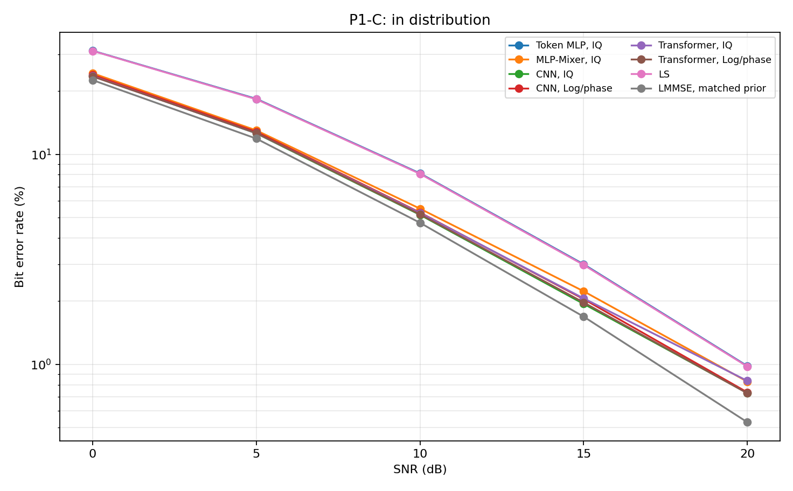
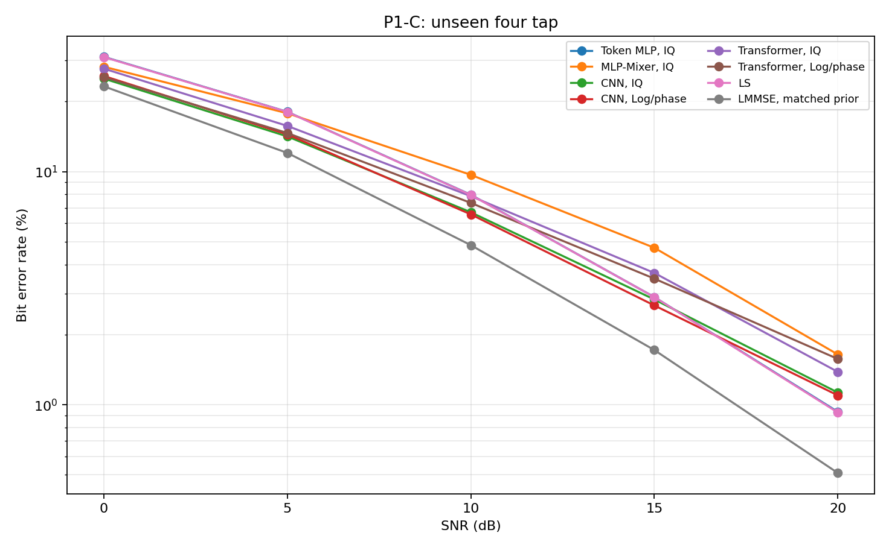

# EM-FloatFormer P1-C — 架构消融实验报告

**日期：2026-11-15。状态：本地CPU实际训练与评估已完成，属于初步模拟研究结果。**

## 1. 研究问题

在同样的合成、被动接收的民用QPSK/OFDM任务上，比较普通逐子载波MLP、可全局混合的MLP-Mixer、局部圆周卷积CNN、全局注意力Transformer，检验网络架构和P1-B两种表示的交互效应。仅非对抗性高斯热噪声和随机多径；不含雷达、电子对抗、发射控制或军事数据。

## 2. 统一实验设计

- 固定32子载波；已知全子载波导频 + QPSK数据；一个导频、一个数据信号共享静态信道；理想同步和充分循环前缀假设。
- 已知噪声方差；训练信道三径功率`(0.72,0.20,0.08)`；分布外测试为四径等功率`(0.25,0.25,0.25,0.25)`。
- 所有网络共享完全相同的复数接收数据、噪声方差、粗均衡器`z = yd*conj(yp)/(abs(yp)^2+noise_var+0.01)`，以及输出`+3*[Re z, Im z]`残差分支。因而此处比较的是相同已知特征的网络建模能力，而不是纯IQ全链路接收器。
- 两组编码：`raw_iq_magnitude` = `[I,Q,abs(z)]` 与 `logamp_phase` = `[log1p(abs(z)), I/(abs(z)+eps), Q/(abs(z)+eps)]`，`sigma=1`、`eps=1e-5`。每个模型有11维每载波输入。
- 每个架构下两组编码使用同一初始权重、同一批训练样本和测试帧；不同架构参数规模匹配至2%以内。AdamW、`lr=0.002`、750步、batch64、SNR在0–20dB均匀采样；种子101、202、303。
- 每种子/测试分布/SNR评估2000独立随机帧，即128,000位；汇总每格3个种子共384,000位；每个方法测0、5、10、15、20dB。
- 传统对照：LS、固定三径支持DFT、固定训练先验LMMSE、**知道正确测试分布先验的LMMSE**、理想瞬时真信道Oracle。后两者使用额外信息，仅供能力参照；尤其不能将分布外Matched LMMSE视作同信息公平对手。
- 与P1-B相同，输入是OFDM频域IQ而不是百万级原始时域复数样本；没有LDPC、MIMO、时钟偏移、3GPP全协议或真实无线电硬件。

## 3. 参数量

| 模型 | 参数量 | 子载波间信息交换 |
|---|---:|---|
| 逐子载波 MLP | 38,612 | 只能单载波，除共享粗均衡器外无全局交互 |
| MLP-Mixer | 38,552 | 全局token混合 |
| 圆周卷积 CNN | 38,018 | 三层k=5局部卷积，循环边界 |
| Transformer | 38,594 | 两层全局自注意力 |

相近参数量≠同FLOPs或同计算成本；同时测量CPU延迟。

## 4. 实测BER（3种子合并，单位%）

### 训练分布内（三径）

| 方法 | 0dB | 5dB | 10dB | 15dB | 20dB |
|---|---:|---:|---:|---:|---:|
| 逐子载波 MLP / IQ | 31.135 | 18.375 | 8.117 | 2.997 | 0.982 |
| MLP-Mixer / IQ | 24.320 | 13.005 | 5.514 | 2.229 | 0.828 |
| 圆周卷积 CNN / IQ | 23.618 | 12.579 | 5.153 | 1.941 | 0.731 |
| Transformer / IQ | 23.560 | 12.604 | 5.257 | 2.062 | 0.835 |
| 逐子载波 MLP / LogAmp-Phase | 31.098 | 18.358 | 8.118 | 3.010 | 0.984 |
| MLP-Mixer / LogAmp-Phase | 24.153 | 12.938 | 5.415 | 2.130 | 0.773 |
| 圆周卷积 CNN / LogAmp-Phase | 23.898 | 12.804 | 5.284 | 2.046 | 0.736 |
| Transformer / LogAmp-Phase | 23.477 | 12.636 | 5.183 | 1.971 | 0.729 |
| LS | 31.067 | 18.288 | 8.075 | 2.976 | 0.977 |
| DFT（三径支持） | 22.624 | 11.918 | 4.730 | 1.686 | 0.530 |
| LMMSE（训练先验） | 22.560 | 11.881 | 4.723 | 1.687 | 0.530 |
| LMMSE（测试先验，额外信息） | 22.560 | 11.881 | 4.723 | 1.687 | 0.530 |
| Oracle（真信道，额外信息） | 21.062 | 11.012 | 4.340 | 1.549 | 0.485 |



### 未见过的四径分布

| 方法 | 0dB | 5dB | 10dB | 15dB | 20dB |
|---|---:|---:|---:|---:|---:|
| 逐子载波 MLP / IQ | 31.127 | 18.080 | 7.966 | 2.899 | 0.933 |
| MLP-Mixer / IQ | 28.218 | 17.817 | 9.698 | 4.717 | 1.644 |
| 圆周卷积 CNN / IQ | 25.091 | 14.174 | 6.697 | 2.830 | 1.128 |
| Transformer / IQ | 27.690 | 15.726 | 7.853 | 3.679 | 1.384 |
| 逐子载波 MLP / LogAmp-Phase | 31.095 | 18.075 | 7.977 | 2.917 | 0.932 |
| MLP-Mixer / LogAmp-Phase | 28.069 | 17.069 | 8.958 | 4.146 | 1.688 |
| 圆周卷积 CNN / LogAmp-Phase | 25.750 | 14.461 | 6.560 | 2.668 | 1.097 |
| Transformer / LogAmp-Phase | 25.466 | 14.663 | 7.348 | 3.477 | 1.573 |
| LS | 31.047 | 18.054 | 7.951 | 2.898 | 0.926 |
| DFT（三径支持） | 27.623 | 19.308 | 14.530 | 12.230 | 11.337 |
| LMMSE（训练先验） | 27.791 | 19.308 | 14.532 | 12.228 | 11.342 |
| LMMSE（测试先验，额外信息） | 23.252 | 12.041 | 4.840 | 1.717 | 0.510 |
| Oracle（真信道，额外信息） | 21.039 | 10.871 | 4.316 | 1.524 | 0.448 |



## 5. 关键结论、效应及反例

- **10dB的未见四径下：** 对数幅相CNN为6.560% BER，对数幅相Transformer为7.348%，差0.788个百分点；三个训练种子下均为CNN较低（Transformer减CNN逐种子：+0.613, +1.055, +0.696个百分点）。基于3个训练种子t(2)近似95%区间为[0.205, 1.371]百分点，只属探索性；未对多种模型/SNR选择修正。
- **更强的传统参照：** 此条件下已知四径统计先验的LMMSE为4.840% BER，仍好于CNN；这项对照拥有额外的测试分布知识。
- **训练分布内：** 10dB时原始IQ CNN 5.153%，LogAmp-Phase Transformer 5.183%，差异很小；传统训练先验LMMSE 4.723%，未被任何神经模型超过。
- **普通逐载波MLP：** 与LS接近，解释为它不能学习跨子载波的信道关联；而不是「MLP必然不行」。
- **MLP-Mixer：** 训练分布内明显优于普通逐载波MLP，但未见四径分布下10dB的LogAmp-Phase版本为8.958%，比CNN的6.560%更差；显示训练分布依赖，不是注意力独有问题。
- **编码×架构交互：** 对数幅相通常改善这个Transformer在分布外低SNR下的表现，但CNN在0/5dB的四径测试中反而是原始IQ更好；没有发现哪种编码适合所有架构和SNR。

## 6. CPU推理延迟（本机PyTorch，seed101，毫秒/次前向推理）

| 模型 / 编码 | batch=1 中位数 | batch=64 中位数 |
|---|---:|---:|
| 逐子载波 MLP / IQ | 0.175 | 1.471 |
| 逐子载波 MLP / LogAmp-Phase | 0.195 | 1.538 |
| MLP-Mixer / IQ | 0.321 | 1.977 |
| MLP-Mixer / LogAmp-Phase | 0.342 | 1.990 |
| 圆周卷积 CNN / IQ | 0.318 | 1.716 |
| 圆周卷积 CNN / LogAmp-Phase | 0.335 | 2.091 |
| Transformer / IQ | 0.469 | 2.923 |
| Transformer / LogAmp-Phase | 0.449 | 3.140 |

说明：CPU PyTorch推理时间受线程数、调用开销、缓存和平台影响；不代表端到端无线电链路、实时性保证或通用硬件部署性能。8模型一轮联合训练各随机种子分别约57秒，不能将其视作单模型训练时间。

## 7. 复现验证

已将全部8个seed101模型从磁盘保存权重单独重新加载，用与训练时独立的相同测试随机流再次评价；共对照2分布×5 SNR×13方法=130个误码统计格，**130/130完全一致，误差计数没有差异**。详见 `p1c_results/checkpoint_verification.json`。此举检验了结果可从模型权重复现，但不等于独立代码实现、跨平台或跨人员复现。

## 8. 判定及后续研究边界

- **P1-C实验执行完成**：4架构×2编码×3随机种子，所有比较具有相同数据生成器、训练样本数与评估帧，参数规模差距不足2%。
- **没有证据证明Transformer普遍优于CNN/传统方法**：该模拟基准上，CNN在未见四径条件表现更好。匹配先验LMMSE依然更强。
- **还不能证明CNN的一般优势**：只有一个理想化QPSK/OFDM任务，3训练种子、小型架构、固定超参数；不同模型尚未做同FLOPs预算的系统超参搜索。
- **本报告撰写时P1-D尚未执行；后续已完成，见 `P1D_REPORT.md`**：重点测量随机信道抽样分布、数值精度、采样率/时钟偏差对预测的影响，增加随机种子并独立验证；若要测试物理时间序列，应明确切换到时域IQ且重新设计公平基线。

## 9. 完整复现命令

```bash
python ofdm_baseline.py --smoke-only
python p1c_architecture.py --smoke
python p1c_architecture.py --steps 750 --eval-frames 2000 --seeds 101 202 303 --out p1c_results
python p1c_verify_checkpoints.py --dir p1c_results --seed 101 --eval-frames 2000
python p1c_make_report.py
```

完整CSV及种子级结果位于 `p1c_results/`；脚本文件：`p1c_architecture.py`, `p1c_verify_checkpoints.py`, `p1c_make_report.py`；使用Python 3.13、CPU版PyTorch 2.10、4线程。

---

**Follow-up note (2026-11-15):** P1-D was subsequently executed; see [P1D_REPORT.md](P1D_REPORT.md). The P1-C numerical results above are unchanged.
