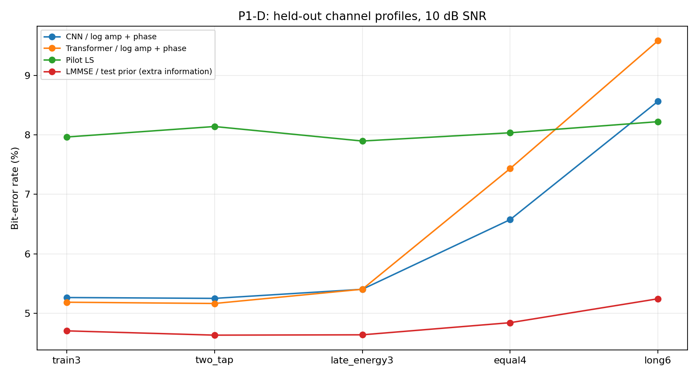
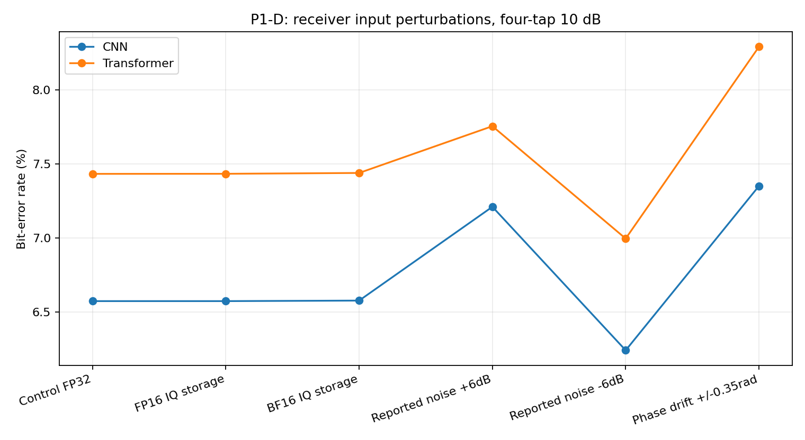

# EM-FloatFormer P1-D — Robustness and numerical-precision evaluation

**2026-11-15 | Executed locally, CPU PyTorch 2.10 | Frozen P1-C checkpoints | Receive-only simulated civilian OFDM**

## Research question

How do the P1-C models generalize to novel multipath distributions, receive IQ storage quantization, misreported noise variance, and pilot-to-data common-phase drift? This is a controlled model benchmark, **not** a physical radio deployment or radar/EW assessment.

## Fixed protocol (specified before examining outcomes)

- All 24 pre-trained P1-C models are loaded from `p1c_results/`; no retraining or post-test hyperparameter changes. Architectures: token MLP, MLP-Mixer, circular CNN, Transformer, with two encodings each.
- Five profiles: training three taps `[0.72,0.20,0.08]`, two taps `[0.7,0.3]`, late-energy three taps `[0.1,0.2,0.7]`, equal-power four taps `[0.25]*4`, six taps `[0.4,0.22,0.15,0.1,0.08,0.05]`.
- Profile matrix evaluated at SNR 0, 10, 20 dB: 15 scenarios. Two profiles also tested at 10 dB with FP16/BF16 **IQ storage quantization only**, +6/-6 dB deliberately incorrect **reported** noise variance, and independent pilot/data common-phase drift sampled uniformly within ±0.35 rad: 10 scenarios. Total **25 scenarios** per seed.
- Three P1-C training seeds 101, 202, 303, 1,024 held-out frames per scenario and seed, 32 subcarriers × 2 data bits: **65,536 bits per seed/scenario, 196,608 bits pooled**. Training and test draws are distinct; within each seed/scenario every receiver sees the exact same frames.
- Traditional references are LS, three-tap DFT, training-prior LMMSE, **test-profile-prior LMMSE (uses extra prior information)**, and true-channel reference (unachievable instantaneous information).
- Quantization means converting only observed I/Q to FP16 or BF16 and then **back to FP32** before model inference. It is **not** complete FP16/BF16 neural inference, an ADC emulation or a test of huge dynamic range.
- Phase drift means a randomized common phase rotation of the *data symbol* relative to pilot. It is **not** full carrier-frequency offset, intercarrier interference, clock offset or sampling-rate generalization.

## Channel-profile results at 10 dB (BER %, lower is better)

| Channel profile | CNN + log/phase | Transformer + log/phase | LS | LMMSE with matching profile (extra prior) |
|---|---:|---:|---:|---:|
| train3 | 5.265 | 5.186 | 7.965 | 4.704 |
| two_tap | 5.251 | 5.165 | 8.141 | 4.632 |
| late_energy3 | 5.404 | 5.404 | 7.897 | 4.638 |
| equal4 | 6.575 | 7.434 | 8.036 | 4.842 |
| long6 | 8.565 | 9.583 | 8.222 | 5.244 |



On six taps, even CNN/log-phase is worse than the plain LS baseline. Both learned models remain worse than the known-test-prior LMMSE reference under all five 10-dB profile tests. The latter has privileged distributional information; it should not be labeled an equal-information comparison.

## Receiver input perturbations, four equal taps, 10 dB (BER %)

| Scenario | CNN + log/phase | Transformer + log/phase |
|---|---:|---:|
| Control FP32 | 6.575 | 7.434 |
| FP16 IQ storage | 6.575 | 7.435 |
| BF16 IQ storage | 6.579 | 7.440 |
| Reported noise +6dB | 7.212 | 7.756 |
| Reported noise -6dB | 6.243 | 6.997 |
| Phase drift +/-0.35rad | 7.352 | 8.292 |



The +6 dB and -6 dB noise-report mistakes behave asymmetrically; a lower BER for one misspecified value does not imply that deliberately falsifying noise is a broadly useful or physically justified tactic. The comparison measures this frozen model only.

## Training-seed paired differences

Here Δ = BER(Transformer/log-phase) − BER(CNN/log-phase), in **percentage points** (positive favors CNN).

| Scenario | Mean Δ | Seed deltas | Exploratory 95% t(2) interval |
|---|---:|---|---|
| train3 | -0.079 | -0.058, -0.154, -0.024 | [-0.246, +0.088] |
| two_tap | -0.086 | -0.121, -0.066, -0.072 | [-0.161, -0.011] |
| late_energy3 | +0.001 | +0.002, -0.017, +0.017 | [-0.041, +0.042] |
| equal4 | +0.859 | +0.775, +1.038, +0.764 | [+0.475, +1.243] |
| long6 | +1.018 | +0.897, +1.300, +0.858 | [+0.410, +1.626] |

These are **exploratory** three-seed t intervals; no adjustment for trying many scenarios, methods and conditions. Bits in the same synthetic frame are correlated, and the limited number of model-training seeds does not establish general superiority. The difference between raw-IQ and log-phase also depends on network and channel; consult the full CSV.

## Code re-evaluation verification

- Frozen weights for seed 101 reloaded and all 25 scenarios evaluated with the same deterministic streams a second time.
- **325/325 exact error-count cells reproduced**, matching the saved evaluation file. This is a deterministic replay check, not a separate physical or cross-platform replication.

## Interpretation and limitations

- These models operate on frequency-domain IQ from a tiny 32-subcarrier ideal OFDM simulation with a full-pilot symbol, known reported noise variance and constant fading within pilot/data pairs.
- No raw million-sample waveforms, no channel coding, no MIMO, no real hardware, no over-the-air link, no transmit functions.
- The requested sampling-rate/clock-drift generalization **cannot be verified** by this fixed-frequency-domain model. Such a claim requires a time-domain simulator with explicit FFT, cyclic prefix and clock offsets; this was not executed here.
- Very low BER or high-SNR conditions need many more frames for high-precision confidence intervals. Profile comparisons and model ordering should be interpreted locally.
- The data does **not** demonstrate new physical laws, generic Transformer superiority, end-to-end communications deployment readiness, or a new robust RF foundation model.

## Reproduce

```bash
python ofdm_baseline.py --smoke-only
python p1c_architecture.py --smoke
python p1c_architecture.py --steps 750 --eval-frames 2000 --seeds 101 202 303 --out p1c_results
python p1d_robustness.py --smoke
python p1d_robustness.py --frames 1024 --seeds 101 202 303 --out p1d_results
python p1d_robustness.py --verify --frames 1024 --seeds 101 --out p1d_results
python p1d_make_report.py
```

Raw observed counts, pooled BER and reproducibility configuration are in `p1d_results/*.csv` and `*.json`. No source datasets or real radio hardware are needed.

**P1-D status: complete. P1-E has not been started.**
