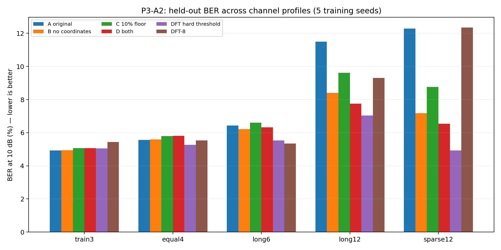

# EM-FloatFormer P3-A2 — Positional-shortcut and residual-floor factorial ablation

**Completed 2026-11-15. Exploratory, synthetic, receive-only civilian QPSK/OFDM only.**

## Frozen protocol and provenance

Protocol: [`P3_A_MECHANISM_PROTOCOL.md`](P3_A_MECHANISM_PROTOCOL.md), GitHub pre-training freeze commit [`c52a9913baeb54b1ddc47c649301724913f3dc88`](https://github.com/20171806011/EM-FloatFormer/commit/c52a9913baeb54b1ddc47c649301724913f3dc88); original SHA256 `2955db97ee5203240cb76f30e068f0d12e4bf140909ecd8cdff9a4ae70aadc06`. All trials use P3-A's unchanged ideal 32-subcarrier QPSK/OFDM generator, known 32 pilot tones, one pilot/data pair, AWGN and perfect synchronization. No radar, jamming, transmitter control or physical RF measurements.

**Main finding:** Both absolute delay coordinates and ability to suppress late taps nearly to zero contribute to the original P3-A network's 12-delay generalization failure. Removing position features (B) and adding a fixed 10% identity floor (C) each reduce 10dB long12/sparse12 BER compared with freshly retrained A; applying both (D) gives the lowest of the four neural BERs. The benefit is **not simply additive** and does **not surpass** the suitable classical hard-threshold DFT on either heldout primary profile. These statements describe the tested network family and five training seeds, not an unconditional causal theory for all radio receivers.

**Byte-level provenance note (post-run tooling audit):** The GitHub pre-training frozen protocol blob has SHA256 `db3721cb5e3511f21d3ea4adafd92810becd2cd3ce0f375eb42057a2e94aab68` without final LF, while the original local training copy has SHA256 `2955db97ee5203240cb76f30e068f0d12e4bf140909ecd8cdff9a4ae70aadc06` with final LF. The files are otherwise byte-for-byte identical; the frozen GitHub protocol remains unchanged, and the replay scripts accept only these exact two byte representations. No experiments or statistical results were changed.

## Protocol compliance

- Exactly four arms, no hyperparameter sweep: A position+0% floor, B no position+0%, C position+10%, D no position+10%. All use the same nominal **985-parameter** convolutional model (`p3_models.EquivDelayConv`), identical initial weights per seed and shared training batches. With position channels zeroed, **24 stem weights become inactive** but remain stored. The gate is fixed as `g_final=beta+(1-beta)*sigmoid(network_output)` with beta 0 or 0.10.
- Training seeds **47101–47105** are disjoint from P3-A/P2-E. Each model: **600 steps**, batch **64**, AdamW lr **0.002**, weight decay **1e-4**, BCEWithLogits QPSK loss, gradient clipping 1. No test-aware tuning. Four models × five seeds = **20 checkpoints**.
- New held-out test RNGs disjoint from training and historic test RNGs. All methods share the same data per scenario. Five profiles (`train3`, `equal4`, `long6`, `long12`, `sparse12`) × SNR 0/10/20 dB × 768 frames/seed. **245,760 bits per method/scenario** across five seeds. The **unit of replication is seed, not bit**.
- Traditional references: pilot-only LS, DFT-8 (max-eight-delay structural prior), DFT-12 (extended support prior), fixed noise-only 0.05 crossing hard/soft threshold DFT, train3-prior LMMSE, matched-profile LMMSE (**privileged**), inaccessible true-channel diagnostic. All use the same observed pilot values; DFT thresholds never tuned on test sets.
- Original P3-A and P2-E frozen reports/claims are untouched. This is a **new exploratory supplement**, not a revised confirmatory trial.

## 10 dB held-out results: BER percent (lower is better)

| Receiver | train3 | equal4 | long6 | long12 | sparse12 |
|---|---:|---:|---:|---:|---:|
| A — position / no floor | 4.929% | 5.557% | 6.431% | 11.495% | 12.291% |
| B — no position / no floor | 4.941% | 5.592% | 6.211% | 8.412% | 7.180% |
| C — position / 10% floor | 5.059% | 5.795% | 6.597% | 9.614% | 8.763% |
| D — no position / 10% floor | 5.067% | 5.817% | 6.324% | 7.757% | 6.549% |
| LS | 8.160% | 8.136% | 7.982% | 7.995% | 8.134% |
| DFT-8 | 5.445% | 5.524% | 5.343% | 9.308% | 12.349% |
| DFT-12 (extended-support ref) | 5.972% | 6.010% | 5.780% | 5.802% | 5.918% |
| DFT hard threshold | 5.057% | 5.267% | 5.526% | 7.031% | 4.919% |
| DFT soft threshold | 5.524% | 5.943% | 6.888% | 9.295% | 5.396% |
| LMMSE train3 prior | 4.824% | 14.547% | 13.556% | 19.637% | 22.223% |
| LMMSE matched-test prior (privileged) | 4.824% | 5.062% | 5.082% | 5.767% | 4.792% |
| True-channel diagnostic (unavailable) | 4.445% | 4.551% | 4.376% | 4.345% | 4.352% |

Notice that the A control was **freshly retrained** with paired initialization: its 10dB sparse12 BER is **12.291%**, which need not equal the old P3-A evaluation's **12.016%**. Do not combine their raw counts or cite them as one cohort.



## Frozen primary exploratory contrasts

Negative values indicate lower BER than the original A arm; positive interaction indicates diminishing combined effect on BER-point improvements.

| Primary heldout profile | Effect (BER pp) | Mean across five seeds | Seed-wise paired differences |
|---|---|---:|---|
| long12 | B − A (remove location) | -3.083 | -3.233, -4.250, -3.072, -3.870, -0.991 |
| long12 | C − A (add floor) | -1.881 | -2.179, -1.731, -1.923, -1.908, -1.664 |
| long12 | D − A (both) | -3.739 | -3.837, -4.116, -3.927, -3.973, -2.840 |
| long12 | (D−C)−(B−A) interaction | +1.226 | +1.575, +1.866, +1.068, +1.805, -0.185 |
| sparse12 | B − A (remove location) | -5.111 | -5.139, -7.247, -4.413, -5.526, -3.229 |
| sparse12 | C − A (add floor) | -3.527 | -4.097, -3.522, -3.709, -3.074, -3.235 |
| sparse12 | D − A (both) | -5.742 | -5.554, -7.355, -5.819, -5.599, -4.384 |
| sparse12 | (D−C)−(B−A) interaction | +2.896 | +3.682, +3.414, +2.303, +3.001, +2.079 |

- On the two primary out-of-distribution profiles, **every** seed had lower BER under B and C versus A, and D versus A. This is descriptive n=5 replication across initializations, **not a confirmatory p-value claim**.
- The interaction on sparse12 is positive (average +2.896 BER pp), so the two interventions overlap substantially rather than producing additive reductions. On long12 one seed has a slightly negative interaction. **Do not assert that both modifications independently solve all long-delay errors.**
- On train3/equal4 the 10% floor typically raises BER slightly. On long6, removing position alone helps, but adding a floor without removing position does not.

## Delay-gate mechanism and channel estimation error

These are **post-hoc diagnostics** using simulated ground-truth channel coefficients **only for measurement**, never as network input. The gate itself is computed from noisy pilot observations and reported noise variance.

Mean effective gate over five seeds at 10 dB:

| Profile / gate | A 0–2 | A 8–11 | B 0–2 | B 8–11 | C 0–2 | C 8–11 | D 0–2 | D 8–11 |
|---|---:|---:|---:|---:|---:|---:|---:|---:|
| train3 | 0.4087 | 0.0022 | 0.4056 | 0.0044 | 0.4142 | 0.1004 | 0.4179 | 0.1015 |
| long12 | 0.3389 | 0.0098 | 0.3105 | 0.0949 | 0.3500 | 0.1019 | 0.3325 | 0.1517 |
| sparse12 | 0.1491 | 0.0036 | 0.1070 | 0.0425 | 0.1904 | 0.1006 | 0.1662 | 0.1258 |

The original A arm's nearly zero gating at delays 8–11 is partly relieved by **removing absolute location features**, and **guaranteed bounded below** by the independent beta=0.10 floor. Their common-phase-equivariance remains intact. The no-position network is equivariant to *cyclic delay shifts* of the tap vector; it is not invariant to arbitrary delay permutations or physically general channel evolution.

Channel **complex MSE**, 10 dB, average across seeds (lower is better):

| Profile | A | B | C | D | Hard-threshold DFT |
|---|---:|---:|---:|---:|---:|
| train3 | 0.4172 | 0.4215 | 0.4150 | 0.4096 | 0.0136 |
| equal4 | 0.3994 | 0.3922 | 0.3909 | 0.3710 | 0.0168 |
| long6 | 0.4336 | 0.4297 | 0.4232 | 0.4081 | 0.0280 |
| long12 | 0.5535 | 0.5176 | 0.5225 | 0.4874 | 0.0679 |
| sparse12 | 0.6576 | 0.6106 | 0.6221 | 0.5748 | 0.0127 |

Even when BER improves, neural channel MSE remains far higher than well-matched classical estimates because **the network optimizes bit BCE**, for which channel amplitude can be poorly calibrated while QPSK signs/phase remain useful. For additional information see `p3a2_results/ber_summary.csv`, which includes per-seed-average normalized MSE and positive-real-scale-aligned MSE. The alignment factor is computed using true channels **for analysis only**.

## CPU inference cost

| Arm | nominal params | active params | 1-frame CPU median | 1-frame p95 |
|---|---:|---:|---:|---:|
| A_pos_0 | 985 | 985 | 0.267 ms | 0.453 ms |
| B_no_pos_0 | 985 | 961 | 0.276 ms | 0.453 ms |
| C_pos_10 | 985 | 985 | 0.273 ms | 0.447 ms |
| D_no_pos_10 | 985 | 961 | 0.304 ms | 0.486 ms |

PyTorch CPU single-frame model-forward timing only; includes FFT/IFFT in the model, not SDR/ADC, total RF chain, I/O or hardware energy. Different noise or training hardware may produce different latencies.

## Integrity and independent checks

- Pre-training structural unit tests: **11/11 PASS**. Verified A numerical equivalence with original `EquivDelayConv` (identical state), shared initial weights, no true-H/unknown-data input to channel estimator, finite gradients, U(1) common-phase equivariance, cyclic delay-shift equivariance in B/D, fixed residual floor, and classical hard-threshold formula.
- Post-run audit: **20/20 checkpoint SHA256 checks PASS**, **240/240 integer error+bit-count replay cells exact**, **60/60 trained common-phase checks PASS**, **20/20 shift checks PASS**, and **5/5 trained-A vs original P3 forward checks PASS**.
- Full **900 raw per-seed/method/scenario rows** cross-checked against **180 aggregates** and **10 factorial contrasts**. Gate diagnostics contain **3200** by-tap records. Per-seed checkpoint hashes are in `p3a2_results/independent_audit.json`.
- This is deterministic same-implementation replay and arithmetic reconciliation, **not independent codebase, cross-hardware replication, physical OFDM validation, or a claimed statistical significance threshold**.

## Replication from source

```bash
python -m pip install -r requirements.txt
python -m unittest test_p3_a_mechanism -v
python p3_a_mechanism.py --mode train --seeds 47101 47102 47103 47104 47105 --steps 600 --batch 64 --ckpt p3a2_checkpoints --out p3a2_results
python p3_a_mechanism.py --mode eval --seeds 47101 47102 47103 47104 47105 --frames 768 --ckpt p3a2_checkpoints --out p3a2_results
python p3_a_mechanism.py --mode diagnose --seeds 47101 47102 47103 47104 47105 --frames 768 --ckpt p3a2_checkpoints --out p3a2_results
python p3_a_mechanism_audit.py --out p3a2_results --ckpt p3a2_checkpoints
python p3_a_mechanism_make_report.py
```

The source repository omits binary model weights, which are included in the full offline ZIP and can be regenerated from saved seeds. We archive training/evaluation logs, raw integer counts, configuration, hashes, and generated plots.

## Interpretation, limitations and stage gate

This ablation establishes **under the specified synthetic train3-only training procedure** that removing absolute delay coordinates and imposing nonzero gain retention substantially reduce one class of long-delay BER failure, without proving they are necessary or sufficient in every distribution. The changes give up some in-distribution performance. The best four-arm neural variant **still loses to** the classical noise-based hard threshold under sparse12 and long12. The updated model does not become a strong physical channel estimator just because its QPSK BER improved.

The simulator remains idealized frequency-domain 32-tone QPSK, full pilots, static channel, AWGN, perfect timing and no channel coding; no ADC, realistic CFO/CPE, 3GPP channel, genuine mobile fading, sample-rate variation, FP16/BF16 execution, SDR, radar, emitters or intentional RF interference. **P3-B is not part of this supplement**. Stop here; any later impairment experiments need a separately frozen protocol.
