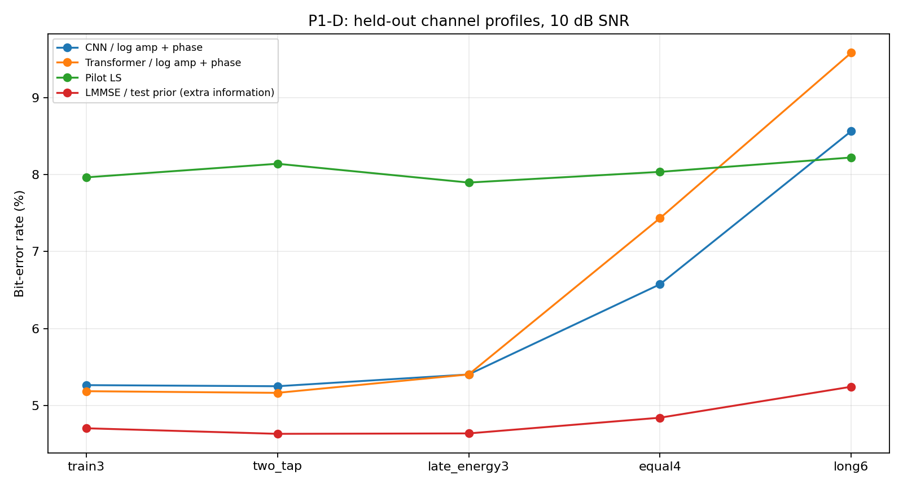

# EM-FloatFormer — Synthetic OFDM representation and receiver benchmarks

## P3-A2: controlled mechanism supplement (2026-11-15)

A separately frozen [P3-A2 protocol](P3_A_MECHANISM_PROTOCOL.md) tested removing absolute delay-position inputs and a fixed 10% retention floor, each alone and combined, with 5 fresh seeds and matched synthetic passive QPSK/OFDM samples. On sparse12 at 10 dB, BER went from **12.291%** (A original freshly retrained) to **6.549%** (D combined), but classical hard-threshold DFT still achieved **4.919%**. These results are **exploratory** and do not change P3-A or P2-E reports. See the [full report](P3_A_MECHANISM_REPORT.md), [scope addendum](P3_A_MECHANISM_SCOPE_ADDENDUM.md), [reproduction guide](P3_A2_README.md), [raw counts](p3a2_results/ber_by_seed.csv) and [source/results ZIP](P3-A2_source_and_results.zip).

[中文概述](#中文概述) · [Reproduction](#reproduction) · [Results](#measured-results)

> **Research prototype, not a validated RF foundation model.** This repository contains a receive-only, purely synthetic, civilian QPSK/OFDM benchmark. It contains **no radar, electronic-warfare logic, jammer, transmitting hardware control, weapon targeting, or real traffic data**.

The central experimental question is whether learned representations of complex baseband samples and particular neural architectures improve decoding under ordinary multipath fading and thermal noise, compared with classical signal processing at known computational cost. We publish negative results alongside positive results.

## P2 completed: Physics-Guided Neural Receiver (2026-11-15)

**P2-A through P2-E have finished** within the original receive-only, synthetic civilian QPSK/OFDM benchmark. Three physical-residual estimators, three IQ encoding paths, mathematically constrained common-phase-equivariant receivers, frozen-weight robustness experiments, and 10 *new* training-seed replication were audited. Results and negative findings are public.

At **10 dB** in *held-out* profiles, with 10 new seeds and **1,310,720 evaluated bits per receiver / profile**:

| Receiver | Unseen equal4 BER | Unseen long6 BER |
|---|---:|---:|
| P1 circular CNN/log (38,018 params, freshly retrained) | 6.574% | 8.323% |
| P2 complex phase-equivariant FIR (2,060 params) | **6.347%** | **7.374%** |
| Fixed generic 8-tap DFT channel estimate | **5.392%** | **5.336%** |
| LMMSE with privileged matched test prior | 4.902% | 5.082% |

Prespecified 10-seed exact paired sign-flip tests after Holm correction: **p = 0.00390625 for both** P2-versus-P1 endpoints. **These do not establish P2 superiority over the classical DFT-8 baseline**; fixed support information is powerful in this simulator. The common-phase-equivariant model also **does not guarantee** invariance to data-only phase error, arbitrary resampling, or new physical channels. Findings are limited to idealized pilot/data pairs.

Research protocol and reports: [`P2_PROTOCOL.md`](P2_PROTOCOL.md), [`P2A_REPORT.md`](P2A_REPORT.md), [`P2B_REPORT.md`](P2B_REPORT.md), [`P2C_REPORT.md`](P2C_REPORT.md), [`P2D_REPORT.md`](P2D_REPORT.md), [`P2E_FREEZE.json`](P2E_FREEZE.json), [`P2E_REPORT.md`](P2E_REPORT.md). Audit evidence: [`p2e_results/final_audit.json`](p2e_results/final_audit.json), [`p2e_results/primary_endpoints.json`](p2e_results/primary_endpoints.json), [`p2e_results/ber_by_seed.csv`](p2e_results/ber_by_seed.csv). No attention, MoE or diffusion was added without a measured justification.

### P2 reproduction (Python 3.11+, CPU PyTorch)

```bash
python -m pip install -r requirements.txt
python -m unittest test_p2_integrity test_p1d_invariants test_p1e_integrity -v
python p2_run.py --mode smoke
# Recreate all P2 exploratory stages, each from the original 3-tap training data:
python p2_run.py --mode train --names res_point_raw res_local_raw res_unfold p1_cnn_log --seeds 1201 1202 1203 --steps 600 --batch 64 --ckpt p2_checkpoints --out p2a_retrained
python p2_run.py --mode train --names res_local_raw res_local_log res_local_dual --seeds 1201 1202 1203 --steps 600 --batch 64 --ckpt p2b_checkpoints --out p2b_retrained
python p2_run.py --mode train --names res_equiv_local --seeds 1201 1202 1203 --steps 600 --batch 64 --ckpt p2_checkpoints --out p2c_retrained
# Final P2-E: fresh seeds on unchanged train3, and previously frozen endpoints:
python p2_run.py --mode train --names res_equiv_local p1_cnn_log --seeds 2201 2202 2203 2204 2205 2206 2207 2208 2209 2210 --steps 600 --batch 64 --ckpt p2e_checkpoints --out p2e_retrained
python p2_run.py --mode eval --names res_equiv_local p1_cnn_log --seeds 2201 2202 2203 2204 2205 2206 2207 2208 2209 2210 --frames 2048 --ckpt p2e_checkpoints --out p2e_recomputed
python p2_finalize.py
```

Checkpoints are deliberately excluded from public GitHub; training scripts recreate weights. P2-E statistical results are from **training seeds 2201–2210** and fresh simulator draws, not independent real-hardware replication. The final audit did not test complete FP16/BF16 neural-network execution, sampling-rate generalization, or SDR streaming.

## Status (2026-11-15)

| Milestone | Description | Evidence |
|---|---|---|
| P1-A | Small OFDM simulator + first Transformer and LS/DFT/LMMSE references | `ofdm_baseline.py`, `results/` |
| P1-B | Raw IQ + magnitude vs log amplitude + regularized phase; mathematical numerical checks | [`P1B_REPORT.md`](P1B_REPORT.md), `p1b_results/` |
| P1-C | Token-MLP, MLP-Mixer, 1-D CNN, Transformer with matched parameter budgets, three seeds | [`P1C_REPORT.md`](P1C_REPORT.md), `p1c_results/` |
| P1-D | Frozen-checkpoint robustness: five delay profiles, IQ quantization, noise-report error, common-phase drift | [`P1D_REPORT.md`](P1D_REPORT.md), `p1d_results/` |
| P1-E | New-seed replication, exact-sign tests, latency audit; **completed** | [`P1E_REPORT.md`](P1E_REPORT.md), `p1e_results/` |

**These results do not demonstrate a universally superior Transformer, novel physical law, real receiver deployment, or full radio foundation model.**

## Measured results

At 10 dB for previously unseen *four equal-power multipath taps* (P1-D, three model seeds, 196,608 evaluated bits for each receiver):

| Model | Bit error rate |
|---|---:|
| Circular CNN, log/phase representation | **6.575%** |
| Transformer, log/phase representation | 7.434% |
| Pilot-only LS | 8.036% |
| LMMSE with *correct test-profile prior* (**additional information**) | **4.842%** |

When the profile is changed to **six taps**, CNN/log-phase BER rises to **8.565%** whereas LS is **8.222%**. The CNN does **not** retain its apparent advantage over the generic classical estimator. More results, 0/10/20 dB curves, and limitations: [`P1D_REPORT.md`](P1D_REPORT.md).



### P1-E: fresh-seed replication (five **new** training seeds)

P1-E trained four model configurations (CNN and Transformer × raw-IQ and log/phase), using seeds **404, 505, 606, 707, 808** and unchanged P1-C training settings. Across five seeds and 2048 frames/seed/test condition (655,360 data bits per receiver/scenario), at 10 dB:

| Receiver | Train3 BER | Unseen equal4 BER | Unseen long6 BER |
|---|---:|---:|---:|
| CNN, log/phase | 5.321% | **6.597%** | 8.564% |
| Transformer, log/phase | 5.251% | 7.410% | 9.557% |
| LS | 8.075% | 8.061% | **8.071%** |
| Matched-profile LMMSE (privileged prior) | **4.777%** | **4.909%** | **5.131%** |

The prespecified CNN-vs-Transformer differences on equal4 and long6 both favored CNN on all five new seeds. **Two-sided exact sign-flip tests with Holm adjustment yielded p=0.125 for each**, so we do **not** claim confirmatory statistical significance. New-seed replication is not independent reimplementation or hardware replication. Complete results, 0/20 dB tests, CPU latency and limitations: [`P1E_REPORT.md`](P1E_REPORT.md).

## Reproduction

Requires Python 3.11+ and PyTorch (CPU is sufficient). The results here were generated with Python 3.13, PyTorch 2.10 CPU, four CPU threads. `matplotlib` is only required to regenerate plots.

```bash
python -m pip install -r requirements.txt
python -m unittest test_p1d_invariants test_p1e_integrity -v
python ofdm_baseline.py --smoke-only
python p1c_architecture.py --smoke
```

Train and assess from scratch (P1-C checkpoints are **not** committed to GitHub; rebuild them):

```bash
python p1b_representation.py --steps 750 --eval-frames 2000 --seeds 101 202 303 --out p1b_results
python p1c_architecture.py --steps 750 --eval-frames 2000 --seeds 101 202 303 --out p1c_results
python p1c_verify_checkpoints.py --dir p1c_results --seed 101 --eval-frames 2000
python p1c_make_report.py
python p1d_robustness.py --smoke
python p1d_robustness.py --frames 1024 --seeds 101 202 303 --out p1d_results
python p1d_robustness.py --verify --frames 1024 --seeds 101 --out p1d_results
python p1d_make_report.py

# P1-E: new training seeds, then held-out test and exact checkpoint replay
python p1c_architecture.py --steps 750 --batch-size 64 --eval-frames 2000 \
  --seeds 404 505 606 707 808 --arches circular_cnn transformer \
  --encodings raw_iq_magnitude logamp_phase --out p1e_train
python p1e_replication.py --checkpoints p1e_train --out p1e_results --frames 2048
python p1e_replication.py --verify --checkpoints p1e_train --out p1e_results --frames 2048
python p1e_make_report.py
```

The included CSV and figures are **recorded results**, not generated examples. Report scripts read the generated CSV and overwrite reports/images for current runs. Random seeds, scenarios and numerical settings are included as JSON. Full set of 24 P1-C and 20 P1-E weights are distributed separately in the full experiment archive, not in the source repository.

## Experimental assumptions and boundaries

- 32 subcarriers, *all-subcarrier known pilot* for a single symbol, one QPSK data symbol, static channel within each pair; cyclic prefix assumed sufficient for the channel support.
- Ideal frequency-domain model with i.i.d. complex Gaussian thermal noise; known **reported** noise variance. No complete time-domain RF chain and no coding or real antennas.
- Neural receivers share the same hand-crafted pilot-based coarse equalizer and other engineered features. This is an architecture/representation comparison, not an unfettered end-to-end waveform model.
- P1-D tests **only storage quantization of IQ** before FP32 inference, not full FP16/BF16 model inference. The simulated pilot/data phase rotation is **not** full carrier-frequency or sample-clock offset. Sampling-rate robustness is **unverified**.
- A correct-test-prior LMMSE reference is informative but uses an advantage unavailable to the learned model. `true_channel_reference` is an unattainable instantaneous-state reference.
- P1-C/P1-D had three training seeds. P1-E adds five fresh training seeds and prespecified two comparisons with Holm correction; its exact nonparametric p-values are 0.125 (not significant at 0.05). Secondary comparisons remain exploratory; no universal-superiority claim.

## Project files

```text
ofdm_baseline.py               P1-A: generator and classical estimates
p1b_representation.py         P1-B: numerical representation & Transformer
p1c_architecture.py           P1-C: model ablations, training, evaluation
p1c_verify_checkpoints.py     P1-C: reload and repeat saved evaluation
p1c_make_report.py            P1-C: report and figures
p1d_robustness.py             P1-D: frozen-weight robustness evaluation
p1d_make_report.py            P1-D: report and figures
p1e_replication.py            P1-E: new-seed evaluation + exact test + latency
p1e_make_report.py            P1-E: report derived from measured CSV/JSON
test_p1e_integrity.py          P1-E: automated data-consistency checks
P1E_PROTOCOL.md               Prespecified confirmatory comparisons
test_p1d_invariants.py        Unit checks, no checkpoint required
P1B_REPORT.md                 P1-B mathematical + experimental report
P1C_REPORT.md                 P1-C architecture report
P1D_REPORT.md                 P1-D robustness report
P1E_REPORT.md                 P1-E independent new-seed replication report
*/ber_*.csv                   Recorded measurements
*/run_config.json             Reproduction settings
```

**Licensing:** No license is assigned yet. Viewing a GitHub repository does not grant rights to reuse the code; the owner may choose a license separately.

## 中文概述

这是一个**仅使用代码生成的民用 QPSK/OFDM 被动接收机仿真研究**。P1-A至P1-E均已完成。P1-D 在不重新训练的前提下，检验了多个陌生多径分布、接收 IQ 的低精度存储量化、噪声方差报告偏差及相位漂移。P1-E 重新训练了五个全新随机种子，检验模型架构差异的可重复性，并评估统计显著性和CPU推理成本。

**结论具有明确边界：** 在部分未知信道下 CNN 优于小型 Transformer，但六径测试中 CNN 反而劣于普通 LS；知道测试信道先验的 LMMSE 仍较强。P1-E 的两项预设比较虽然在五个新种子中方向一致，但精确检验经 Holm 校正后 p=0.125，未达到0.05门槛。模型不包含真实无线电硬件、发射控制或军事用途的算法。详细数据和局限性见各阶段报告。

## P2 original-plan alignment supplement (2026-11-15)

After the original [P2-E report](P2E_REPORT.md) was frozen, a separate [scope audit](P2_SCOPE_ALIGNMENT_AUDIT.md) confirmed three originally contemplated controls had not been executed: independent RMS-only/local-RMS encoding, reduced-pilot-density evaluations, and a matched-information mixed-channel training route. The supplementary work is **exploratory**, not a retroactive amendment of the P2-E preregistration or its statistical claims.

- [Frozen supplemental protocol](P2_SUPPLEMENT_PROTOCOL.md) — distinct seeds/training/test distributions, separated from P2-E.
- [New evidence report](P2_SUPPLEMENT_REPORT.md) — S1 (six IQ encodings), S2 (32/16/8/4 pilot tones), S3 (train3 versus mixed-profile training, finite-training classical covariance), and negative results.
- [Final scope addendum](P2_FINAL_SCOPE_ADDENDUM.md) — what is now tested, what remains out of scope, and clear distinction from original P2-E confirmation.
- Code: `p2_supplement.py`, reproducible aggregation `p2_supplement_finalize.py`, numerical/metadata audit `test_p2_supplement_independent.py`; raw measurement data in `p2_supplement/s1_results/`, `s2_results/` and `s3_results/`.

Reproduce supplementary studies using `python p2_supplement.py --phase smoke`, then `--phase S1`, `--phase S2`, `--phase S3` (each runs the separate frozen-seed train/eval workflow). CPU, PyTorch >=2.1, and Matplotlib for the plots. Runs can be split by frozen seed using `--only-seed`; evaluation without it aggregates all checkpoints. Each route trains **new** checkpoints; it never reruns the ten frozen P2-E groups.

**Reminder:** the model and all data are purely synthetic passive civilian OFDM, not a real transmitter/receiver, radar, electronic-warfare system or validated RF foundation model. Models do not uniformly outperform standard DFT/LMMSE signal processing.


## P3-0 / P3-A: frozen mathematical audit and delay-domain exploratory study (2026-11-15)

The [P3-0/P3-A protocol](P3_0_A_PROTOCOL.md) was committed **before** training (commit `bce622eddc0d8277c64073033c1248eb035a3803`). This stage has now run 5 **new** training seeds (46001–46005), retraining the older P2 delay-unfolding and equivariant-frequency models alongside a new **985-parameter** U(1)-equivariant delay-domain CNN. All conditions are simulated civilian receive-only QPSK/OFDM with full pilots and ideal synchronization.

At 10 dB, long6 BER: new delay model **6.442%**, P2 delay unfold **7.622%**, P2 equivariant frequency FIR **7.466%**, DFT-8 **5.359%**, noise-calibrated hard-threshold DFT **5.633%**. On unseen long12/sparse12 the new model **fails to generalize** (11.411% / 12.016%). The result is exploratory and **does not** demonstrate superiority over classical methods.

- [Full report, mathematical audit, limitations and reproducibility instructions](P3_0_A_REPORT.md)
- [New delay-domain model source](p3_models.py)
- [Complete P3-0/P3-A source, evaluation CSV, checkpoint hashes and independent audit in a single ZIP archive](P3-0_A_source_and_results.zip) (model weights not included; use separate full checkpoint archive)
- Frozen P2-E results and supplementary P2 results remain unchanged. **P3-B through P3-E have not been started.**


## P3-B: isolated non-idealities (2026-11-15; exploratory negative result)

The **P3-B0–B4** purely synthetic, passive civilian 32-tone QPSK/OFDM benchmark is complete. The train-before-evaluation frozen protocol is [`P3B_PROTOCOL.md`](P3B_PROTOCOL.md). Five new seeds (48101–48105) produced 30 lightweight residual heads, evaluated on 5 multipath profiles × 3 SNRs × 9 clean/single-factor non-idealities against seven fixed nonprivileged classical estimators and the frozen P3-A2 D backbone. The trained neural heads did not surpass the **per-cell envelope** of the predeclared classical estimator list in any of 135 scenario cells; this envelope is an after-test descriptive comparator, **not** a deployable selector. No unconditional model superiority or realistic RF performance is claimed.

- [P3-B full evidence report](P3B_REPORT.md) and [scope/limitations](P3B_SCOPE_ADDENDUM.md).
- PyTorch code: `p3b_time_link.py`, `p3b_receivers.py`, `p3b_train_eval.py`, `test_p3b_link.py`, plus auditable extra diagnostic and report scripts.
- [P3-B primary exploratory comparisons](p3b_results/primary_exploratory_10db.csv) and [independent integrity audit](p3b_results/independent_audit.json).
- [P3-B archived raw results (ZIP)](P3B_evidence_2026-11-15.zip), containing all 9,450 raw per-seed evaluation rows, 1,890 aggregate rows, training logs, supplementary privileged-reference diagnostics, hashes and timings; binary model weights remain in the separately distributed full offline archive.

All earlier frozen P2/P3-A reports are unmodified. **P3-C/D/E are not started.**


## P3-C: CPU mixed-precision and IQ-storage numerical audit (2026-11-15)

**Exploratory, receive-only civilian synthetic QPSK/OFDM.** The P3-C protocol was frozen before testing in [`P3C_PROTOCOL.md`](P3C_PROTOCOL.md). All 30 frozen P3-B residual heads and five P3-A2 D backbones were re-evaluated, not retrained, with disjoint new held-out RNGs (five trained seeds). CPU PyTorch 2.10 executes real Conv1d under *actual FP16 or BF16 autocast output dtypes*, but complex FFT/complex arithmetic remain `complex64`/FP32 because this CPU does not support half or bfloat FFT. **This is not a full FP16/BF16 receiver execution claim.**

- Normal-range mixed precision changed relatively few bit decisions and did not show a consistent BER or CPU latency advantage vs FP32.
- Artificial coherent gain stress demonstrated sharp scale-generalization failure **even under FP32**; this is distinct from half-precision numerical error.
- Separate FP16/BF16 received-IQ storage and synthetic high-dynamic-range encoding tests show both numerical benefits and counterexamples; finite reconstruction is not sufficient for information fidelity.
- [`P3C_REPORT.md`](P3C_REPORT.md), [`P3C_SCOPE_ADDENDUM.md`](P3C_SCOPE_ADDENDUM.md), [`P3C_README.md`](P3C_README.md); raw counts, CPU dtype evidence, historical-weight hashes, numerical tests and full results: [`P3C_evidence_2026-11-15.zip`](P3C_evidence_2026-11-15.zip).

Original P2-E, P3-A, P3-A2 and P3-B frozen protocols/results are unchanged. **P3-D and P3-E have not been started.**
