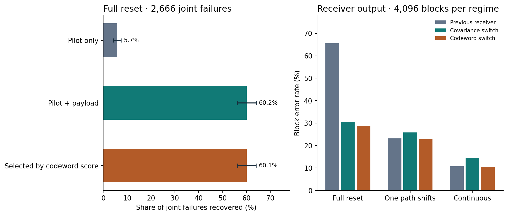

# EM-FloatFormer · 用未知载荷重建完全重置后的三径信道

2026-11-20。第一项验收是新估计能否救回 P9 和上一轮单径修复共同译错的块。主评估和独立重复使用相同的冻结方法。两批完全重置链路合并，独立重建分支救回 1604/2666 个共同失败块（60.17%，按链路配对、分批重抽的探索性 95% 区间 56.18%–64.10%）。匹配的仅导频重建分支救回 153/2666 个。还有 115 个块在两套旧输出中均正确，而新分支把它们译错。面向混合场景，应保留旧接收机和有条件的切换。



## 物理算子和可识别量

第 r 行信道满足 H[n,(n−dₗ) mod N]=gₗ(r,n)，三条已知延迟为 0、2、4 个样点，N=32。项目原生系统码的归一化 16-QAM 载荷两两不相关，E[xxᴴ]=I，则给定信道的精确二阶矩为 C=HHᴴ+N₀I。对非零滞后 k，

$$
 C[n,(n-k)\bmod N]
 =\sum_{d_i-d_j\equiv k\ (\bmod N)}
 g_i(r,n)\overline{g_j(r,(n-k)\bmod N)}.
$$

k=4 时只出现延迟 4 与 0 的交叉项。k=2 时，延迟 2 与 0、4 与 2 两个交叉项相加。估计器跟踪不同时刻各行**内部**的相关结构怎样变化；不同载荷行是不同码字，本模型无须假定两行传了相同数据。对于每行普遍相同的相位旋转，接收协方差不变。共同频偏仍通过行内采样的相位梯度留下有限信号：C(δ)=D(δ)CD(δ)ᴴ，其中 D(δ) 对角元为 exp(2πiδ n/N)。行首的公共相位完全抵消。因此仅凭相关性和一个短导频无法保证任意时变信道的绝对相位轨迹唯一。已知导频为一个 32 采样块，用于锚定这段观测的绝对相位。

在 48 条独立完全重置开发链路的局部曲率诊断中，固定增益、啁啾与导频中心相位，使用五行载荷时，两个单位相对频移方向的平均曲率与等范数共同频移方向的曲率之比，中位数约 2185。使用的是高斯二阶评分的局部曲率；它不等于编码 QAM 真实完整分布的 Fisher 信息。

## 怎样生成新的信道输出

1. 帧 B 发生物理重置的假设下，从该族公开的起止频率范围、随机正负号、线性啁啾和径功率出发。每径以三点 Gauss–Legendre 求积估计起止频率，两端同号，总共 18 条轨迹。三径联合有 18³=5832 个候选。整条重建分支从 B 帧起步，不读取 A 帧。
2. 给定轨迹，用唯一的已知导频更新增益。按模拟器模型，主径固定模长、未知均匀初相，另两径是复高斯。后两径条件矩可解析求出，主径相位的条件一阶矩由修正贝塞尔函数给出。每个轨迹保留三径增益的一阶矩与完整二阶矩。
3. 五个未知载荷块逐一给轨迹打分。先使用各候选的频域协方差对角计算快速分数，再从温和加权的分布作 160 个确定性分层抽样位置（可重复），计算保留节点的完整时变协方差评分 −yᴴC⁻¹y−log det C，并校正提议权重。沿三径轨迹混合，输出每个目标采样处的三径复增益均值和边际方差。给定每条频率轨迹，锚点增益的条件矩来自导频；未知载荷更新的是**联合轨迹权重**，进而改变全帧的信道输出。对离散载荷采用高斯二阶评分，对多行共享的增益误差使用复合似然，这些都是近似。
4. 对照使用相同的 5832 条轨迹和相同导频更新，关闭载荷打分，在整库上作仅导频求积。两种输出都接同一冻结的 P9 strong_large 译码器。另保留 P9 经典输出、上一轮单径修复（v1）、清空历史的已有 clear 分支、上一轮冻结的风险校准注意力切换结果（默认接收机）。
5. 两种实际可运行的切换规则都只看另外两行未知载荷（0、9），比较新分支和冻结默认接收机。第一种按复协方差预测打分。第二种让两个接收机各给一个合法 LDPC 码字，组成去重、共享的候选表，以两种预测信道分别重建表中码字波形，计入符号能量相关的预测噪声，按共同列表内的对数似然和选输出。每个方法都给同一列表评分，严格胜出才切换。这个小列表是截断近似，不能保证最大似然。一个验证块最多需要两次 strong_large 候选译码。加入新动作后，上一轮只约束旧单径修复的秩保护不涵盖这项新动作。

## 数据与独立性

每批三种机制各 128 条链路，每条链路 16 个共有目标块，每批 6144 块。机制为全重置、单径跳变、连续；9 dB，稀疏导频和整帧平滑。冻结主评估种子为 981120030000+i，独立重复为 981120040000+i，i=0…127。每个批次内三机制共享同一组物理种子。开发、数值积分检查、控制实验与两批评估的种子范围独立。估计器哈希 ee23afb7b425726e47f2a76756b79ea48ad4f83631fb78135556696f35882adc。

折一用第 2、5、8、13、16 行拟合重建，评其余 11 个共有目标块。折二用第 1、4、7、12、15 行拟合，只评折一留下的 5 个块。两折均用导频第 10 行；验证 0、9 行仅供切换，保留的第 19 行无噪探针仅供评分。每个目标块在对应折完全留出。推理时没有真实码字、变化标签、信道或初相。每机制首条轨迹对所有非允许行以及 A 作替换，状态估计通过不变性检验。对照使用额外验证行没有增加发射时的导频开销，但需要额外计算并等待这些行。

## 第一项验收与物理结果

| 完全重置，每批 2048 个块 | 主评估 | 新种子重复 |
|---|---:|---:|
| P9、v1 同时译错 | 1241 | 1425 |
| 同一估计器只用导频，救回共同失败 | 84 | 69 |
| 新估计器加入未知载荷，救回共同失败 | 698（56.24%） | 906（63.58%） |
| 新分支把 P9、v1 均正确的块译错 | 68/762 | 47/577 |
| P9、v1、clear 均错时，新分支救回 | 664/1204 | 876/1394 |
| 实际码字验证接收机救回共同失败 | 698 | 905 |
| 新分支单独使用的总错块 | 616 | 572 |

主评估的共同失败救回率 95% 区间为 50.00%–62.32%，独立重复为 58.27%–68.79%。相对匹配的仅导频分支，在同一共同失败子集上，主评估额外救回 625 个、丢掉 11 个，独立重复额外救回 848 个、丢掉 11 个。两批合计 2666 个共同失败，占全部重置块的 65.09%；两种旧方法至少有一个正确的其余 1430 块中，新分支错了 126 块。

在冻结后才用隐藏的真实信道计算留出行的物理误差。相对相位按径对真实交叉功率加权，比较三对路径的相位差。相对频率由每行首尾采样的相位差估计，以 cycles/N samples 为单位，在一个采样块内取模。线性啁啾时它对应行中点处的平均频差；弱径的权重较低。下表为按真值权重合并后的 RMSE。

| 完全重置 | 仅导频 | 导频＋未知载荷 |
|---|---:|---:|
| 径间相位，主评估 / 独立重复（rad） | 0.797 / 0.999 | 0.224 / 0.258 |
| 径间多普勒，主评估 / 独立重复（每 N 样点的周数） | 0.06772 / 0.08189 | 0.00902 / 0.01084 |
| 两批合并的绝对相位（rad） | 0.552 | 0.312 |
| 隐藏帧末波形 NMSE，主评估 / 独立重复 | 0.484 / 0.546 | 0.257 / 0.228 |

## 最终接收机

| 两批合计 BLER | 上一轮冻结接收机 | 始终用新分支 | 协方差切换 | 码字验证切换 |
|---|---:|---:|---:|---:|
| 完全重置 | 65.58% | 29.00% | 30.44% | 28.86% |
| 单径跳变 | 23.22% | 80.96% | 25.88% | 22.88% |
| 连续 | 10.79% | 29.59% | 14.55% | 10.45% |
| 三种机制等权 | 33.19% | 46.52% | 23.62% | 20.73% |

码字验证接收机相对冻结默认接收机的等权收益分别为 10.56 pp [8.94,12.22] 和 14.37 pp [12.63,16.08]。合并后净少错 1532/12288 个，即 12.47 pp [11.28,13.64]。在完全重置上净少错 1504/4096，36.72 pp [33.18,40.19]。连续及单径跳变均少错 14/4096 个，各约 0.34 pp，此处应以重置场景的收益为主。区间采用独立物理种子配对重抽，环境及数据生成器固定，未作多重比较校正。能单独归因给“载荷参与估计”的比较是新候选开/关载荷；端到端等权提升同时计入了新分支和切换规则。

## 仍然能看见的盲区与独立控制

- 时间错配对照在另外 32 条完全重置链路上运行，保持五段未知波形原样，循环错置其行时刻。共有 512 块，仅导频错 320，新分支正确配对时错 138，时刻错置后错 407。分别给五行施加各自的整行常相位旋转，四折检查中新状态均值和方差在数值容差内完全相同。二者共同检验本方法所使用的行内复相关与跨行时间对应。
- 两个主批次分别事先留下首 32 条完全重置链路，用真实信道给每一个目标行额外补一个最优共同相位，只用于诊断。新分支在这两个子集上的错误数分别从 132 降至 40、154 降至 26（各 512 块）。公开可用的接收机没有此真值。它揭示剩余错误对共同相位的敏感性，无法证明真实系统能知道这项修正，也不能把残差唯一归咎于多普勒。
- 独立以稠密 32×32 矩阵和 4096 点初相积分核对导频条件矩与相关性打分，误差量级低于 3×10⁻¹³。八条开发链路上用完整 5832 节点交叉检查 160 点近似，两者输出的归一化波形平方差最高约 6.4×10⁻⁵，这项检查没有计入连续频率的网格误差。
- 适用边界为给定模拟器的三径延迟、功率、轨迹先验与 9 dB 稀疏布局。单径跳变属于不同模型族，始终清空历史会出现明显退步。现场采集、其他信噪比、未知延迟和在线低时延尚需另外检验。两个编码验证分数均基于有限候选表和近似不确定性模型。此次没有重新训练注意力，没有将重建的收益归因于注意力架构。

## 如何复算

基线为 [EM-FloatFormer，固定 P9 提交 faeea639](https://github.com/20171806011/EM-FloatFormer/tree/faeea639727aab72740cdd0a719106f83824226e)。压缩包的 prior 目录提供本次用到的上一轮冻结模型、校准记录和辅助脚本。Python 3.12.14、NumPy 2.3.5、SciPy 1.17.0、Numba 0.63.1、llvmlite 0.46.0。plot_results.py 额外使用 Matplotlib。下例从解包目录运行，工程根目录需包含 p8、p8c、p9 三个包。强译码器使用原 P9 的 strong_large 参数。单独验证已有记录可从 audit_rebuild.py 和 audit_replication.py 开始。

```bash
export PYTHONPATH="/absolute/path/to/EM-FloatFormer:$PWD/prior"
export OPENBLAS_NUM_THREADS=1
python test_estimator_math.py
python code_check.py
python phase_check.py
python eval_rebuild.py --prior-dir ./prior --workers 7
python replicate.py --prior-dir ./prior --workers 7
python audit_rebuild.py
python audit_replication.py
python pooled.py
python phase_controls.py
python frequency_sensitivity.py
python quadrature_audit.py
python plot_results.py
```

图表、主/复验逐折记录、错误向量、物理量摘要、背景初相诊断与 SHA256 清单均已附上。结论来自本包的独立数值试验。二阶统计辨识的背景文献为 Lang Tong, Guanghan Xu, and Thomas Kailath, “Blind Identification and Equalization Based on Second-Order Statistics: A Time Domain Approach,” *IEEE Transactions on Information Theory*, volume 40, number 2, March 1994, pages 340–349. [作者公开全文](https://people.ece.cornell.edu/ltong/papers/TongXuKailath94IT.pdf)。
