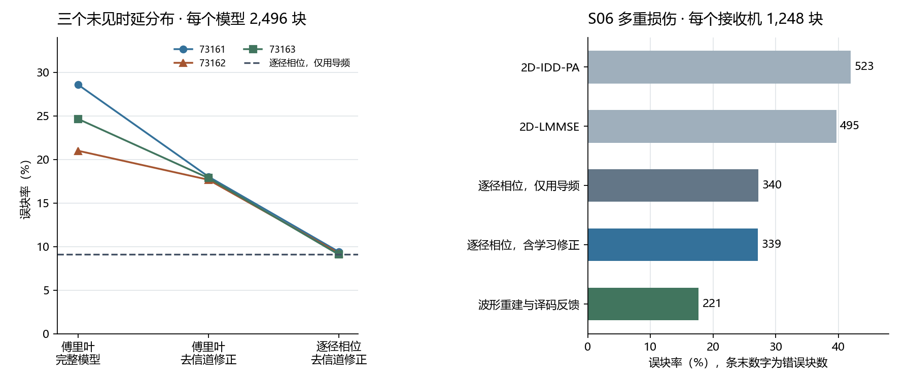

# P4-B 接收机复验：长时延、超稀疏导频与译码反馈

2026 年 11 月 17 日，接续 Antigravity 对话 （早期研究记录）。上一轮发现，关闭已经训练好的信道修正分支能改善长时延表现。这一轮从初始化开始移除该分支，重新训练，并把模拟器扩展到原方案要求的分数采样时延。

**在三个未见的整数时延分布中，逐径相位前端显著降低了实际错误码块数。该前端单靠导频也达到相同水平。在超稀疏导频下，利用载荷数据迭代估计信道的经典方法跨过了 4 dB 门槛，三次专项训练的 Transformer 仍有明确差距。** 下列结果均为本地基带仿真的开发实验。正式 P4-D 十种子验证仍等待 M3 验收。[上一轮实验](P4_CONTINUATION_REPORT.md) · [正式协议](P4D_PROTOCOL.md)

## 重新训练后，哪一部分降低了误块率？

在训练分布 equal4 上进行九次拟合。三种架构各用三个开发种子，每次 120 步、每步 8 个时隙。相同种子的三种架构共用训练样本及保留参数的初始值。测试取 18 dB 下的 long12、sparse12、exp16，每个条件 64 个新时隙、832 个 LDPC 码块。表中每个单元格的分母均为 2,496。

| 接收机 | 种子 73161 | 种子 73162 | 种子 73163 |
|---|---:|---:|---:|
| 傅里叶导频插值，加可学习信道修正 | 713 | 524 | 615 |
| 同一插值，从训练开始去掉信道修正 | 450 | 441 | 446 |
| 换为逐径相位估计，仍去掉信道修正 | 235 | 231 | 227 |
| 仅用对应的逐径导频估计和软解调 | 228 | 228 | 228 |

末行是同一个确定性接收机在同一批测试帧上的结果。固定三组已训练权重、按时延分布分层重抽配对时隙，移除信道修正后，误块率平均下降 6.88 个百分点。换用逐径前端再降 8.60 个百分点。最终模型相对自身纯导频对照的误块率高 0.12 个百分点，描述性 95% 区间为 −0.16 至 +0.40 个百分点。这批数据支持前端的贡献，剩余学习模块的增益仍不确定。[试验设置](next_neural_protocol.json) · [逐时隙计数](results/next_neural_study.json) · [配对差值](results/next_neural_summary.json)

该前端由两个导频行的复相位差估计每个可分辨时延上的相位变化，再按两行幅度的一致程度抑制噪声。它需要当前图样中的两行完整 comb-2 导频，并假定每个可分辨时延对应单个相位斜率。在当前符号与循环前缀长度下，两次观测间隔导致归一化多普勒幅度超过约 0.037 时可能发生相位混叠。[接收机实现](next_neural.py)

## S07 的两个问题：整数网格与分数采样时延

**原验收程序**比较训练分布 equal4 与未见 exp16 的译码后信息位错误率，二者都使用整数时延。将新接收机按原程序的 75 步预算训练后，在原样本上两个分布各错 0/416 块、0/26,624 个信息位，且导频位置平移诊断通过。在另外 64 个新时隙上，三个逐径模型均在 equal4 错 4 位、exp16 错 5 位，各自分母为 53,248。这给出了原样本“零误码”的适用范围。[原工作量重放](results/next_s07_replay.json) · [新时隙结果](results/next_neural_summary.json)

**文字方案**要求在分数时延下比较未编码 BER 与保留 8 个抽头的 DFT 基线。新模拟器对功放输出波形施加分数采样延迟，保留符号边界与上一符号循环前缀的影响。在 20 dB、轻功放失真、归一化多普勒 0.01、零频偏下，固定一组 16 径非整点时延。所有接收机共享波形、信道实现与噪声。未编码与编码载荷各用独立生成的 64 个时隙。

| 分数时延接收机 | 未编码 BER，106,496 比特 | 信道 NMSE | 错误 LDPC 块 / 832 |
|---|---:|---:|---:|
| DFT-8，时间线性插值 | 17.390% | 0.2102 | 545 |
| DFT-8，逐径相位跟踪 | 17.397% | 0.2098 | 547 |
| 16 抽头逐径相位，仅用导频 | 7.490% | 0.1391 | 77 |
| 16 抽头逐径相位，三组训练模型 | 7.482%–7.513% | 0.1391 | 71–72 |
| 16 抽头傅里叶插值，三组去信道修正模型 | 7.047%–7.068% | 0.1356 | 63–73 |

三个逐径模型都达到相对 DFT-8 的未编码 BER 差值不超过 0.005 的门槛。基线只保留 8 个抽头，这个比较同时包含时延支撑的差异。整数 exp16 上逐径相位模型的未编码 BER 更低，改为这组分数时延后，傅里叶插值模型的未编码 BER 更低。对同一潜在信道改换时延几何，确实会改变模型排序。[波形定义、独立验算与逐时隙数据](results/next_fractional_holdout.json) · [误码、NMSE 与配对区间](results/next_fractional_summary.json)

## S05：八个导频是否足够？网络学到了多少？

单个 OFDM 符号每隔四个频点放一个导频，整帧只有 8 个导频。以下增益均以最近邻导频最小二乘估计为参照，先平均逐时隙信道 NMSE，再取比值的分贝数。三个专项模型各训练 120 步、批量 8，使用与测试图样相同的训练信道统计和三抽头傅里叶初值。推理只读取接收信号和已知导频等可用输入。

| 方法 | 原验收 8 个时隙 | 新生成 128 个时隙 |
|---|---:|---:|
| 匹配统计量的纯导频 LMMSE | 1.405 dB | 1.584 dB |
| 原双行导频网络，直接迁移 | −0.242 dB | −0.192 dB |
| 单行导频专训，三个种子 | 0.974–1.317 dB | 1.158–1.425 dB |
| 利用载荷软判决的经典联合 MAP 估计 | **4.815 dB** | **6.092 dB** |

128 个测试时隙分成 16 组。联合 MAP 在 16 组均达到 4 dB，三个专项模型在每组均低于门槛。冻结网络后关掉双向交叉注意力，三组权重的增益变化方向不一致。225,280 个未编码比特上，三个专项模型错 27,194、27,642、27,361 位，联合 MAP 错 10,983 位。另一批 96 时隙上联合 MAP 的合并增益为 5.480 dB，12 个小组有 11 个达到门槛。[专训设置](results/next_sparse_neural_protocol.json) · [逐时隙测量](results/next_sparse_neural_evaluation.json) · [独立的 96 时隙试验](results/next_pilots.json)

## S06：加入功放失真、多普勒、频偏与长时延

在 18 dB、强功放失真、long6、多普勒 0.03、频偏 0.04 下，所有方法使用同一批 96 个时隙和同一 LDPC 码。每个接收机解码 1,248 块。三套逐径网络各错 **339** 块，纯导频前端错 **340** 块，匹配的 2D-LMMSE 和 2D-IDD-PA 分别错 **495** 和 **523** 块。使用波形重建和译码反馈的经典接收机进一步降至 **221** 块。该经典方法使用标称信道和功放模型，需额外迭代计算。

对预定的两个传统基线，在 12 个独立测试组上计算配对差，对三组固定网络取平均，枚举 4,096 种符号翻转。两项 Holm 校正后的双侧 p 值均为 0.0009765625。这项推断限于本组开发权重、仿真条件及比较对象。339 与 340 的差距也说明，超越这两个传统基线的现象本身不足以确认神经网络提供了独立增益。[原始计数与检验](results/next_multi_impairment.json)

## S01、S03、S11 尚未达标的原因与证据

| 场景与目标 | 原程序对应样本 | 新接收机在同一批样本上的结果 |
|---|---:|---|
| S01 高速、强功放失真，误块率 <5% | 错 22/52 块 | 波形重建与译码反馈错 21/52 块，错误信息位由 147 增至 183 |
| S03 极端频偏，平均残余相位 <3° 且 I/Q 符号位零错误 | 错 181/6,656 个符号位 | 优化频偏估计后残余相位 1.232°，仍错 93 个符号位，给定真实频偏与信道仍错 86 个 |
| S11 编码链路，误块率 <1% | 错 97/1,600 块 | 相同映射下错 87/1,600 块。额外改变发端，加入时隙内交织后错 38/1,600 块（2.375%） |

扩大测试后，S01 在四个开发种子上由 403 降至 156/832 块，S11 从 542 降至 459/6,400 块。交织将深衰落造成的相邻错误分散，在另一批 S11 帧上把反馈接收机的误块数从 199 降至 78/3,072，但在 S01 从 268 增至 288/1,248。S03 的原程序使用静态信道和未编码判决，额外的 150 Hz 试验仍有 71 个符号位错误。静态场景中的真值对照表明深衰落与噪声在当前检测器下足以产生错误。它没有给出其他编码或联合检测方案的性能下界。[波形与反馈原始数据](results/next_classical_evaluation.json) · [交织实验](results/next_interleaving_waveform.json) · [频偏与真值对照](results/next_pilots.json)

## 验收状态与复现

本轮保留了原项目的门槛和接收机入口。现有完整套件的历史记录为 245/253。独立候选已满足 S07 的两个实测判据，S05 的经典方法达到了信道估计数值门槛，S05 的神经机制以及 S01、S03、S11 仍待解决。P4-D 的正式种子 74001–74010 未使用。13 项既有 P4-B 单元测试本轮重新通过，230 个历史路径与原始指纹一致。三份开发冻结记录及分数时延的六份权重已按哈希复核，关键误块与 S06 检验均可由原始整数记录复算。[上一次套件记录](results/p4_e2e_outcome.json) · [神经模型冻结记录](results/next_neural_freeze.json) · [经典接收机设置](results/next_classical_protocol.json)

另外，在三个已训练模型上复现了全零导频导致输入梯度非有限的问题。独立的修正避免在零点对平方根反向求导，21 个模型与输入组合中的前向输出和参数梯度逐值一致，异常输入梯度消失。该修正已在隔离进程验证，可在下一份模型版本采用。[数值审计](results/next_anchor_audit.json)

在项目根目录运行 `python -m p4.next_s07_replay` 可重放整数时延验收。`python -m p4.next_fractional` 和 `python -m p4.next_fractional_analysis` 使用已保存的权重生成分数时延结果。`python -m p4.next_sparse_neural` 重训三组 S05 模型并计算同帧比较。`python p4/next_receiver_figure.py` 从已保存的整数记录重绘图形。
