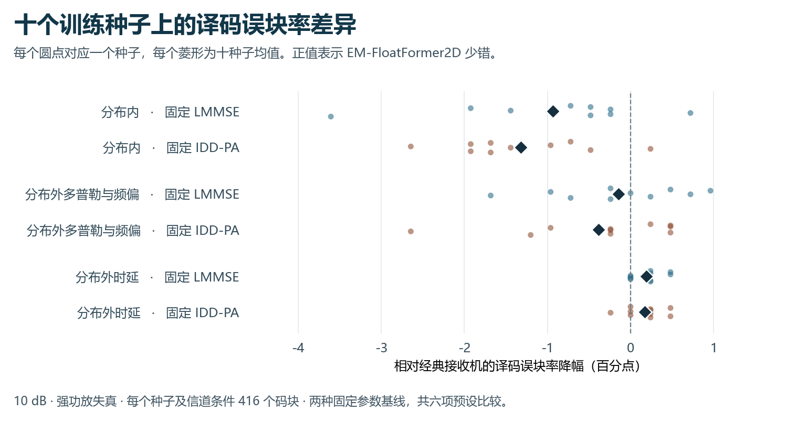
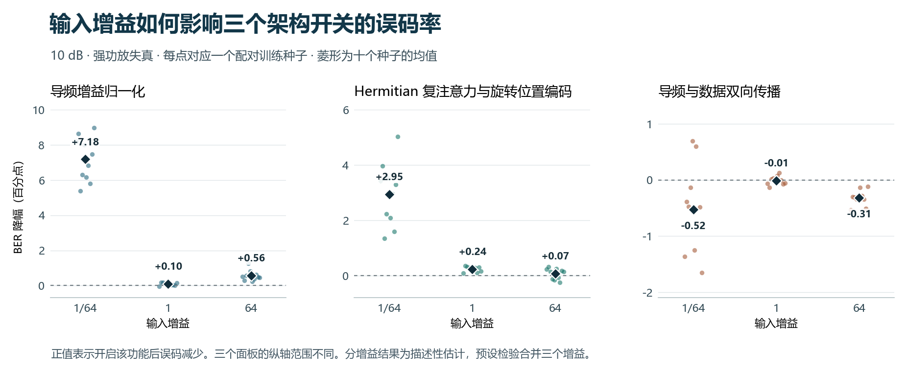

# EM-FloatFormer P4 研究结果与复现

**十种子实验未显示二维 EM-FloatFormer 的译码误块率显著低于固定先验的经典基线。** 在六项预设比较中，唯一达到 Holm 校正显著性的差异出现在分布内信道。EM 在 4,160 个码块中比两轮迭代功放消除（IDD-PA）多错 55 块，误块率高 1.322 个百分点，校正后 p = 0.02344。在长时延信道，EM 只成功译出 22/4,160 块。该结果针对协议指定的高斯导频插值模型、10 dB 和强功放失真。[十种子整数数据](results/p4d/raw_by_seed.csv) · [预设协议](P4D_PROTOCOL.md)

正式训练、重放与最终测试均已完成。十个二维模型各训练 600 步，一维八臂独立重训 80 次。按用户确认的 S01 独立时隙及 S03 载波象限失锁定义验收 M3。两个项目目录中的 230 个历史文件均与冻结指纹一致。[验收索引](P4_COMPLETION_EVIDENCE.md) · [工作量资格](results/stage3_qualification.json) · [联合重放](results/p4d/joint_replay.json)

## 二维编码的十种子正式比较

二维编码评估使用十个预定种子（74001–74010）。每个种子训练 600 步，每步 64 个样本。每种信道下，五种接收机处理相同样本。下表合并十个种子的整数计数。三个条件均在 10 dB 和强功放失真下评估。分布外多普勒条件同时加入了频偏。

| 信道 | 接收机 | 误块/总块（BLER） | 译码前误比特/编码比特（BER） | 译码后误比特/信息比特（BER） |
|---|---|---:|---:|---:|
| 同分布 | EM-FloatFormer | 3,266/4,160（78.510%） | 99,113/532,480（18.613%） | 34,564/266,240（12.982%） |
| 同分布 | 固定先验 LMMSE | 3,227/4,160（77.572%） | 97,966/532,480（18.398%） | 33,421/266,240（12.553%） |
| 同分布 | 固定先验 IDD-PA | 3,211/4,160（77.188%） | 97,960/532,480（18.397%） | 33,518/266,240（12.589%） |
| 同分布 | 按场景给定先验 LMMSE | 3,222/4,160（77.452%） | 98,039/532,480（18.412%） | 33,384/266,240（12.539%） |
| 同分布 | 按场景给定先验 IDD-PA | 3,267/4,160（78.534%） | 99,369/532,480（18.662%） | 35,010/266,240（13.150%） |
| 高多普勒与频偏 | EM-FloatFormer | 3,828/4,160（92.019%） | 131,143/532,480（24.629%） | 58,903/266,240（22.124%） |
| 高多普勒与频偏 | 固定先验 LMMSE | 3,822/4,160（91.875%） | 132,143/532,480（24.817%） | 59,062/266,240（22.184%） |
| 高多普勒与频偏 | 固定先验 IDD-PA | 3,812/4,160（91.635%） | 132,211/532,480（24.829%） | 59,126/266,240（22.208%） |
| 高多普勒与频偏 | 按场景给定先验 LMMSE | 3,949/4,160（94.928%） | 136,265/532,480（25.591%） | 62,844/266,240（23.604%） |
| 高多普勒与频偏 | 按场景给定先验 IDD-PA | 3,937/4,160（94.639%） | 136,921/532,480（25.714%） | 63,226/266,240（23.748%） |
| 长时延 | EM-FloatFormer | 4,138/4,160（99.471%） | 146,496/532,480（27.512%） | 72,477/266,240（27.222%） |
| 长时延 | 固定先验 LMMSE | 4,146/4,160（99.663%） | 152,219/532,480（28.587%） | 75,672/266,240（28.422%） |
| 长时延 | 固定先验 IDD-PA | 4,145/4,160（99.639%） | 152,418/532,480（28.624%） | 75,992/266,240（28.543%） |
| 长时延 | 按场景给定先验 LMMSE | 3,814/4,160（91.683%） | 111,164/532,480（20.877%） | 45,509/266,240（17.093%） |
| 长时延 | 按场景给定先验 IDD-PA | 3,869/4,160（93.005%） | 112,788/532,480（21.182%） | 47,212/266,240（17.733%） |

二维六项主检验比较固定先验基线与 EM-FloatFormer 的译码后 BLER。降幅为“基线减去 EM”，单位为百分点。改善、持平、恶化分别对应逐种子差值为正、零、负。两个按场景给定先验的方法仅列描述性计数。

| 信道 | 固定先验基线 | BLER 降幅（百分点） | 改善/持平/恶化种子数 | 原始 p | Holm p | EM 的方向 |
|---|---|---:|---:|---:|---:|---|
| 同分布 | 固定先验 LMMSE | -0.9375 | 1/0/9 | 0.02343750 | 0.11718750 | BLER上升，校正后未达阈值 |
| 同分布 | 固定先验 IDD-PA | -1.3221 | 1/0/9 | 0.00390625 | 0.02343750 | BLER上升，校正后显著 |
| 高多普勒与频偏 | 固定先验 LMMSE | -0.1442 | 4/1/5 | 0.65234375 | 0.65234375 | BLER上升，校正后未达阈值 |
| 高多普勒与频偏 | 固定先验 IDD-PA | -0.3846 | 4/0/6 | 0.30859375 | 0.61718750 | BLER上升，校正后未达阈值 |
| 长时延 | 固定先验 LMMSE | +0.1923 | 6/4/0 | 0.03125000 | 0.12500000 | BLER下降，校正后未达阈值 |
| 长时延 | 固定先验 IDD-PA | +0.1683 | 6/3/1 | 0.09375000 | 0.28125000 | BLER下降，校正后未达阈值 |

两个场景匹配的经典接收机使用实际信道与功放统计，其结果属于描述性对照。长时延中，匹配 LMMSE 错 3,814/4,160 块，EM 错 4,138/4,160 块。高多普勒与频偏中，匹配 LMMSE 错 3,949 块，EM 错 3,828 块。绝对误块率和基线可用的先验都会影响这些差值的解释。[原始整数](results/p4d/raw_by_seed.csv) · [正式主比较](results/p4d/summary.json)

## 一维八臂机制消融

十个预定种子的一维训练已完成。独立训练循环再次训练了全部 80 个模型，最终权重指纹与 240 组增益条件的整数误码记录全部吻合。每个种子训练全部八个参数匹配的架构，再用 96 个独立测试帧，在增益 1/64、1、64 上测量同一组比特。每个主效应先在种子内按另两个开关取平均，然后在十个种子间比较。下表为开启该功能后的平均 BER 降幅，负值表示错误增多。[一维独立重放记录](results/p4d/factorial_replay.json)

| 启用的机制 | BER 降幅（百分点） | 改善/持平/恶化种子数 | 原始 p | Holm p | 启用后的方向 |
|---|---:|---:|---:|---:|---|
| 复增益归一化与 RMSNorm | +2.6152 | 10/0/0 | 0.00195312 | 0.00585938 | BER下降，校正后显著 |
| Hermitian 注意力与复 RoPE | +1.0860 | 10/0/0 | 0.00195312 | 0.00585938 | BER下降，校正后显著 |
| 双向导频与数据交叉注意力 | -0.2816 | 2/0/8 | 0.01562500 | 0.01562500 | BER上升，校正后显著 |

这项一维研究使用 10 dB、强功放失真和短训练预算。单看单位增益的描述性结果，三项 BER 降幅分别为 +0.102、+0.235、−0.009 个百分点。S05 在二维超稀疏导频及展开的物理更新内观察到了双向注意力增益。两个实验的任务、前端和比较设计不同，可以分别支持各自的结论。[80 个拟合的逐种子统计](results/p4d/factorial/summary.json)

将每个种子的八个架构按输入增益分别比较，归一化在 1/64、1、64 三个增益上平均降低 BER 7.185、0.102、0.558 个百分点。Hermitian 复注意力与旋转位置编码的改善同样集中在 1/64 增益。双向传播在增益 64 时使全部十个种子的错误增加。这些分增益结果用于解释合并效应，统计检验沿用预设的三个跨增益主效应。

注意力与物理信道统计的相关性也做了开发对照。在四径信道中，导频自注意力与理论频域协方差的相关系数在初始化时为 0.544，训练后为 0.540。这组测量不足以证明网络从数据中学得格林函数。[注意力探针与对照](P4C_1D_REPORT.md)

## M3 场景验收与连续轨迹复测

| 场景 | 实际测量 |
|---|---|
| S01，高速列车 | 在原设定的四个独立衰落时隙间交织，使用四个 (1664,832) LDPC 码块，3,328 个信息位和 6,656 个空口位。由速度和载频换算的 833.91 Hz 以及蓝图文字中的 500 Hz，均在默认样本错 0/4 个长码块，额外 12 组均合计错 0/48。新码保留原有 1/2 码率，增加四时隙缓冲。如果四个时隙共用同一条连续衰落轨迹，默认样本的同一映射在两种频率下均错 4/4 块。不重抽各径幅度、把四个时隙拉开到 17.5 ms，在该样本仍错 4/4 块。 |
| S02，城市多径 | 在原样本的两种信道中各错 0/520 块。使用同一预设信道统计的波形反馈接收机，在 80 个新时隙上分别错 0/2,080 和 6/2,080 块。在已测的十个信道与种子组合中，关掉神经初值的学习修正，最终误块计数完全相同。 |
| S03，频偏与 150 Hz 多普勒 | 按用户确认的载波象限失锁定义，112 个 OFDM 符号均处于正确象限，104 次相邻比较无象限变化，平均残余相位 0.936°。载荷的 6,656 个 I/Q 符号位错 71 个。这里单独保留了符号误判。 |
| S05，单行八导频 | 默认种子的公开入口取得 6.623 dB，相对最近邻 LS 的信道 NMSE 从 0.18788 降至 0.04089。128 个新时隙上的三个完整模型取得 7.083、6.321、5.888 dB。配对比较表明，完整模型比各自重新训练的去交叉注意力版本改善 0.78 dB。把纯物理更新从六步增加到十二步，比完整模型的三种子平均再好 0.77 dB。 |
| S06，多重损伤 | 12 个原定测试时隙各解码 13 个码块。波形反馈加网络初值错 25/156 块，2D-LMMSE 和 2D-IDD-PA 分别错 56 和 59 块。两个配对检验的 Holm 校正 p 值均为 0.01953。关掉初值的学习修正同样错 25 块。单独使用逐径相位跟踪的网络错 37 块，对两个基线的校正 p 值均为 0.1328。 |
| S07，分数采样时延 | 只在 equal4 训练，再在独立的 64 个分数时延 exp16 时隙测量。在 106,496 个未编码比特上，逐径相位网络错 7,690 位，两种 DFT-8 基线错 16,936、16,760 位。原有的整点时延工作量也通过，两种分布各错 0/26,624 个译码后信息位。 |
| S11，持续 50 时隙传输 | 强功放失真、300 Hz 多普勒、一段连续 700 个 OFDM 符号的信道。原样本顺序映射错 22/1,600 块，采用固定 50 时隙交织后错 4/1,600，11/102,400 个信息位。额外 12 条连续轨迹合计错 182/19,200 块，其中两条的误块率高于 1%。交织增加了最多 50 时隙的缓冲开销。 |

[S01 原信道与连续轨迹](results/stage3_link_hst_summary.json) · [延长交织时隙间隔](results/stage3_spaced_summary.json) · [S02 两种信道](results/stage3_urban.json) · [S03 频偏与误判](results/stage3_cfo.json) · [S05 消融和分层误差](stage3_sparse_report.md) · [S06 配对计数](results/stage3_s06_hybrid.json) · [S07 未编码与编码计数](results/stage3_s07.json) · [S11 跨信道分布](results/stage3_link_variability.json)

在 S01 的 12 组新波形中，把四个时隙接成一条连续轨迹后，同一个交织长码在 833.91 Hz 错 16/48 块（33.3%），在 500 Hz 错 4/48 块（8.3%）。错误分别集中在 4 组和 1 组，每个出错组的四个码块全部失败。两种多普勒复用了相同的随机种子。按独立时隙验收时，两种频率的 12 组均为零误块。如果把波形组视为独立抽样，观察到 0/12 组出错，对“下一个四时隙组至少错一块”的单侧 95% 二项上限为 22.1%。这个上限量化的是组级风险，不能直接当作逐块误块率。[逐组原始计数](results/stage3_link_hst_results.json)

为判断连续高速轨迹能否进一步改善，另对 13 条轨迹、两种多普勒做了只用于诊断的真值实验。833.91 Hz 的默认轨迹上，冻结接收机、译码器和短码后，把估计的信道替换成真实信道，错块从 22/52 降到 19/52。在最弱的开发轨迹上，即使给出真实信道，仍错 52/52 块。包含循环前缀、符号间信号尾部及子载波间干扰的高斯互信息上界为 3,792–9,221 比特，全部高于该工作量承载的 3,328 个信息位。现有证据能确认所测接收机的限制，无法证明所有接收机均达不到 5%。[真值诊断与信息上界](results/stage3_hst_feasibility.json)

23 个原定基准格点的 115 个既有方法与条件组合，七项整数计数全部重放一致。每个接收机共评估 7,176 个码块。原始网络错 4,476 块，三个逐径网络错 2,507、2,518、2,507 块，逐径纯导频前端错 2,524 块。匹配统计量的 LMMSE 错 2,548 块，其译码后信息位错误数少于三个逐径模型。与它比较时，三个模型的配对误块率差值区间均跨零。[全基准数据](results/stage3_benchmark.json)

## LLR 读出范围与软译码

在相同权重、相同接收信号上，把旧版读出（方差底 0.05、饱和上限 8）换成现版（0.035、20），一维 EM 模型在七个 13–19 dB 的条件下均少错码块，在另四个 25–30 dB 条件持平。四组训练种子、两个架构、五种设置共评估了 22,528 个不同编码波形。独立开发的二维诊断固定原模型检查点，在强功放 30 dB 时，译码前错误数同为 4,368/106,496，译码后从 39/832 个误块降到 30/832。18 dB 时从 62 降到 58，22 dB 时从 17 增到 18。降幅随接收机和信道条件变化。[编码校准实验与逐条件结果](P4A_CODED_CALIBRATION.md) · [重放收据](results/p4a_coded_calibration/replay.json)

## 数值精度与硬件实测

同一组 100 个二维时隙、五个 SNR 下，对浮点投影矩阵乘法实际执行 FP32、BF16 与 FP16。相对 FP32 的硬判翻转率为 BF16 0.03726%、FP16 0.00481%，均低于 0.05%。其余归一化、相位和读出计算保留宽精度。在这台 i7-1255U CPU 的该次实测中，BF16 吞吐为 FP32 的 0.44 倍，运行时没有报告原生 BF16 矩阵加速。固定 BF16 引擎后，在七个输入功率尺度上没有硬判翻转。计时依赖同时运行的任务与硬件。[精度、吞吐与硬件信息](results/stage3_precision.json)

若进一步要求半精度输出的最大 LLR 偏差小于 0.15，把所有投影都改为 BF16 的二维实现，在原 100 槽和新 100 槽上的最大偏差分别为 0.20229、0.17642。保持输入与物理读出的四个投影为 FP32、仅在 Transformer 块内的 48 个投影使用 BF16，最大偏差分别降到 0.01199、0.01172，判决分别翻转 7/166,400 和 3/166,400。两批均无非有限值。算子记录逐次核对了 2,400 次 BF16 与 200 次 FP32 投影的输入、权重和输出类型。此对照只测数值精度。[二维逐 SNR 结果](results/mixed_precision_followup/two_dimensional.json)

一维复验使用 15 dB 强功放，每组 32 帧，每个增益 4,096 位。相对签名的宽精度实现，仅在块内使用 BF16 后，两组 5 个增益上的最大 LLR 偏差分别为 0.02101、0.02080。原样本每个增益仍翻转 3/4,096 位（0.0732%），新样本为 0/4,096。相同增益组共享比特，不能重复计为独立样本。固定同一混合精度模型再改变输入增益，两组均无新增翻转。[一维逐增益结果](results/mixed_precision_followup/one_dimensional.json) · [混合精度复现包](results/mixed_precision_followup/reproduction.zip)

## 统计与复现

两个统计家族分别以十个训练种子为配对单位，各枚举 1,024 种符号翻转。二维六项 BLER 比较和一维三项 BER 主效应各自进行 Holm 校正，显著性阈值为校正后 p < 0.05。独立审计从原始 CSV 复算了六项检验，并逐一核对十个检查点及对应计数。隔离副本中的原始端到端套件 253/253 通过，另一次隔离运行通过全部 100 项单元与对抗测试，其中含 15 项 Tier 5 白盒测试。两次运行均无失败、错误或跳过。[独立统计审计](results/stage3_final_audit.json) · [253 项端到端记录](results/stage3_final_e2e.json) · [100 项单元与对抗测试记录](results/stage3_final_unit_tests.json)

<!-- P4-D FINAL c021f4ad4251a796125143f74405ae577bb0ff77a28e4dc805a49eff39c15036 -->
