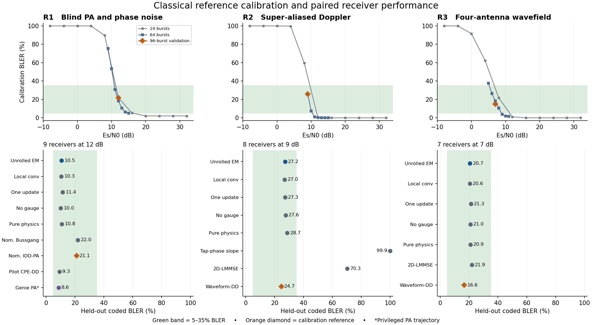
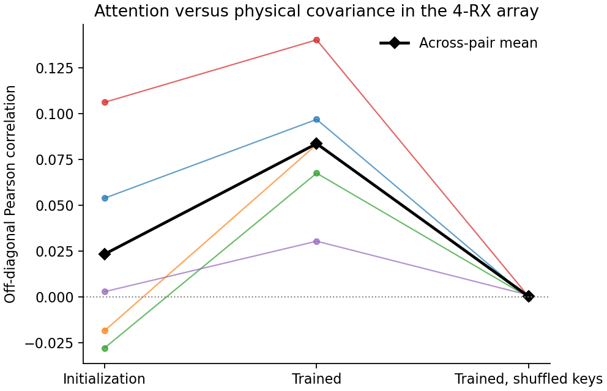

# Can a physics-anchored EM Transformer beat a waveform receiver?

**The strongest equal-information classical receiver had the lowest nonprivileged BLER in all three regimes.** The unrolled model did beat nominal IDD-PA under blind PA drift and oscillator noise, reducing errors from 675 to 337 in 3,200 blocks (10.5625 percentage points, 10/10 paired seeds, Holm p=0.005859375). Allowing a classical receiver to track common phase on those same observations reduced errors further to 297. Under super-aliased Doppler the full model missed 1,960/7,200 blocks against waveform-DD's 1,777. On the four-element array it missed 331/1,600 against 265.

The architecture preserved complex-gain symmetry after training, and every trainable tensor had a first-step gradient. The matched local convolution had slightly fewer pooled errors than Hermitian attention in each regime. Attention's mean correlation with the physical covariance magnitude rose from 0.0234 to 0.0836 on the array. These experiments support a working physics-anchored receiver and a measurable change in the learned weights. They leave an independent end-to-end benefit from the Hermitian head unproven.

## Link results

The three operating points were selected before training with one named nonprivileged receiver per regime. Each point passed the prespecified 5–35% BLER check on 96 fresh calibration bursts. The formal test then used 80 new bursts for each independent training seed. Rows within one regime see exactly the same transmitted codewords, physical realization and AWGN. Percentages below are rounded from the displayed integer counts. [Protocol](PROTOCOL.md) · [Per-seed counts](results/raw_by_seed.csv)

| Regime | Classical reference | Es/N₀ | Calibration validation BLER | Formal test reference BLER |
|---|---:|---:|---:|---:|
| R1 | Nominal IDD-PA | 12 dB | 84/384 (21.88%) | 675/3,200 (21.09%) |
| R2 | Waveform-DD with code feedback | 9 dB | 447/1,728 (25.87%) | 1,777/7,200 (24.68%) |
| R3 | Waveform-DD with code feedback | 7 dB | 57/384 (14.84%) | 265/1,600 (16.56%) |

### R1 · Blind PA drift and oscillator noise

| Receiver | Pre-decode bit errors/bits | Decoded errors/info bits | Block errors/blocks | Channel NMSE (dB) | Real parameters | Batch 1 / 64 (ms) |
|---|---:|---:|---:|---:|---:|---:|
| Unrolled EM | 37,342/409,600 (9.12%) | 1,375/204,800 (0.67%) | 337/3,200 (10.53%) | -10.466 | 94 | 4.96 / 29.17 |
| Matched local convolution | 37,313/409,600 (9.11%) | 1,374/204,800 (0.67%) | 331/3,200 (10.34%) | -10.470 | 94 | 5.40 / 29.01 |
| One physical update | 37,736/409,600 (9.21%) | 1,494/204,800 (0.73%) | 364/3,200 (11.38%) | -10.549 | 94 | 1.88 / 10.37 |
| Without gauge/RMS | 37,384/409,600 (9.13%) | 1,347/204,800 (0.66%) | 321/3,200 (10.03%) | -10.465 | 94 | 4.17 / 25.44 |
| Pure physics | 37,470/409,600 (9.15%) | 1,412/204,800 (0.69%) | 344/3,200 (10.75%) | -10.511 | 0 | 2.32 / 20.17 |
| Nominal Bussgang-LMMSE | 43,171/409,600 (10.54%) | 3,988/204,800 (1.95%) | 704/3,200 (22.00%) | -11.826 | 0 | 1.06 / 18.32 |
| Nominal IDD-PA | 41,912/409,600 (10.23%) | 3,863/204,800 (1.89%) | 675/3,200 (21.09%) | -11.886 | 0 | 3.94 / 42.26 |
| Pilot-CPE-tracked DD | 36,526/409,600 (8.92%) | 1,214/204,800 (0.59%) | 297/3,200 (9.28%) | -10.558 | 0 | 4.34 / 41.23 |
| Genie-PA (privileged) | 36,048/409,600 (8.80%) | 1,109/204,800 (0.54%) | 275/3,200 (8.59%) | -12.149 | 0 | 4.11 / 54.01 |

### R2 · Super-aliased Doppler

| Receiver | Pre-decode bit errors/bits | Decoded errors/info bits | Block errors/blocks | Channel NMSE (dB) | Real parameters | Batch 1 / 64 (ms) |
|---|---:|---:|---:|---:|---:|---:|
| Unrolled EM | 108,366/921,600 (11.76%) | 7,733/460,800 (1.68%) | 1,960/7,200 (27.22%) | -17.709 | 94 | 4.87 / 79.85 |
| Matched local convolution | 108,283/921,600 (11.75%) | 7,650/460,800 (1.66%) | 1,942/7,200 (26.97%) | -17.733 | 94 | 5.46 / 76.95 |
| One physical update | 108,528/921,600 (11.78%) | 7,805/460,800 (1.69%) | 1,965/7,200 (27.29%) | -17.656 | 94 | 1.89 / 28.61 |
| Without gauge/RMS | 108,773/921,600 (11.80%) | 7,888/460,800 (1.71%) | 1,989/7,200 (27.62%) | -17.442 | 94 | 3.95 / 77.74 |
| Pure physics | 109,291/921,600 (11.86%) | 8,171/460,800 (1.77%) | 2,068/7,200 (28.72%) | -16.899 | 0 | 2.39 / 58.33 |
| Per-slot tap-phase slope | 390,785/921,600 (42.40%) | 197,137/460,800 (42.78%) | 7,195/7,200 (99.93%) | 2.591 | 0 | 1.80 / 36.79 |
| 2D-LMMSE | 145,684/921,600 (15.81%) | 38,087/460,800 (8.27%) | 5,065/7,200 (70.35%) | -10.451 | 0 | 2.33 / 118.96 |
| Waveform-DD with code feedback | 105,677/921,600 (11.47%) | 7,008/460,800 (1.52%) | 1,777/7,200 (24.68%) | -18.272 | 0 | 10.85 / 290.40 |

### R3 · Four-antenna fractional-delay channel

| Receiver | Pre-decode bit errors/bits | Decoded errors/info bits | Block errors/blocks | Channel NMSE (dB) | Real parameters | Batch 1 / 64 (ms) |
|---|---:|---:|---:|---:|---:|---:|
| Unrolled EM | 17,487/204,800 (8.54%) | 2,340/102,400 (2.29%) | 331/1,600 (20.69%) | -11.194 | 94 | 5.26 / 51.14 |
| Matched local convolution | 17,470/204,800 (8.53%) | 2,333/102,400 (2.28%) | 330/1,600 (20.62%) | -11.194 | 94 | 6.08 / 44.90 |
| One physical update | 17,585/204,800 (8.59%) | 2,393/102,400 (2.34%) | 341/1,600 (21.31%) | -11.147 | 94 | 2.08 / 20.02 |
| Without gauge/RMS | 17,501/204,800 (8.55%) | 2,363/102,400 (2.31%) | 336/1,600 (21.00%) | -11.176 | 94 | 5.24 / 47.45 |
| Pure physics | 17,504/204,800 (8.55%) | 2,352/102,400 (2.30%) | 335/1,600 (20.94%) | -11.192 | 0 | 2.28 / 26.18 |
| 2D-LMMSE | 18,590/204,800 (9.08%) | 2,587/102,400 (2.53%) | 351/1,600 (21.94%) | -10.488 | 0 | 1.06 / 20.30 |
| Waveform-DD with code feedback | 15,333/204,800 (7.49%) | 1,876/102,400 (1.83%) | 265/1,600 (16.56%) | -12.972 | 0 | 7.02 / 82.72 |

Latency is median batch wall time in milliseconds, one CPU thread, three warmups and eleven timed calls with batch sizes 1 and 64. It includes the waveform-DD receiver's internal six-round code-feedback pass. The receiver timings exclude simulation and terminal LDPC scoring. The saved latency files include all observations and quartiles. Parameter counts are trainable real scalars. Each learned arm also stores a frozen 94-scalar reference map. The classical methods have explicit physical coefficients and zero fitted neural parameters. [R1 timings](results/latency_r1.json) · [R2 timings](results/latency_r2.json) · [R3 timings](results/latency_r3.json)

## Which comparisons survive paired testing?

Positive effects in this table mean fewer block errors with the full model. Wins, ties and losses use one paired difference per training and evaluation seed. The two-sided sign-flip test enumerates all 1,024 assignments in R1 and all 32 in R2 and R3 under the sign-exchangeability null. Holm adjustment is within the three primary comparisons and, separately, within all twelve ablation comparisons. Individual codes in the same burst share a channel. Treating them as independent statistical replicates would give misleading precision. [Effect sizes, signs and tail counts](results/summary.json)

| Family | Regime | Comparator | BLER improvement (pp) | Win/tie/loss | Exact p | Holm p |
|---|---:|---:|---:|---:|---:|---:|
| Primary | 1 | Nominal IDD-PA | +10.5625 | 10/0/0 | 0.0019531 | 0.0058594 |
| Primary | 2 | Waveform-DD with code feedback | -2.5417 | 0/0/5 | 0.0625000 | 0.1250000 |
| Primary | 3 | Waveform-DD with code feedback | -4.1250 | 0/0/5 | 0.0625000 | 0.1250000 |
| Ablation | 1 | Pure physics | +0.2188 | 4/3/3 | 0.5156250 | 1.0000000 |
| Ablation | 1 | Matched local convolution | -0.1875 | 3/2/5 | 0.3046875 | 1.0000000 |
| Ablation | 1 | One physical update | +0.8438 | 7/2/1 | 0.0156250 | 0.1875000 |
| Ablation | 1 | Without gauge/RMS | -0.5000 | 1/2/7 | 0.0312500 | 0.3437500 |
| Ablation | 2 | Pure physics | +1.5000 | 5/0/0 | 0.0625000 | 0.6250000 |
| Ablation | 2 | Matched local convolution | -0.2500 | 1/0/4 | 0.1875000 | 1.0000000 |
| Ablation | 2 | One physical update | +0.0694 | 2/1/2 | 0.8750000 | 1.0000000 |
| Ablation | 2 | Without gauge/RMS | +0.4028 | 4/0/1 | 0.1875000 | 1.0000000 |
| Ablation | 3 | Pure physics | +0.2500 | 2/2/1 | 0.7500000 | 1.0000000 |
| Ablation | 3 | Matched local convolution | -0.0625 | 1/2/2 | 1.0000000 | 1.0000000 |
| Ablation | 3 | One physical update | +0.6250 | 5/0/0 | 0.0625000 | 0.6250000 |
| Ablation | 3 | Without gauge/RMS | +0.3125 | 2/3/0 | 0.5000000 | 1.0000000 |

In R1 the full model removed 338 errors relative to nominal IDD-PA. Pure physics already removed 331 of those errors (675 to 344). With the physical update held fixed, adding the learned controller removed seven more in the pooled count. The pilot-CPE receiver used the same inference information and beat the full model by 40 errors. Supplying only the real PA trajectory to its privileged counterpart saved another 22. This isolates the value of the R1 primary comparison more precisely than an unrestricted claim against classical receivers.

In R2 the per-slot slope missed 7,195/7,200 blocks and the all-row 2D-LMMSE missed 5,065. The pure unrolled solver reached 2,068 before learning. The full model removed 108 additional errors across five seeds, while the local control removed 126. The strongest classical receiver still saved 183 errors over the full model. Its receiver uses the same public code and observed pilots, and spends additional inference work on code feedback and sample-wise ICI cancellation. In R3 the full model saved 20 errors over 2D-LMMSE and four over pure physics. Waveform-DD saved 66 over the full model. The primary BLER advantages for waveform-DD in R2 and R3 were descriptive at the available seed count. None of the twelve ablation contrasts passed the prespecified Holm threshold.

The Doppler receiver also shows a performance–latency trade-off on this host. One burst took 4.87 ms with the full model and 10.85 ms with classical waveform/code feedback. At batch 64 the respective times were 79.85 and 290.40 ms. The array showed the same ordering at both batch sizes. These timings include the particular CPU tensor implementations and their internal feedback workloads.

## Did training recover a physical attention kernel?

The four-element array supplies 48 joint tokens at four antennas, three symbol positions and four frequencies. The scorer compares the learned head's actual attention probabilities against the magnitude of the conditional two-point covariance of the propagation diagonal. For a pair of token coordinates, this target is the magnitude of the sum over rays of realized ray power times the steering, temporal-phase and delay-response products. The target marginalizes independent initial ray phases. It uses the simulated ray parameters only after model prediction. An independent finite phase-ensemble construction checks this target. The loss uses coded bits alone.

Eight fresh bursts per seed were shared across initialization, the final iterate and eight key permutations per iteration. The permutation reassigns columns of the actual attention matrix for scoring. A separate causal link test would need to intervene during receiver inference. Pearson correlations exclude the diagonal. The reported value averages burst correlations over the three unroll steps. The probe tests alignment with a real covariance magnitude. It leaves phase recovery, the complete ICI operator and causal use of spatial structure unresolved. [Probe and integer records](results/r3)

| Independent pair | Initial | Trained | Trained, permuted keys |
|---|---:|---:|---:|
| 1 | 0.05392 | 0.09681 | -0.00053 |
| 2 | -0.01829 | 0.08313 | 0.00087 |
| 3 | -0.02768 | 0.06753 | -0.00006 |
| 4 | 0.10612 | 0.14014 | 0.00026 |
| 5 | 0.00299 | 0.03046 | 0.00110 |
| Mean | 0.02341 | 0.08362 | 0.00033 |

Training changed the mean by +0.06020 (improved in 5/5 seeds, two-sided p=0.0625, Holm p=0.1250). The trained-minus-permuted difference was +0.08329 (two-sided p=0.0625, Holm p=0.1250). These five pairs give descriptive evidence of covariance alignment. Their smallest attainable two-sided p-value is 0.0625.

## Physical model, baseline access and limitations

* **R1, blind PA drift and phase noise.** Every burst draws endpoints independently for PA saturation A (1.05–2.50), smoothness p (1.3–2.7), and AM–PM coupling (−0.30–0.90). Each varies linearly over five OFDM symbols. Rapp AM–AM and Saleh-form AM–PM operate at 2× oversampling before in-band reconstruction. The oscillator integrates independent sample increments continuously through CP intervals with burst-specific standard deviation 0.012–0.032 rad/√sample. This generates both CPE and ICI. The nominal PA is (1.775, 2, 0.30). Nominal Bussgang-LMMSE accounts for average distortion. Nominal IDD reconstructs the waveform and refits path gains twice. Pilot-CPE-DD initializes and updates per-symbol common phase. The PA genie uses the same CPE-aware algorithm and the actual three PA parameters for each symbol. It retains unknown phase noise and channel. Its performance measures the benefit of privileged coefficients within this receiver family. It gives no mathematical upper bound on achievable performance.
* **R2, continuous high Doppler.** Signed per-ray start and end magnitudes lie in [0.045, 0.080] with a common sign along each ray. Their linear interpolation is integrated over all 20 OFDM symbols, including CPs. The phase continues across the laboratory slot boundary. Pilot rows 0, 9, 10 and 19 use alternate tones. Within either slot the pilot separation is 13.5 useful symbol periods, so the principal-slope Nyquist limit is 1/27 ≈ 0.03704. The per-slot tap-phase control takes this wrapped phase. The full model's pilot solver searches a public signed two-endpoint chirp dictionary on all four rows before attention. The close pair at rows 9 and 10 helps disambiguate trajectories. The waveform-DD baseline independently fits all four pilot rows, reconstructs sample-domain path evolution, refits the path gains and uses code feedback. The 2D-LMMSE baseline integrates the public chirp prior. A gain over the wrapped estimator alone cannot identify a learned de-aliasing mechanism.
* **R3, four-element receive array.** One transmit stream excites a half-wavelength ULA. Four fractional-delay rays in two angular clusters use centered Gaussian angular offsets, per-ray Doppler and independently drawn complex gains. Three nonzero delays jitter by ±0.15 samples around 1.5, 3.5 and 5.25. The physical propagation includes within-symbol ICI and transmit PA drift. The Fourier anchor represents the public delay centers exactly and incurs dictionary mismatch off grid. The simulator and paths are synthetic. The study uses neither a named standardized CDL profile nor external Sionna, measured RF data or spatial multiplexing. The 2D-LMMSE baseline processes each receive antenna before combining. Waveform-DD also fits shared Doppler hypotheses across antennas. The CDL nomenclature and standardized profiles are described in section 7.7.1. [3GPP TR 38.901](https://www.etsi.org/deliver/etsi_tr/138900_138999/138901/17.01.00_60/tr_138901v170100p.pdf)
* **Common link.** N=32, CP=16, Gray 16-QAM and the P4 systematic (128,64) code. All data REs carry complete words, four per burst in R1/R3 and eighteen in R2. The terminal decoder uses up to twelve normalized min-sum iterations. Pre-decode BER uses transmitted coded bits. Post-decode BER and BLER use all 64 information bits per word. Physical-channel NMSE is the ratio of summed squared error to summed ideal diagonal energy. The unknown common phase and coherent PA gain can improve detection while remaining ambiguous against that target. A better channel NMSE need not imply a lower BLER.

## Architecture and numerical evidence

Least squares on a Fourier delay dictionary initializes the channel. Three weight-tied updates estimate soft 16-QAM symbols, insert the known pilots, reconstruct a nominal distorted transmit waveform and approximate within-symbol ICI from neighboring channel slopes. Each iteration projects the conjugate-symbol-weighted forward residual onto the delay support. A Hermitian head reads channel, observation and residual features. Complex RoPE assigns a coordinate to space, time and frequency. Its outputs control the projected step size, cancellation strength and final demapper precision. The head runs on 12, 32 or 48 tokens in R1, R2 and R3, with coefficients broadcast to the full grid. The one-step control keeps the same trainable weights. The local control uses three-site mixing along each axis. The no-gauge control removes pilot RMS normalization and feature RMS normalization, while retaining the physical equations.

Subtracting a frozen copy of the initial learned map makes its correction exactly zero at initialization while preserving derivatives with respect to live weights. The input reference remains differentiable. The audit verifies initial LLRs and channel estimates bit-for-bit against the corresponding pure solver. All training is CPU complex128/float64 inside the model, including the pilot scale boundary, factored complex RMS and radial activation. The common P4 terminal LDPC decoder uses float32. C* transforms multiply the received field by a complex gain and its AWGN variance by the squared gain magnitude.

For a gain $g=r e^{i\phi}$ the pilot RMS scales by $r$, leaving the normalized field with only the common phase $e^{i\phi}$. The Fourier coefficients inherit this phase. A Hermitian score uses the real part of $qk^H$, so the phases of the query and conjugated key cancel. RoPE commutes with the common phase. The value message rotates with the field, and multiplication by the conjugate local reference gives invariant real step coefficients. Inductively, the projected channel and waveform residual rotate together, while equalized symbols and likelihoods retain their values. The numerical erasure tests exercise the choice of phase and scale reference when a pilot row vanishes. Tied or nearly tied discrete chirp hypotheses and finite-precision rounding still limit universal numerical guarantees.

| Regime | First-batch active tensors / real gradient entries | Final checkpoint coded flips / decisions | Max ΔLLR | Max relative CFR L2 error |
|---|---:|---:|---:|---:|
| R1 | 3/3 · 94/94 | 0/110,592 | 1.563e-13 | 4.385e-16 |
| R2 | 3/3 · 94/94 | 0/497,664 | 7.105e-14 | 3.538e-16 |
| R3 | 3/3 · 94/94 | 0/110,592 | 5.684e-14 | 3.751e-16 |

The trained audit uses pair 1 in each regime, eight fresh bursts apiece and independent random phases at 27 magnitudes (every binary octave from 2⁻¹² to 2¹², plus 10⁻³⁵ and 10²⁰). Central finite differences checked a random direction per parameter tensor on the first training batch, with maximum absolute error 3.63×10⁻¹². The frozen reference weights remained unchanged. [Numerical audit](results/model_audit.json)

## Optimization budget and reproducibility

Four models were fitted separately per pair, using the same initial RNG seed and the same 192 fresh, four-burst training batches. Adam optimized mean coded-bit BCE at a fixed learning rate of 0.006. Every reported model is the final iterate. Validation with 16 independent, fixed bursts at five checkpoints permits a direct check of whether further optimization might matter. The brief fixed-budget runs cannot establish asymptotic convergence. [Training and replay commands](README.md)

| Regime | Mean validation BCE | Step 0 | 48 | 96 | 144 | 192 |
|---|---:|---:|---:|---:|---:|---:|
| 1 | Unrolled EM | 0.22036 | 0.21241 | 0.21237 | 0.21237 | 0.21224 |
| 1 | Matched local convolution | 0.22036 | 0.21201 | 0.21229 | 0.21216 | 0.21201 |
| 1 | One physical update | 0.22291 | 0.21487 | 0.21428 | 0.21426 | 0.21404 |
| 1 | Without gauge/RMS | 0.22036 | 0.21323 | 0.21295 | 0.21298 | 0.21312 |
| 2 | Unrolled EM | 0.26226 | 0.25859 | 0.25706 | 0.25681 | 0.25674 |
| 2 | Matched local convolution | 0.26226 | 0.25678 | 0.25667 | 0.25668 | 0.25662 |
| 2 | One physical update | 0.25967 | 0.25746 | 0.25679 | 0.25673 | 0.25675 |
| 2 | Without gauge/RMS | 0.26226 | 0.25970 | 0.25844 | 0.25824 | 0.25805 |
| 3 | Unrolled EM | 0.20832 | 0.19657 | 0.19590 | 0.19574 | 0.19572 |
| 3 | Matched local convolution | 0.20832 | 0.19579 | 0.19518 | 0.19526 | 0.19533 |
| 3 | One physical update | 0.20688 | 0.19718 | 0.19641 | 0.19622 | 0.19615 |
| 3 | Without gauge/RMS | 0.20832 | 0.20130 | 0.20055 | 0.20011 | 0.19999 |

The i7-1255U host ran four independent one-thread workers (two R1, one R2, one R3). All 80 fits and their paired evaluations spanned approximately 2.17 minutes of elapsed time, estimated from pair completion timestamps and measured in-process durations. Pair wall times summed to 7.71 worker-minutes. The independent calibration jobs took 3.0 s, 8.6 s, 4.0 s for R1/R2/R3. The 80 final state dictionaries occupy 360,080 bytes. Individual durations include data generation, fitting, validation, checkpoint writes and/or scoring according to their recorded fields. The latency tables measure receiver calls separately.

Mean validation BCE for the full model improved in all three regimes. From steps 144 to 192 the means fell by about 0.00013, 0.00007 and 0.00002, respectively. This levels off at the measured resolution for these fixed validation sets. R1 and R3 local controls reached slightly lower final validation loss. The original pre-amendment fits and scoring added 15.91 worker-minutes, for 23.62 worker-minutes across both runs. Calibration, standalone latency measurements, checkpoint replay and verification are additional operations.

## What changed from P4

P4's 1D factorial measured BER reductions of 2.615 and 1.086 percentage points for the gauge/RMS and Hermitian/RoPE bundles, respectively, both positive on ten seeds with Holm p=0.00586. In P4's 2D frontend a noiseless delay-four ray retained only 0.007 coherent amplitude. Fourier interpolation reduced 2,248 errors to 667 and subsequent removal of the free channel head yielded 441–450. The tap-phase frontend alone reached 228 versus 227–235 with training. On S05 classical joint MAP achieved 6.092 dB versus 1.158–1.425 dB for the neural variants. On S06 waveform/code feedback reached 221 errors versus 339. P4's coded reference BLERs of roughly 77–99.7% and its flat or declining 1D attention correlations motivated the separate calibration and trained-versus-initial kernel tests here. The P5 comparisons apply to the frozen synthetic workload, one code, one operating point per regime and compact tied weights. [P4 formal results](../p4/STAGE3_RESULTS.md) · [Receiver follow-up](../p4/P4B_RECEIVER_FOLLOWUP.md) · [Kernel probe](../p4/P4C_1D_REPORT.md) · [Frontend diagnosis](../p4/P4_CONTINUATION_REPORT.md)

## Erasure correction and final verification

After the first complete run, a constructed R1 burst with the first pilot row erased exposed an undefined phase reference. Rotating and scaling the same observations by 2i changed 379/1,024 payload decisions (456/1,280 over the full grid), with maximum LLR difference 110.79. With the entire receive grid zero, 640/1,280 original LLRs were spuriously nonzero. The correction uses the surviving pilot endpoint as phase reference, a scale from known noise when pilot RMS vanishes, and the uniform symbol prior and neutral LLR when the channel precision is zero. On the same erased-row test the final receiver had 0/1,024 payload flips and maximum LLR difference 4.53×10⁻¹⁴. The all-zero grid yielded exactly zero LLRs. [Original frozen evidence](revisions/first_run.zip) · [Before/after measurement](results/amendment_verification.json)

All 80 fits were repeated with the original seeds, test observations and stopping rule. Every calibration cell, all 165 integer-count rows and all five R3 probe records matched the original. Forty of the 80 state dictionaries matched bit-for-bit. In the remaining 40 the largest weight difference was 6.76×10⁻¹⁶ or less. Three score dictionaries differed only in the accumulated floating-point channel-error sum. The repeated run uses the same trial population. [Comparison of both runs](results/amendment_verification.json)

* All 15 P5 unit tests passed, covering simulator parity, feedback inputs, the initial physics solution, gradients, extreme-scale forward/backward behavior and erasures. The 2× PA agreed with the P4 reference to 1.55×10⁻¹⁵ on the development parity fixture. The integer-delay sample-level Doppler comparison agreed to 2.07×10⁻⁷ on a fixture whose P4 output is complex64. [Test suite](tests) · [Test and checkout receipt](results/checkout_verification.json)
* Reloading the corrected 80 final checkpoints and regenerating every formal frame reproduced all 165 receiver score dictionaries exactly. A separate implementation checked the integer denominators, three selection grids, 24 pooled receiver rows, 17 paired hypotheses, Holm corrections, 48 latency groups and source identities. [Checkpoint replay](results/checkpoint_replay.json) · [Independent result audit](results/study_verification.json)
* `python -B -m publication.verify_p4` exited 0. It verified 230 previous checkout files, the 117-item frozen inventory, 150 coded rows and ten final weight hashes. HEAD remained `8380084c6dece64119ab72f9c3c1c212e154fb17`. Both staged and unstaged tracked-file diffs were empty, and Git listed only `?? p5/`. [Checkout verification](results/checkout_verification.json)
