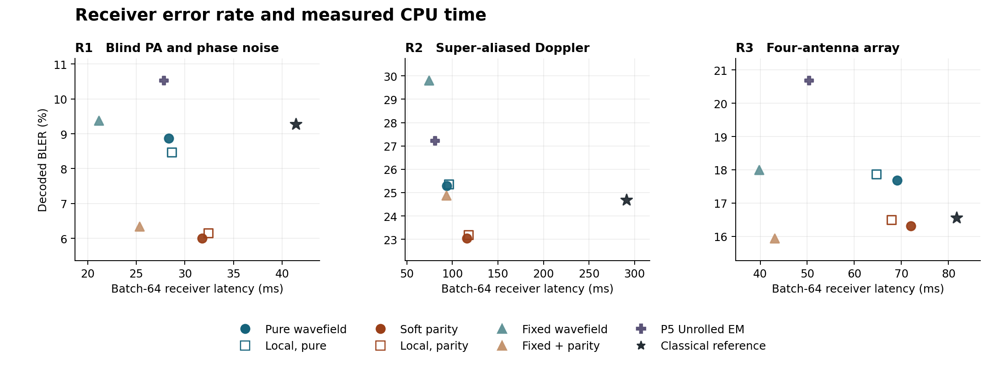
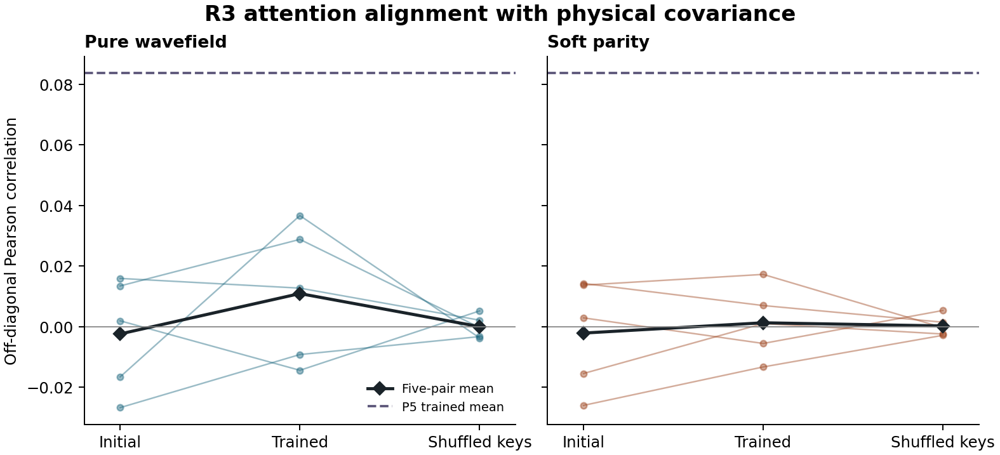

# Can a complex-operator EM receiver beat the P5 classical references?

**Complex-operator EM recorded fewer block errors than the strongest nonprivileged P5 classical reference in all three registered comparisons. None reached the prespecified Holm-adjusted 0.05 threshold.** In R2, SoftParity missed 1,659/7,200 blocks against 1,777 for Waveform-DD, with fewer errors in all five pairs. PureWavefield saved 13 blocks against Pilot-CPE-DD in R1. SoftParity saved four against Waveform-DD in R3, where the fixed parity solver performed better than the trained model.

Internal parity feedback accounted for a larger and more consistent change than changing the token mixer. In R1 it removed 92 errors relative to trained PureWavefield across ten of ten pairs (2.875 percentage points, Holm p = 0.03516). The matched local controls were competitive in every regime. R3 pure attention's mean covariance correlation was 0.01087 against 0.08362 for archived P5. Cross-generation BLER differences include the redesigned physical solver, the larger head and the different unroll and training budgets. [Paired effects and counts](results/summary.json)

## Paired link results

Every receiver in a regime saw the same eighty bursts per seed, with four complete codewords per R1/R3 burst and eighteen per R2 burst. All methods used the same outer LDPC decoder. P5's stored neural checkpoint for each pair and each regime-supported classical receiver were evaluated again on the same field and codeword tensors. The physical channel metric compares against the simulator's ideal propagation diagonal. A coherent PA gain or common-phase estimate can improve symbol detection while changing that metric. [Integer counts by pair](results/raw_by_seed.csv) · [Protocol](PROTOCOL.md)

### R1 · Blind PA drift and oscillator phase noise at 12 dB

<!-- r1 -->

| Receiver | Pre-decode errors / bits | Decoded errors / info bits | Block errors / blocks | CFR NMSE (dB) | Trainable real | B1 / B64 (ms) |
| --- | --- | --- | --- | --- | --- | --- |
| OpEM-PureWavefield | 36,107/409,600 (8.82%) | 1,140/204,800 (0.56%) | 284/3,200 (8.88%) | -10.544 | 1158 | 4.23 / 28.32 |
| OpEM-SoftParity | 32,980/409,600 (8.05%) | 671/204,800 (0.33%) | 192/3,200 (6.00%) | -10.653 | 1158 | 4.86 / 31.76 |
| OpEM-LocalConv (pure) | 35,939/409,600 (8.77%) | 1,114/204,800 (0.54%) | 271/3,200 (8.47%) | -10.662 | 1158 | 4.38 / 28.64 |
| OpEM-LocalConv (parity) | 32,962/409,600 (8.05%) | 687/204,800 (0.34%) | 197/3,200 (6.16%) | -10.679 | 1158 | 4.84 / 32.38 |
| OpEM-NoGauge (pure) | 35,958/409,600 (8.78%) | 1,092/204,800 (0.53%) | 274/3,200 (8.56%) | -10.548 | 1158 | 3.74 / 26.71 |
| Fixed wavefield | 36,496/409,600 (8.91%) | 1,223/204,800 (0.60%) | 300/3,200 (9.38%) | -10.559 | 0 | 2.82 / 21.14 |
| Fixed wavefield + parity | 33,225/409,600 (8.11%) | 734/204,800 (0.36%) | 203/3,200 (6.34%) | -10.685 | 0 | 3.17 / 25.31 |
| P5 Unrolled EM | 37,342/409,600 (9.12%) | 1,375/204,800 (0.67%) | 337/3,200 (10.53%) | -10.466 | 94 | 5.03 / 27.82 |
| Nominal Bussgang-LMMSE | 43,171/409,600 (10.54%) | 3,988/204,800 (1.95%) | 704/3,200 (22.00%) | -11.826 | 0 | 1.20 / 17.22 |
| Nominal IDD-PA | 41,912/409,600 (10.23%) | 3,863/204,800 (1.89%) | 675/3,200 (21.09%) | -11.886 | 0 | 3.85 / 41.28 |
| Pilot-CPE-DD | 36,526/409,600 (8.92%) | 1,214/204,800 (0.59%) | 297/3,200 (9.28%) | -10.558 | 0 | 4.04 / 41.41 |
| Genie-PA (privileged) | 36,048/409,600 (8.80%) | 1,109/204,800 (0.54%) | 275/3,200 (8.59%) | -12.149 | 0 | 4.23 / 53.09 |

<!-- end r1 -->

### R2 · Super-aliased Doppler at 9 dB

<!-- r2 -->

| Receiver | Pre-decode errors / bits | Decoded errors / info bits | Block errors / blocks | CFR NMSE (dB) | Trainable real | B1 / B64 (ms) |
| --- | --- | --- | --- | --- | --- | --- |
| OpEM-PureWavefield | 107,195/921,600 (11.63%) | 7,044/460,800 (1.53%) | 1,821/7,200 (25.29%) | -18.215 | 1158 | 5.11 / 93.75 |
| OpEM-SoftParity | 105,099/921,600 (11.40%) | 6,249/460,800 (1.36%) | 1,659/7,200 (23.04%) | -19.583 | 1158 | 6.07 / 115.92 |
| OpEM-LocalConv (pure) | 107,133/921,600 (11.62%) | 7,165/460,800 (1.55%) | 1,826/7,200 (25.36%) | -18.268 | 1158 | 5.43 / 96.10 |
| OpEM-LocalConv (parity) | 105,108/921,600 (11.40%) | 6,285/460,800 (1.36%) | 1,670/7,200 (23.19%) | -19.616 | 1158 | 5.94 / 117.63 |
| OpEM-NoGauge (pure) | 107,141/921,600 (11.63%) | 7,075/460,800 (1.54%) | 1,802/7,200 (25.03%) | -18.175 | 1158 | 4.86 / 91.00 |
| Fixed wavefield | 110,601/921,600 (12.00%) | 9,065/460,800 (1.97%) | 2,146/7,200 (29.81%) | -15.447 | 0 | 3.45 / 74.31 |
| Fixed wavefield + parity | 106,492/921,600 (11.56%) | 6,904/460,800 (1.50%) | 1,791/7,200 (24.88%) | -17.921 | 0 | 4.02 / 93.42 |
| P5 Unrolled EM | 108,366/921,600 (11.76%) | 7,733/460,800 (1.68%) | 1,960/7,200 (27.22%) | -17.709 | 94 | 5.11 / 80.79 |
| Tap-phase slope | 390,785/921,600 (42.40%) | 197,137/460,800 (42.78%) | 7,195/7,200 (99.93%) | 2.591 | 0 | 2.02 / 35.92 |
| 2D-LMMSE | 145,684/921,600 (15.81%) | 38,087/460,800 (8.27%) | 5,065/7,200 (70.35%) | -10.451 | 0 | 2.51 / 124.92 |
| Waveform-DD | 105,677/921,600 (11.47%) | 7,008/460,800 (1.52%) | 1,777/7,200 (24.68%) | -18.272 | 0 | 10.66 / 290.90 |

<!-- end r2 -->

### R3 · Four-antenna fractional-delay channel at 7 dB

<!-- r3 -->

| Receiver | Pre-decode errors / bits | Decoded errors / info bits | Block errors / blocks | CFR NMSE (dB) | Trainable real | B1 / B64 (ms) |
| --- | --- | --- | --- | --- | --- | --- |
| OpEM-PureWavefield | 16,514/204,800 (8.06%) | 1,951/102,400 (1.91%) | 283/1,600 (17.69%) | -12.629 | 1158 | 4.64 / 69.12 |
| OpEM-SoftParity | 15,404/204,800 (7.52%) | 1,757/102,400 (1.72%) | 261/1,600 (16.31%) | -12.940 | 1158 | 5.15 / 72.04 |
| OpEM-LocalConv (pure) | 16,487/204,800 (8.05%) | 1,948/102,400 (1.90%) | 286/1,600 (17.88%) | -12.616 | 1158 | 5.01 / 64.62 |
| OpEM-LocalConv (parity) | 15,387/204,800 (7.51%) | 1,771/102,400 (1.73%) | 264/1,600 (16.50%) | -12.924 | 1158 | 5.21 / 67.84 |
| OpEM-NoGauge (pure) | 16,540/204,800 (8.08%) | 1,969/102,400 (1.92%) | 286/1,600 (17.88%) | -12.625 | 1158 | 4.29 / 64.22 |
| Fixed wavefield | 16,656/204,800 (8.13%) | 1,977/102,400 (1.93%) | 288/1,600 (18.00%) | -12.620 | 0 | 2.81 / 39.80 |
| Fixed wavefield + parity | 15,489/204,800 (7.56%) | 1,747/102,400 (1.71%) | 255/1,600 (15.94%) | -12.946 | 0 | 3.36 / 43.05 |
| P5 Unrolled EM | 17,487/204,800 (8.54%) | 2,340/102,400 (2.29%) | 331/1,600 (20.69%) | -11.194 | 94 | 5.14 / 50.37 |
| 2D-LMMSE | 18,590/204,800 (9.08%) | 2,587/102,400 (2.53%) | 351/1,600 (21.94%) | -10.488 | 0 | 1.25 / 20.29 |
| Waveform-DD | 15,333/204,800 (7.49%) | 1,876/102,400 (1.83%) | 265/1,600 (16.56%) | -12.972 | 0 | 6.76 / 81.70 |

<!-- end r3 -->

Nominal IDD-PA and Pilot-CPE-DD have pilots, the nominal PA model and received samples. Genie-PA additionally receives the realized PA parameters. Waveform-DD in R2/R3 uses a sample-domain propagation fit and an internal decode/re-encode feedback pass with up to six LDPC iterations. Every P5-B parity variant uses one check-to-variable update. The pure variants use the code only in the shared terminal scorer. The original P5 waterfall validation on independent calibration bursts gave 84/384, 447/1,728 and 57/384 reference block errors in R1, R2 and R3 respectively. These operating points were reused unchanged. [P5 calibration and baseline definitions](../p5/P5_REPORT.md)

## Primary comparisons

Positive gain is the comparator's BLER minus the named arm's BLER. Each sign is one paired training seed and its test stream. The two-sided exact test counts ties in the tail. Holm adjustment uses the three primary tests. Sign flips require exchangeability under the null. With five pairs, the minimum possible two-sided p-value is 0.0625. No equivalence or noninferiority margin was set.

<!-- primary -->

| Regime | Arm | Comparator | Gain (pp) | W/T/L | Exact p | Holm p |
| --- | --- | --- | --- | --- | --- | --- |
| R1 | OpEM-PureWavefield | Pilot-CPE-DD | +0.4062 | 7/1/2 | 0.429688 | 0.859375 |
| R2 | OpEM-SoftParity | Waveform-DD | +1.6389 | 5/0/0 | 0.062500 | 0.187500 |
| R3 | OpEM-SoftParity | Waveform-DD | +0.2500 | 3/1/1 | 0.625000 | 0.859375 |

<!-- end primary -->

## What changed inside the receiver?

Two tied updates start from a pilot fit. R1 initializes per-symbol common phase from pilot rows and refits it against the predicted time waveform. R2/R3 use a public Doppler dictionary and a trajectory shared across receive antennas for each path. Every update fits ray amplitudes by regularized least squares, synthesizes the distorted receive waveform and subtracts predicted interference. These fixed operations are included in the two zero-parameter controls. They differ from the channel-gradient solver in the archived P5 network.

At each of P5's original 12, 32 or 48 token positions, the new head embeds six complex field features in twelve complex dimensions. Global propagation uses Hermitian attention with coordinate RoPE. The local control uses three-site convolutions along antenna, time and frequency, with identical learned projections, physical equations, reference map and optimizer schedule. Six readouts replace P5's three real step sizes. Five invariant complex coefficients drive a cubic/quintic correction on the 2× oversampled transmit waveform, per-symbol rotation, demapper precision, and signed adjacent-carrier residual mixing. The sixth readout carries the receive phase and directly updates the complex propagation diagonal. Linear interpolation in time and periodic linear interpolation across frequency spread knot values across the grid. [Model implementation](operator_em_transformer.py)

The radial correction is an adaptive deviation from the public nominal transmit map. It can change both AM–AM and AM–PM. R2 also has access to the same radial basis despite its linear simulated transmitter. The PA trajectory remains hidden from the network. The R3 covariance is used only for scoring. SoftParity computes extrinsic messages on payload bits using the public parity matrix and a normalization of 0.75. It uses the resulting priors in the soft-symbol posterior for the second waveform refit. The terminal demapper returns channel LLRs. [Parity implementation](parity.py)

### Matched controls

Each learned arm has 1,158 real trainable scalars and 1,158 frozen reference scalars. Subtraction of the initial head's output gives the physical solve at initialization with a live gradient. The two local controls have exactly the same count and output capacity as their attention counterparts. The eighteen prespecified ablations form one Holm family.

<!-- ablation -->

| Regime | Arm | Comparator | Gain (pp) | W/T/L | Exact p | Holm p |
| --- | --- | --- | --- | --- | --- | --- |
| R1 | OpEM-PureWavefield | OpEM-LocalConv (pure) | -0.4062 | 4/2/4 | 0.421875 | 1.000000 |
| R1 | OpEM-SoftParity | OpEM-LocalConv (parity) | +0.1562 | 4/5/1 | 0.250000 | 1.000000 |
| R1 | OpEM-PureWavefield | OpEM-NoGauge (pure) | -0.3125 | 4/2/4 | 0.562500 | 1.000000 |
| R1 | OpEM-SoftParity | OpEM-PureWavefield | +2.8750 | 10/0/0 | 0.001953 | 0.035156 |
| R1 | OpEM-PureWavefield | Fixed wavefield | +0.5000 | 8/0/2 | 0.332031 | 1.000000 |
| R1 | OpEM-SoftParity | Fixed wavefield + parity | +0.3438 | 7/0/3 | 0.425781 | 1.000000 |
| R2 | OpEM-PureWavefield | OpEM-LocalConv (pure) | +0.0694 | 3/0/2 | 0.812500 | 1.000000 |
| R2 | OpEM-SoftParity | OpEM-LocalConv (parity) | +0.1528 | 3/1/1 | 0.375000 | 1.000000 |
| R2 | OpEM-PureWavefield | OpEM-NoGauge (pure) | -0.2639 | 2/0/3 | 0.625000 | 1.000000 |
| R2 | OpEM-SoftParity | OpEM-PureWavefield | +2.2500 | 5/0/0 | 0.062500 | 1.000000 |
| R2 | OpEM-PureWavefield | Fixed wavefield | +4.5139 | 5/0/0 | 0.062500 | 1.000000 |
| R2 | OpEM-SoftParity | Fixed wavefield + parity | +1.8333 | 5/0/0 | 0.062500 | 1.000000 |
| R3 | OpEM-PureWavefield | OpEM-LocalConv (pure) | +0.1875 | 3/2/0 | 0.250000 | 1.000000 |
| R3 | OpEM-SoftParity | OpEM-LocalConv (parity) | +0.1875 | 2/2/1 | 0.750000 | 1.000000 |
| R3 | OpEM-PureWavefield | OpEM-NoGauge (pure) | +0.1875 | 3/1/1 | 0.500000 | 1.000000 |
| R3 | OpEM-SoftParity | OpEM-PureWavefield | +1.3750 | 5/0/0 | 0.062500 | 1.000000 |
| R3 | OpEM-PureWavefield | Fixed wavefield | +0.3125 | 4/0/1 | 0.500000 | 1.000000 |
| R3 | OpEM-SoftParity | Fixed wavefield + parity | -0.3750 | 1/0/4 | 0.375000 | 1.000000 |

<!-- end ablation -->

### Fixed-weight operator interventions

For each primary-tier fit, we suppressed an output group at both physical steps, preserving all other trained weights and the same waveforms. Positive changes below are **additional** block errors after suppression. The phase and precision are read from the same complex output and are suppressed together. Each effect includes downstream changes to the second physical iterate. Interacting effects need not sum to the all-off difference. [Per-pair counts and all-off verification](results/interventions.json)

<!-- interventions -->

| Suppressed at inference | R1 pure | R2 parity | R3 parity |
| --- | --- | --- | --- |
| Cubic and quintic PA | -3 (-0.094 pp) | +8 (+0.111 pp) | -2 (-0.125 pp) |
| Phase and precision | -11 (-0.344 pp) | +13 (+0.181 pp) | -4 (-0.250 pp) |
| Adjacent-carrier ICI | -4 (-0.125 pp) | +0 (+0.000 pp) | +0 (+0.000 pp) |
| Complex channel | +30 (+0.938 pp) | +158 (+2.194 pp) | -2 (-0.125 pp) |
| All learned outputs | +16 (+0.500 pp) | +132 (+1.833 pp) | -6 (-0.375 pp) |

<!-- end interventions -->

Removing the direct channel update cost 30 blocks in R1 and 158 in R2. Removing the radial correction saved three in R1, and removing the joint phase/precision output saved eleven. The R1 data support use of the direct complex channel update; they do not establish successful blind identification of PA drift by the radial branch. The fixed R1 solver already reduced the P5 full model's 337 errors to 300. Learning lowered that to 284, while training the matched local pure control lowered it further to 271.

In R2, learning lowered the fixed parity anchor from 1,791 errors to 1,659. The direct channel update had the largest measured effect. Suppressing the learned adjacent-carrier term produced the same pooled error count as the intact model in both R2 and R3. Equal pooled counts may hide offsetting individual errors. In R3, the fixed pure solver scored 288 errors, the fixed parity solver scored 255, and training the parity solver increased that number to 261. There the pooled advantage over Waveform-DD can already be obtained from the fixed physics and one parity update. No global-versus-local comparison passed correction. On all 200 batches, suppressing all learned outputs reproduced the corresponding fixed solver's LLRs and channel estimates bit-for-bit.

## CPU latency

SoftParity took **115.92 ms against 290.90 ms** for Waveform-DD at batch 64 in R2, a **2.51× speedup**. At batch 1 it took 6.07 against 10.66 ms (1.75×). For this regime the trained model offered lower measured latency and fewer errors in all five pairs. The earlier P5 neural receiver was still faster at batch 64 (80.79 ms) and missed 301 more blocks.

In R3 the advantage over Waveform-DD was smaller, **72.04 versus 81.70 ms** at batch 64 (1.13×), and 5.15 versus 6.76 ms at batch 1 (1.31×). The fixed parity solver gave both fewer errors (255 versus 261) and lower batch-64 latency (43.05 versus 72.04 ms) than trained SoftParity. In R1, PureWavefield was faster at batch 64 (28.32 versus 41.41 ms for Pilot-CPE-DD) and slightly slower at batch 1 (4.23 versus 4.04 ms). The latency advantage depends on both regime and batch size.

Timing used one PyTorch thread on a Core i7-1255U CPU. Each method received three warmups, then eleven timed calls per batch size. Method order was shuffled reproducibly within each timed round. All internal code feedback is included. Simulation, model construction and the shared final decoder are excluded. The paired table uses the new measurements for every receiver. Archived P5 milliseconds describe that earlier timing session. These are software implementation measurements on one host. [R1 samples](results/latency_r1.json) · [R2 samples](results/latency_r2.json) · [R3 samples](results/latency_r3.json)

## Does attention recover the physical covariance?

The R3 probe correlates actual attention probabilities with the magnitude of a conditional two-point covariance constructed from the simulated rays. It excludes diagonal coordinate pairs, averages the eight P5 probe bursts across the two tied steps, and reuses eight column permutations per layer for the shuffled control. P5 used the same 48 coordinates and probe frames with three unroll steps. The primary probe tier is PureWavefield. SoftParity is descriptive. [Per-seed scores and tests](results/r3_kernel.json)

<!-- probe -->

| Pair | Pure initial | Pure trained | Pure shuffled | Parity initial | Parity trained | Parity shuffled | P5 trained |
| --- | --- | --- | --- | --- | --- | --- | --- |
| 1 | 0.00188 | -0.01445 | 0.00515 | 0.00286 | -0.00559 | 0.00530 | 0.09681 |
| 2 | -0.02677 | -0.00925 | -0.00332 | -0.02604 | -0.01334 | -0.00290 | 0.08313 |
| 3 | 0.01588 | 0.01267 | 0.00209 | 0.01421 | 0.00692 | 0.00142 | 0.06753 |
| 4 | -0.01662 | 0.03662 | -0.00377 | -0.01551 | 0.00098 | -0.00248 | 0.14014 |
| 5 | 0.01340 | 0.02876 | -0.00034 | 0.01366 | 0.01720 | -0.00038 | 0.03046 |
| Mean | -0.00245 | 0.01087 | -0.00004 | -0.00216 | 0.00123 | 0.00019 | 0.08362 |

<!-- end probe -->

Pure alignment rose from −0.00245 to 0.01087, improving in three of five seeds (Holm p = 0.75). Its trained-minus-shuffled difference was +0.01091 (Holm p = 0.75). It missed the 0.084 target and fell below P5's trained correlation in all five matched seeds, with a paired mean difference of −0.07275 (raw p = 0.0625, Holm p = 0.1875). Parity's trained mean was 0.00123. These data give little evidence of stronger spatial-spectral covariance alignment. Shuffling score columns evaluates alignment with coordinate labels; it does not intervene on live receiver inference.

## Training and numerical evidence

The development pair 901 was disjoint from all formal pairs. In R1, attention validation BCE moved from 0.23389 to 0.21853 for PureWavefield and from 0.20621 to 0.20095 for SoftParity. In R2 the corresponding changes were 0.27728 to 0.26163 and 0.26319 to 0.25722. The formal fits used precisely 64 Adam steps at 0.003, four bursts per step, and the final iterate. The table gives mean validation BCE over the formal pairs. Improvement over a finite schedule cannot establish convergence to an optimum. [Development traces](results/development/pilot_comparison.json) · [Frozen source identities](results/freeze.json)

<!-- training -->

| Regime | Arm | 0 | 16 | 32 | 48 | 64 | Pairs improving |
| --- | --- | --- | --- | --- | --- | --- | --- |
| R1 | OpEM-PureWavefield | 0.21295 | 0.20648 | 0.20456 | 0.20470 | 0.20361 | 9/10 |
| R1 | OpEM-SoftParity | 0.19026 | 0.18970 | 0.18925 | 0.18815 | 0.18784 | 9/10 |
| R1 | OpEM-LocalConv (pure) | 0.21295 | 0.20534 | 0.20362 | 0.20395 | 0.20259 | 10/10 |
| R1 | OpEM-LocalConv (parity) | 0.19026 | 0.18958 | 0.18927 | 0.18806 | 0.18769 | 10/10 |
| R1 | OpEM-NoGauge (pure) | 0.21295 | 0.20547 | 0.20553 | 0.20457 | 0.20347 | 10/10 |
| R2 | OpEM-PureWavefield | 0.26759 | 0.25668 | 0.25541 | 0.25505 | 0.25490 | 5/5 |
| R2 | OpEM-SoftParity | 0.25456 | 0.25053 | 0.25024 | 0.25034 | 0.25003 | 5/5 |
| R2 | OpEM-LocalConv (pure) | 0.26759 | 0.25597 | 0.25530 | 0.25514 | 0.25516 | 5/5 |
| R2 | OpEM-LocalConv (parity) | 0.25456 | 0.25035 | 0.25028 | 0.25045 | 0.25016 | 5/5 |
| R2 | OpEM-NoGauge (pure) | 0.26759 | 0.25752 | 0.25599 | 0.25569 | 0.25505 | 5/5 |
| R3 | OpEM-PureWavefield | 0.19487 | 0.18735 | 0.18689 | 0.18570 | 0.18533 | 5/5 |
| R3 | OpEM-SoftParity | 0.17941 | 0.17638 | 0.17601 | 0.17511 | 0.17528 | 5/5 |
| R3 | OpEM-LocalConv (pure) | 0.19487 | 0.18680 | 0.18639 | 0.18535 | 0.18502 | 5/5 |
| R3 | OpEM-LocalConv (parity) | 0.17941 | 0.17642 | 0.17592 | 0.17499 | 0.17506 | 5/5 |
| R3 | OpEM-NoGauge (pure) | 0.19487 | 0.18899 | 0.18807 | 0.18677 | 0.18631 | 5/5 |

<!-- end training -->

For a gain $g=r e^{i\phi}$, pilot RMS scales by $r$. The normalized receive field, its channel estimate, and the head's value messages rotate by $e^{i\phi}$. A real Hermitian score, the conjugate-reference products and equalized transmit symbols are invariant. Radial functions commute with rotation, and the complex channel output inherits the common phase. Putting back the burst scale yields $\hat h(gy)=g\hat h(y)$ when noise variance scales by $r^2$. Erasures use observed power, noise or a neutral zero-field fallback. The NoGauge arm removes pilot scaling and token RMS.

The initial diagnostic passed random gains and erasures but revealed a limitation when tested on constructed pilot degeneracies. R1's opposite pilot rows could select either half-turn. R2/R3 could select different mirrored Doppler hypotheses after a gain change. The amended solver chooses the positive half-turn or first numerically tied candidate using relative floating-point tie tolerances. Both development tables reproduced identically after the repair. At the repaired boundary, all three constructed cases together had zero coded flips in 26,624 decisions, with maximum grid LLR deviation 7.82 × 10⁻¹⁴. The negative cases and the original receipts are retained. [Before/after fixtures](results/antipodal_repair.json) · [Development evidence](results/development)

On the first formal training batch of each regime, all 1,158 real gradient entries were nonzero in all five learned arms. The preflight checked one central finite-difference direction per parameter tensor, sixty directions in total. The gauge-enabled models agreed bit-for-bit with their respective fixed solvers at initialization. The NoGauge arm, which computes the same initial physical equations in different units, agreed to floating-point precision. The receiver retains the P5 demapper's machine-epsilon variance guard for noiseless inputs, a positive-noise LS regularizer and bounded learned operators. BLER, BER, NMSE and gain discrepancies are reported from the measured values. [Preflight measurements](results/preflight.json) · [Invariant and parity tests](tests/test_p5b_invariants.py)

The three one-thread training workers completed the formal sweep in 105.1 seconds of elapsed time, including held-out scoring. Each worker's per-pair times are recorded separately. Replay loaded all 100 final checkpoints, regenerated 200 batches, and reproduced all 225 complete score records, both R3 probe tiers, and every stored field/payload digest exactly. All eight scores and denominators in each of the 85 re-evaluated archived neural and classical pair rows agreed with P5. The replay re-created observations and predictions from the trained weights; it did not repeat optimization. During fitting a diagnostic-only edit for an additional post-fit reference audit was restored byte-for-byte to the prospectively recorded version. The extra check lives in a separate script. The fitted model, data generator, runner and protocol kept their frozen identities. [Sweep receipt](results/sweep_run.json) · [Checkpoint replay](results/checkpoint_replay.json) · [Checkout verification](results/checkout_verification.json)

The final gain audit covered all 40 PureWavefield and SoftParity checkpoints. It applied gains from 2⁻¹² through 2¹², 10⁻³⁵ and 10²⁰ to intact observations, and extreme and unit gains to first-row, last-row, all-pilot and complete-field erasures. It observed **0/2,995,200 coded flips**, maximum absolute grid ΔLLR **1.8474 × 10⁻¹³**, and maximum relative CFR L2 error **1.025 × 10⁻¹⁵**. Whole-field erasures gave exactly zero outputs with both positive and zero noise variance at all 40 checkpoints. These are measured finite-precision bounds on the exercised inputs. The largest first-batch finite-difference discrepancy was 4.372 × 10⁻⁸. All 100 learned arms retained their initial frozen tensors and changed all four live parameter tensors. [Final gain receipt](results/trained_gauge.json) · [Frozen references](results/frozen_reference.json)

## Scope

Final native verification passed all 13 P5-B tests and all 15 archived P5 tests. The P4 publication verifier exited 0. The checkout remained at `8380084`, the tracked and staged diffs were empty, and the before/after SHA-256 inventories of all 138 archived P5 files were identical. [Command outputs and durations](results/checkout_verification.json)

This is a paired evaluation on a synthetic 32-carrier, 16-QAM link using a short (128,64) LDPC code. The P5 benchmark outcomes informed the architecture. There are five independent pairs in two regimes. The learned cross-carrier operator uses the adjacent tones with global context. The scalar covariance target describes neither the complete complex Green's operator nor the phases of the ICI matrix. The fixed-weight interventions test reliance on output groups within these fits. They do not measure identification of the transmitter's true nonlinearity, performance on measured radio signals, hardware energy, or out-of-distribution generalization.
