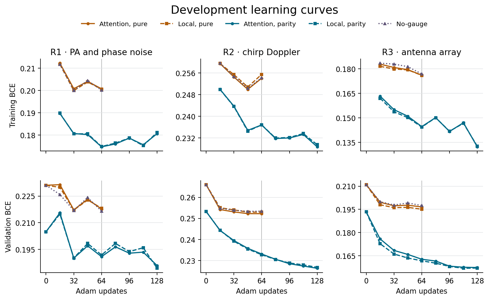

# Phase 6 · Development iteration 1

The full-frame receiver improved decoded block error rates in R2 and R3. Most of the parity gain was shared by the parameter-matched local receiver. At the primary two-step, 64-update setting, attention had one more block error in R1 and two fewer in each of R2 and R3 than local. Its largest advantage over local was in R2 without parity, with 430 versus 447 errors on 1,728 words.

## Primary comparison

Each regime uses 96 bursts, drawn as one batch of 32 per pair on validation stream 6. This reproduced the three supplied fixed-parity counts. An initial construction using four separately seeded batches of eight per pair produced 31, 438 and 65 errors. Its receipts are retained in `results/initial_four_batches/`. All tables below use the single B32 draw. The supplied oracle and AWGN results were not recomputed.

Primary fits used 64 Adam updates at LR 0.003, a training batch of four, a gradient norm limit of one, BCE, and two weight-tied EM steps. Attention and local used identical seeds, features, centering, physics handles, parity rounds, supervision and schedules. Both have 236 trainable real parameters and 236 frozen reference parameters. Fit time is mean seconds per pair, including stream-5 simulation and the optimizer update. Three single-thread workers shared the CPU.

### R1 · blind PA and phase noise · 12 dB

| Receiver | Failed / total words | BLER | Pre-BER | CFR NMSE (dB) | Payload BCE | Fit (s/pair) |
| --- | --- | --- | --- | --- | --- | --- |
| Fixed physics | 39 / 384 | 10.16% | 9.17% | -10.25 | 0.22150 | — |
| Fixed physics + parity | 32 / 384 | 8.33% | 8.39% | -10.26 | 0.19536 | — |
| Axial pure | 44 / 384 | 11.46% | 9.07% | -10.39 | 0.21050 | 5.01 |
| Local pure | 47 / 384 | 12.24% | 9.16% | -10.41 | 0.21118 | 4.52 |
| Axial parity | 32 / 384 | 8.33% | 7.86% | -10.14 | 0.18432 | 5.16 |
| Local parity | 31 / 384 | 8.07% | 7.85% | -10.19 | 0.18442 | 4.49 |
| Axial no-gauge | 43 / 384 | 11.20% | 9.13% | -10.43 | 0.21047 | 4.63 |
| nominal_bussgang_lmmse | 94 / 384 | 24.48% | 10.87% | -11.63 | 0.25730 | — |
| nominal_idd_pa | 81 / 384 | 21.09% | 10.64% | -11.72 | 0.27372 | — |
| pilot_cpe_dd | 40 / 384 | 10.42% | 9.17% | -10.24 | 0.22261 | — |
| Genie PA (privileged classical) | 38 / 384 | 9.90% | 9.10% | -11.53 | 0.21814 | — |

### R2 · three-path chirp Doppler · 9 dB

| Receiver | Failed / total words | BLER | Pre-BER | CFR NMSE (dB) | Payload BCE | Fit (s/pair) |
| --- | --- | --- | --- | --- | --- | --- |
| Fixed physics | 547 / 1728 | 31.66% | 12.02% | -15.58 | 0.26775 | — |
| Fixed physics + parity | 439 / 1728 | 25.41% | 11.60% | -18.22 | 0.25418 | — |
| Axial pure | 430 / 1728 | 24.88% | 11.55% | -19.13 | 0.25221 | 11.19 |
| Local pure | 447 / 1728 | 25.87% | 11.64% | -18.73 | 0.25389 | 9.57 |
| Axial parity | 425 / 1728 | 24.59% | 10.25% | -18.86 | 0.23274 | 11.87 |
| Local parity | 427 / 1728 | 24.71% | 10.23% | -18.78 | 0.23266 | 10.12 |
| Axial no-gauge | 439 / 1728 | 25.41% | 11.61% | -19.03 | 0.25267 | 10.09 |
| tap_phase_slope | 1727 / 1728 | 99.94% | 42.24% | 2.61 | 2.63391 | — |
| lmmse_2d | 1220 / 1728 | 70.60% | 15.67% | -10.77 | 0.33416 | — |
| waveform_dd | 446 / 1728 | 25.81% | 11.54% | -18.49 | 0.25433 | — |

### R3 · four-antenna fractional-delay channel · 7 dB

| Receiver | Failed / total words | BLER | Pre-BER | CFR NMSE (dB) | Payload BCE | Fit (s/pair) |
| --- | --- | --- | --- | --- | --- | --- |
| Fixed physics | 72 / 384 | 18.75% | 8.51% | -12.53 | 0.20063 | — |
| Fixed physics + parity | 66 / 384 | 17.19% | 7.94% | -12.86 | 0.18392 | — |
| Axial pure | 62 / 384 | 16.15% | 8.06% | -13.09 | 0.18278 | 14.44 |
| Local pure | 59 / 384 | 15.36% | 8.03% | -13.10 | 0.18190 | 11.97 |
| Axial parity | 55 / 384 | 14.32% | 6.18% | -12.92 | 0.14832 | 14.75 |
| Local parity | 57 / 384 | 14.84% | 6.12% | -12.96 | 0.14839 | 12.50 |
| Axial no-gauge | 62 / 384 | 16.15% | 8.11% | -13.07 | 0.18328 | 13.55 |
| lmmse_2d | 83 / 384 | 21.61% | 9.47% | -10.25 | 0.21338 | — |
| waveform_dd | 65 / 384 | 16.93% | 7.97% | -12.89 | 0.18231 | — |

BLER uses the public min-sum decoder with up to 12 iterations. Pre-BER counts hard coded-bit decisions before decoding. NMSE pools squared channel error and truth energy before converting to dB. The R1 returned channel includes fitted common phase and removes the nominal coherent PA gain once. Its truth target describes propagation alone, so oscillator mismatch can affect NMSE. The R1 classical genie receives the realized PA parameters.

## Solver depth and training budget

Each cell below gives pooled attention / local block errors with parity. Budgets 64, 96 and 128 are checkpoints on the same constant-LR trajectories. The depth-three fits used the same train batches and update count as the depth-two primary fits. The fixed-depth column measures the extra EM step in the archived fixed solver on the same frames.

| Regime | 2 steps, 64 updates | 2 steps, 96 updates | 2 steps, 128 updates | 3 steps, 64 updates | Fixed + parity, 2 → 3 steps |
| --- | --- | --- | --- | --- | --- |
| R1 | 32 / 31 | 28 / 26 | 33 / 35 | 26 / 25 | 32 → 29 |
| R2 | 425 / 427 | 430 / 422 | 443 / 441 | 418 / 418 | 439 → 429 |
| R3 | 55 / 57 | 55 / 53 | 56 / 54 | 57 / 57 | 66 → 65 |

A third pass reduced R1 and R2 errors for both learned arms. R3 attention rose from 55 to 57 errors and local stayed at 57. R2 attention BCE improved from 0.23274 at update 64 to 0.22530 at update 128 while the number of failed words rose from 425 to 443. R3 also reached its lowest attention BCE at 128, with 56 failed words versus 55 at 64.

### Pair 901 optimizer screen

Each cell gives attention / local block errors after 64 updates. Each column changes one setting from the primary design. Warmup lasts four updates, followed by cosine decay to one tenth of peak LR. The auxiliary objective adds 0.05 times channel NMSE using training truth.

| Regime | Primary | LR 0.005 | Warmup + cosine | Auxiliary NMSE | Unclipped |
| --- | --- | --- | --- | --- | --- |
| R1 | 11 / 10 | 9 / 9 | 10 / 10 | 11 / 10 | 11 / 10 |
| R2 | 170 / 172 | 165 / 175 | 162 / 162 | 171 / 171 | 170 / 172 |
| R3 | 14 / 14 | 15 / 15 | 13 / 14 | 14 / 14 | 14 / 14 |

Learning curves average three pairs. Each training point averages 16 successive B4 updates. Validation curves use a B8 draw with the same stream-6 seed as the B32 score. They have different sample composition. Numerical traces, per-pair scores and optimizer gradient norms are in the JSON report.

## R3 Green-kernel probe

The joint matrix is the product of the actual conditional frequency, time and antenna softmax entries along their shared path. Values are sampled at the 48 archived coordinates after full-grid inference. Overall Pearson uses all 2,256 off-diagonal entries. The axis-only column restricts the trained comparison to pairs that differ only on the indicated axis. Each result averages 24 stream-8 bursts and two EM steps. The shuffled column permutes keys using stream 9. Local convolution has no softmax matrix.

| Arm | Kernel | Initial | Trained | Trained shuffled | Trained axis-only |
| --- | --- | --- | --- | --- | --- |
| Axial pure | joint | 0.02403 | 0.01918 | 0.00017 | — |
| Axial pure | spatial | 0.01819 | 0.01565 | -0.00077 | -0.01377 |
| Axial pure | time | -0.00704 | -0.00654 | 0.00078 | 0.09465 |
| Axial pure | frequency | 0.02945 | 0.03127 | 0.00188 | -0.03299 |
| Axial parity | joint | 0.02356 | 0.02546 | 0.00079 | — |
| Axial parity | spatial | 0.01929 | 0.01384 | -0.00075 | 0.00981 |
| Axial parity | time | -0.00651 | -0.00659 | 0.00119 | 0.11379 |
| Axial parity | frequency | 0.02744 | 0.04892 | 0.00225 | -0.02750 |

Parity’s joint correlation rose by 0.00189. Its frequency component rose from 0.02744 to 0.04892, while its spatial component fell from 0.01929 to 0.01384. The trained joint value of 0.02546 remained below the supplied P5 value of 0.084. Pure attention’s joint correlation decreased. The inspected path excludes the residual and pointwise MLP branches, so this probe measures attention alignment only.

## Physical-handle interventions

Each intervention suppressed one family throughout both passes of a trained pair-901 receiver. Both architectures were rescored on the same 32 B32 validation bursts. All six full-model scores replayed, and zeroing every learned handle reproduced the archived fixed-parity scores. The table gives changes in failed words relative to each full receiver. Positive values mean suppression made the result worse.

| Suppressed family | R1 attention / local | R2 attention / local | R3 attention / local |
| --- | --- | --- | --- |
| PA forward, inverse and radial calibration | -2 / -1 | — | -1 / -1 |
| Per-path phase | — | +8 / +7 | 0 / +1 |
| Fractional delay | 0 / 0 | -1 / 0 | +3 / +3 |
| Spatial shrinkage and IRC | — | — | 0 / +1 |
| Common phase | 0 / 0 | 0 / -11 | +1 / +1 |
| Time-frequency channel residual | +1 / 0 | -5 / -4 | -2 / -3 |
| Free log-variance | -1 / 0 | -3 / -9 | 0 / 0 |

R2 trajectory suppression added eight attention errors and seven local errors. R3 delay suppression added three for each arm. R1 PA suppression reduced errors from 11 to 9 for attention and from 10 to 9 for local. The R3 spatial intervention changed the two counts by zero and one, respectively. These are one-pair, fixed-weight interventions. Their effects interact within the EM solver. Both architectures also share global physical reductions and the waveform solve, even though the local backbone’s temporal mixing has one-hop support.

## Single-thread receiver latency

Median milliseconds for one burst / a batch of 64 bursts. Each method had one warmup and five timed forwards in shuffled order. Timings exclude simulation and the final LDPC decode. The fit workers and the separate checkpoint audit had finished before latency measurement. Timing samples and every classical receiver are in the JSON.

| Receiver | R1 B1 / B64 (ms) | R2 B1 / B64 (ms) | R3 B1 / B64 (ms) |
| --- | --- | --- | --- |
| Fixed + parity | 12.6 / 88.0 | 16.8 / 240.3 | 23.0 / 162.2 |
| 2-step attention + parity | 38.8 / 291.6 | 45.4 / 1316.2 | 73.1 / 1515.5 |
| 2-step local + parity | 31.9 / 309.9 | 31.9 / 1064.3 | 60.0 / 1042.8 |
| 3-step attention + parity | 61.9 / 473.9 | 60.4 / 1824.8 | 96.7 / 2393.7 |
| 3-step local + parity | 50.8 / 388.9 | 45.5 / 1633.3 | 81.7 / 1804.8 |

## Numerical and isolation checks

- All seven P6 tests passed. At depths two and three, every learned arm matched its P6 fixed counterpart bit-for-bit at initialization. The largest initialized LLR difference from the archived solver on the positive-noise fixtures was 5.68e-14.
- All 236 real gradient components were finite and active in each of 15 regime–arm combinations. The directional check uses one fixed direction for each trainable tensor, 75 directions in total. The radial bound has first-order central-difference truncation error at the centered origin. Maximum absolute errors at half-widths 1e-5, 1e-6 and 1e-7 were 7.97e-7, 7.97e-8 and 7.52e-9.
- The 18 trained, step-64 checkpoints passed 180 finite-noise, gain, erasure, zero-noise and degenerate-pilot checks on pair 901. There were zero flips in 2,156,544 coded decisions. Maximum absolute LLR error was 2.27e-13 and maximum relative channel L2 error was 1.14e-15. After one update, the supplemental pair-902/903 audit also had zero flips over 2,875,392 decisions.
- At exactly zero reported thermal noise, informed P6 LLRs use signed log-precision of magnitude 36.04. Ties and uninformed outputs remain zero. The archived zero-noise demapper uses an epsilon variance floor. Primary dev scores use positive thermal noise. The PA inverse is a learned, bounded radial correction to equalized symbols.
- The unchanged P5 and P5-B test bodies passed 15/15 and 13/13 with waveform fixtures redirected to allowed development seeds. The unchanged P4 publication verifier passed its historical evidence checks. The independent result audit reconstructed the final pooled metrics from the 96 job receipts.
- All Phase 6 waveform draws used pairs 901–903. Training used stream 5, validation used stream 6, and the R3 probe used streams 8/9. Iteration 1 stopped before protocol lock or formal cohort evaluation.

[Machine-readable report](results/dev_iter1.json) · [Printed tables](results/dev_summary.txt) · [Verification receipt](results/verification.json) · [Trained gauge audit](results/extended_trained.json) · [Intervention details](results/handle_ablation.json)

