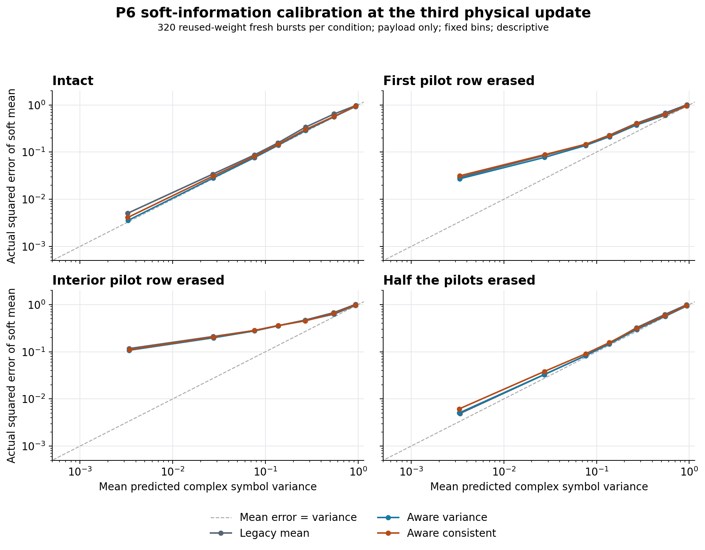

# P6 后续研究：失效导频观测模型与软信息一致性

日期：2026-11-19。状态：**观测语义及加权物理更新已修正；已完成新样本机制验证；完整候选未证明主性能胜出，且有一项严格数值检查未通过。**

## 1. 主要结论

本轮按‘先修正观测模型、再检查软均值/方差、再统一物理更新与最终解调’的顺序完成。交错擦除条件中，原版加入方差后多错183个码块；观测修正组加入方差后少错68个码块。两者的交互效应为251/5760＝4.3576个百分点，10个检查点/波形簇方向一致，预设Holm校正p＝0.00390625。这支持观测处理会显著改变方差项的实际效果。

但完整一致方案相对同样获得擦除元数据的‘观测修正＋方差’，仅少错9/5760个码块，BLER降低0.1563个百分点，4簇改善、6簇恶化，Holm p＝0.634765625。它在交错擦除下仍比原Trust多错64块（1334对1270）。交互效应的显著性不能改写成整体接收机胜出，也不能证明某一单独模块是唯一原因。

完整导频下，完整一致方案比原Trust少错89/5760块，BLER由20.6944%降至19.1493%，十簇均改善；这是预先保留的描述性条件，不是本轮两项主要性能检验之一。候选还存在一次1.00897e-12的LLR复增益误差，超过原1e-12门槛。当前证据适合发布修正代码与研究结果，尚不足以替换默认接收机。

## 2. 已修正的观测模型

旧压力测试是在接收FFT之后，将选定样本的信号和噪声一起乘以增益。因此已知非零增益可以逆变换；零增益表示该接收方程缺失，不能当成‘可靠观测到零’。同时，发送端的导频符号依然已知，其软均值仍等于导频、方差仍为零；删除接收观测行不应改变发送导频掩码、载荷位置或码块划分。

修正贯穿有效导频归一化、只用有效子字典的初始化、按保留导频比例加权的相位字典匹配、频域物理拟合与解调。Fisher可靠性仍以完整发送导频孔径为参考，不把缺失后的孔径重新当作完整孔径。固定神经头的缺失观测特征以当前对角预测均值补入，创新量为零；补值不进入似然。这一特征处理仍是适配旧权重的工程近似。

每个aware方法都得到相同的真实腐败增益图，这是诊断用额外信息，尚未实现盲擦除识别。它也不是数学意义上的性能上界。跨legacy/aware比较同时改变了信息可用性和观测处理。对于首行×0.4，各aware方法均恢复其完整导频计数；全部200个检查点/批次/方法对照的整数结果一致。这验证了已知数字乘法的逆处理，不代表挽回了物理信道衰减造成的SNR损失。[机制检查](results/mechanism_checks.json)保存浮点差异和所有对照。

## 3. 实际数学改动

**加权期望物理更新。** 固定相位/时延后，使用完整频域射线算子`B_p = cpe F diag(rot_p) F^H diag(basis_p)`及接收权重W，最小化`E_q ||sqrt(W)(y-(sum a_p B_p + diag(delta_h))x)||² + aᴴΛa`。期望Gram保留跨射线和频率耦合项。将学习残差delta_h纳入同一个模型时，右端不仅减去其均值贡献，还减去符号方差产生的交叉项。该恒等式由有限QAM联合枚举、显式DFT和独立增广最小二乘检查。

**统一软信息与读出。** 原标量解调只用N0/|h|²，未完整表达残余ICI。新cavity版本使用完整有效算子G，构造`C=N0 I+Gw V Gwᴴ`，其中`Gw=sqrt(W)G`。令`t=Gwᴴ C⁻¹(yw-Gw m)`、`s=diag(Gwᴴ C⁻¹ Gw)`，得到`z=m+t/s`、`tau=1/s-v`。它们与逐符号删除自身高斯先验后的显式逆矩阵一致。再由有限16-QAM星座计算均值与方差；最终读出保留原max-log公式，且不重复加入本符号的码先验。

码先验只来自上一轮channel LLR的校验外信息。同一轮重解调共用同一先验，最终使用最新G；上一轮消息是在幅度更新前取出，因此存在明确的一轮时序。本方法同时改变完整干扰似然和外信息时序，不能把全部效果归因于一个标量方差修正。proper复高斯、对角符号协方差、重复使用观测的外循环都是近似；未边缘化信道/相位参数的不确定性。详见[数学说明](MATH.md)。

## 4. 冻结设计与全部错误率

R2线性时变信道，9 dB，20×32二维OFDM，16-QAM，(128,64) LDPC，单接收天线。复用pair06–15的十组权重，不重新训练。每组4个B8新批次，共320个burst，每条件/方法5760块、737280编码比特、368640信息比特。五种条件重复使用同一组波形，不能当作五倍独立样本。种子为814611190000＋1000×index＋batch。[协议](PROTOCOL.md)和[冻结清单](FREEZE.json)在新评分前固定，属于本会话内前瞻冻结，非外部预注册。

七个方法沿同一组旧权重和三轮Trust相位规则作消融：原均值、原方差、观测修正均值、观测修正方差、进一步纳入有效delta_h、cavity但幅度更新不用方差、完整一致方案。这轮未叠加上一轮剖面Hessian相位精修，未重测Smooth、固定先验或场景匹配先验经典基线。

### 译码块错误数（分母均为5760）

| 条件 | 原Trust | 原版＋方差 | 观测修正 | 观测修正＋方差 | 再统一有效算子 | cavity仅均值 | 完整一致方案 |
| --- | --- | --- | --- | --- | --- | --- | --- |
| 完整导频 | 1192 (20.694%) | 1170 (20.312%) | 1192 (20.694%) | 1170 (20.312%) | 1139 (19.774%) | 1240 (21.528%) | 1103 (19.149%) |
| 首行×0.4 | 1241 (21.545%) | 1272 (22.083%) | 1192 (20.694%) | 1170 (20.312%) | 1139 (19.774%) | 1240 (21.528%) | 1103 (19.149%) |
| 首行擦除 | 1933 (33.559%) | 1954 (33.924%) | 2051 (35.608%) | 1909 (33.142%) | 1908 (33.125%) | 2199 (38.177%) | 1925 (33.420%) |
| 中间行擦除 | 2131 (36.997%) | 2158 (37.465%) | 2171 (37.691%) | 2128 (36.944%) | 2103 (36.510%) | 2256 (39.167%) | 2113 (36.684%) |
| 交错擦除一半 | 1270 (22.049%) | 1453 (25.226%) | 1411 (24.497%) | 1343 (23.316%) | 1334 (23.160%) | 1531 (26.580%) | 1334 (23.160%) |

### 译码前编码比特BER

| 条件 | 原Trust | 原版＋方差 | 观测修正 | 观测修正＋方差 | 再统一有效算子 | cavity仅均值 | 完整一致方案 |
| --- | --- | --- | --- | --- | --- | --- | --- |
| 完整导频 | 10.94442% | 10.89505% | 10.94442% | 10.89505% | 10.86019% | 10.94469% | 10.72876% |
| 首行×0.4 | 10.91417% | 10.96748% | 10.94442% | 10.89505% | 10.86019% | 10.94469% | 10.72876% |
| 首行擦除 | 12.74292% | 12.71918% | 12.92955% | 12.70413% | 12.69491% | 13.15999% | 12.71172% |
| 中间行擦除 | 14.85881% | 14.86138% | 14.96324% | 14.81106% | 14.80876% | 15.08260% | 14.79004% |
| 交错擦除一半 | 11.03760% | 11.36122% | 11.20280% | 11.08643% | 11.05808% | 11.34101% | 11.02607% |

完整导频下，原Trust/观测修正＋方差/完整一致方案的CFR NMSE依次为-22.1850/-24.2486/-24.7727 dB。全部信息比特BER、NMSE及逐批计数见[summary.json](results/summary.json)与[原始记录](results/fresh)。不同研究轮次使用不同波形，不直接相减前一轮与本轮的错误计数。

## 5. 两项预设主检验

均在交错擦除条件上，以十个检查点/新波形簇为单位，精确枚举1024种配对符号翻转，对两项检验作Holm校正。检验依赖零假设下簇效应符号可交换/对称；区间为十簇下近似、未作同时校正的点态t95区间。

| 预设主检验 | 效应（百分点） | 点态95%区间 | 有利/平/不利簇 | Holm p |
| --- | --- | --- | --- | --- |
| 观测处理×方差交互 | +4.3576 | [+3.3564, +5.3588] | 10/0/0 | 0.00390625 |
| 完整一致方案相对观测修正＋方差 | +0.1562 | [-0.4916, +0.8041] | 4/0/6 | 0.63476562 |

第一项是差中之差：`(原方差−原均值)−(修正方差−修正均值)`；它不能解释成完整方案直接降低了4.36个百分点BLER。十簇交互差值为`[29,18,27,24,37,16,19,27,38,16]`个块。第二项在相同元数据条件下比较完整方案与修正方差，十簇差值为`[-1,3,10,8,-4,-2,-3,-3,-4,5]`。其不显著不构成等价或非劣证明。其余条件、消融、BER、NMSE、BCE及校准均为描述性结果。

## 6. 软均值和方差是否可信

在真正用于第三次物理更新的软信息上，统计载荷符号的预测复方差与实际软均值平方误差。理想匹配需要误差与方差相称，但总体比值接近1只是很弱的校准检查，不能替代分箱、BCE及BER/BLER。

| 条件 | 方法 | 平均预测方差 | 软均值实际MSE | MSE/方差 | 最终比特BCE |
| --- | --- | --- | --- | --- | --- |
| 完整导频 | 原Trust | 0.085059 | 0.100064 | 1.1764 | 0.241987 |
| 完整导频 | 观测修正＋方差 | 0.096151 | 0.098518 | 1.0246 | 0.241181 |
| 完整导频 | 完整一致方案 | 0.094050 | 0.100815 | 1.0719 | 0.238648 |
| 首行擦除 | 原Trust | 0.092867 | 0.161639 | 1.7405 | 0.309119 |
| 首行擦除 | 观测修正＋方差 | 0.102797 | 0.160676 | 1.5630 | 0.304054 |
| 首行擦除 | 完整一致方案 | 0.101930 | 0.170572 | 1.6734 | 0.307535 |
| 中间行擦除 | 原Trust | 0.088880 | 0.270452 | 3.0429 | 0.490450 |
| 中间行擦除 | 观测修正＋方差 | 0.098599 | 0.272514 | 2.7639 | 0.465136 |
| 中间行擦除 | 完整一致方案 | 0.097113 | 0.276421 | 2.8464 | 0.475470 |
| 交错擦除一半 | 原Trust | 0.093389 | 0.105660 | 1.1314 | 0.245191 |
| 交错擦除一半 | 观测修正＋方差 | 0.097438 | 0.104889 | 1.0765 | 0.247446 |
| 交错擦除一半 | 完整一致方案 | 0.096634 | 0.111400 | 1.1528 | 0.247082 |

交错擦除初次更新的平均预测方差由原版的0.280210降至观测修正后的0.151320，说明旧观测处理确实改变了进入物理更新的不确定性规模。但原方差版本在该条件下的最终总体MSE/方差＝0.99496，几乎等于1，仍比原均值版本多错183个块：校准比例好看不代表估计准确或译码更好。

中间行擦除的完整方案中，预测方差小于0.01的35217个载荷符号，平均报告方差仅0.003402，实际均值MSE却为0.110792，相差32.57倍。这直接暴露了高置信软判断失准；即使补齐完整ICI似然，也没有解决这一问题。

图中每点为预设方差区间的均值，横纵轴均为对数；对角线仅作参考。完整表保留三轮、全部七方法、各批次的七个固定区间及样本数，未据新标签拟合温度。接收机从未读取真值，只有评价器重建发送载荷。

## 7. 还未解决的问题

已经证实的是：观测语义需要修正；方差项与观测处理存在显著交互；中间导频缺失时软信息严重失准；完整一致方案未取得预设的额外BLER收益。代码层面还能确定，现有方差条件于单个估计G，不包含G本身的不确定性。

**下一轮需要区分的解释，而非本轮已证明的因果结论：** 相位/多普勒模式选错或多模态，单点信道估计误差，遗漏的符号互相关与伪协方差，以及旧权重对旧更新规则的适配。应先在开发集上冻结同一外信息先验、掩码与读出，只交换估计的完整G和诊断用真实完整G，检查校准偏差能消除多少；不能只替换h_true的对角量，也不能同时更新先验。真值只用于带额外信息的诊断，不作为可部署算法或数学性能上界。随后再评估多候选信道/相位的似然混合及总方差分解，或有独立证据支持的相关协方差模型。也可在固定先验下检查proper与保留伪协方差的非圆高斯近似，并用两个未知QAM符号的256态枚举作参考。复线性平方误差的期望直接依赖协方差E[eeᴴ]；伪协方差E[eeᵀ]应进入似然/后验形成，不能直接加到原Gram项。这些方案尚未在本轮实现或验证。仅调大一个全局LLR温度不等同于恢复丢失的相对可靠性。

## 8. 测试与严格数值审计

41项新数学/集成测试及38项历史P6回归全部通过。包含显式DFT、256个联合QAM样本枚举、增广加权LS、逐符号leave-one-out高斯逆、自身先验消除、被掩码值不影响推断、发送导频保持已知、输入/权重不变。观测完整时新均值路径与旧Trust的最大LLR差约1.95e-13、无硬翻转；旧接收机的追踪适配器在开发对照中逐位一致。[测试收据](results/tests.json)。

五个aware方法、三个开发检查点、五种条件、27种复增益，共2025次完整数值检查：

| 方法 | 严格通过/变换数 | 最大LLR绝对差 | 最大CFR相对L2 | 硬判决翻转 |
| --- | --- | --- | --- | --- |
| 观测修正 | 405/405 | 2.84217e-13 | 3.91715e-15 | 0 |
| 观测修正＋方差 | 405/405 | 2.38032e-13 | 4.09993e-15 | 0 |
| 再统一有效算子 | 405/405 | 3.39284e-13 | 3.51185e-15 | 0 |
| cavity仅均值 | 405/405 | 8.66862e-13 | 3.0172e-15 | 0 |
| 完整一致方案 | 404/405 | 1.00897e-12 | 3.08815e-15 | 0 |

**严格门槛未全部通过。** aware_consistent在pair903完整导频的一次变换中，LLR差1.0089706847793423e-12不小于1e-12；该项保留为失败。全部2025次输出有限，无载荷硬判决翻转；其余2024次通过。不能写成‘全部满足1e-12’。完整记录见[numerical_audit.json](results/numerical_audit.json)。正常9 dB新样本中，没有幅度伪逆回退、Gaussian计算噪声floor或cavity方差clamp触发。

所有新物理/后验计算为CPU float64/complex128；外部历史LDPC译码器内部是float32。未验证FP32/BF16/FP16接收机、GPU或真实硬件。测试开发曾因先运行inference_mode测试而污染旧代码缓存，使同进程梯度回归报错；已改为独立新进程运行历史回归，未改动历史实现，初始失败和处理记录均保留。这项测试运行器修正不等于验证了新方案端到端训练。

## 9. 延迟与复核

单位为每batch推理毫秒中位数，AMD EPYC 9V74、单Torch线程，2轮热身、10轮循环交错计时，其他实验完成后单独运行。含内部校验信息与诊断计算，不含模拟、真值校准评分和最终外部LDPC译码；legacy使用实际旧接收机，排除追踪适配器开销。

| Batch / 条件 | 原Trust | 原版＋方差 | 观测修正 | 观测修正＋方差 | 再统一有效算子 | cavity仅均值 | 完整一致方案 |
| --- | --- | --- | --- | --- | --- | --- | --- |
| 1 / 完整导频 | 18.063 | 19.198 | 31.614 | 33.601 | 33.425 | 49.507 | 50.598 |
| 1 / 交错擦除一半 | 17.451 | 17.304 | 32.011 | 31.529 | 32.367 | 46.796 | 49.085 |
| 8 / 完整导频 | 100.529 | 104.514 | 232.563 | 227.140 | 225.733 | 352.558 | 365.424 |
| 8 / 交错擦除一半 | 95.348 | 95.756 | 229.220 | 229.974 | 232.839 | 369.653 | 383.911 |

这是尚未优化的稠密研究实现。额外的频域矩阵和cavity求解有计算成本，没有等计算预算、加速、实时部署或其他硬件结论。原始时长见[latency.json](results/latency.json)。

另一代理在同一环境独立检查全部35个条件/方法聚合、350个簇聚合、两项主检验、35组校准汇总及数值门槛，并重新运行预选cluster1和10的全部280个评分单元。[独立审计收据](results/independent_audit.json)保存完整比较、输入哈希和浮点容差。这里‘审计一致’只表示保存的结果可被复算，也包括正确复核那项数值失败。这是同CPU/软件环境的独立代理及进程重执行，没有外部团队、第二硬件或重训的独立复现。

## 10. 相对P4及证据等级

| 维度 | 本轮结论与边界 |
| --- | --- |
| 连续复数信号物理结构 | 沿用P6连续取值的复数波形采样与线性R2；新增接收缺失模型及加权期望更新。 |
| C*等变性 | 数学结构保留，FP64严格检查2024/2025；一项失败明确保留。 |
| Hermitian注意力 | 沿用已有轴向Hermitian算子和权重，没有新增注意力结构或训练证据。 |
| 二维OFDM | 沿用20×32 R2；P4已具有二维任务，本轮不是首次二维实现。 |
| BER/BLER | 交互机制显著，完整一致方案主性能比较不显著；完整导频改善仅作描述性证据。 |
| 未知信道泛化 | 新随机波形仍来自原R2家族；数字导频腐败不等于未知信道家族泛化。 |
| 固定/匹配先验经典基线 | 本轮未重测经典基线，aware组额外知道增益/擦除位置，不能借前轮计数宣称公平胜出。 |
| 统计与复现 | 前瞻冻结、十簇配对、Holm两检验、原始计数与同环境独立重放；无外部独立复现。 |
| 延迟与精度 | 单CPU研究实现有额外成本；未作低精度/硬件部署证明。 |

P4基准为[8380084c](https://github.com/20171806011/EM-FloatFormer/commit/8380084c6dece64119ab72f9c3c1c212e154fb17)。[P4正式研究](../p4/STAGE3_RESULTS.md)的10 dB强PA任务与本轮9 dB线性R2不同，未重跑P4模型，不能直接比较跨阶段绝对BLER。代码存在、执行结果、同环境复核和外部独立复现是不同证据等级。本轮是P6后续机制研究，不以阶段升级代替性能结论。

## 11. 溯源

- main基准：`63ad2ec5b22027ea3d6f15aa50619a9caf6bbcd1`。
- 本研究父提交：`bb9396f08132bb5f586ff728dcfa4e7872201c7b`。
- 新评分前冻结SHA-256：`a2e02a6c80770defeefbc419f90ff1cf74fa1e56ff0966fcd910c539dbcb7973`。
- [源码、协议与运行入口](README.md)。
- [完整文件清单与SHA-256](MANIFEST_SHA256.json)。
- [最终完整性记录](results/final_integrity.json)。

本研究只增加p6_consistency目录；已有P4/P5/P5B/P6及前两轮研究源码、权重和原始结果保持原样。
