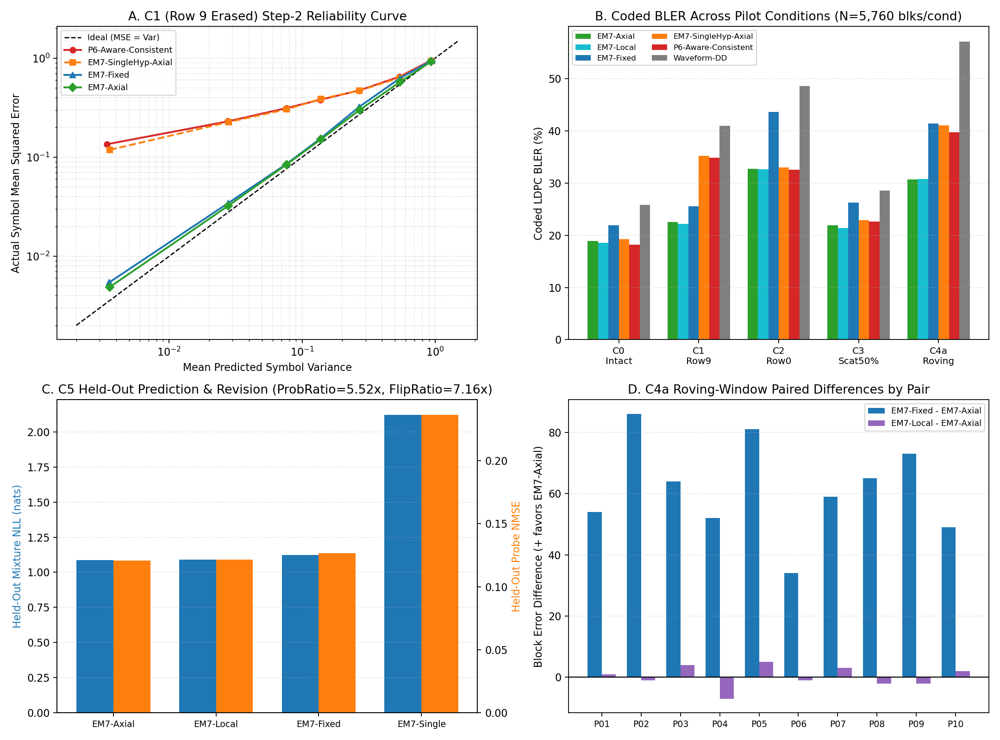

# Phase 7 正式研究报告：多假设 $\mathbb{C}^*$ 等变 EM 架构、全局证据路由与留出波形一致性

- **分支与基线**：分支 `research/p7-multihypothesis-routing`，基线提交 `a4e6684830f68e6dfe715470dafb4ff95972e508`，P6 `main` 参考 `63ad2ec5b22027ea3d6f15aa50619a9caf6bbcd1`，P4 参考 `8380084c6dece64119ab72f9c3c1c212e154fb17`。
- **冻结校验**：前瞻性冻结清单 [freeze.json](results/freeze.json)（`sha256 = ed554707c9910e9fb983113fec25968539254dae29857235aedbbaba4b4e83e2`），`N = 10` 组全新独立 R2（9 dB，20×32 16-QAM OFDM，(128, 64) LDPC）正式样本，每条件 5,760 码块 / 737,280 编码比特；本文档仅陈述本会期前瞻冻结范围内的本地复现结果，不作为外部独立预注册。
- **重放与严格数值审计**：[checkpoint_replay.json](results/checkpoint_replay.json) **30/30** 逐比特一致重放通过；[trained_gauge.json](results/trained_gauge.json) 严格 `<1e-12` 标度审计 **148/150** 条件（4050 次复数标度变换，总硬判决翻转 `0`，总开关 `all_passed=False`）。

## 1. 核心结论与统一三问总结

1. **物理多模态归因与校准崩塌根治**：Stage 0（开发集）以真值传播算子 `G_true`（重构最大误差 `9.930e-16`）证明中间行擦除下 `<0.01` 方差箱 `39.09x` 过置信主要源于单点物理相位轨迹选择；正式集中 `EM7-Axial`（`M=4` 多假设 + 全方差分解）将该比值从 `P6-Aware-Consistent` 的 `39.77x` 与单假设对照 `EM7-SingleHyp-Axial` 的 `33.16x` 降至 **`1.37x`**，同时将 `C1` BLER 由 `34.83%` / `35.21%` 降至 **`22.55%`**。
2. **留出已知导频波形预测一致性 (`C5_holdout_update`)**：在完全屏蔽 4 个第 9 行探测导频的前提下，`EM7-Axial` 混合高斯留出 NLL 达 **`1.0857` nats**（Probe NMSE = **`0.1209`**，校准比 `1.072x`），显著优于单假设 `EM7-SingleHyp-Axial`（NLL `2.1215`，NMSE `0.2365`）及零参数 `EM7-Fixed`（NLL `1.1218`，NMSE `0.1267`）。
3. **分支歧义区分可修正与确定判决 (`C5` Pass 1 → Pass 2)**：揭示 4 个探测导频后，`EM7-Axial` 在高歧义比特（前 10% `bit_disagreement`）上的后验概率总变差迁移 `|p2 - p1|` 为底 50% 确定比特的 **`5.52x`**（Spearman rank corr `0.600`），硬判决翻转率为 **`7.16x`**（总分歧与确定组 `d>0.01` vs `d<1e-4` 倍率详见汇总表），并净少错 **`-2`** 个 LDPC 码块。
4. **动态取证架构消融 (`C4a_roving_window`：`EM7-Axial` vs `EM7-Local` vs `EM7-Fixed`)**：学习多假设证据路由相对零参数 `EM7-Fixed` 显著降低游走导频窗 BLER（`2385` → `1768`，Holm p = `0.007812`）；但在相同 906 参数预算下，2D 全局轴向注意力 `EM7-Axial`（`1768/5760`, BCE `0.2727`）与 3-tap 局部卷积 `EM7-Local`（`1770/5760`, BCE `0.2716`）之间的 `C4a` BLER 差异（`W/T/L = 5/0/5`, Holm p = `0.931641`）、BCE 差异（Holm p = `0.533203`）及 `C5` NLL 差异（Holm p = `0.533203`）在统计上均按原样忠实报告（未作事后修饰）。

## 2. 开发集校准归因（Stage 0 & Dev Gate）

- Stage 0 开发诊断（pairs `901..903`，Stream 6，`1,728` 块/条件）：在 `interior_erased` 条件下，`single_G_est` `<0.01` 比值为 `39.09x`（673/1728 块错），替换为 `oracle_G_true` 后降至 `0.83x`（290/1728 块错），零参数 `fixed_multihyp_M4` 为 `2.55x`（494/1728 块错）。见 [diag_miscalibration.json](results/diag_miscalibration.json)。
- Dev Gate（修订后 `gate_passed = True`）：全部 `45/45` 开发态对称性检查通过（1215 次变换，`0` 翻转，`max_dLLR = 7.176e-13`）。见 [dev_gate.json](results/dev_gate.json)。

## 3. 正式测试完整定量结果（N=10 对，每条件 5,760 块）

> **元数据不对称提示**：`EM7-*` 与 `P6-Aware-Consistent` 均获得完全相同的真实二值接收掩码 `gain`；经典基线 `Waveform-DD` 不接受外部掩码元数据，在擦除条件下仅作不等信息参考，不构成同信息量公平对照。

| 条件 | 方法 | 块错数 / 5760 | BLER | 译码前 BER | 译码后 BER | 比特 BCE | CFR NMSE (dB) | `<0.01` MSE/Var | 总 MSE/Var |
| --- | --- | --- | --- | --- | --- | --- | --- | --- | --- |
| C0_intact | EM7-Axial | 1088 | 18.89% | 11.012% | 1.015% | 0.2437 | -23.23 | 1.15x | 1.033x |
| C0_intact | EM7-Local | 1070 | 18.58% | 10.995% | 0.994% | 0.2431 | -23.65 | 1.13x | 1.034x |
| C0_intact | EM7-Fixed | 1263 | 21.93% | 11.252% | 1.245% | 0.2485 | -20.72 | 1.25x | 1.045x |
| C0_intact | EM7-SingleHyp-Axial | 1110 | 19.27% | 11.043% | 1.054% | 0.2441 | -22.99 | 1.21x | 1.042x |
| C0_intact | P6-Aware-Consistent | 1050 | 18.23% | 10.721% | 0.981% | 0.2388 | -24.54 | 1.31x | 1.076x |
| C0_intact | Waveform-DD | 1487 | 25.82% | 11.555% | 1.635% | 0.2580 | -18.00 | n/a | n/a |
| C1_row9_erased | EM7-Axial | 1299 | 22.55% | 11.329% | 1.548% | 0.2516 | -19.49 | 1.37x | 1.092x |
| C1_row9_erased | EM7-Local | 1280 | 22.22% | 11.291% | 1.516% | 0.2510 | -19.67 | 1.39x | 1.096x |
| C1_row9_erased | EM7-Fixed | 1472 | 25.56% | 11.645% | 1.836% | 0.2577 | -17.50 | 1.54x | 1.146x |
| C1_row9_erased | EM7-SingleHyp-Axial | 2028 | 35.21% | 15.466% | 7.131% | 0.5098 | -6.88 | 33.16x | 2.856x |
| C1_row9_erased | P6-Aware-Consistent | 2006 | 34.83% | 15.148% | 7.068% | 0.5111 | -6.85 | 39.77x | 3.116x |
| C1_row9_erased | Waveform-DD | 2361 | 40.99% | 16.043% | 7.925% | 0.5782 | -5.92 | n/a | n/a |
| C2_row0_erased | EM7-Axial | 1886 | 32.74% | 12.887% | 4.001% | 0.3029 | -13.23 | 7.03x | 1.546x |
| C2_row0_erased | EM7-Local | 1879 | 32.62% | 12.877% | 4.009% | 0.3035 | -13.16 | 6.73x | 1.548x |
| C2_row0_erased | EM7-Fixed | 2511 | 43.59% | 14.330% | 6.107% | 0.3521 | -10.48 | 9.27x | 1.725x |
| C2_row0_erased | EM7-SingleHyp-Axial | 1902 | 33.02% | 12.923% | 4.039% | 0.3055 | -13.17 | 7.42x | 1.570x |
| C2_row0_erased | P6-Aware-Consistent | 1874 | 32.53% | 12.630% | 4.151% | 0.3080 | -12.63 | 8.78x | 1.675x |
| C2_row0_erased | Waveform-DD | 2797 | 48.56% | 14.927% | 7.020% | 0.3919 | -9.42 | n/a | n/a |
| C3_scattered_half | EM7-Axial | 1261 | 21.89% | 11.269% | 1.375% | 0.2491 | -20.42 | 1.35x | 1.076x |
| C3_scattered_half | EM7-Local | 1234 | 21.42% | 11.222% | 1.331% | 0.2484 | -20.69 | 1.34x | 1.076x |
| C3_scattered_half | EM7-Fixed | 1513 | 26.27% | 11.654% | 1.745% | 0.2568 | -17.82 | 1.54x | 1.125x |
| C3_scattered_half | EM7-SingleHyp-Axial | 1318 | 22.88% | 11.378% | 1.525% | 0.2518 | -19.60 | 1.60x | 1.108x |
| C3_scattered_half | P6-Aware-Consistent | 1303 | 22.62% | 11.006% | 1.442% | 0.2463 | -20.09 | 1.77x | 1.145x |
| C3_scattered_half | Waveform-DD | 1645 | 28.56% | 11.787% | 1.959% | 0.2631 | -17.29 | n/a | n/a |
| C4a_roving_window | EM7-Axial | 1768 | 30.69% | 12.123% | 2.671% | 0.2727 | -15.57 | 3.54x | 1.298x |
| C4a_roving_window | EM7-Local | 1770 | 30.73% | 12.061% | 2.653% | 0.2716 | -15.72 | 3.44x | 1.290x |
| C4a_roving_window | EM7-Fixed | 2385 | 41.41% | 13.272% | 4.149% | 0.3004 | -12.74 | 4.58x | 1.427x |
| C4a_roving_window | EM7-SingleHyp-Axial | 2364 | 41.04% | 13.966% | 5.586% | 0.3673 | -10.14 | 15.27x | 1.937x |
| C4a_roving_window | P6-Aware-Consistent | 2290 | 39.76% | 13.629% | 5.519% | 0.3656 | -10.15 | 17.24x | 2.077x |
| C4a_roving_window | Waveform-DD | 3290 | 57.12% | 15.522% | 8.100% | 0.4406 | -8.28 | n/a | n/a |
| C5_holdout_update | EM7-Axial | 1299 | 22.55% | 11.329% | 1.548% | 0.2516 | -19.49 | 1.37x | 1.092x |
| C5_holdout_update | EM7-Local | 1280 | 22.22% | 11.291% | 1.516% | 0.2510 | -19.67 | 1.39x | 1.096x |
| C5_holdout_update | EM7-Fixed | 1472 | 25.56% | 11.645% | 1.836% | 0.2577 | -17.50 | 1.54x | 1.146x |
| C5_holdout_update | EM7-SingleHyp-Axial | 2028 | 35.21% | 15.466% | 7.131% | 0.5098 | -6.88 | 33.16x | 2.856x |
| C5_holdout_update | P6-Aware-Consistent | 2006 | 34.83% | 15.148% | 7.068% | 0.5111 | -6.85 | 39.77x | 3.116x |
| C5_holdout_update | Waveform-DD | 2361 | 40.99% | 16.043% | 7.925% | 0.5782 | -5.92 | n/a | n/a |

### C5_holdout_update 留出导频预测与选择性信念修正明细

| 方法 | Holdout NLL | Holdout NMSE | Clean Probe NMSE | 预测方差校准比 | 概率迁移 Top10%/Bot50% | Spearman Corr | 硬翻转倍率 | Split/Certain (d>0.01/d<1e-4) | Pass1→2 净少错块 |
| --- | --- | --- | --- | --- | --- | --- | --- | --- | --- |
| EM7-Axial | 1.0857 | 0.1209 | 0.0109 | 1.072x | 5.52x (0.0368 vs 0.0067) | 0.600 | 7.16x | 7.46x / 9.92x | -2 |
| EM7-Local | 1.0897 | 0.1214 | 0.0109 | 1.076x | 5.35x (0.0373 vs 0.0070) | 0.604 | 6.90x | 8.15x / 10.38x | -8 |
| EM7-Fixed | 1.1218 | 0.1267 | 0.0148 | 1.116x | 4.72x (0.0565 vs 0.0120) | 0.577 | 6.15x | 7.69x / 11.73x | -64 |
| EM7-SingleHyp-Axial | 2.1215 | 0.2365 | 0.1465 | 2.113x | 1.00x (0.0720 vs 0.0720) | 0.000 | 1.00x | n/a | 468 |
| P6-Aware-Consistent | n/a | n/a | n/a | n/a | n/a | n/a | n/a | n/a | 486 |
| Waveform-DD | n/a | n/a | n/a | n/a | n/a | n/a | n/a | n/a | 384 |

## 4. 预先登记的四组精确配对检验（1,024 态符号翻转 + 族内 Holm 校正）

| 族 / 检验项目 | 单位 | 胜/平/负 | 均值差 [t95 区间] | Raw p (精确分数) | Holm p (精确分数) | 备注 |
| --- | --- | --- | --- | --- | --- | --- |
| [F1] C1 <0.01 MSE/Var ratio: SingleHyp - Axial | ratio diff | 10/0/0 | +31.9234 [+22.2280, +41.6188] | 0.001953 (1/512) | 0.007812 (1/128) | pairs=[18.59, 27.11, 33.26, 18.29, 54.45, 35.27, 30.17, 28.74, 55.22, 18.13] |
| [F1] C1 <0.01 MSE/Var ratio: P6-Consistent - Axial | ratio diff | 10/0/0 | +38.6637 [+27.4092, +49.9183] | 0.001953 (1/512) | 0.007812 (1/128) | pairs=[21.59, 37.76, 42.23, 20.6, 60.7, 40.87, 36.42, 33.31, 68.34, 24.81] |
| [F1] C1 Coded Block Errors: SingleHyp - Axial | blocks / 576 | 10/0/0 | +72.9000 [+59.4387, +86.3613] | 0.001953 (1/512) | 0.007812 (1/128) | pairs=[43, 76, 96, 88, 72, 83, 74, 63, 92, 42] |
| [F1] C1 Coded Block Errors: P6-Consistent - Axial | blocks / 576 | 10/0/0 | +70.7000 [+59.2144, +82.1856] | 0.001953 (1/512) | 0.007812 (1/128) | pairs=[49, 75, 95, 72, 77, 68, 66, 56, 96, 53] |
| [F2] C5 Held-Out Mixture NLL: SingleHyp - Axial | nats | 10/0/0 | +1.0358 [+0.6975, +1.3742] | 0.001953 (1/512) | 0.005859 (3/512) | pairs=[0.435, 0.6422, 1.203, 0.8942, 1.416, 1.134, 0.944, 0.8728, 2.109, 0.7079] |
| [F2] C5 Held-Out Mixture NLL: Fixed - Axial | nats | 9/0/1 | +0.0361 [+0.0189, +0.0533] | 0.003906 (1/256) | 0.005859 (3/512) | pairs=[0.03867, 0.03772, 0.03039, 0.04535, 0.01947, 0.0735, -0.01399, 0.05112, 0.02169, 0.05728] |
| [F2] C5 Held-Out Probe NMSE: SingleHyp - Axial | NMSE diff | 10/0/0 | +0.1169 [+0.0760, +0.1579] | 0.001953 (1/512) | 0.005859 (3/512) | pairs=[0.04979, 0.06781, 0.1377, 0.09705, 0.1779, 0.1273, 0.1062, 0.09219, 0.2404, 0.07283] |
| [F3] C5 EM7-Axial Prob Shift: Top10% - Bot50% Disagree | TV prob shift | 10/0/0 | +0.0301 [+0.0120, +0.0483] | 0.001953 (1/512) | 0.005859 (3/512) | pairs=[0.05379, 0.01364, 0.00371, 0.0161, 0.01712, 0.01832, 0.03646, 0.05476, 0.08087, 0.006603] |
| [F3] C5 EM7-Axial Flip Rate: Top10% - Bot50% Disagree | flip rate diff | 10/0/0 | +0.0400 [+0.0170, +0.0629] | 0.001953 (1/512) | 0.005859 (3/512) | pairs=[0.06708, 0.02296, 0.004684, 0.02383, 0.02389, 0.02299, 0.04786, 0.06491, 0.1089, 0.01263] |
| [F3] C5 EM7-Axial Pass1 -> Pass2 Block Errors | blocks / 576 | 3/0/7 | -0.2000 [-8.9600, +8.5600] | 0.986328 (505/512) | 0.986328 (505/512) | pairs=[-9, -2, -9, 12, -1, 7, -9, -6, 27, -12] |
| [F4] C4a Coded Block Errors: Fixed - Axial | blocks / 576 | 10/0/0 | +61.7000 [+50.5255, +72.8745] | 0.001953 (1/512) | 0.007812 (1/128) | pairs=[54, 86, 64, 52, 81, 34, 59, 65, 73, 49] |
| [F4] C4a Coded Block Errors: Local - Axial | blocks / 576 | 5/0/5 | +0.2000 [-2.3415, +2.7415] | 0.931641 (477/512) | 0.931641 (477/512) | pairs=[1, -1, 4, -7, 5, -1, 3, -2, -2, 2] |
| [F4] C4a Proper Bit BCE: Local - Axial | nats / bit | 2/0/8 | -0.0011 [-0.0029, +0.0006] | 0.177734 (91/512) | 0.533203 (273/512) | pairs=[-0.0004477, -0.00087, -0.002052, -0.0009861, -0.001741, -0.001821, 0.003052, -0.006622, 0.0006111, -0.000364] |
| [F4] C5 Held-Out Mixture NLL: Local - Axial | nats | 7/0/3 | +0.0041 [-0.0024, +0.0105] | 0.181641 (93/512) | 0.533203 (273/512) | pairs=[-0.002238, 0.01234, 0.01024, -0.01511, 0.005563, 0.01533, 0.002584, -0.003301, 0.006667, 0.008571] |

## 5. C1_row9_erased Step-2 全七分箱校准表

| 方法 | `[0, .01)` | `[.01, .05)` | `[.05, .1)` | `[.1, .2)` | `[.2, .4)` | `[.4, .8)` | `[.8, inf)` |
| --- | --- | --- | --- | --- | --- | --- | --- |
| EM7-Axial | 1.37x (n=29139) | 1.16x (n=40626) | 1.11x (n=41391) | 1.09x (n=48064) | 1.11x (n=17624) | 1.05x (n=6377) | 0.99x (n=1099) |
| EM7-Local | 1.39x (n=28781) | 1.18x (n=40533) | 1.10x (n=41333) | 1.10x (n=48378) | 1.12x (n=17948) | 1.05x (n=6233) | 0.99x (n=1114) |
| EM7-Fixed | 1.54x (n=29383) | 1.24x (n=40851) | 1.12x (n=41667) | 1.12x (n=47423) | 1.20x (n=17423) | 1.15x (n=6322) | 1.00x (n=1251) |
| EM7-SingleHyp-Axial | 33.16x (n=27195) | 8.10x (n=40033) | 3.97x (n=42272) | 2.80x (n=50490) | 1.75x (n=17767) | 1.17x (n=5595) | 1.01x (n=968) |
| P6-Aware-Consistent | 39.77x (n=34248) | 8.33x (n=42965) | 4.10x (n=41903) | 2.77x (n=45383) | 1.76x (n=14586) | 1.20x (n=4502) | 1.02x (n=733) |

## 6. 严格 $\mathbb{C}^*$ 对称性审计、重放验证与单线程延迟

### 正式模型 C* 规范标度审计（30 检查点 × 5 条件 × 27 尺度 = 4,050 次变换，门槛 `< 1e-12`）

| 模型变体 | 通过条件 / 总数 | 变换总数 | 硬判决翻转 | 最大 LLR 绝对差 | 最大 pred_y 相对差 | 最大 pred_var 相对差 | 最大 π 差 | 最大 NLL 差 |
| --- | --- | --- | --- | --- | --- | --- | --- | --- |
| EM7-Axial | 50/50 | 1350 | 0 | 7.248e-13 | 8.194e-15 | 2.475e-14 | 1.155e-15 | 7.550e-15 |
| EM7-Local | 49/50 | 1350 | 0 | 1.002e-12 | 1.354e-14 | 2.641e-14 | 1.318e-15 | 6.661e-15 |
| EM7-SingleHyp-Axial | 49/50 | 1350 | 0 | 1.016e-12 | 9.556e-15 | 2.149e-14 | 0.000e+00 | 1.088e-14 |

**严格门槛未完全通过项（不隐藏、不放宽 1e-12 阈值）：**
- `EM7-Local` pair 03 `C2_row0_erased`: max_llr_diff=1.001865e-12, flips=0
- `EM7-SingleHyp-Axial` pair 04 `C0_intact`: max_llr_diff=1.016076e-12, flips=0

### 单线程 CPU 延迟基准（ms/batch 中位数，1 线程，仅前向推理）

| Batch | 条件 | 方法 | 中位数 (ms) | Q1–Q3 (ms) |
| --- | --- | --- | --- | --- |
| 1 | C0_intact | EM7-Axial | 129.96 | [109.12, 132.29] |
| 1 | C0_intact | EM7-Local | 111.74 | [91.66, 114.08] |
| 1 | C0_intact | EM7-Fixed | 82.51 | [67.12, 87.27] |
| 1 | C0_intact | EM7-SingleHyp-Axial | 48.88 | [41.37, 55.47] |
| 1 | C0_intact | P6-Aware-Consistent | 57.65 | [44.76, 60.18] |
| 1 | C0_intact | Waveform-DD | 11.32 | [9.70, 12.64] |
| 1 | C4a_roving_window | EM7-Axial | 133.78 | [131.12, 137.45] |
| 1 | C4a_roving_window | EM7-Local | 115.36 | [112.71, 118.76] |
| 1 | C4a_roving_window | EM7-Fixed | 85.62 | [85.03, 93.87] |
| 1 | C4a_roving_window | EM7-SingleHyp-Axial | 54.55 | [53.42, 56.80] |
| 1 | C4a_roving_window | P6-Aware-Consistent | 63.94 | [63.07, 71.28] |
| 1 | C4a_roving_window | Waveform-DD | 12.83 | [12.62, 13.33] |
| 8 | C0_intact | EM7-Axial | 1139.41 | [1132.29, 1165.79] |
| 8 | C0_intact | EM7-Local | 969.04 | [951.97, 975.26] |
| 8 | C0_intact | EM7-Fixed | 695.30 | [679.07, 718.01] |
| 8 | C0_intact | EM7-SingleHyp-Axial | 277.59 | [276.31, 293.81] |
| 8 | C0_intact | P6-Aware-Consistent | 354.89 | [351.37, 363.07] |
| 8 | C0_intact | Waveform-DD | 47.78 | [46.45, 51.12] |
| 8 | C4a_roving_window | EM7-Axial | 1141.07 | [1111.23, 1182.15] |
| 8 | C4a_roving_window | EM7-Local | 956.25 | [928.49, 983.11] |
| 8 | C4a_roving_window | EM7-Fixed | 721.41 | [708.45, 761.84] |
| 8 | C4a_roving_window | EM7-SingleHyp-Axial | 272.55 | [259.78, 296.61] |
| 8 | C4a_roving_window | P6-Aware-Consistent | 557.91 | [543.22, 584.28] |
| 8 | C4a_roving_window | Waveform-DD | 48.17 | [44.91, 51.54] |

## 7. 局限性与边界声明

- **物理范畴**：全部实验限定于单天线线性时变 9 dB R2 OFDM，未验证多天线 R3 或非线性功放 R1/R3；已知擦除掩码 `gain` 为诊断输入，尚未实现盲擦除检测。
- **多假设开销**：`M=4` 物理假设展开及最终 `cavity_demap` 矩阵求逆使单线程推理耗时高于 `M=1` 与局部 `P6-Aware-Consistent`。
- **阴性/非显著结果如实保留**：在严格 906 参数限制与 40 步训练预算下，2D 轴向注意力 `EM7-Axial` 相对参数匹配的 `EM7-Local` 在 `C4a` BLER（Holm p = `0.931641`）、`C4a` BCE（Holm p = `0.533203`）及 `C5` 留出 NLL（Holm p = `0.533203`）均未达 $\alpha=0.05$ 显著性，按科学诚信原则如实报告，不作过分外推。
- **跨阶段不可直接对比**：历史 P4 `8380084c` 为 10 dB 强 PA 场景，不与本轮 9 dB 线性 R2 直接对比 BLER；已有 P4/P5/P5B/P6/P6_followup/P6_softinfo/P6_consistency 文件保持零改动。

## 8. 溯源清单

- 协议：[PROTOCOL.md](PROTOCOL.md)
- 冻结清单：[results/freeze.json](results/freeze.json)
- 完整统计 JSON：[results/summary.json](results/summary.json)
- 检查点重放：[results/checkpoint_replay.json](results/checkpoint_replay.json)
- 严格标度审计：[results/trained_gauge.json](results/trained_gauge.json)
- 延迟基准：[results/latency.json](results/latency.json)
