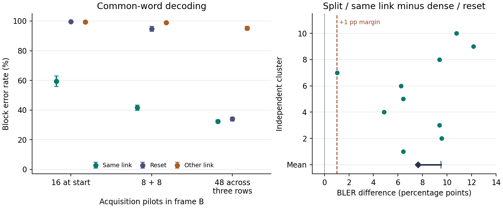

# P8-A/B 实验报告：连续 OFDM 帧之间能带走多少信道信息？

在 9 dB、单天线、三径线性时变信道上，**第一帧估计出的传播状态可以帮助第二帧解码和预测。导频在时间上的分布也显著影响这份收益。** 在独立的第二批链路中，第二帧沿用正确历史时，同样 16 个估计导频从首行集中改为首行和中段各 8 个，共有载荷的块错误率从 59.36% 降到 41.55%。使用 48 个估计导频、从头估计的参考组达到 33.92%。本次两种减半方案都未达到预先规定的误差容限。

## 两帧如何相连

A、B 两帧共用一条连续 40 个 OFDM 符号的传播轨迹。每帧有 20 行、32 个子载波和 16 个循环前缀采样。三条路径的时延为 0、2、4 个采样，增益相位和多普勒沿包含循环前缀的同一时钟演变，仿真包含符号内变化引起的载波间干扰。两帧的载荷与噪声独立。

A 帧的 64 个导频给出各径复增益、多普勒与多普勒变化率的后验估计。经典跟踪器在每个已知时延上保留 128 个可能的多普勒轨迹及其概率，将各自的复增益均值和方差推进到 B 的起点。三种接收方式只在 B 的初始状态上有区别：继承同一链路的 A、从公共先验重新开始、继承独立链路的 A。之后三组使用相同的 B 波形、统计先验、估计器和 LDPC 解码器。接收机只得到公开的时延支撑与分布范围，路径的真实增益和多普勒留在仿真器中。

每种 B 布局都在最后一行发射 16 个检验导频。这 16 个接收值在预测和解码前全部置为 NaN，只在评分时读取。表中的导频数只计用于估计的导频。加上检验导频，密集布局实际发射 64 个，稀疏布局发射 32 个。稀疏布局释放的 32 个资源单元承载一个额外的独立 LDPC 码块。所有 BLER 主比较仅计位置和信息比特完全相同的 18 个共有码块。

## 第一批链路：仅在 B 帧起点更新

初始协议与源代码先在研究分支冻结，随后评估 10 组各 32 对新链路。每个表格单元包含 5,760 个共有码块和 5,120 个帧末复数观测。NMSE 为对带噪检验波形的总平方预测误差除以总目标能量，越低越好。[初始协议与冻结提交](https://github.com/20171806011/EM-FloatFormer/tree/56e65c121a8d22424977ab11b5c208863e5f3005/p8)

| B 估计导频 | 历史状态 | 错块 / 5,760 | BLER | 帧末 NMSE |
| --- | --- | ---: | ---: | ---: |
| 16，全部在第 0 行 | 同链路 | 3,236 | 56.18% | 0.396 |
| 16，全部在第 0 行 | 清空 | 5,741 | 99.67% | 1.000 |
| 16，全部在第 0 行 | 另一条链路 | 5,716 | 99.24% | 1.491 |
| 48，第 0、9、10 行 | 同链路 | 1,873 | 32.52% | 0.200 |
| 48，第 0、9、10 行 | 清空 | 2,022 | 35.10% | 0.220 |
| 48，第 0、9、10 行 | 另一条链路 | 5,465 | 94.88% | 0.879 |

在 16 个估计导频下，继承同链路历史相对另外两组的 BLER 和帧末 NMSE 在全部 10 组中都改善。四项配对符号翻转检验经 Holm 校正后均为 p=0.0078125。与密集导频清空组相比，稀疏继承组的 BLER 高 21.08 个百分点，单侧 95% 上界为 +23.04 个百分点，预设非劣界限为 +1.00 个百分点。[逐链路原始记录](results/links.jsonl) · [第一批完整统计](results/summary.json)

## 第二批链路：固定数量，只移动 8 个导频

第一次实验同时减少了导频数量并延长了末次观测到帧末的时间。看到第一批结果后，我们冻结补充协议，再生成完全不同的 320 对链路。两个稀疏布局在整帧使用相同的 16 个偶数子载波。分散布局保留第 0 行的 0、4、…、28 号导频，把 2、6、…、30 号子载波的导频移到第 10 行。各布局的帧末检验波形逐样本相同。[补充协议与冻结提交](https://github.com/20171806011/EM-FloatFormer/tree/0cc52afb308650328b33d2884b22385d93c6441b/p8)

| B 估计导频 | 历史状态 | 错块 / 5,760 | BLER | 帧末 NMSE | 实际误差 / 预测方差 |
| --- | --- | ---: | ---: | ---: | ---: |
| 16，集中 | 同链路 | 3,419 | 59.36% | 0.430 | 1.14 |
| 16，集中 | 清空 | 5,740 | 99.65% | 0.997 | 0.99 |
| 16，集中 | 另一条链路 | 5,720 | 99.31% | 1.575 | 6.26 |
| 16，分散为 8+8 | 同链路 | 2,393 | 41.55% | 0.230 | 1.14 |
| 16，分散为 8+8 | 清空 | 5,459 | 94.77% | 0.441 | 0.91 |
| 16，分散为 8+8 | 另一条链路 | 5,703 | 99.01% | 1.342 | 7.36 |
| 48，密集 | 同链路 | 1,868 | 32.43% | 0.198 | 1.28 |
| 48，密集 | 清空 | 1,954 | 33.92% | 0.212 | 0.87 |
| 48，密集 | 另一条链路 | 5,480 | 95.14% | 0.866 | 5.95 |

同样继承正确历史，只移动 8 个导频就少错 **1,026 个共有码块**，BLER 下降 17.81 个百分点，按 10 个独立组计算的双侧 95% t 区间为 13.86 至 21.76 个百分点。共有载荷的后 9 个码块改善更大，其 BLER 从 81.81% 降到 56.70%，前 9 个从 36.91% 降到 26.39%。帧末带噪 NMSE 从 0.430 降到 0.230，去掉评分目标中的噪声后，NMSE 也从 0.360 降到 0.133。补充协议中的六项比较全部为 10 组同向，原始 p=0.001953125，族内 Holm p=0.01171875。[逐链路原始记录](results/placement_links.jsonl) · [补充实验完整统计](results/placement_summary.json)



左图误差棒为组均值的双侧 95% t 区间。右图每点为一个组，底部菱形为均值，向右的线段延伸至单侧 95% 上界。

**导频开销减半后，解码性能仍未达标。** 分散继承组比密集清空组多错 439 个共有码块，BLER 高 7.62 个百分点，单侧 95% 上界为 +9.51 个百分点。即使计入新增码块，每 320 帧多发的 320 块中有 216 块解对。分散继承组共正确解出 3,583 块，密集清空组解出 3,806 块。两者占用相同 B 帧时长，这个差额尚未计入重传。

## 证据范围与复跑

这是经典接收机的同波形实验。已知时延、固定径数、线性多普勒演化和单一信噪比都限定了解释范围。单行冷启动对正负多普勒约束很弱，继承收益依赖具体观测条件。给错历史会令预测方差严重低估真实误差，分散布局中达到 7.36 倍。本轮没有训练跨帧神经接收机，也未评估更换调制波形后的迁移。

九项测试通过，覆盖逐采样串行卷积、边界相位推进、LDPC、更新闭式解、导频释出、禁止读取留出值和后验预测矩。原始研究的全部 320 条记录在接口扩展后逐字节复现。两批各自预先指定的第 1 与第 10 组在独立进程中重放，各 64 对链路的全部记录均一致。另一份核算实现从原始记录复算两批的汇总、组差、全部 1,024 种符号翻转、Holm 校正及非劣上界。这些复核在同一 CPU 软件环境中进行。[核算记录](results/audit.json) · [独立核算实现](audit.py)

复跑命令从仓库根目录执行。

```sh
export OPENBLAS_NUM_THREADS=1 OMP_NUM_THREADS=1
python -m unittest discover -s p8/tests -v
python -m p8.study --workers 4
python -m p8.summary
python -m p8.placement --workers 4
python -m p8.summary --placement
python -m p8.study --workers 1 --clusters 1 10 --output /tmp/p8-primary.jsonl
python -m p8.placement --workers 1 --clusters 1 10 --output /tmp/p8-placement.jsonl
python -m p8.audit /tmp/p8-primary.jsonl /tmp/p8-placement.jsonl
python -m p8.figure
```
