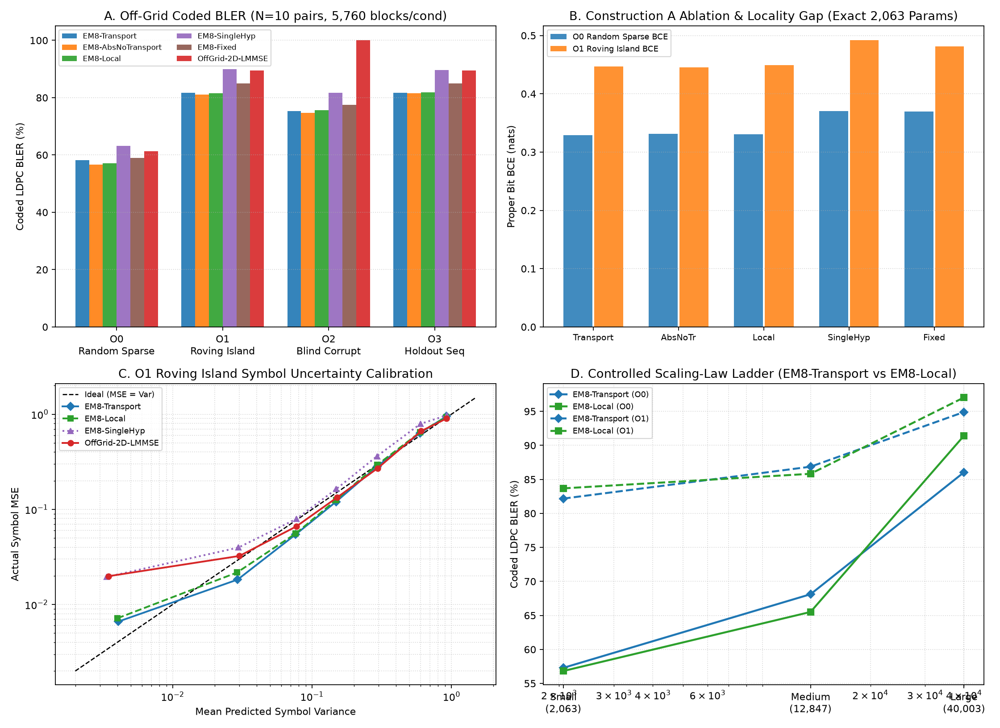

# Phase 8 Manifold (`p8_manifold`) Formal Research Report

- **Prospective Freeze SHA-256**: `0ccd481df572555f0e51340d597f4b719d09be43e2c091b971424d5dd980121d`
- **Base Commit**: `4dab1ac9ee15b4f1a7f78ae05486c55a2dc3bd72` (`research/p7-multihypothesis-routing`, inherited files untouched)
- **Sample Size**: `N = 10` fresh paired seeds (`5,760` LDPC blocks / condition; exact `2,063` real params parity across `EM8-Transport`, `EM8-AbsNoTransport`, `EM8-Local`, selected via pre-formal Scaling-Law Ladder)

## 1. Main Off-Grid Benchmark Results (`O0..O3`, `5,760` blocks/cond)

### `O0_random_sparse`

| Arm | Block Errors / 5,760 | BLER | Bit BCE | CFR NMSE | `<0.01` Cal | Total Cal |
| :--- | ---: | ---: | ---: | ---: | ---: | ---: |
| `EM8-Transport` | 3,350 | 58.16% | 0.3292 | 0.1717 | 1.87x | 0.89x |
| `EM8-AbsNoTransport` | 3,266 | 56.70% | 0.3316 | 0.1647 | 1.72x | 0.84x |
| `EM8-Local` | 3,294 | 57.19% | 0.3305 | 0.1675 | 1.84x | 0.87x |
| `EM8-SingleHyp` | 3,639 | 63.18% | 0.3705 | 0.1771 | 2.13x | 0.74x |
| `EM8-Fixed` | 3,398 | 58.99% | 0.3694 | 0.1658 | 1.51x | 0.69x |
| `OffGrid-2D-LMMSE` | 3,529 | 61.27% | 0.4008 | 0.1665 | 2.68x | 0.68x |

### `O1_roving_island`

| Arm | Block Errors / 5,760 | BLER | Bit BCE | CFR NMSE | `<0.01` Cal | Total Cal |
| :--- | ---: | ---: | ---: | ---: | ---: | ---: |
| `EM8-Transport` | 4,704 | 81.67% | 0.4467 | 0.3639 | 1.63x | 1.02x |
| `EM8-AbsNoTransport` | 4,673 | 81.13% | 0.4453 | 0.3443 | 1.60x | 0.96x |
| `EM8-Local` | 4,701 | 81.61% | 0.4493 | 0.3666 | 1.79x | 1.03x |
| `EM8-SingleHyp` | 5,184 | 90.00% | 0.4917 | 0.4539 | 5.80x | 1.18x |
| `EM8-Fixed` | 4,895 | 84.98% | 0.4815 | 0.3875 | 1.56x | 0.88x |
| `OffGrid-2D-LMMSE` | 5,152 | 89.44% | 0.5011 | 0.4423 | 5.74x | 1.01x |

### `O2_blind_burst_erasure`

| Arm | Block Errors / 5,760 | BLER | Bit BCE | CFR NMSE | `<0.01` Cal | Total Cal | Clean w | Corrupt w | Reject Ratio |
| :--- | ---: | ---: | ---: | ---: | ---: | ---: | ---: | ---: | ---: |
| `EM8-Transport` | 4,341 | 75.36% | 0.3809 | 0.2407 | 1.72x | 0.91x | 0.993 | 0.0069 | 143.8x |
| `EM8-AbsNoTransport` | 4,306 | 74.76% | 0.3832 | 0.2322 | 1.84x | 0.87x | 0.993 | 0.0072 | 138.0x |
| `EM8-Local` | 4,358 | 75.66% | 0.3825 | 0.2380 | 2.04x | 0.90x | 0.993 | 0.0070 | 141.6x |
| `EM8-SingleHyp` | 4,704 | 81.67% | 0.4246 | 0.2614 | 3.69x | 0.81x | 0.996 | 0.0088 | 113.4x |
| `EM8-Fixed` | 4,460 | 77.43% | 0.4211 | 0.2401 | 1.87x | 0.74x | 0.996 | 0.0111 | 89.8x |
| `OffGrid-2D-LMMSE` | 5,760 | 100.00% | 11.0360 | 38.2956 | 798.39x | 2.11x | n/a | n/a | n/a |

### `O3_holdout_sequential`

| Arm | Block Errors / 5,760 | BLER | Bit BCE | CFR NMSE | `<0.01` Cal | Total Cal | Holdout NLL | H-Cal | P1->P2 dBlk | Sel Prob | Sel Flip |
| :--- | ---: | ---: | ---: | ---: | ---: | ---: | ---: | ---: | ---: | ---: | ---: |
| `EM8-Transport` | 4,702 | 81.63% | 0.4551 | 0.3633 | 1.19x | 1.00x | 3.567 | 0.59x | +17 | 4.92x | 2.10x |
| `EM8-AbsNoTransport` | 4,701 | 81.61% | 0.4548 | 0.3457 | 1.11x | 0.94x | 3.546 | 0.56x | +45 | 5.01x | 1.83x |
| `EM8-Local` | 4,713 | 81.82% | 0.4578 | 0.3651 | 0.88x | 1.01x | 3.555 | 0.59x | +49 | 4.98x | 1.91x |
| `EM8-SingleHyp` | 5,162 | 89.62% | 0.5056 | 0.4716 | 6.91x | 1.20x | 3.625 | 0.52x | +26 | 0.94x | 0.98x |
| `EM8-Fixed` | 4,891 | 84.91% | 0.4945 | 0.3949 | 0.96x | 0.87x | 3.773 | 0.38x | +121 | 5.48x | 1.43x |
| `OffGrid-2D-LMMSE` | 5,153 | 89.46% | 0.5157 | 0.4653 | 9.15x | 1.03x | n/a | n/a | +34 | n/a | n/a |

## 2. Pre-Registered Exact 1,024-State Holm-Bonferroni Inference

| Family | Contrast | Mean Diff | 95% t-CI | Wins/10 | Exact p | Holm p | Sig (<0.05) |
| :--- | :--- | ---: | :--- | ---: | ---: | ---: | :---: |
| `family1_attention_vs_local` | O1 BLER: Local - Transport | -0.0005 | [-0.0137, +0.0127] | 5/10 | 61/64 (0.95312) | 61/64 (0.95312) | NO |
| `family1_attention_vs_local` | O1 BCE: Local - Transport | +0.0026 | [+0.0006, +0.0045] | 9/10 | 3/512 (0.00586) | 3/128 (0.02344) | YES |
| `family1_attention_vs_local` | O0 BLER: Local - Transport | -0.0097 | [-0.0187, -0.0007] | 3/10 | 5/128 (0.03906) | 15/128 (0.11719) | NO |
| `family1_attention_vs_local` | O0 BCE: Local - Transport | +0.0013 | [-0.0007, +0.0033] | 6/10 | 25/128 (0.19531) | 25/64 (0.39062) | NO |
| `family2_construction_a_ablation` | O1 BLER: AbsNoTransport - Transport | -0.0054 | [-0.0133, +0.0025] | 3/10 | 5/32 (0.15625) | 5/16 (0.31250) | NO |
| `family2_construction_a_ablation` | O1 BCE: AbsNoTransport - Transport | -0.0014 | [-0.0040, +0.0013] | 5/10 | 17/64 (0.26562) | 5/16 (0.31250) | NO |
| `family2_construction_a_ablation` | O0 BLER: AbsNoTransport - Transport | -0.0146 | [-0.0237, -0.0055] | 1/10 | 3/512 (0.00586) | 9/512 (0.01758) | YES |
| `family2_construction_a_ablation` | O0 BCE: AbsNoTransport - Transport | +0.0024 | [+0.0015, +0.0033] | 9/10 | 1/256 (0.00391) | 1/64 (0.01562) | YES |
| `family3_blind_and_multichart` | O2 Blind BLER: LMMSE - Transport | +0.2464 | [+0.2203, +0.2724] | 10/10 | 1/512 (0.00195) | 3/512 (0.00586) | YES |
| `family3_blind_and_multichart` | O2 Blind BCE: SingleHyp - Transport | +0.0437 | [+0.0384, +0.0489] | 10/10 | 1/512 (0.00195) | 3/512 (0.00586) | YES |
| `family3_blind_and_multichart` | O1 BCE: SingleHyp - Transport | +0.0450 | [+0.0390, +0.0510] | 10/10 | 1/512 (0.00195) | 3/512 (0.00586) | YES |
| `family4_holdout_and_assimilation` | O3 Holdout NLL: SingleHyp - Transport | +0.0586 | [-0.0174, +0.1346] | 8/10 | 29/256 (0.11328) | 29/128 (0.22656) | NO |
| `family4_holdout_and_assimilation` | O3 Assimilate BLER Gain (P1 - P2): Transport | +0.0030 | [-0.0040, +0.0099] | 6/10 | 97/256 (0.37891) | 97/256 (0.37891) | NO |
| `family4_holdout_and_assimilation` | O3 Assimilate BCE Gain (P1 - P2): Transport | +0.0070 | [+0.0050, +0.0090] | 10/10 | 1/512 (0.00195) | 1/128 (0.00781) | YES |
| `family4_holdout_and_assimilation` | O3 Selective Revision (Top25 - Bot25): Transport | +0.0396 | [+0.0328, +0.0465] | 10/10 | 1/512 (0.00195) | 1/128 (0.00781) | YES |

## 3. Controlled 3-Rung Scaling-Law Ladder (`Small -> Medium -> Large`)

| Condition | Rung | Real Params | `EM8-Transport` BLER / BCE | `EM8-Local` BLER / BCE | Gap (`Local - Transport`) |
| :--- | :--- | ---: | :--- | :--- | :--- |
| `O0_random_sparse` | Small | 2,063 | 57.29% / 0.3300 | 56.83% / 0.3305 | -0.46 pp / +0.0006 |
| `O0_random_sparse` | Medium | 12,847 | 68.11% / 0.3435 | 65.51% / 0.3419 | -2.60 pp / -0.0016 |
| `O0_random_sparse` | Large | 40,003 | 86.05% / 0.4114 | 91.44% / 0.4878 | +5.38 pp / +0.0764 |
| `O1_roving_island` | Small | 2,063 | 82.18% / 0.4477 | 83.68% / 0.4510 | +1.50 pp / +0.0034 |
| `O1_roving_island` | Medium | 12,847 | 86.86% / 0.4474 | 85.82% / 0.4571 | -1.04 pp / +0.0096 |
| `O1_roving_island` | Large | 40,003 | 94.91% / 0.4996 | 97.05% / 0.5497 | +2.14 pp / +0.0501 |
| `O2_blind_burst_erasure` | Small | 2,063 | 78.47% / 0.3869 | 77.72% / 0.3877 | -0.75 pp / +0.0009 |
| `O2_blind_burst_erasure` | Medium | 12,847 | 82.35% / 0.3924 | 82.00% / 0.3959 | -0.35 pp / +0.0036 |
| `O2_blind_burst_erasure` | Large | 40,003 | 93.52% / 0.4493 | 95.72% / 0.5144 | +2.20 pp / +0.0651 |
| `O3_holdout_sequential` | Small | 2,063 | 79.34% / 0.4578 | 80.15% / 0.4603 | +0.81 pp / +0.0025 |
| `O3_holdout_sequential` | Medium | 12,847 | 84.90% / 0.4595 | 83.68% / 0.4693 | -1.22 pp / +0.0098 |
| `O3_holdout_sequential` | Large | 40,003 | 93.75% / 0.5060 | 96.12% / 0.5552 | +2.37 pp / +0.0493 |

## 4. Independent Audits, Replay & Latency

- **Checkpoint Replay**: `40/40` exact match (`passed=True`).
- **Formal $\mathbb{C}^*$ Gauge Audit**: rel `<1e-12` = `120/120`, strict abs `<1e-12` = `113/120` across `3,240` transforms, coded bit flips = `0`.

| Batch | Condition | Arm | Median (ms) | IQR [Q1, Q3] (ms) |
| ---: | :--- | :--- | ---: | :--- |
| 1 | `O0_random_sparse` | `EM8-Transport` | 178.57 | [178.16, 180.02] |
| 1 | `O0_random_sparse` | `EM8-AbsNoTransport` | 238.92 | [235.81, 239.83] |
| 1 | `O0_random_sparse` | `EM8-Local` | 154.31 | [153.48, 155.31] |
| 1 | `O0_random_sparse` | `EM8-SingleHyp` | 49.10 | [48.74, 49.18] |
| 1 | `O0_random_sparse` | `EM8-Fixed` | 54.61 | [54.31, 55.00] |
| 1 | `O0_random_sparse` | `OffGrid-2D-LMMSE` | 6.86 | [6.82, 6.92] |
| 1 | `O1_roving_island` | `EM8-Transport` | 179.55 | [178.42, 180.83] |
| 1 | `O1_roving_island` | `EM8-AbsNoTransport` | 239.63 | [238.05, 240.51] |
| 1 | `O1_roving_island` | `EM8-Local` | 153.79 | [153.35, 154.22] |
| 1 | `O1_roving_island` | `EM8-SingleHyp` | 48.91 | [48.54, 49.08] |
| 1 | `O1_roving_island` | `EM8-Fixed` | 54.85 | [54.61, 55.88] |
| 1 | `O1_roving_island` | `OffGrid-2D-LMMSE` | 6.87 | [6.15, 6.91] |
| 8 | `O0_random_sparse` | `EM8-Transport` | 1464.76 | [1442.37, 1506.39] |
| 8 | `O0_random_sparse` | `EM8-AbsNoTransport` | 2032.47 | [2017.02, 2051.49] |
| 8 | `O0_random_sparse` | `EM8-Local` | 1139.65 | [1136.00, 1161.31] |
| 8 | `O0_random_sparse` | `EM8-SingleHyp` | 287.83 | [283.35, 297.56] |
| 8 | `O0_random_sparse` | `EM8-Fixed` | 444.68 | [444.38, 448.37] |
| 8 | `O0_random_sparse` | `OffGrid-2D-LMMSE` | 45.05 | [44.44, 50.43] |
| 8 | `O1_roving_island` | `EM8-Transport` | 1491.43 | [1459.01, 1505.07] |
| 8 | `O1_roving_island` | `EM8-AbsNoTransport` | 2042.05 | [2035.70, 2067.63] |
| 8 | `O1_roving_island` | `EM8-Local` | 1140.61 | [1136.31, 1152.18] |
| 8 | `O1_roving_island` | `EM8-SingleHyp` | 289.54 | [286.26, 290.72] |
| 8 | `O1_roving_island` | `EM8-Fixed` | 447.48 | [444.63, 449.71] |
| 8 | `O1_roving_island` | `OffGrid-2D-LMMSE` | 51.97 | [51.65, 52.39] |

