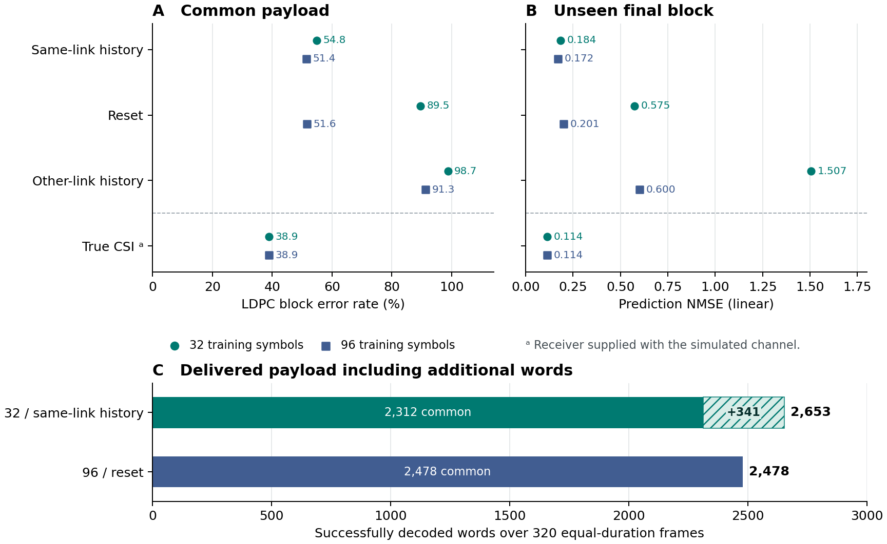

# P8-C 实验报告｜从 OFDM 估出的传播状态能帮助单载波解码吗？

**可以。在同步、连续的三径合成链路上，从前一帧有噪 OFDM 导频估出的状态，改善了后一帧单载波载荷的解码和帧末波形预测。** 单载波帧只有一个训练块时，同链路历史比清空状态少错 1,773 个共有码块，块错误率（BLER）降低 34.63 个百分点。错误信道的历史将 BLER 推高到 98.71%。

工程上的两个指标给出了不同答案。与密集训练、从头估计相比，稀疏训练、继承状态的共有码块 BLER 高 3.24 个百分点，超过预设容限。由于稀疏方案还能多发送两个码块，在相同的 320 帧时长内，最终共多解对 175 个码块。

## 到这一阶段，项目验证了什么

P7 的多假设接收机解决了一个可定位的错误。在中间导频行擦除时，它把最自信分箱的实际符号误差与预测方差之比从 39.77 降到 1.37，BLER 从 34.83% 降到 22.55%。同参数预算的轴向注意力和局部卷积在游走导频条件下仅相差 2 个错块，Holm p=0.932。可归因的收益集中在保留多个物理解释。[P7 报告](../p7/P7_REPORT.md)

P8-A/B 让相邻的两个 OFDM 帧共用连续信道，分离了同链路历史、错配历史和导频时间位置的影响。但两帧仍使用同一种波形。P8-C 改用时域单载波符号承载 B 帧。仿真器保证真实环境连续，实验检验的是从 A 的有限含噪观测估出的状态，经过波形切换还保留多少可用信息。这些结果可构成一篇接收机论文中的受控仿真实验章节。它们的适用边界仍是指定的链路与接收机。[P8-A/B 报告](../p8/P8_REPORT.md)

## 方法与判据

A 帧是原生 P8 OFDM，B 帧是带循环前缀的单载波，每个数据块在时域直接传送 32 个连续的 16-QAM 符号。两帧共享采样时钟和一条连续演化的 9 dB 单天线三径信道。各径时延支撑公开，复增益和正负多普勒轨迹对接收机未知。带到 B 的是各条路径上 128 个多普勒假设的概率与对应的复增益矩。B 用自己的时域训练序列更新这些状态，随后采用线性最小均方误差均衡和原生 LDPC 解码。这里使用经典跟踪器。

稀疏 B 在第 10 行发 1 个训练块，密集 B 在第 0、9、10 行发 3 个。两者都在第 19 行发送相同的 32 符号检验块。接收机先预测该块，评估端再读取其观测值。计入检验块，B 实际发出的已知符号从 128 个降到 64 个。再计入 A 固定的 64 个导频，整对帧的开销从 192 个降到 128 个。解码使用整帧训练，因此较早载荷允许用到中段训练。帧末预测仅用较早的观测。

协议和实现均在正式取样前冻结。主实验使用 10 组、每组 32 对新链路。每个表格单元比较相同的 5,120 个共有 LDPC 码块，并评估 10,240 个帧末复数样本。同预算内，各组的 B 波形、输入信息、译码器都相同，区别仅是带入的历史。真信道参考额外知道完整物理轨迹，用来诊断剩余误差。[冻结提交](https://github.com/20171806011/EM-FloatFormer/tree/71c800b162e33eed55362675dfa0531738a28a11/p8c) · [实验协议](PROTOCOL.md)

## 逐组结果

帧末 NMSE 为预测误差总能量除以目标总能量。含噪列使用实际接收观测，无噪列仅在评分时扣去仿真噪声。方差校准列为实际观测误差与模型预测方差的比值，1 表示聚合量相符。

| B 训练块 | 初始状态 | 错块 / 5,120 | BLER | 帧末 NMSE，含噪 | 帧末 NMSE，无噪 | 方差校准 |
| --- | --- | ---: | ---: | ---: | ---: | ---: |
| 1 | 同链路 A | 2,808 | 54.84% | 0.184 | 0.079 | 1.28 |
| 1 | 清空 | 4,581 | 89.47% | 0.575 | 0.520 | 0.93 |
| 1 | 另一条链路 A | 5,054 | 98.71% | 1.507 | 1.582 | 10.83 |
| 1 | 真信道参考 | 1,993 | 38.93% | 0.114 | 0 | 1.03 |
| 3 | 同链路 A | 2,632 | 51.41% | 0.172 | 0.065 | 1.30 |
| 3 | 清空 | 2,642 | 51.60% | 0.201 | 0.098 | 0.94 |
| 3 | 另一条链路 A | 4,676 | 91.33% | 0.600 | 0.547 | 4.78 |
| 3 | 真信道参考 | 1,993 | 38.93% | 0.114 | 0 | 1.03 |

稀疏预算下，同链路历史相对清空状态的 BLER 改善为 34.63 个百分点，按独立组计算的双侧 95% t 区间为 32.71 至 36.55 个百分点。相对错配历史改善 43.87 个百分点，区间为 41.39 至 46.35 个百分点。两个对照下的 BLER 和帧末预测 NMSE 均在 10 组中全部改善。四项预设比较分别用全部 1,024 种符号翻转检验，族内 Holm 校正后均为 p=0.0078125。密集训练下，同链路历史相对清空状态只少错 10 块，这一项是描述性结果。[汇总和组间差值](results/summary.json)



## 减少训练后，可靠性和正确交付量分别怎样变化

按共有码块比较，稀疏继承组比密集清空组多错 166 块。BLER 差值为 +3.24 个百分点，单侧 95% 上界为 +5.15 个百分点，超出冻结协议设定的 +1.00 个百分点非劣界限。值得注意的是，稀疏继承组的帧末预测 NMSE（0.184）还略低于密集清空组（0.201）。预测一个位置准确，并不足以保证整帧解码同样可靠。

按相同帧时长计算，稀疏继承组正确解出 2,312 个共有码块及 341 个额外码块，合计 **2,653**。密集清空组正确解出 **2,478** 个。这一描述性指标增加 175 块（7.06%），10 个独立组中 9 组增加。受评的都是 64 信息位的等长码块。这是仿真器根据已知载荷核算的一次传输正确交付量，尚未计入重传、协议反馈或处理时延。[逐链路原始记录](results/links.jsonl)

## 结论边界和下一项诊断

证据支持在同一频带、同一采样时钟和已知时延支撑上，沿 **OFDM → 带循环前缀的单载波** 这个方向复用从观测估出的物理状态。当前结果不能决定两种波形孰优，也不能单独归因为 Transformer。不同信道族、跨帧重新同步、前端变化、真实空口和可学习的跨波形接收机仍待检验。

在真信道已知且无噪声检验波形预测误差为零时，同一套均衡解码器处理有噪声载荷的 BLER 仍达 38.93%。这给下一步留下了可直接检验的问题：固定真实信道和载荷，对信噪比及解调方法做配对比较，量化均衡解码链自身的损失，再判断继续改善信道估计可以换来多少收益。

## 复核与重放

7 项 P8-C 测试和 9 项继承的 P8 测试通过，覆盖逐采样跨帧卷积、物理时间推进、单载波符号映射、检验样本隔离及真信道预测。独立核算程序从 2,560 个原始实验单元重新计算了统计量。用单个工作进程重放预先选定的第 1 和第 10 组，64 对链路的完整记录逐项一致。环境为 Python 3.12.14、NumPy 2.3.5 和 SciPy 1.17.0。[核算记录](results/audit.json)

```sh
export OPENBLAS_NUM_THREADS=1 OMP_NUM_THREADS=1
python -m unittest discover -s p8c/tests -v
python -m unittest discover -s p8/tests -v
python -m p8c.study --workers 4
python -m p8c.summary
python -m p8c.study --clusters 1 10 --workers 1 --output /tmp/p8c-replay.jsonl
python -m p8c.audit --replay /tmp/p8c-replay.jsonl
python -m p8c.figure
```
