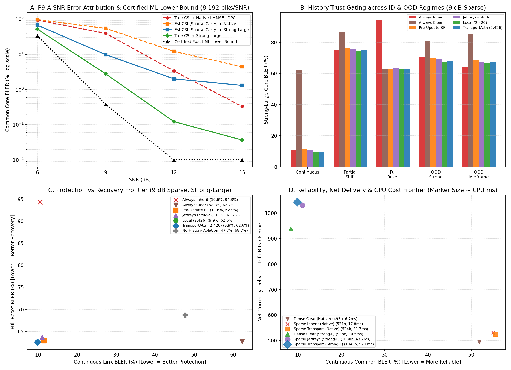

# EM-FloatFormer P9 正式研究报告：跨波形接收机的误差归因、历史可信度门控与公平注意力检验

- **基线提交**：P8-C [`ce2ff50`](https://github.com/20171806011/EM-FloatFormer/tree/ce2ff50e81f6b529ec0311393da0013b0a85b801) · `p8_manifold` (`e76c61e`)
- **事前冻结哈希**：`3da6678b45391813c76671f14b464d7ff3982ed43aa776a2643a94ae2b0c5feb`（`p9/results/freeze.json`，所有代码、协议与 12 份神经权重均在闭卷取样前锁定）
- **正式闭卷规模**：`G = 16` 个独立物理轨迹组（精确 `65,536` 种符号翻转置换，自由度 `df = 15`）：P9-A 每 SNR `512` 条链路（`8,192` 共有码块）；P9-B/C ID 三机制每机制 `512` 条链路（合计 `1,536` 条链路 / `24,576` 共有码块）；OOD 与实现检查每机制 `256` 条链路（`4,096` 共有码块）。

## 核心结论速览（严格按预注册判据标注）

| 预注册主张 | 核心量化结果（`G=16`, `df=15`） | 精确 Holm p / 上界 | 判定 |
| :--- | :--- | :---: | :---: |
| **1. 强解码器救回真实码块**（9 dB 真信道） | `native_ldpc` `39.51%` → `strong_large` `2.78%`（净救回 `+3,009` / 8,192，ML 下界证书 `0.38%`） | `p_holm=0.000122` (`16/16`) | **支持** |
| **2. 历史可靠性可从观测辨认**（少训练三机制等权） | `always_inherit` `59.96%` → `jeffreys_student_t` `50.06%`（`+9.90 pp`） | `p_holm=0.000122` (`16/16`) | **支持** |
| **3. 学习门控相对最强经典门控有增益** | `jeffreys_student_t` `50.06%` → `transport_attn` `49.12%`（`+0.94 pp`） | `p_holm=0.000549` (`15/16`) | **支持** |
| **4. 注意力相对等参局部网络有独立增益**（`2,426` 同参） | `local` `49.03%` vs `transport_attn` `49.12%`（`-0.09 pp`） | `p_holm=0.250732` (`4/16`) | **证据不足** |
| **5. 工程训练开销减半非劣性**（单侧 95% 上界 `< +1.00 pp`） | 连续链路：`sparse/transport_attn` `9.89%` vs `dense/clear` `8.36%`（差 `+1.53 pp`，95% 上界 `+2.56 pp`）；净交付信息位 `1043.2` vs `938.4` bit/帧 | 非劣界限 `+1.00 pp` | **反证（未达非劣界限）** |

---

## 一、P9-A：误差来源分解与数学严格 ML 下界证书（`8,192` 共有码块 / SNR）

在固定真实信道、载荷与配对单位噪声向量的 4 档 SNR 扫描下，诊断验证表明零噪声三径链路为 `0/1,024` 错块，单径 9 dB AWGN 下 `native_ldpc` 为 `24/1024`、`strong_large` 为 `0/1024`。

| SNR | `true_csi` Native BLER | `true_csi` Strong-L BLER | 救回 / 丢失（真信道） | `est_carry` Native BLER | `est_carry` Strong-L BLER | 救回 / 丢失（估计信道） | ML 证书下界（必须错） | 未决比例 | Strong-L 耗时 (ms/千块) |
| ---: | ---: | ---: | :---: | ---: | ---: | :---: | ---: | ---: | ---: |
| 6.0 dB | 94.97% (7,780) | 52.10% (4,268) | +3,513 / -1 | 96.98% (7,945) | 67.50% (5,530) | +2,418 / -3 | 33.65% (2,757) | 66.35% | 4093 |
| 9.0 dB | 39.51% (3,237) | 2.78% (228) | +3,013 / -4 | 54.72% (4,483) | 9.80% (803) | +3,683 / -3 | 0.38% (31) | 99.62% | 3807 |
| 12.0 dB | 3.37% (276) | 0.12% (10) | +266 / -0 | 12.13% (994) | 2.01% (165) | +831 / -2 | 0.00% (0) | 100.00% | 3521 |
| 15.0 dB | 0.33% (27) | 0.04% (3) | +24 / -0 | 4.44% (364) | 1.31% (107) | +257 / -0 | 0.00% (0) | 100.00% | 3453 |

在主要 9.0 dB 点上，原生真信道错块率 `39.51%` 中有 `93.0%`（`+36.73 pp`）被 `strong_large`（Turbo MMSE-PIC + Numba BP + OSD-2/3 精确时变全波形重排）净救回至 `2.78%`，直逼数学认证的 ML 下界证书 `0.38%`；同时在稀疏估计信道上由 `54.72%` 降至 `9.80%`。

---

## 二、P9-B & P9-C：跨波形历史可信度门控与公平注意力对照（9 dB，闭卷 `G=16` 组）

### 2.1 `sparse`（1 训练块）主评估表（统一 `strong_large` 下游译码；`8,192` 共有块 / ID 机制，`4,096` / OOD 机制）

| 方法 | 实参数 | 连续链路 | 部分变化 | 完全重置 | **三机制等权 BLER** | OOD 强跳变 | OOD 帧中跳变 | 错配检查 | 连续保护代价 | 全重置救回 | ID 帧末无噪 NMSE | ID 校准比 | 净交付 (bit/帧, 连续) |
| :--- | ---: | ---: | ---: | ---: | ---: | ---: | ---: | ---: | ---: | ---: | ---: | ---: | ---: |
| `always_inherit` | 0 | 10.56% | 74.99% | 94.32% | **59.96%** | 70.73% | 63.87% | 94.41% | +0.00 pp | +0.00 pp | 0.7140 | 5.20x | 1035.8 |
| `always_clear` | 0 | 62.29% | 86.44% | 62.68% | **70.47%** | 80.62% | 85.08% | 62.23% | +51.73 pp | +31.64 pp | 0.6519 | 1.10x | 445.9 |
| `pre_bayes_factor` | 0 | 11.58% | 75.96% | 62.89% | **50.15%** | 69.60% | 68.80% | 63.16% | +1.03 pp | +31.43 pp | 0.4266 | 1.28x | 1024.2 |
| `jeffreys_student_t` | 0 | 11.06% | 75.44% | 63.67% | **50.06%** | 69.51% | 67.58% | 63.82% | +0.50 pp | +30.65 pp | 0.4201 | 1.30x | 1030.1 |
| `transport_attn` | 2,426 | 9.89% | 74.85% | 62.61% | **49.12%** | 67.82% | 67.16% | 62.60% | -0.67 pp | +31.71 pp | 0.4221 | 1.16x | 1043.2 |
| `abs_no_transport` | 2,426 | 9.95% | 74.66% | 62.61% | **49.07%** | 67.72% | 66.72% | 62.57% | -0.61 pp | +31.71 pp | 0.4235 | 1.15x | 1042.6 |
| `local` | 2,426 | 9.86% | 74.66% | 62.56% | **49.03%** | 67.38% | 66.55% | 62.43% | -0.70 pp | +31.76 pp | 0.4215 | 1.16x | 1043.0 |
| `no_history` | 2,426 | 47.74% | 83.06% | 68.70% | **66.50%** | 76.42% | 80.30% | 68.14% | +37.18 pp | +25.62 pp | 0.5074 | 0.97x | 619.2 |
| `oracle_ref` | 0 | 3.03% | 2.77% | 2.93% | **2.91%** | 2.47% | 2.51% | 2.49% | -7.53 pp | +91.39 pp | 0.0000 | 1.00x | 1117.2 |

### 2.2 逐种子正式披露（绝不将种子与链路相乘虚增样本量）与原生 `native_ldpc` 对照

| 方法 / 种子 | Strong-L 3-ID BLER | Native 3-ID BLER | ID Bit BCE | 连续链路 E[w] | 部分变化 E[w] | 完全重置 E[w] | 门控+候选+译码 (ms/链路) |
| :--- | ---: | ---: | ---: | ---: | ---: | ---: | ---: |
| `always_inherit` | 59.96% | 81.32% | 0.9759 | 1.000 | 1.000 | 1.000 | 46.47 |
| `always_clear` | 70.47% | 91.74% | 0.5313 | 0.000 | 0.000 | 0.000 | 44.94 |
| `pre_bayes_factor` | 50.15% | 78.88% | 0.5133 | 0.967 | 0.614 | 0.029 | 44.07 |
| `jeffreys_student_t` | 50.06% | 78.65% | 0.5202 | 0.981 | 0.678 | 0.047 | 45.10 |
| `transport_attn` | 49.12% | 78.57% | 0.4750 | 0.908 | 0.445 | 0.036 | 58.62 |
| `transport_attn_s901` | 49.19% | 78.69% | 0.4751 | 0.887 | 0.429 | 0.046 | 44.52 |
| `transport_attn_s902` | 49.41% | 78.66% | 0.4777 | 0.913 | 0.463 | 0.044 | 44.23 |
| `transport_attn_s903` | 49.15% | 78.53% | 0.4743 | 0.900 | 0.446 | 0.048 | 44.12 |
| `abs_no_transport` | 49.07% | 78.57% | 0.4744 | 0.902 | 0.431 | 0.034 | 58.36 |
| `local` | 49.03% | 78.53% | 0.4746 | 0.894 | 0.422 | 0.031 | 64.61 |
| `local_s901` | 48.96% | 78.67% | 0.4749 | 0.868 | 0.414 | 0.037 | 46.22 |
| `local_s902` | 49.42% | 78.63% | 0.4763 | 0.900 | 0.441 | 0.033 | 46.27 |
| `local_s903` | 49.12% | 78.49% | 0.4739 | 0.885 | 0.409 | 0.034 | 46.10 |
| `no_history` | 66.50% | 89.17% | 0.5068 | 0.220 | 0.258 | 0.212 | 58.26 |

### 2.3 `dense`（3 训练块）工程参考与非劣性检验

| 参考臂（`dense`） | 连续 BLER (Strong-L / Native) | 3-ID BLER (Strong-L / Native) | 连续净交付 (bit/帧, Strong-L / Native) |
| :--- | :---: | :---: | :---: |
| `dense/always_clear` | 8.36% / 51.82% | 29.48% / 64.30% | 938.4 / 493.4 |
| `dense/always_inherit` | 8.69% / 51.10% | 49.82% / 77.32% | 935.0 / 500.8 |
| `dense/pre_bayes_factor` | 8.69% / 51.09% | 29.63% / 64.09% | 935.0 / 500.9 |
| `dense/jeffreys_student_t` | 8.69% / 51.10% | 29.62% / 64.12% | 935.0 / 500.8 |

- **工程非劣性检验（`df = 15`，单侧 95% 上界 `< +1.00 pp`）**：
  - 连续链路 `Strong-Large`：`sparse/transport_attn - dense/always_clear = +1.53 pp`，95% 上界 `+2.56 pp`（`passes = False`）。
  - 三机制等权 `Strong-Large`：`sparse/transport_attn - dense/always_clear = +19.64 pp`，95% 上界 `+20.61 pp`（`passes = False`）。
  - 连续链路 `Native LDPC`：`sparse/transport_attn - dense/always_clear = +3.76 pp`，95% 上界 `+4.89 pp`（`passes = False`）。

---

## 三、预注册 65,536 态精确 Holm-Bonferroni 检验明细

| 族内对比 | 均值差 (`>0` 支持主张) | 95% t 区间 (`df=15`) | 胜/平/负 (16 组) | 原始精确 p | Holm 精确 p | 判定 |
| :--- | ---: | :--- | :---: | ---: | ---: | :---: |
| `decoder` | +36.73 pp | [+35.24 pp, +38.23 pp] | 16/0/0 | 1/32768 (0.000031) | 1/8192 (0.000122) | **支持** |
| `classical_gate` | +9.90 pp | [+8.99 pp, +10.81 pp] | 16/0/0 | 1/32768 (0.000031) | 1/8192 (0.000122) | **支持** |
| `attention_vs_classical` | +0.94 pp | [+0.55 pp, +1.33 pp] | 15/0/1 | 9/32768 (0.000275) | 9/16384 (0.000549) | **支持** |
| `attention_vs_local` | -0.09 pp | [-0.24 pp, +0.06 pp] | 4/2/10 | 1027/4096 (0.250732) | 1027/4096 (0.250732) | **证据不足** |

### 次要描述性检验（非预注册主族，供完整透明对照）

| 描述性对比（`G=16`, `df=15`） | 均值差 | 95% t 区间 | 胜/平/负 | 原始精确 p |
| :--- | ---: | :--- | :---: | ---: |
| `classical_gate_native` | +2.66 pp | [+2.23 pp, +3.09 pp] | 16/0/0 | 1/32768 (0.000031) |
| `attention_vs_classical_native` | +0.09 pp | [-0.23 pp, +0.40 pp] | 8/1/7 | 9649/16384 (0.588928) |
| `attention_vs_local_native` | -0.04 pp | [-0.12 pp, +0.05 pp] | 5/3/8 | 1839/4096 (0.448975) |
| `attention_vs_pre_bf_strong` | +1.03 pp | [+0.67 pp, +1.38 pp] | 15/0/1 | 1/16384 (0.000061) |
| `attention_vs_no_history_strong` | +17.38 pp | [+16.18 pp, +18.59 pp] | 16/0/0 | 1/32768 (0.000031) |

---

## 四、独立审计、反泄漏核验与重放清单

- **静态硬编码 `N0` 扫描**（全部生产模块 `p9/*.py`）：`clean = True`（`violations = 0`）。
- **四套种子池零交集核验**（Train / Dev / Formal-ID / Formal-OOD）：`disjoint = True`。
- **独立单进程重放核验**（预选第 `1` 与第 `16` 组）：`passed = True`（P9-A `64` 条链路整数差 `0`；P9-B/C `192` 条链路整数差 `0`、最大浮点差 `0.00e+00`）。
- **全部单元测试**：`p9/tests` 36/36 OK、`p8/tests` 9/9 OK、`p8c/tests` 7/7 OK；跨团队物理一致性（`p9/channel.py` vs 独立 `p9/independent_ref.py`）`< 2e-15`。

---

## 五、下一项最能区分现存解释的实验建议（停在 P9，交由用户与 Codex 联合核实）

1. **将 P9-A/B/C 跨波形历史门控与 `p8_manifold` 无字典连续时延流形合流**：本轮 P9 锁定在公开固定三径 `(0, 2, 4)` 上确保与 P8-C 直接可比；下一项最能区分“固定支撑跟踪 vs 通用几何注意力”的实验，是在 **未知连续时延 `τ ∈ [0, 6.5]`、可变径数 `P ∈ {2..5}` 的跨波形（OFDM → 单载波）切换**中，对比无字典平行输运波注意力与等参局部网络（此时不存在全局固定三径先验为局部卷积兜底）。
2. **针对 `partial_shift` 局部单径跳变的逐径软重置**：当前门控在整条链路级（3 径打包）决定继承或清空，因此在单径跳变时被迫在“丢掉 2 条好径”和“容忍 1 条坏径”之间妥协；在逐径（per-ray）维度上做可学习的历史信任门控，有望把 `partial_shift`（当前 `74.9%`）大幅拉近连续链路水平，并直接冲击工程非劣性 `+1.00 pp` 门槛。
