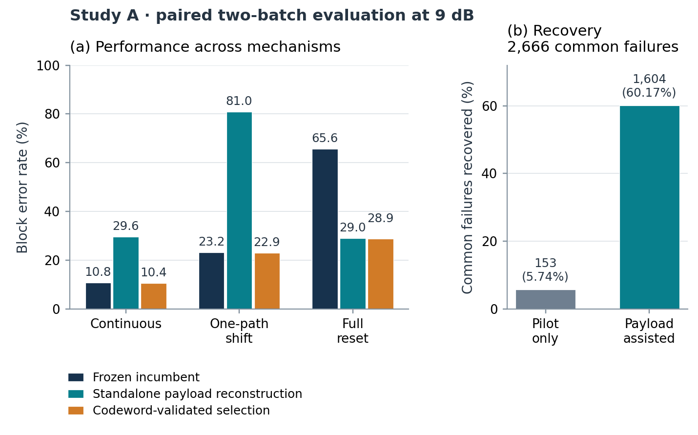
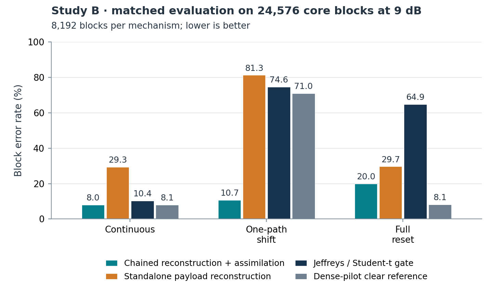
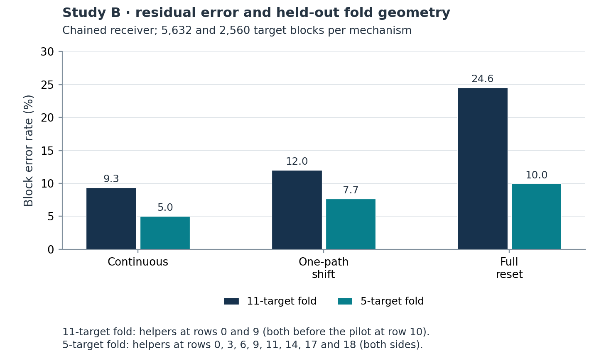

# Abstract

Sparse training becomes particularly fragile when a receiver inherits a channel state that is only partly valid or has been completely reset. We study a receiver that combines unknown-payload covariance reconstruction with selective assimilation of decoded codewords. For a coded cyclic-prefix single-carrier waveform, we derive the second-order information carried by unknown payloads and distinguish relative multipath dynamics from the common phase that a block covariance cannot resolve. A conditional Fisher-information calculation explains how correctly decoded, temporally separated helper blocks can restore coherent frequency information. The receiver conditions a joint trajectory bank on one known block, scores unknown auxiliary blocks through their full within-block covariance, selects a continuous, single-path-shift, or reset model, and assimilates reliability-weighted codewords while keeping the target blocks separate from channel fitting. In a first synthetic study at 9 dB, payload reconstruction recovers 1,604 of 2,666 blocks missed by two incumbent receivers, compared with 153 recovered by the matched pilot-only reconstruction. Codeword-based branch selection reduces the equal-regime block error rate from 33.19% to 20.73%. In a separate frozen study of 24,576 target blocks, the complete receiver achieves 12.88%, compared with 46.76% for standalone reset reconstruction and 49.96% for the history-trust baseline. Incorrect accepted words account for 1.18% of assimilation events. These results support the proposed combination under the declared synthetic model, while exposing limits due to phase ambiguity, model mismatch, finite candidate lists, and error propagation.

**Keywords:** semi-blind channel estimation; dynamic multipath; coded single-carrier reception; phase ambiguity; covariance inference; decision-directed estimation.

# 1. Introduction

A receiver that carries a propagation estimate from one frame to the next faces two distinct problems. It must detect when that estimate is unreliable, and it must construct a useful replacement from the observations that remain. Rejecting stale information solves only the first problem. If the next frame contains little known training, a receiver may correctly decide to discard its history and still lack enough coherent information to decode the payload.

Partial changes make this decision harder. A frequency shift on one propagation path does not invalidate every path. Conversely, retaining an entire historical state after an independent channel reset can produce sharply concentrated but incorrect predictions. A useful receiver therefore needs both a reconstruction mechanism and a disciplined way to decide which physical model should supply the reconstruction.

Unknown payload samples provide one source of additional information. Their transmitted values are unavailable, but their modulation and coding impose statistical structure. Received covariance can expose interference between delayed copies of the same transmitted sample, including the relative phases and frequencies of propagation paths. This structure survives even when different blocks carry independent information words. However, it does not provide every component of a coherent channel estimate. Multiplying a complete block channel by a common phase leaves its covariance unchanged.

This paper studies a reconstruction-and-assimilation receiver built around that division of information. Unknown payloads first constrain a small physical trajectory model. One known block anchors the coherent gain distribution. Selected decoded blocks then provide further coherent constraints, with their reliability discounted before they are admitted into a persistent observation ledger. The expression *phase consistent* refers to preserving a common phase coordinate and the declared trajectory law through prediction, model changes, and refitting. It does not imply that phase is always identifiable or that accepted words are always correct.

The technical contributions are threefold. First, we give a model-specific analysis of what payload covariance retains, what it removes, and why temporally separated coherent observations address a different estimation direction. The analysis includes a direct check that the implemented coded constellation has the required second moments, without assuming mutual independence of all coded symbols. Second, we specify a practical receiver with joint reset trajectories, conditional gain uncertainty, explicit physical-class selection, and fold-specific codeword assimilation. Third, we evaluate recovery, newly introduced errors, residual phase limitations, and the complete receiver under two separately frozen synthetic protocols.

The scope is deliberately concrete: a known three-path support, a short rate-one-half coded 16-QAM waveform, one primary signal-to-noise ratio, and complete-frame processing. The experiments establish neither universal identifiability nor a general advantage over all semi-blind receivers. They demonstrate that recovering relative dynamics and selectively adding coherent information can repair failures that history rejection or pilot-only reconstruction leaves unresolved.

# 2. Related work

Blind and semi-blind channel estimation from received-data structure is established. Tong, Xu, and Kailath developed blind identification and equalization using second-order statistics of oversampled communication signals [1]. Their identifiability setting differs from the finite-block structured channel considered here, but it rules out treating second-order channel information itself as a new principle. Ma, Kobayashi, and Schwartz used expectation-maximization procedures to improve OFDM channel estimates initialized from limited pilots or the preceding frame [2].

Decoder feedback is also a mature receiver design. Tüchler, Koetter, and Singer studied turbo equalization, including the exchange of soft information between linear-filter equalizers and decoders [3]. Otnes and Tüchler used soft iterative channel estimation for time-varying frequency-selective channels, effectively supplying additional training information between transmitted training sequences [4]. Factor graphs provide a general framework for representing such coupled inference problems [5]. The present implementation uses selected hard codewords with discounted observation precision; it is not an exact sum-product solution of the joint channel-and-codeword posterior.

Modern methods exploit unknown payloads in several other ways. DeepRx combines pilot and data observations in a convolutional receiver and produces soft bits compatible with an external decoder [6]. Hansen investigated semi-blind estimation from 802.11 OFDM data symbols to recover packets with unavailable or corrupted physical-layer headers [7]. Mehrabani, Abolhassani, and Haddadi combined received-signal correlation, a basis-expansion model, pilot placement, and sparse estimation for doubly selective massive MIMO-OFDM channels [8].

Our contribution is the specific treatment of dynamic historical-state failure: payload-derived relative trajectory reconstruction, coherent phase anchoring, a protected choice among physical change classes, and selective codeword assimilation with declared observation boundaries. The comparisons in this paper are against frozen project receivers sharing the waveform and evaluation contract. They are not numerical reproductions of [1]–[8], whose observation models and budgets differ. A broader comparison with matched modern semi-blind and iterative receivers remains necessary before claiming a general performance advantage.

# 3. Signal model and observation budget

## 3.1. Coded blocks and dynamic multipath

Let $r$ index a useful block in the target frame and $n\in\{0,\ldots,N-1\}$ index a sample after cyclic-prefix removal. The received vector is

$$
y_r=H_r x_r+\epsilon_r,\qquad
\epsilon_r\sim\mathcal{CN}(0,N_0 I), \qquad (1)
$$

where the noise is independent of the transmitted symbols. The time-varying cyclic channel satisfies

$$
H_r[n,m]=\sum_{\ell=0}^{2}g_\ell(t_{r,n})
\mathbf{1}\{m=(n-d_\ell)\bmod N\}. \qquad (2)
$$

The benchmark uses $N=32$, a cyclic prefix of 16 samples, and delay support $(d_0,d_1,d_2)=(0,2,4)$. Time is measured in units of $N$ samples, including prefix intervals. Each path follows a linear frequency trajectory, so its complex phase is quadratic in time. Around a reference time $t_0$, write

$$
g_\ell(t)=a_\ell
\exp\!\left\{2\pi i\left[f_\ell(t-t_0)
+\tfrac12 q_\ell(t-t_0)^2\right]\right\}. \qquad (3)
$$

Here $f_\ell$ is a normalized frequency and $q_\ell$ is its slope. The path powers are $(0.75,0.17,0.08)$. In the reset model, the dominant path has a fixed modulus and uniform phase; the weaker gains are circular complex Gaussian. The public signed start and end frequency magnitudes lie between 0.045 and 0.080 cycles per $N$ samples, with a common sign at both endpoints for each path [9,10].

Each useful block carries a systematic $(128,64)$ low-density parity-check codeword, mapped to 32 normalized Gray 16-QAM symbols. Independent uniform information words are generated across blocks. Frame A supplies OFDM history; frame B, the target of all primary decoding results below, uses cyclic-prefix single-carrier modulation. Thus the experiment tests transfer of a physical propagation state across waveform types, rather than an OFDM-only target receiver.

## 3.2. Three change regimes

The nominal regimes are continuous evolution, a frequency shift on one path, and a full reset. Continuous evolution preserves the historical trajectory law. A single-path shift changes the frequency of one path while retaining a continuous phase at the onset. A full reset replaces the historical propagation state with an independently generated state. These mechanisms share the same declared support and are not arbitrary channel perturbations.

Frame B contains 20 rows. The sparse receiver knows the transmitted block at row 10. Rows 0 and 9 carry additional payload in the sparse layout; the dense-pilot reference instead knows rows 0, 9, and 10. Row 19 is a withheld probe used only to evaluate predictive channel quantities. The 16 core decoding targets are rows 1–8 and 11–18. Historical frame A contains 64 known pilot resource elements: the 16 even-indexed subcarriers in rows 0, 9, 10, and 19. Its remaining cells contain payload. The reset reconstruction does not use frame A; the continuous and shifted alternatives do.

## 3.3. Separation of reconstruction and target observations

The receiver constructs two separate fold-specific fitting states. Their contracts are shown in Table 1. A core target is decoded only with its owning fold after channel fitting and helper assimilation have finished. Its samples, and those of the other core targets in that fold, do not enter the substantive estimation or helper-selection computations. The two updated states and their accepted-word ledgers are not shared, although the underlying observations overlap across folds and the states are not statistically independent.

**Table 1. Observation sets for the two fitting folds.** Row 10 is the common known anchor; row 19 is excluded from fitting in both folds.

| Fold | Unknown auxiliary rows | Core target rows | Eligible helper rows |
|:--|:--|:--|:--|
| 0 | 2, 5, 8, 13, 16 | 1, 3, 4, 6, 7, 11, 12, 14, 15, 17, 18 | 0, 9 |
| 1 | 1, 4, 7, 12, 15 | 2, 5, 8, 13, 16 | 0, 3, 6, 9, 11, 14, 17, 18 |

Each fold uses five unknown auxiliary blocks to score channel covariance. Those blocks are excluded from its helper ledger, so a covariance observation is not silently relabeled as an independent virtual pilot. This construction covers all core rows while preserving a strict separation between a target decision and the channel fit used for that decision. It is a complete-frame smoothing protocol: some observations occur later in time than the target. No causal-streaming latency claim follows from it.

# 4. Information supplied by unknown and decoded payloads

## 4.1. Exact second moments of the implemented coded constellation

**Proposition 1.** Let $u$ be uniform on $\mathbb{F}_2^{64}$, let $c=uG$ be the implemented codeword, and group four consecutive code bits into each normalized 16-QAM symbol. If every four-column symbol projection of $G$ has rank four and every eight-column two-symbol projection has rank eight, then

$$
\mathbb{E}[x]=0,\qquad \mathbb{E}[xx^{\mathrm H}]=I. \qquad (4)
$$

**Proof.** A full-rank linear image of a uniform binary vector is uniform over its output space. Each four-bit group is therefore uniform, and each distinct pair of groups is independent. The two symmetric PAM coordinates have zero mean and variance one half. Consequently every QAM symbol has unit expected energy and every distinct pair has zero cross moment. This proves (4), without requiring mutual independence of all 32 symbols.

For the frozen code, direct arithmetic over $\mathbb F_2$ gives rank four for all 32 symbol projections and rank eight for all 496 distinct symbol pairs. This finite algebraic check supports the moment model used below. It does not replace the code constraints with an independent-symbol likelihood.

## 4.2. Covariance reveals cross-path structure

Conditional on a deterministic channel, (1) and (4) give

$$
C_r=\mathbb E[y_r y_r^{\mathrm H}\mid H_r]
=H_rH_r^{\mathrm H}+N_0I. \qquad (5)
$$

At a nonzero cyclic lag $k$, expansion over the common input column yields

$$
C_r[n,(n-k)\bmod N]
=\sum_{d_i-d_j\equiv k\;(\bmod N)}
g_i(t_{r,n})\,\overline{g_j(t_{r,(n-k)\bmod N})}. \qquad (6)
$$

For delays $(0,2,4)$, lag four isolates the pair of paths at delays four and zero. Lag two combines the pairs $(2,0)$ and $(4,2)$. Their complex products encode relative phase evolution. A trajectory model couples these products across observation times even when the transmitted information words differ.

Equation (5) also exposes an ambiguity: $H_r$ and $e^{i\phi_r}H_r$ have identical covariance for any phase constant within block $r$. More generally, identifying $H_rH_r^{\mathrm H}$ need not identify the physical parameters uniquely. The present analysis does not prove global injectivity of the three-path parameterization modulo phase.

## 4.3. Why a Gaussian covariance score remains useful

The receiver evaluates a Gaussian score even though the payload is discrete and coded. Its population interpretation can be stated exactly.

**Proposition 2.** For $C_\star=\mathbb E[yy^{\mathrm H}]\succ0$, define $s(C;y)=-y^{\mathrm H}C^{-1}y-\log\det C$ for $C\succ0$. Then

$$
\mathbb E[s(C_\star;y)-s(C;y)]
=\operatorname{tr}(C^{-1}C_\star)
-\log\det(C^{-1}C_\star)-N\ge0. \qquad (7)
$$

Equality holds if and only if $C=C_\star$.

**Proof.** The expected quadratic form equals $\operatorname{tr}(C^{-1}C_\star)$. If $\lambda_k$ are the eigenvalues of $C^{-1/2}C_\star C^{-1/2}$, the right-hand side is $\sum_k(\lambda_k-1-\log\lambda_k)$. Each summand is nonnegative and vanishes only at one.

No Gaussian true-data assumption is needed for (7). The result establishes expected optimality in covariance space; it does not establish finite-sample recovery or a calibrated trajectory posterior. Summing such marginal block scores remains meaningful in expectation, but sharing uncertain gains across blocks makes the resulting product a composite likelihood rather than the exact joint coded-data likelihood.

## 4.4. A common frequency is weakly observed, not entirely invisible

Suppose every path acquires the same additive frequency $\delta$, and write $t_{r,n}=t_r+n/N$. With $D(\delta)_{nn}=\exp(2\pi i\delta n/N)$,

$$
H_r(\delta)=e^{2\pi i\delta t_r}D(\delta)H_r(0),
\qquad C_r(\delta)=D(\delta)C_r(0)D(\delta)^{\mathrm H}. \qquad (8)
$$

The block-start phase cancels. Nevertheless,

$$
\left.\frac{\partial C_r(\delta)_{nm}}{\partial\delta}\right|_{\delta=0}
=2\pi i\,\frac{n-m}{N}\,C_r(0)_{nm}. \qquad (9)
$$

Off-diagonal covariance can therefore retain within-block information about a common frequency. What it loses is the coherent long temporal baseline associated with the block-start phase. This distinction is more precise than saying that covariance contains only relative frequencies.

## 4.5. Coherent helper blocks supply temporal leverage

Consider the conditional model $y_n=e^{i(\phi+2\pi f u_n)}z_n+\epsilon_n$, with independent $\epsilon_n\sim\mathcal{CN}(0,v_n)$, known $z_n$, known variances $v_n>0$, and all other channel parameters held fixed. Let $e_n=|z_n|^2/v_n$ and assume $\sum_n e_n>0$.

**Proposition 3.** After eliminating the unknown phase intercept, the Fisher information for the common frequency is

$$
J_{f\mid\phi}
=2(2\pi)^2\sum_n e_n(u_n-\overline{u}_e)^2,\qquad
\overline{u}_e=\frac{\sum_n e_nu_n}{\sum_n e_n}. \qquad (10)
$$

**Proof.** For proper complex Gaussian noise, $J_{ab}=2\operatorname{Re}\sum_n(\partial_a\mu_n)^*(\partial_b\mu_n)/v_n$. The derivatives are $i\mu_n$ and $2\pi i u_n\mu_n$. The Schur complement of the phase entry gives (10).

Equation (10) connects coherent information to an energy-weighted temporal spread. A correctly decoded helper far from the known anchor can contribute a useful frequency baseline. The result is conditional: unknown relative path parameters require further nuisance elimination, and an incorrectly decoded word is not a valid coherent reference. The assimilation procedure must therefore balance information gain against the risk of installing a wrong word.

# 5. Reconstruction and selective assimilation

## 5.1. Joint reset trajectories and conditional gain inference

The reset branch represents each path by 18 signed start/end frequency trajectories, using three-point Gauss–Legendre quadrature for each endpoint and two signs. Their Cartesian product contains 5,832 joint nodes. For a fixed node, the known anchor is a linear observation of the three complex gains. Integrating the two Gaussian weak gains and the uniform dominant phase gives conditional means and a full three-by-three gain covariance. Appendix A gives the formulas.

In Study A, the nominal gain-power model is fixed. The complete receiver in Study B additionally integrates a dimensionless power scale with 49 quadrature points under a frozen log-uniform prior on $[0.25,64]$. Computation takes place in canonical units $c_B=\sqrt{N_0}\,u_B$, where $u_B$ is a unit-modulus phase derived from the anchor. Received signals and gain means are divided by $c_B$ and variances by $|c_B|^2$; quantities are transformed back consistently. This change of coordinates improves numerical and phase consistency without creating additional information.

The five auxiliary blocks are first scored through the Fourier-diagonal projection of their covariance. This inexpensive score constructs a tempered proposal, with exponent 0.75. A deterministic midpoint compression allocates a budget of 160 samples from that proposal. Study B stratifies the compression to retain materially represented sign modes. The retained nodes are then rescored using the full time-domain covariance, including cross-path gain second moments, and the proposal contribution is corrected in their weights.

Because every delay is even, permuting samples into even and odd indices reduces each 32-by-32 covariance to two 16-by-16 Hermitian blocks. This is an exact computational simplification. It does not make the Gaussian payload law, finite trajectory quadrature, or support compression exact. Importance correction also cannot recover a mode absent from the retained support.

The output is a moment approximation. For a propagated scalar gain with node mean $m_j$ and conditional variance $\sigma_j^2$,

$$
\mu=\sum_j w_jm_j,\qquad
v=\sum_jw_j\{\sigma_j^2+|m_j-\mu|^2\}. \qquad (11)
$$

The second term accounts for disagreement between trajectories. In Study B, the persistent reset state retains full conditional cross-path covariance for known-waveform prediction. Study A uses full moments internally for covariance scoring but exports only per-path means and marginal variances. Final data decoding uses means and marginal variances in both studies.

## 5.2. Selecting a physical change class

Standalone reset reconstruction is appropriate when history has failed completely. It is not a suitable universal replacement for continuous or partially valid history. The complete receiver therefore compares continuous ($C$), single-path-shift ($S$), and reset ($R$) classes using the same anchor and auxiliary observations in common noise units.

The shifted class contains 144 candidates: three possible changed paths, 24 signed frequency offsets, and onset rows zero or six. Its score includes a uniform multiplicity prior over these hypotheses; the top-level classes have equal nominal prior weights. A local parabolic refinement can improve the best shift candidate, after which both its state and score are recomputed. The phase modification is

$$
M_\ell(t)=
\exp\{2\pi i\,\mathbf1_{\ell=\ell_\star}\,
\delta(t-\tau)_+\}, \qquad (12)
$$

which is continuous at the onset $\tau$.

Writing the common-unit composite scores as $B_C,B_S,B_R$, the frozen switch uses

$$
T_f=\max(B_S,B_R)-B_C. \qquad (13)
$$

It selects $C$ when $T_f\le3.50$ and otherwise chooses the larger of $B_S$ and $B_R$. This is a calibrated hard class decision. Trajectory uncertainty remains inside the selected class; the receiver does not maintain a final soft mixture over all three classes. The score construction should not be interpreted as a proof of calibrated class probabilities.

## 5.3. Codeword scoring and admission

Helper decoding uses the frozen large-list decoder, denoted Strong-L, with waveform reranking of generated valid codewords and selected generator-neighbor perturbations. When both signs of the dominant-path frequency have more than 0.05 probability in the first wave, candidate words from both sign modes are deduplicated and evaluated on a common union.

For mode $b$ and candidate word $x$, the diagonal predictive variance is

$$
V_{b,n}(x)=N_0+
\sum_\ell v_{b,\ell,n}|x_{(n-d_\ell)\bmod N}|^2. \qquad (14)
$$

The multimode word score is

$$
\ell(x)=\log\sum_b p_b\exp\!\left\{
-\sum_n\left[
\log(\pi V_{b,n}(x))+
\frac{|y_n-(H_bx)_n|^2}{V_{b,n}(x)}
\right]\right\}. \qquad (15)
$$

Thus mode evidence is combined before candidate words are compared. The best and runner-up searched words define the admission margin. The uncertainty model in (14) neglects temporal and cross-path covariance, and the finite list need not contain the globally most likely word. Neither a zero parity syndrome nor a large searched-list margin certifies the transmitted word.

Admission uses a bounded margin weight, an absolute-fit guard, and a second predictive-residual guard. The default margin threshold is 4.5, increased to 6.5 when belief propagation has not converged. Above threshold,

$$
\alpha_{\mathrm{margin}}=0.75
\left[1-e^{-(\Delta-\Delta_{\min})/5.5}\right]w_{\mathrm{fit}}. \qquad (16)
$$

Residual weights equal one up to a normalized residual ratio of one, decrease smoothly thereafter, and vanish at 3.5. After both guards, a word enters the ledger only if $\alpha_{\mathrm{eff}}\ge0.08$. Its effective observation variance is

$$
N_{\mathrm{eff}}=N_0(1/\alpha_{\mathrm{eff}}+0.15). \qquad (17)
$$

These frozen weights provide conservative influence control. They are not calibrated posterior probabilities of correctness. Appendix B specifies the taper and remaining implementation details.

## 5.4. Wave scheduling and immutable-base refitting

Eligible helpers are processed in four rings around the anchor: $(9,11)$, $(8,12)$, $(4,5,6,7,13,14,15,16)$, and $(0,1,2,3,17,18)$, each intersected with the fold's helper set. All words in a ring are evaluated against the same pre-wave state. Accepted words are installed together before the next wave.

The ledger records each distinct accepted row, its re-encoded waveform, and its discounted variance. It does not repeatedly treat a previously accepted word as a new independent observation. For the reset branch, let $A$ denote the known anchor, $U$ the auxiliary payload rows, and $V$ the current ledger. With base weights $w_j^0$ containing the frozen auxiliary contribution,

$$
w_j(V)\propto w_j^0
\exp\{L_j(A\cup V)-L_j(A)\}. \qquad (18)
$$

Gain moments are recomputed on $A\cup V$. The empty ledger returns the base state, and refitting the same ledger is idempotent. Continuous and shifted branches similarly refit from their immutable pre-anchor historical prior. This prevents replay of designated anchor and ledger factors within the implemented representation. It does not remove dependencies created by selecting virtual observations from noisy decoded data.

After the final wave, each fold freezes its state. The owning core targets receive LMMSE-generated initial log-likelihood ratios followed by Strong-L decoding. Their effective per-sample noise includes the sum of marginal path variances. Full trajectory-and-codeword marginalization is not performed.

**Algorithm 1. Complete reconstruction-and-assimilation receiver.**

1. Estimate the historical propagation prior from frame A; construct the independent reset candidate bank from the frame-B anchor.
2. For each fold, score its five unknown auxiliary blocks, obtain the reset moment state, and compare the continuous, shifted, and reset classes.
3. Select one class using (13) and retain its internal trajectory uncertainty.
4. Process eligible helper rings. Generate and rerank valid words, apply (16)–(17), and admit accepted rows together.
5. Refit the selected class from its immutable base and the complete current ledger using each designated row once.
6. Freeze the fold state and decode its core targets. Evaluate the withheld probe and correctness metrics only outside receiver inference.

# 6. Experimental protocol

## 6.1. Study A: isolating payload reconstruction

Study A compares pilot-only and payload-assisted versions of the same reset reconstruction. Both use the same 5,832-node candidate universe, gain prior, analytic anchor conditioning, and final Strong-L decoder. The pilot-only arm integrates the complete bank. The payload-assisted arm adds auxiliary covariance evidence and its associated score-guided compression to a budget of 160 samples. This comparison tests the payload-assisted construction within a shared physical model, with the numerical support difference stated explicitly [9].

Two independently seeded batches each contain 128 physical links per regime and 16 core targets per link. Each batch therefore contains 6,144 targets; pooling yields 12,288 targets, with 4,096 per regime. Within a batch, the three regime variants share physical seeds. The replication changes simulation seeds while preserving the model and frozen receiver settings.

The frozen incumbent retains the Jeffreys/Student-t output unless an earlier single-path repair passes its covariance checks and a frozen attention-rank safeguard. The safeguard uses maximum actionable-fold scores from 128 independent reset calibration links and admits repair only when its finite-sample rank probability is at most 0.05. Neither its inherited weights nor its calibration records are retrained in Study A. In addition to always using the new reset branch, the study evaluates covariance-based and codeword-based branch selection. The latter uses reserved rows zero and nine, forms a common union of at most two decoded valid words per validation row, and evaluates the same word list under each competing branch. It is a finite-list validation score, not an exhaustive likelihood calculation.

The common-failure subset comprises full-reset targets missed by both the history-trust receiver and the earlier repair branch. Its denominator is fixed before evaluating recovery by the new branch. Introduced errors are reported separately. Confidence intervals use 10,000 paired physical-link bootstrap replicates, stratified by batch; regime variants for a physical seed remain together in equal-regime contrasts. These intervals are exploratory and have no multiplicity correction.

## 6.2. Study B: the frozen complete receiver

Study B evaluates the complete procedure in Section 5 on 16 paired simulation clusters. Each cluster contains 32 links per nominal regime, giving 1,536 links and 24,576 core targets in total, or 8,192 targets per regime. Development uses a separate seed namespace and 320 links spanning five mechanisms. There is no newly trained neural head in the primary reconstruction-and-assimilation arm [10].

The within-study controls are standalone reset reconstruction, sparse-pilot receivers that always clear or inherit history, the frozen Jeffreys/Student-t history-trust baseline, and a dense-pilot always-clear receiver. The history gate blends inherited and cleared trajectory candidates using row-dependent weights from Student-t pilot innovations with four degrees of freedom and Jeffreys-divergence extrapolation penalties. It mixes bit probabilities and includes within-branch and between-branch uncertainty before the same Strong-L decoder. The dense reference uses three known frame-B blocks rather than one. A full-pipeline comparison against standalone reset reconstruction changes both physical-class handling and assimilation; it does not isolate the effect of assimilation alone.

The two prespecified primary contrasts enumerate all $2^{16}=65{,}536$ paired cluster sign patterns, followed by Holm adjustment. The two-sided 95% confidence intervals are paired-cluster Student-t intervals with 15 degrees of freedom; they are separate from the sign-flip tests and are not multiplicity-adjusted simultaneous intervals. Exact validity of the sign-flip reference distribution requires joint sign symmetry under the null, as would hold for independent symmetric cluster differences. The large number of coded bits is not treated as the independent sample size.

For the continuous regime, sparse-pilot noninferiority to the dense reference uses a prespecified margin of one percentage point of block error rate and a one-sided 95% paired $t$ upper bound with 15 degrees of freedom. This criterion does not extend to the reset regime.

All primary numerical results in both studies use 9 dB, with $N_0=10^{-9/10}$ for unit mean symbol energy. The declared implementation supports other SNR values, but no multi-SNR performance curve is established by these experiments. Primary physical inference in Study B uses float64/complex128 arithmetic.

## 6.3. Metrics and accounting

Block error rate (BLER) counts an information block as incorrect if any of its 64 information bits is wrong. Recovery is the number corrected within a specified baseline failure set; a recovery rate alone is not a net improvement. Net improvement also accounts for previously correct blocks made incorrect.

Probe normalized mean-square error compares the predicted clean received waveform with the withheld clean probe. A residual-to-predictive-variance ratio is also reported as a calibration diagnostic; a value near one is a pooled moment check, not full distributional calibration. False assimilation is measured using the actual codeword installed at the time of each ledger event, rather than a later redecoding.

Delivered information bits per frame are secondary accounting. The sparse layout includes two additional payload rows, zero and nine, that may also act as helpers and are subsequently redecoded. The strict target-isolation statement applies to the 16 core rows, not to those extra-row contributions. Both layouts use the same frame geometry; the bit count does not include processing time, retransmission protocols, or hardware throughput.

# 7. Results

## 7.1. Unknown payloads recover failures left by pilot-only reconstruction

Across the two Study A batches, the common-failure subset contains 2,666 full-reset blocks. The matched pilot-only reconstruction recovers 153, or 5.74%. Payload reconstruction recovers 1,604, or 60.17%, with an exploratory 95% link-bootstrap interval of 56.18%–64.10%. The two batches contribute 698 of 1,241 and 906 of 1,425 recovered common failures, respectively. Thus the effect persists under independently regenerated links rather than arising solely from one batch [9].

This recovery has a cost. On the 1,339 full-reset blocks that both predecessor receivers decode correctly, standalone reconstruction introduces 115 errors. It should therefore not be judged only on the failure subset. Over all 4,096 full-reset targets, its BLER is 29.00%, compared with 63.75% for the matched pilot-only reconstruction. The corresponding reduction is 34.74 percentage points, with an exploratory paired interval of 31.27–38.16 points.

**Table 2. Study A BLER in percent.** Each regime has 4,096 targets. Equal-regime pooling contains 12,288 targets.

| Receiver | Continuous | One-path shift | Full reset | Pooled |
|:--|--:|--:|--:|--:|
| Frozen incumbent | 10.79 | 23.22 | 65.58 | 33.19 |
| Always use payload reconstruction | 29.59 | 80.96 | 29.00 | 46.52 |
| Covariance-based selection | 14.55 | 25.88 | 30.44 | 23.62 |
| Codeword-based selection | 10.45 | 22.88 | 28.86 | 20.73 |

Table 2 and Figure 1 show why reconstruction must be selective. Always using the reset model substantially harms the continuous and one-path-shift regimes. Codeword-based selection instead reduces errors from 4,079 to 2,547 over the full cohort. It corrects 1,656 incumbent errors and introduces 124 new errors, a net reduction of 1,532 blocks or 12.47 percentage points; the paired interval is 11.28–13.64 points. The selected receiver recovers 1,603 of the common-failure blocks, one fewer than standalone reconstruction.

The 115 and 124 introduced-error counts answer different questions. The first concerns standalone reconstruction on full-reset blocks correct under both predecessors. The second concerns the selected receiver relative to the frozen incumbent across all three regimes. Keeping their populations separate prevents recovery claims from obscuring the actual trade-off.

{width=6.5in}

**Figure 1. Study A at 9 dB.** Left: matched three-regime BLER, showing the need for selective reset reconstruction. Right: recovery within 2,666 full-reset blocks missed by both predecessor receivers; these fractions are not whole-cohort BLER. The pilot-only arm recovers 153 blocks and standalone payload reconstruction recovers 1,604. The selected arm recovers 1,603. Bars are descriptive; paired uncertainty intervals are reported in the text.

## 7.2. Physical diagnostics support the relative-dynamics mechanism

The decoding improvement accompanies better physical estimates on full-reset links. In the first Study A batch, relative-phase RMSE decreases from 0.797 to 0.224 radians and relative-frequency RMSE from 0.06772 to 0.00902 cycles per $N$ samples when payload scoring is enabled. The replication gives corresponding changes of 0.999 to 0.258 radians and 0.08189 to 0.01084 cycles per $N$ samples [9].

A timing control separates structured trajectory evidence from merely adding received energy. On a separate 32-link full-reset set containing 512 targets, pilot-only reconstruction produces 320 errors, correctly timed payload reconstruction produces 138, and cyclically permuting the auxiliary block times produces 407. The result is consistent with exploitation of temporal cross-path structure, although the deliberately mismatched control is not a competing estimator.

The remaining common-phase problem is substantial. In two diagnostic 32-link subsets, replacing the residual common phase with evaluator-only oracle information reduces reconstruction errors from 132 to 40 and from 154 to 26, each over 512 targets. These oracle results are excluded from operational receiver comparisons. They indicate available improvement if coherent phase were better resolved, not an achievable performance bound for the proposed decoder.

## 7.3. The complete receiver improves matched Study B controls

The frozen complete receiver makes 3,166 errors in 24,576 core targets, yielding 12.88% BLER. Table 3 and Figure 2 give the matched breakdown. Its error counts are 654, 874, and 1,638 in the continuous, one-path-shift, and full-reset regimes, respectively [10].

**Table 3. Study B matched BLER in percent.** Every regime contains 8,192 targets. Sparse receivers know one frame-B block; the dense reference knows three.

| Receiver | Continuous | One-path shift | Full reset | Pooled |
|:--|--:|--:|--:|--:|
| Complete receiver | 7.98 | 10.67 | 20.00 | 12.88 |
| Standalone reset reconstruction | 29.32 | 81.29 | 29.66 | 46.76 |
| Always clear history | 61.55 | 85.13 | 63.37 | 70.02 |
| Always inherit history | 10.19 | 74.50 | 94.04 | 59.58 |
| Jeffreys/Student-t history gate | 10.36 | 74.63 | 64.87 | 49.96 |
| Dense-pilot clear reference | 8.07 | 70.96 | 8.14 | 29.06 |

The mean paired cluster improvement is 33.87 percentage points relative to standalone reset reconstruction, with a 95% interval of 32.78–34.96 points. Relative to the history gate, it is 37.07 points, with an interval of 35.63–38.51 points. The complete receiver improves both controls in all 16 clusters. Both two-sided sign-flip tests have raw $p=1/32{,}768$ and Holm-adjusted $p=1/16{,}384$.

These are complete-pipeline effects. The large one-path-shift advantage over standalone reconstruction reflects appropriate use and repair of history as well as codeword assimilation. The design does not provide a matched arm that removes only assimilation while preserving every other component. Also, the 20.73% selected-receiver result from Study A and the 12.88% result here belong to different cohorts and implementations; their difference is not reported as a paired incremental gain.

On the withheld probe, the complete receiver has pooled clean-waveform NMSE 0.0672, compared with 0.5917 for standalone reconstruction and 0.4096 for the history gate. Their pooled residual-to-predictive-variance ratios are 1.01, 1.88, and 1.33, respectively. The complete receiver's regime-specific ratios range from 0.86 to 1.16, so the near-unit pooled value should not be interpreted as uniform conditional calibration.

{width=6.5in}

**Figure 2. Study B at 9 dB.** All methods share 1,536 physical links and 24,576 core targets. The complete receiver combines class selection, payload reconstruction, and codeword assimilation. Its comparison with standalone reconstruction does not isolate assimilation. The dense reference has a larger pilot budget and is more accurate under full reset. Inference uses the 16 paired cluster aggregates, not the individual coded bits.

## 7.4. Continuous-channel pilot economy has a limited noninferiority result

Under continuous evolution, the sparse complete receiver has 7.9834% BLER and the dense reference 8.0688%. The paired difference, sparse minus dense, is $-0.0854$ percentage points. Its one-sided 95% upper bound is $+0.6218$ points, below the declared $+1$-point margin. The prespecified continuous-regime noninferiority criterion is therefore satisfied [10].

Secondary delivered-bit accounting gives 1,063.75 information bits per frame for the sparse receiver and 941.375 for the dense reference, an increase of 122.375 bits or 13.00%. This reflects the two additional payload rows in the sparse layout as well as decoding performance, with the helper-row qualification in Section 6.3.

The result does not extend to an independently reset channel. There, sparse BLER remains 20.00%, whereas the dense reference achieves 8.14%. Extra known coherent blocks remain valuable precisely when inherited state is least informative. The dense reference also performs poorly on the one-path-shift condition, showing that a larger pilot budget alone does not repair an inadequate trajectory model.

## 7.5. Incorrect assimilation and asymmetric observation geometry

Across the formal cohort, the receiver installs 12,354 virtual observations. Of these, 146 contain incorrect transmitted words: a false-assimilation fraction of 1.18%. The regime counts are 52 of 4,406 for continuous evolution, 56 of 4,278 for one-path shifts, and 38 of 3,670 for full reset. These nonzero counts directly demonstrate why parity validity and a finite-list margin cannot be treated as correctness certificates [10].

The first wave accepts at least one helper and no incorrect word in 2,820 of 3,072 link-fold units; 42 units contain at least one incorrect first-wave word, and 210 accept none. The conditional final BLER is 11.56% for the first group and 27.02% when no first-wave word is accepted. These selected groups differ in difficulty; their contrast is diagnostic and does not estimate the causal benefit of a first-wave word.

Figure 3 localizes residual errors. In full reset, the 11-target fold has 24.56% BLER, whereas the five-target fold has 9.96%. The former has eligible helper rows zero and nine, both before the anchor. The latter has eight helper positions on both sides. This pattern is compatible with the temporal-leverage argument in (10), but helper availability, target positions, and selection opportunities change together. The experiment is not a randomized comparison of helper geometry.

{width=6.5in}

**Figure 3. Residual error by fold.** Per regime, fold 0 contributes 5,632 targets and fold 1 contributes 2,560. Both use five unknown covariance blocks, but their target positions and eligible coherent helpers differ as specified in Table 1. The full-reset difference identifies a concentration of residual errors; it does not isolate a causal effect of placing helpers on both sides of the anchor.

## 7.6. Distribution stress within the declared candidate support

Additional frozen conditions use 256 links and 4,096 targets each. The complete receiver obtains 10.21% BLER for stronger shifts, 11.11% for a midframe shift, and 20.07% for an unrelated-history donor sanity condition. The corresponding standalone reconstruction rates are 69.46%, 80.42%, and 29.20%; the history-gate rates are 69.78%, 67.50%, and 66.14% [10].

These results test changes in the sampling distribution, not arbitrary unsupported physics. The receiver's candidate bank already includes the stronger signed offsets and onset rows zero and six, and development includes strong-shift and midframe-shift mechanisms. They therefore provide evidence of robustness within an extended declared model family. They do not demonstrate extrapolation to unknown delay support, unmodeled onset positions, or arbitrary path birth and death.

# 8. Discussion and limitations

The evidence supports a division of receiver responsibilities. Covariance reconstruction supplies useful relative path information even when conventional coherent initialization fails. Coherent observations then constrain directions that covariance alone cannot determine. Physical-class selection protects valid history and avoids applying a reset-specific model indiscriminately. The immutable observation ledger makes the resulting feedback process explicit and prevents accidental repeated installation of the same designated factor.

Several boundaries matter for interpreting the result. First, the physical support is known and small. Three paths at fixed integer delays permit a compact trajectory bank and an even/odd covariance decomposition. Unknown path count, fractional delay, diffuse scattering, synchronization error, and changing support could alter both identifiability and computational cost.

Second, inference is approximate at multiple levels. Finite quadrature replaces continuous trajectories; support compression can lose modes; a Gaussian moment model replaces the coded payload law; summed block scores neglect dependencies induced by shared uncertain gains; top-level class selection is hard; and final decoding reduces uncertainty to a mean channel with marginal effective noise. The population covariance result in (7) justifies a score direction, not the calibration of the resulting approximate posterior.

Third, successful decoding is both an outcome and a source of subsequent information. Fold separation prevents a core target from directly validating its own fit, but accepted helpers remain data-dependent observations. Inflated variance and residual guards limit their influence without eliminating error propagation. The observed false-assimilation fraction is small but nonzero, and its consequences may become larger under a different code, SNR, or channel family.

Fourth, temporal geometry limits the present protocol. The folds provide unequal helper coverage, and the receiver uses complete-frame observations. The information calculation assumes correct coherent words and a shared frequency law. It cannot justify a latency claim or guarantee recovery after a phase discontinuity outside that law.

Fifth, the primary evidence is synthetic and concentrated at 9 dB. The study does not validate the complete pipeline on recorded radio data or hardware. Nor does it establish that a Transformer or attention architecture is necessary: the primary improvements arise from physical reconstruction and explicit receiver inference. The EM-FloatFormer project supplies the implementation context, but an architecture-specific claim would require an additional controlled comparison.

Finally, further experiments are needed to separate the contributions inside the complete receiver. The most direct next comparisons would hold the selected physical class fixed while disabling assimilation, vary helper placement at a fixed target set, and match pilot cost and computational budget against established semi-blind and turbo-estimation baselines. SNR sweeps, unsupported channel changes, longer codes, and receiver-runtime measurements would determine whether the present mechanism scales beyond the benchmark.

# 9. Conclusion

We have specified and evaluated a receiver that combines unknown-payload covariance reconstruction with phase-consistent selective codeword assimilation under dynamic multipath changes. The analysis distinguishes covariance-visible cross-path structure from common block phase and shows, conditionally, how coherent temporal spread supplies common-frequency information. The implementation respects this distinction through joint reset trajectories, a protected physical-class switch, uncertainty-aware candidate scoring, and immutable-ledger refitting.

The matched reconstruction study shows a large recovery advantage over pilot-only fitting, while also revealing newly introduced errors and the need for selection. The separate complete-receiver study achieves 12.88% BLER over 24,576 core targets and satisfies a declared continuous-channel noninferiority criterion relative to a larger pilot budget. Residual full-reset errors, false assimilation, and unequal helper geometry remain material. These findings establish a model-specific reconstruction-and-assimilation result and identify the comparisons needed for broader receiver claims.

# Code and experimental provenance

The implementation and recorded study outputs are available in the EM-FloatFormer repository [9,10]. Study A is pinned to commit 9e9d93bcbf6345b8645314b223cd954b2f31e63a; its principal files are p10/payload_reconstruction/estimator.py, protocol.txt, pooled.json, and the accompanying audits. Study B is pinned to report commit 307d62fd89206442960fa0cebdcdc6a0530db366; its receiver is p11/wavefront_pipeline.py with reconstruction in p11/payload_rebuild.py, and formal summaries in p11/results/.

The Study B code freeze is cec54bfd7835f0b586cde2863174830c2d619838 and the manifest freeze is cb6b2bbb33608fe26a50ddb6e18555cb35df6dd4. The manuscript reports the frozen experiments and derives the accompanying mathematical statements; it does not present the two studies as a newly rerun common cohort. All information-word correctness, true-channel errors, and oracle diagnostics are evaluator-only quantities.

# Appendix A. Conditional gain integration

For a fixed trajectory node and positive power scale $s$, stack the designated known blocks as

$$
y=d_0g_0+D_wg_w+\epsilon,\qquad
g_0=a e^{i\theta},\quad a=\sqrt{sP_0}, \qquad (A1)
$$

where $\theta$ is uniform, $g_w\sim\mathcal{CN}(0,sP_w)$, $P_w=\operatorname{diag}(P_1,P_2)$, and $\epsilon\sim\mathcal{CN}(0,W^{-1})$, with $\theta$, $g_w$, and $\epsilon$ mutually independent. The precision matrix $W$ is diagonal, with entries equal to the inverse designated observation variances, including discounted ledger variances. Define

$$
R=W^{-1}+D_w(sP_w)D_w^{\mathrm H},\qquad
b=d_0^{\mathrm H}R^{-1}y,\qquad \kappa=2a|b|. \qquad (A2)
$$

Integrating the weak gains leaves a von Mises density for the dominant phase. With $I_\nu$ denoting the modified Bessel function,

$$
m_0=a e^{i\arg b}\frac{I_1(\kappa)}{I_0(\kappa)},\qquad
v_0=a^2\left[1-\left(\frac{I_1(\kappa)}{I_0(\kappa)}\right)^2\right]. \qquad (A3)
$$

The mean is zero when $b=0$. Let

$$
\begin{aligned}
C_w&=[(sP_w)^{-1}+D_w^{\mathrm H}WD_w]^{-1},\\
b_w&=C_wD_w^{\mathrm H}Wy,\quad c=C_wD_w^{\mathrm H}Wd_0.
\end{aligned} \qquad (A4)
$$

The joint mean and covariance are

$$
m=\begin{bmatrix}m_0\\b_w-cm_0\end{bmatrix},\qquad
\Sigma=
\begin{bmatrix}0&0\\0&C_w\end{bmatrix}
+v_0\begin{bmatrix}1\\-c\end{bmatrix}
\begin{bmatrix}1\\-c\end{bmatrix}^{\mathrm H}. \qquad (A5)
$$

For $Q$ complex observations, the fixed-node, fixed-scale log evidence is

$$
L_{j,s}=-Q\log\pi-\log\det R-y^{\mathrm H}R^{-1}y
-a^2d_0^{\mathrm H}R^{-1}d_0+\log I_0(\kappa). \qquad (A6)
$$

These conditional formulas are exact under the stated prior. The code evaluates the weak-gain contribution with two-by-two linear algebra and stable Bessel functions. Study B numerically integrates $\rho=s/N_0$ using 49-point quadrature over the declared log-uniform prior. Both scale and trajectory averaging include within-component covariance and between-component mean disagreement.

For a known probe sample with delayed-symbol vector $x$, the reset branch predicts

$$
\begin{aligned}
p&=\sum_jw_jx^{\mathsf T}m_j,\\
v_p&=N_0+\sum_jw_j
\left[x^{\mathsf T}\Sigma_jx^*
+|x^{\mathsf T}m_j-p|^2\right].
\end{aligned} \qquad (A7)
$$

Here the node gain moments are propagated to the probe time. The quadratic retains cross-path covariance and adds observation noise once. It describes the variance of the declared mixture; empirical calibration remains a separate question.

# Appendix B. Admission parameters and computational scope

For normalized residual ratio $u$, the fit and residual guards use the same taper:

$$
w(u)=
\begin{cases}
1, & 0\le u\le1,\\
\displaystyle\frac{4}{4+(u-1)^2}
\left[1-\left(\frac{u-1}{2.5}\right)^2\right]^2,
& 1<u<3.5,\\
0, & \text{otherwise}.
\end{cases} \qquad (B1)
$$

The additional pre-assimilation guard uses the larger of an aggregate normalized residual and the mean of samplewise normalized residuals. A fast belief-propagation candidate path can terminate candidate generation when its margin is at least 18 and fit ratio is at most 1.35. The final core decisions still use the designated Strong-L decoder: the large candidate-list setting, 20 belief-propagation iterations, enabled turbo parallel interference cancellation, and PIC scale 0.75. These thresholds and the class switch are frozen before the formal evaluation.

The shifted class covers magnitudes 0.025, 0.035, 0.045, 0.055, 0.065, and 0.075, plus 0.085, 0.095, 0.105, 0.115, 0.125, and 0.135, with both signs. Its onset rows are zero and six. In normalized units, the frame-B useful-sample time is $t_{r,n}=30+1.5r+0.5+n/32$, and the onset for row $b$ is $\tau_b=30+1.5b$, at the start of its cyclic prefix. This explicit support explains why the stress results in Section 7.6 cannot be interpreted as arbitrary extrapolation.

The principal reset computation conditions 5,832 joint nodes on the anchor, compresses to a nominal budget of 160 proposal samples, and evaluates five full covariance blocks per retained node. With the even/odd permutation, each dense solve has dimension 16. A straightforward implementation therefore has an auxiliary scoring cost proportional to $K R\,2(N/2)^3$, where $K$ is the number of retained unique nodes and $R=5$. Gain integration and codeword enumeration add separate costs, and complete-frame buffering adds latency. The present data support no end-to-end real-time claim.

# Appendix C. A code constraint can resolve a covariance sign ambiguity

The implemented Gray mapping uses the PAM values $(-3,-1,3,1)/\sqrt{10}$. Negating every QAM symbol corresponds to adding the binary mask $(1,0,1,0)$ repeatedly across all 32 symbols. For the frozen parity-check matrix, this mask has a syndrome of Hamming weight 32 and is therefore not a codeword.

Let $\mathcal C$ be the linear binary code and $\mathcal X$ its modulated codebook. If $c$ and $c+v$ were both valid for this mask $v$, linearity would imply $v\in\mathcal C$, a contradiction. Hence $\mathcal X\cap(-\mathcal X)=\varnothing$. If the physical channel $H$ is invertible and observations are noiseless, the received codebooks $H\mathcal X$ and $(-H)\mathcal X$ are disjoint even though $H$ and $-H$ have the same covariance in (5).

This finite-code example makes the role of higher-order coding constraints explicit. It does not imply that arbitrary phase ambiguities disappear, or that a finite-list decoder resolves the sign reliably in noise. It supplies an identifiability illustration under stated conditions rather than a performance guarantee for assimilation.

# References

[1] Lang Tong, Guanghan Xu, and Thomas Kailath, “Blind Identification and Equalization Based on Second-Order Statistics: A Time Domain Approach,” *IEEE Transactions on Information Theory*, vol. 40, no. 2, pp. 340–349, March 1994. DOI: [10.1109/18.312157](https://doi.org/10.1109/18.312157).

[2] Xiaoqiang Ma, Hisashi Kobayashi, and Stuart C. Schwartz, “EM-Based Channel Estimation Algorithms for OFDM,” *EURASIP Journal on Applied Signal Processing*, vol. 2004, no. 10, pp. 1460–1477, 2004. DOI: [10.1155/S1110865704311121](https://doi.org/10.1155/S1110865704311121).

[3] Michael Tüchler, Ralf Koetter, and Andrew C. Singer, “Turbo Equalization: Principles and New Results,” *IEEE Transactions on Communications*, vol. 50, no. 5, pp. 754–767, May 2002. DOI: [10.1109/TCOMM.2002.1006557](https://doi.org/10.1109/TCOMM.2002.1006557).

[4] Roald Otnes and Michael Tüchler, “Iterative Channel Estimation for Turbo Equalization of Time-Varying Frequency-Selective Channels,” *IEEE Transactions on Wireless Communications*, vol. 3, no. 6, pp. 1918–1923, November 2004. DOI: [10.1109/TWC.2004.837421](https://doi.org/10.1109/TWC.2004.837421).

[5] Frank R. Kschischang, Brendan J. Frey, and Hans-Andrea Loeliger, “Factor Graphs and the Sum-Product Algorithm,” *IEEE Transactions on Information Theory*, vol. 47, no. 2, pp. 498–519, February 2001. DOI: [10.1109/18.910572](https://doi.org/10.1109/18.910572).

[6] Mikko Honkala, Dani Korpi, and Janne M. J. Huttunen, “DeepRx: Fully Convolutional Deep Learning Receiver,” *IEEE Transactions on Wireless Communications*, vol. 20, no. 6, pp. 3925–3940, June 2021. DOI: [10.1109/TWC.2021.3054520](https://doi.org/10.1109/TWC.2021.3054520).

[7] Christopher J. Hansen, “Semi-Blind Channel Estimation on 802.11 OFDM Data Symbols,” in *2024 International Conference on Computing, Networking and Communications (ICNC)*, Big Island, Hawaii, USA, pp. 163–167, 2024. DOI: [10.1109/ICNC59896.2024.10556187](https://doi.org/10.1109/ICNC59896.2024.10556187).

[8] Mohammad Reza Mehrabani, Bahman Abolhassani, and Farzan Haddadi, “Semi-Blind Channel Estimation and Pilot Allocation for Doubly-Selective Massive MIMO-OFDM Systems,” *IEEE Access*, vol. 12, pp. 111565–111578, 2024. DOI: [10.1109/ACCESS.2024.3441375](https://doi.org/10.1109/ACCESS.2024.3441375).

[9] EM-FloatFormer project repository, “Payload Channel Reconstruction,” source code, protocol, and recorded Study A results, commit 9e9d93bcbf6345b8645314b223cd954b2f31e63a. [Pinned implementation and results](https://github.com/20171806011/EM-FloatFormer/tree/9e9d93bcbf6345b8645314b223cd954b2f31e63a/p10/payload_reconstruction).

[10] EM-FloatFormer project repository, “Wavefront Payload Assimilation,” source code, frozen manifest, and recorded Study B results, commit 307d62fd89206442960fa0cebdcdc6a0530db366. [Code and results](https://github.com/20171806011/EM-FloatFormer/tree/307d62fd89206442960fa0cebdcdc6a0530db366/p11).
