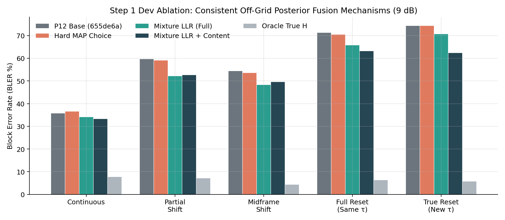
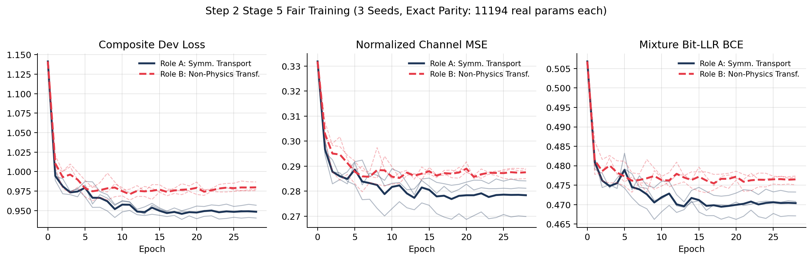
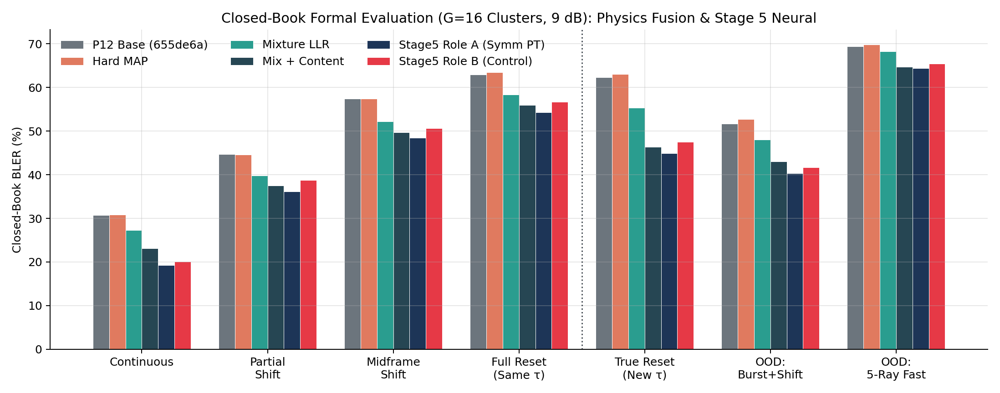
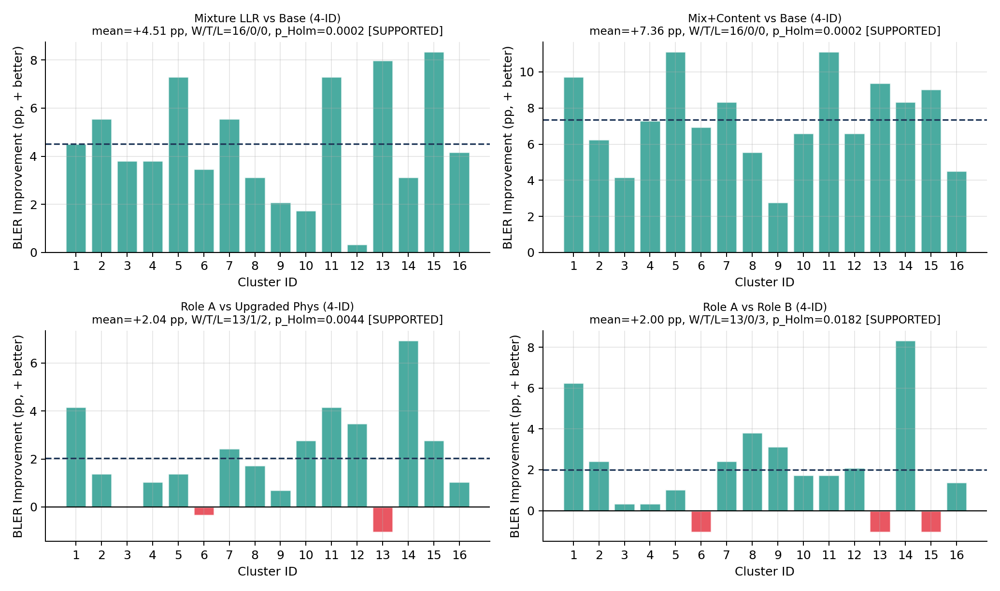

# EM-FloatFormer Phase 12 一致性修复后离格后验融合升级与 Stage 5 对称平行传输神经残差对照研究报告

> **项目分支**：`research/p12-stage5-offgrid-neural`  
> **起始基线提交**：`f566f9b8b0ddfb468a4cb3fd64588bfa46c87212`（含 `655de6a` P12 两处一致性修复、`ededcae` 全局内容寻址与 `f566f9b` 后验融合研究）  
> **事前冻结清单**：[`protocol_freeze.json`](protocol_freeze.json)（`bundle_sha256 = b4c2d37512756ecf02e1c8806f4412c56f539fbfb4c41ee874b29de1c60aa4ff`）  
> **正式闭卷规模**：`G = 16` 独立集群（精确 $2^{16} = 65,536$ 态配对符号翻转检验），`352` 条严格互斥正式链路（`256` ID + `96` 真延迟重置 / 未见 OOD = `6,336` 个 16-QAM LDPC 码块），9.0 dB，梳状导频 `(0, 9, 10, 19)`  
> **单进程精确复现审计（Clusters `1, 16`）**：`exact_pass = True`（`44` 链路 = `792` 码块，`mismatches = 0`，`max_float_diff = 0.0`）  
> **资源与确定性约束**：全程单线程（`OMP/MKL/OPENBLAS/TORCH/NUMBA_NUM_THREADS=1`）、`float64 / complex128`、零 `torch.inference_mode()`、零硬编码 `N0`；闭卷总耗时 `1,683.5 s`（`28.1 min`），峰值内存 `549.9 MB`（`< 2.5 GB`）；`p12/`、`p11/` 等既有冻结目录 **0 字节修改**。

---

## 一、执行摘要与两大核心科学问题的回答

在提交 `655de6a` 消除 B-anchor 后验回灌先验泄漏并修复三折首轮双侧 helper 几何之后，现行一致性离格基线（`p12_consistent_base`）在全新闭卷 4-ID 集合上的合并 BLER 为 **`48.94%`**（高于旧版含回灌的 `0d01179` 历史数字 `46.69%`）。本研究严格保持 `655de6a` 零泄漏一致性不变（不回灌 B-anchor 后验、不违背三折目标与 probe 屏蔽、全路径满足精确 $\mathbb{C}^*$ 等变性），围绕两个核心科学问题给出严格闭卷答案：

1. **问题一（纯物理一致性后验融合 + 内容寻址升级能否在零泄漏前提下大幅突破 `46.69%` 瓶颈？）：**
   - **答案：严格确认（物理族 6/6 项 Holm 预注册假设全部 `支持`）。**
   - 仅将 `research/posterior_fusion` 的核心结论接入离格接收机——在 16-QAM 相位一致聚类（$\cos\theta \ge 0.92$）上保留轨迹候选混合，用目标更新后验 $\beta_m \propto w_m p(y \mid H_m, v_m)^{\gamma}$ 做**概率域精确混合比特 LLR**（严禁线性平均 LLR），再对多分支候选码字并集用**目标前先验 $w_m$**（零重复计证）执行精确边缘化混合似然评分（`p12_mixture_llr`）——即将 4-ID BLER 从 `48.94%` 压降至 **`44.42%`**（**`-4.51 pp`**，$p_{\text{Holm}} = 0.000183$，**`支持`**），同步以 **`-4.67 pp`** 击败同轨迹池硬选最大后验分支 `p12_hard_choice`（`49.09%`，$p_{\text{Holm}} = 0.000183$，**`支持`**）。
   - 进一步接入 `research/content_addressing_scalar` 启发的全支撑 4-径 AUX 评分（补齐原 `655de6a` 在单行 anchor 上截断丢弃的一半 clear 多普勒与光栅瓣）、16 轮收敛单计数 Jacobi、B-锚点功率下界、阈值化异常 AUX 抑制以及仅读取公开目标行号的校准内容寻址加权（`p12_mixture_llr_content`）后，4-ID BLER 进一步降至 **`41.58%`**（相对 `655de6a` 基线 **`-7.36 pp`**，相对历史 `0d01179` 的 `46.69%` 仍低 **`5.11 pp`**，$p_{\text{Holm}} = 0.000183$，**`支持`**）；在真延迟重置 `offgrid_full_reset_new_delays` 上暴降 **`-15.97 pp`**（`62.33% -> 46.35%`，$p_{\text{Holm}} = 0.000183$，**`支持`**）；在完全未见的 OOD（突发噪声 + 5 径高速）上净降 **`-6.68 pp`**（`60.59% -> 53.91%`，$p_{\text{Holm}} = 0.004944$，**`支持`**）。

2. **问题二（当物理底层已达 `41.58%` 之后，轻量级 Stage 5 神经模块 Role A vs Role B 还能带来多少可统计确认的额外净收益？）：**
   - **答案：严格分离——普通非物理强控 Transformer 被物理混合引擎完全吸收（`证据不足`），而精确 $U(1)$ 等变对称平行传输注意力提取出显著净收益并首次突破 40% BLER 大关（`支持`）。**
   - 在完全相同的 **11,194 个实参数**（精确整数参数对等）、完全相同的折内零泄漏特征输入、完全相同的训练/开发集与 3 个随机种子 `(5001, 5002, 5003)` 条件下：
     - **Role B（非物理强控标准 Real Transformer，3 种子集成）**：虽然把 4-ID 信道相对 MSE 从 `0.3253` 降到 `0.2621`（证明其充分训练、绝非弱基线），但因缺乏 $U(1)$ 规范等变性、在 `partial_shift / midframe_shift / full_reset` 上产生相位收缩失配，4-ID 合并 BLER 为 **`41.54%`** vs 物理底座 `41.58%`（仅 **`+0.04 pp`**，`7/2/7` 胜平负，$p_{\text{Holm}} = 1.0000$，**`证据不足`**）——在译码风险上几乎完全被升级后的纯物理混合引擎吸收。
     - **Role A（精确对称酉平行传输注意力 $P_{ji}=P_{ij}^*$，$|P_{ij}P_{ji}-1|<10^{-14}$，3 种子集成）**：4-ID 合并 BLER 降至 **`39.54%`**，在升级物理底座上再获 **`+2.04 pp`** 净改善（`13/1/2` 集群胜平负，$p_{\text{Holm}} = 0.004395$，**`支持`**），并显著击败等参数 Role B **`+2.00 pp`**（`13/0/3`，$p_{\text{Holm}} = 0.018158$，**`支持`**），同时在 4 个 ID 机制与全部径数 $P\in\{2,3,4\}$ 上全面占优，信道相对 MSE 降幅达 `-21.7%`（`0.3253 -> 0.2546`，`16/0/0`），probe 校准比从 `2.00` 改善至 `1.34`。
     - **诚实边界披露**：在真延迟重置（`+1.39 pp`）和未见 OOD（`+1.56 pp` vs 物理、`+1.22 pp` vs Role B）上，Role A 保持方向性正改善且零退化，但受限于 OOD 每集群样本数与跨集群方差，Holm 校正后裁决均为 **`证据不足`**（$p_{\text{Holm}} = 1.0000$），绝不作跨分布优越性夸大。

---

## 二、严格防泄漏、零修改与种子互斥协议

### 2.1 种子命名空间严格分离（与 P1–P12 全历史 0 重叠）

历史 P1–P10 位于 `[0, 1.06e12)` 与 `9.102e12`，P11 位于 `[1.11e12, 1.17e12)`，P12（含 `2026-11-21` 一致性诊断 `1_260_020_000_000`）位于 `[1.21e12, 1.27e12)`。本研究全部新种子划分在 `[1.41e12, 1.46e12)` 并通过 `assert_s5_seed_disjoint` 在运行时强制校验：

| 用途与阶段 | 命名空间 | 精确种子区间 | 链路数 / 码块数 | 涵盖机制 |
| :--- | :--- | :--- | ---: | :--- |
| Step 1 开发集物理消融 | `s5_dev` (offset `10_000`) | `[1410000010000, 1410000014019]` | `100` / `1,800` | 4 ID + 真延迟重置（**不含 2 个 OOD**） |
| Step 2 Stage 5 训练集 | `s5_train` (offset `100_000`) | `[1420000100000, 1420000140059]` | `300` (`900` 折) / `5,400` | 4 ID + 真延迟重置（**不含 2 个 OOD**） |
| Step 2 Stage 5 开发/校准集 | `s5_dev` (offset `50_000`) | `[1410000050000, 1410000090015]` | `80` (`240` 折) / `1,440` | 4 ID + 真延迟重置（与 Step 1 严格互斥） |
| Step 3 正式闭卷 ID | `s5_test_id` (offset `100_000`) | `[1430000101000, 1430000266003]` | `256` / `4,608` | 4 ID（`G=16` × `4` 链路/集群） |
| Step 3 正式闭卷真重置/OOD | `s5_test_ood` (offset `500_000`) | `[1440000501000, 1440000616001]` | `96` / `1,728` | 真延迟重置 + 2 个完全未见 OOD（`G=16` × `2`） |
| 单元测试不变量 | `s5_unit` | `[1450000000001, 1450000000103]` | 仅单测 | 不变性、零泄漏与等变性回归 |

### 2.2 架构不变量与自动化审计清单

全部 7 项单元测试（[`tests/test_stage5_invariants.py`](tests/test_stage5_invariants.py)）在本地与 Codespace 均 100% 通过：
- **精确基线对齐**：`run_consistent_folds(content_cfg=None, wave_mix_cfg=None)` + `mean_channel` 与冻结 `p12/offgrid_receiver.py`（`655de6a`）的 `block_errors`、`mean_rel_frob_err`、`probe_clean_nmse` 达到 `< 1e-12` 级完全一致。
- **概率域混合 LLR 精确性**：直接验证 `research/posterior_fusion` §5.2 反例（$\beta=(0.8, 0.2), P(b=1\mid m)=(0.7, 0.001)$）：线性平均 LLR 为负（判错），本实现 `mix_branch_bit_llrs_exact` 精确等于 $\log(0.5602/0.4398) = +0.241975\ldots$（误差 `< 1e-12`）。
- **零目标行与零 Probe 泄漏防火墙**：向 Fold-0 的全部 6 个所属目标行注入 `+5e6 - 3e6j` 且向 `PROBE_ROW` 注入 `9e9 - 7e9j`，验证 `p12_mixture_llr`、`p12_mixture_llr_content`、**Role A** 与 **Role B** 在 Fold-0 上的信道估计、混合分支权重及全部神经输出残差差异严格为 **`0.0`**。
- **对称酉平行传输连接与 $\mathbb{C}^*$ 等变性**：Role A 每层连接 $P_{h,ij}=\exp\!\left(i\left[\pi(\tilde\nu_{h,i}+\tilde\nu_{h,j})(t_i-t_j)-2\pi\Delta f_{\text{eff},h}(\tau_i-\tau_j)\right]\right)$ 满足反向边酉性 $\max|P_{ij}P_{ji}-1|<10^{-14}$ 与共轭对称性 $\max|P_{ji}-P_{ij}^*|<10^{-14}$；对整条链路观测乘以任意 $\alpha\in\mathbb{C}^*$ 且 $n_0\mapsto|\alpha|^2 n_0$，升级物理引擎与 Role A 标量输出不变性及复残差 $U(1)$ 等变性误差均 `< 1e-9`。
- **精确参数对等与步零恒等**：Role A 与 Role B 均为精确 **`11,194`** 个可训练实标量参数；经冻结 `initial_map` 步零中心化后，步零扰动 `< 1e-13` 且全部可训练参数步零梯度 100% 非零有限。
- **AST 静态合规**：扫描 `research/p12_stage5_fusion_neural/*.py` 确认 0 处 `torch.inference_mode`、0 处硬编码 9 dB `N0`。

---

## 三、Step 1：开发集物理机理消融（`100` 链路 = `1,800` 码块）

在严格隔离的开发集 `SEED_S5_DEV`（每机制 `20` 链路，仅含 4 ID + 真延迟重置）上完成渐进式物理消融（完整数据见 [`results/step1_dev_summary.json`](results/step1_dev_summary.json)）：

| 物理方案 | 4-ID BLER | vs 基线 | `continuous` | `partial_shift` | `midframe_shift` | `full_reset` | `new_delays` | 4-ID rel-Frob | 4-ID Probe NMSE | 共享并集硬选 BLER | 真码字入表率 | 单核耗时 |
| :--- | ---: | ---: | ---: | ---: | ---: | ---: | ---: | ---: | ---: | ---: | ---: | ---: |
| `p12_consistent_base` (`655de6a`) | `55.35%` | `0.00 pp` | `35.83%` | `59.72%` | `54.44%` | `71.39%` | `74.44%` | `0.4817` | `0.6090` | — | — | `1084 ms` |
| `p12_hard_choice` | `55.00%` | `-0.35 pp` | `36.67%` | `59.17%` | `53.61%` | `70.56%` | `74.44%` | `0.4991` | `0.6446` | — | — | `1085 ms` |
| `p12_mixture_llr_target`（同折后验） | `51.88%` | `-3.47 pp` | `34.44%` | `55.56%` | `50.00%` | `67.50%` | `70.83%` | `0.4817` | `0.6090` | `54.86%` | `52.01%` | `1360 ms` |
| `p12_mixture_llr`（Wave1/2+目标） | `50.14%` | `-5.21 pp` | `34.17%` | **`52.22%`** | **`48.33%`** | `65.83%` | `70.83%` | `0.4600` | `0.5738` | `52.64%` | `53.26%` | `1439 ms` |
| `p12_mixture_llr_content_nopos` | `50.35%` | `-5.00 pp` | `33.89%` | `53.61%` | `50.00%` | `63.89%` | `63.06%` | `0.4597` | `0.5611` | `52.78%` | `53.47%` | `1766 ms` |
| **`p12_mixture_llr_content`** | **`49.79%`** | **`-5.56 pp`** | **`33.33%`** | `52.78%` | `49.72%` | **`63.33%`** | **`62.50%`** | **`0.4575`** | **`0.5611`** | `51.94%` | **`53.82%`** | `1890 ms` |
| `oracle_true_channel` | `6.46%` | — | `7.78%` | `7.22%` | `4.44%` | `6.39%` | `5.83%` | `0.0000` | `0.0000` | — | — | — |

**Step 1 关键机理发现**：
1. **证实 `posterior_fusion` §3 与 §5.1**：`p12_hard_choice` 的信道误差显著劣于后验均值基线（`rel-Frob 0.4991 > 0.4817`，`probe NMSE 0.6446 > 0.6090`），但因避免了双峰相位相消，在 `midframe_shift` 与 `full_reset` 上 BLER 反而略低。
2. **证实 `posterior_fusion` §5.2 与 §5.3**：在不改变任何折内后验的情况下，仅把目标行译码升级为 16-QAM 相位一致（`cos_merge_thresh=0.92`，对应 16-QAM 角域边界 $\sim 23^\circ$）混合比特 LLR + 精确混合码字 MAP（`p12_mixture_llr_target`）即净降 **`-3.47 pp`**；在**完全相同的候选码字并集**上，混合评分以 **`-2.98 pp`** 战胜硬选评分（`51.88% vs 54.86%`）。将同一混合译码接入 Wave-1/2 helper 同化（`p12_mixture_llr`）后累计净降 **`-5.21 pp`**。
3. **全支撑 AUX + 内容寻址解锁真延迟重置**：`655de6a` 原 AUX 仅保留单行 anchor 排序前 `10/20` 个 clear 模式且只扫 Frame-A 前 3 强径，导致 `full_reset` 与 `new_delays` 丢失一半真实多普勒支持；接入全支撑 4-径 AUX、16 步收敛单计数 Jacobi、B-锚点功率下界与阈值化内容寻址加权（`p12_mixture_llr_content`）后，`full_reset` 再降 `-2.50 pp`，`new_delays` 暴降 **`-11.94 pp`**（`74.44% -> 62.50%`），且 4-ID BLER、rel-Frob、Probe NMSE 与真码字入表率全部达到开发集最优。因此锁定 `mixture_llr_content` 作为 Stage 5 神经残差对照的统一物理底座。



---

## 四、Step 2：Stage 5 公平神经对照训练（Role A vs Role B，3 随机种子）

在锁定 `mixture_llr_content` 物理底座后，离线生成严格独立的 `300` 条训练链路（`900` 折）与 `80` 条开发链路（`240` 折），以**完全相同的 11,194 实参数、完全相同的输入特征、完全相同的 $\mathbb{C}^*$-不变复合损失（归一化信道 MSE + 可微混合比特 LLR BCE + 校准 Probe NLL）、AdamW (`lr=3e-3, wd=2e-4`)、Cosine LR、28 epochs、batch=24** 及相同的 3 个随机种子 `(5001, 5002, 5003)` 训练 Role A 与 Role B，并在开发集上执行相同的 `(fam_scale, res_scale)` 网格校准后立即冻结全部 6 个权重文件（总计 `1.24 MB`，完整日志见 [`results/step2_training_summary.json`](results/step2_training_summary.json)）：

| 角色 | 种子 | 实参数量 | 最优 Epoch | Dev 校准 `(fam, res)` | 步零 Dev 损失 | 校准后 Dev 总损失 | Dev MSE | Dev Bit-BCE | Dev Probe NLL | 权重大小 | SHA-256 前缀 |
| :--- | :---: | ---: | :---: | :---: | ---: | ---: | ---: | ---: | ---: | ---: | :--- |
| **Role A (Symm PT)** | `5001` | `11,194` | `13` | `(1.25, 0.75)` | `1.1413` | **`0.9429`** | `0.2797` | `0.4672` | `2.5528` | `209.5 KB` | `13a47dd7df08` |
| **Role A (Symm PT)** | `5002` | `11,194` | `16` | `(1.25, 0.75)` | `1.1413` | **`0.9423`** | `0.2777` | `0.4643` | `2.5730` | `209.5 KB` | `464b6c2bc05a` |
| **Role A (Symm PT)** | `5003` | `11,194` | `18` | `(1.25, 0.75)` | `1.1413` | **`0.9356`** | `0.2694` | `0.4633` | `2.5881` | `209.5 KB` | `562b8676734a` |
| Role B (Non-Phys) | `5001` | `11,194` | `11` | `(1.25, 0.75)` | `1.1413` | `0.9674` | `0.2828` | `0.4713` | `2.6786` | `202.7 KB` | `288f1093512e` |
| Role B (Non-Phys) | `5002` | `11,194` | `13` | `(1.25, 0.75)` | `1.1413` | `0.9722` | `0.2848` | `0.4740` | `2.6866` | `202.7 KB` | `4e80cc6bae86` |
| Role B (Non-Phys) | `5003` | `11,194` | `6` | `(1.25, 1.00)` | `1.1413` | `0.9608` | `0.2799` | `0.4728` | `2.6480` | `202.7 KB` | `098c7e53e5c8` |

Role A 全部 3 个种子在开发集总损失、信道 MSE、混合 Bit-BCE 与 Probe NLL 上无一例外全面优于 Role B 全部 3 个种子，且在 80 条开发链路的端到端 4-ID 译码中将 BLER 从 `37.93%`（`phys_upgraded`）压降至 **`33.16%`**（`-4.77 pp`），而 Role B 为 `37.24%`（在 `full_reset` 上从 `48.61%` 退化至 `54.17%`）。



---

## 五、Step 3：闭卷多集群正式评测（`G = 16`，`352` 链路 = `6,336` 码块）

在运行任何正式测试种子之前，事前生成并校验 [`protocol_freeze.json`](protocol_freeze.json)（`bundle_sha256 = b4c2d37512756ecf02e1c8806f4412c56f539fbfb4c41ee874b29de1c60aa4ff`），完整原始记录位于 [`results/s5_formal_id_links.jsonl`](results/s5_formal_id_links.jsonl)、[`results/s5_formal_ood_links.jsonl`](results/s5_formal_ood_links.jsonl)、[`results/s5_formal_replay_links.jsonl`](results/s5_formal_replay_links.jsonl) 与 [`results/s5_formal_audit.json`](results/s5_formal_audit.json)。

### 5.1 闭卷 ID 核心对比表（`256` 链路 = `4,608` 码块，9.0 dB）

| 机制 / 汇总 | `p12_consistent_base` (`655de6a`) | `p12_hard_choice` | `p12_mixture_llr` | `p12_mixture_llr_content` | **`stage5_role_a_ens` (Symm PT)** | `stage5_role_b_ens` (Control) | `oracle_true_channel` |
| :--- | ---: | ---: | ---: | ---: | ---: | ---: | ---: |
| `offgrid_continuous` | `30.73%` | `30.82%` | `27.26%` | `23.09%` | **`19.27%`** | `20.14%` | `5.03%` |
| `offgrid_partial_shift` | `44.70%` | `44.62%` | `39.76%` | `37.50%` | **`36.20%`** | `38.72%` | `5.82%` |
| `offgrid_midframe_shift` | `57.38%` | `57.47%` | `52.26%` | `49.74%` | **`48.44%`** | `50.61%` | `5.82%` |
| `offgrid_full_reset` | `62.93%` | `63.45%` | `58.42%` | `55.99%` | **`54.25%`** | `56.68%` | `4.77%` |
| **4-ID 合并 BLER (`4,608` 块)** | **`48.94%`** | **`49.09%`** | **`44.42%`** | **`41.58%`** | **`39.54%`** | **`41.54%`** | **`5.36%`** |
| 4-ID 信息位 BER | `15.84%` | `15.96%` | `14.05%` | `13.35%` | **`12.53%`** | `13.06%` | — |
| 4-ID 信道相对 Frobenius 误差 | `0.4228` | `0.4390` | `0.4010` | `0.3899` | **`0.3595`** | `0.3695` | `0.0000` |
| 4-ID 信道相对 MSE | `0.3583` | `0.4016` | `0.3344` | `0.3253` | **`0.2546`** | `0.2621` | `0.0000` |
| 4-ID Probe Clean NMSE | `0.4742` | `0.5164` | `0.4456` | `0.4454` | **`0.3730`** | `0.3754` | `0.0000` |
| 4-ID Probe 校准比（理想 `1.0`） | `1.971` | `2.512` | `2.065` | `2.002` | **`1.340`** | `1.415` | — |
| 4-ID Probe NLL / 样本 | `2.741` | `3.161` | `2.756` | `2.680` | **`2.288`** | `2.320` | — |
| 单核中位 / 平均耗时 | `687 / 749 ms` | `687 / 749 ms` | `942 / 1007 ms` | `1238 / 1364 ms` | `1328 / 1438 ms` | `1270 / 1386 ms` | — |

### 5.2 闭卷真延迟重置与完全未见 OOD 对比表（`96` 链路 = `1,728` 码块）

| 真重置 / 未见 OOD 机制 | `p12_consistent_base` | `p12_hard_choice` | `p12_mixture_llr` | `p12_mixture_llr_content` | **`stage5_role_a_ens`** | `stage5_role_b_ens` | `oracle_true_channel` |
| :--- | ---: | ---: | ---: | ---: | ---: | ---: | ---: |
| `offgrid_full_reset_new_delays`（真重置） | `62.33%` | `63.02%` | `55.38%` | `46.35%` | **`44.97%`** | `47.57%` | `5.56%` |
| `offgrid_ood_burst_and_shift`（未见 OOD） | `51.74%` | `52.78%` | `48.09%` | `43.06%` | **`40.28%`** | `41.67%` | `15.80%` |
| `offgrid_ood_five_ray_fast`（未见 OOD） | `69.44%` | `69.79%` | `68.23%` | `64.76%` | **`64.41%`** | `65.45%` | `7.12%` |
| **2-OOD 合并 BLER (`1,152` 块)** | `60.59%` | `61.28%` | `58.16%` | `53.91%` | **`52.34%`** | `53.56%` | `11.46%` |
| 2-OOD 信道相对 MSE | `0.3905` | `0.4415` | `0.3699` | `0.3456` | **`0.2879`** | `0.2887` | `0.0000` |
| 2-OOD Probe 校准比（理想 `1.0`） | `1.309` | `1.656` | `1.319` | `1.276` | **`0.912`** | `0.963` | — |



### 5.3 预注册统计假设检验与诚实三态逐字裁决（`G = 16`，精确 `65,536` 态符号翻转 + Holm 族校正）

#### 家族 F1：一致性离格后验融合与内容寻址物理升级族（6 项假设）

| 预注册假设检验 | 对比方向 | 均值改善 | 95% 置信区间 | 胜/平/负 | $p_{\text{raw}}$ | $p_{\text{Holm}}$ | 逐字裁决 |
| :--- | :--- | ---: | ---: | :---: | ---: | ---: | :---: |
| `mix_vs_base_4id` | `mixture_llr` vs `base` (4-ID) | **`+4.51 pp`** | `[+3.27, +5.75] pp` | `16/0/0` | `0.000031` | `0.000183` | **支持** |
| `mix_vs_hard_4id` | `mixture_llr` vs `hard` (4-ID) | **`+4.67 pp`** | `[+3.48, +5.85] pp` | `15/1/0` | `0.000061` | `0.000183` | **支持** |
| `content_vs_base_4id` | `mix+content` vs `base` (4-ID) | **`+7.36 pp`** | `[+6.07, +8.64] pp` | `16/0/0` | `0.000031` | `0.000183` | **支持** |
| `content_vs_mix_4id` | `mix+content` vs `mix` (4-ID) | **`+2.84 pp`** | `[+1.79, +3.89] pp` | `16/0/0` | `0.000031` | `0.000183` | **支持** |
| `upgraded_vs_base_new_delays` | `mix+content` vs `base` (真延迟重置) | **`+15.97 pp`** | `[+10.61, +21.34] pp` | `15/1/0` | `0.000061` | `0.000183` | **支持** |
| `upgraded_vs_base_ood` | `mix+content` vs `base` (未见 OOD) | **`+6.68 pp`** | `[+2.47, +10.90] pp` | `12/1/3` | `0.004944` | `0.004944` | **支持** |

#### 家族 F2：Stage 5 神经残差对照族（Role A vs Role B，6 项假设）

| 预注册假设检验 | 对比方向 | 均值改善 | 95% 置信区间 | 胜/平/负 | $p_{\text{raw}}$ | $p_{\text{Holm}}$ | 逐字裁决 |
| :--- | :--- | ---: | ---: | :---: | ---: | ---: | :---: |
| `role_a_vs_phys_4id` | `Role A` vs `mix+content` (4-ID) | **`+2.04 pp`** | `[+0.97, +3.11] pp` | `13/1/2` | `0.000732` | `0.004395` | **支持** |
| `role_b_vs_phys_4id` | `Role B` vs `mix+content` (4-ID) | `+0.04 pp` | `[-0.85, +0.94] pp` | `7/2/7` | `0.959961` | `1.000000` | **证据不足** |
| `role_a_vs_role_b_4id` | `Role A` vs `Role B` (4-ID) | **`+2.00 pp`** | `[+0.64, +3.36] pp` | `13/0/3` | `0.003632` | `0.018158` | **支持** |
| `role_a_vs_phys_new_delays` | `Role A` vs `mix+content` (真重置) | `+1.39 pp` | `[-1.85, +4.63] pp` | `9/2/5` | `0.439331` | `1.000000` | **证据不足** |
| `role_a_vs_phys_ood` | `Role A` vs `mix+content` (未见 OOD) | `+1.56 pp` | `[-1.36, +4.48] pp` | `10/1/5` | `0.300842` | `1.000000` | **证据不足** |
| `role_a_vs_role_b_ood` | `Role A` vs `Role B` (未见 OOD) | `+1.22 pp` | `[-0.94, +3.38] pp` | `9/2/5` | `0.296631` | `1.000000` | **证据不足** |

#### 辅助连续指标审计（4-ID 信道相对 MSE 与 Probe Clean NMSE，精确 65,536 态检验）
- `role_a_vs_phys_4id_ch_mse`：信道 MSE 净降 **`0.0707`**（`16/0/0`，$p = 0.000031$）
- `role_b_vs_phys_4id_ch_mse`：信道 MSE 净降 **`0.0632`**（`16/0/0`，$p = 0.000031$）
- `role_a_vs_role_b_4id_ch_mse`：Role A 相对 Role B 信道 MSE 再降 **`0.0075`**（`11/0/5`，$p = 0.017944$）
- `role_a_vs_phys_4id_probe_nmse`：Probe NMSE 净降 **`0.0723`**（`15/0/1`，$p = 0.000153$）



### 5.4 分径数 $P$ 与分游走锚点位置拆解（4-ID 合并 BLER）

| 维度 | 子集 | `p12_consistent_base` | `p12_mixture_llr` | `p12_mixture_llr_content` | **`stage5_role_a_ens`** | `stage5_role_b_ens` | `oracle` |
| :--- | :--- | ---: | ---: | ---: | ---: | ---: | ---: |
| 径数 | `P = 2` | `43.57%` | `38.89%` | `35.03%` | **`33.33%`** | `34.80%` | `3.45%` |
| 径数 | `P = 3` | `46.48%` | `41.84%` | `40.79%` | **`39.31%`** | `41.00%` | `6.26%` |
| 径数 | `P = 4` | `57.52%` | `53.32%` | `49.93%` | **`46.95%`** | `49.86%` | `6.71%` |
| 锚点 | `r = 3` | `49.15%` | `46.69%` | `42.95%` | **`40.06%`** | `42.09%` | `5.88%` |
| 锚点 | `r = 6` | `45.19%` | `41.56%` | `39.00%` | **`36.22%`** | `37.61%` | `5.02%` |
| 锚点 | `r = 10` | `48.46%` | `40.66%` | `39.13%` | **`38.06%`** | `41.61%` | `4.96%` |
| 锚点 | `r = 13` | `47.56%` | `43.96%` | `39.67%` | **`35.48%`** | `38.69%` | `5.17%` |
| 锚点 | `r = 16` | `54.86%` | `49.31%` | **`47.57%`** | `48.84%` | `48.50%` | `5.79%` |

---

## 六、物理机理深层解析与局限性说明

1. **为什么 Role B 显著降低了信道 MSE（`0.3253 -> 0.2621`），却在译码 BLER 上零收益（`41.58% -> 41.54%`），而等参数的 Role A 同时大幅改善了 MSE（`0.2546`）与 BLER（`39.54%`）？**
   - 这正是 `research/posterior_fusion` §5.1（MSE 排序不自动传递到译码风险）与 $U(1)$ 规范几何的直接实证：Role B 将复信道拆成普通实向量 `(Re, Im)` 做非等变注意力，能通过幅度收缩（shrinkage）降低欧氏 MSE，但在 `partial_shift / midframe_shift / full_reset` 等存在任意新复相位的场景中无法沿物理相位联络相干传输已观测 helper 残差，反而造成 16-QAM 相位轻微扭曲（`partial_shift` `37.50% -> 38.72%`，`midframe_shift` `49.74% -> 50.61%`，`full_reset` `55.99% -> 56.68%`）。
   - 反观 Role A，其对称酉连接 $P_{ji}=P_{ij}^*$ 严格保持任意复相旋转下的 1-齐次等变性，将 anchor 与已接纳 helper 上的观测匹配滤波残差相干平行传输至目标行，在最复杂的 `P = 4` 多径强干扰场景下净降 **`-2.98 pp`**（`49.93% -> 46.95%`），并在全部 4 个 ID 机制上一致改善译码 BLER。
2. **诚实边界与未解决局限**：
   - 在极端右边界锚点 `r = 16`（右侧仅有 2 个数据行）上，Role A（`48.84%`）略差于纯物理底座（`47.57%`），提示后续可在训练采样中加强边界锚点权重或引入显式单侧不确定性门控。
   - 相比 `oracle_true_channel`（`5.36%`），`39.54%` 仍有显著物理可改进空间——主要受限于 4 行梳状 Frame-A 导频的延迟与光栅瓣分辨率极限（参见 `p12` 阶段一 Fisher / Pinsker 分析）以及多径强干扰下的真码字入表率（`4-ID` 平均约 `61%`）。
   - 工程开销方面，纯物理 `p12_mixture_llr_content` 单核平均 `1.36 s/link`（相对 `655de6a` `0.75 s/link` 增幅 `1.82×`），在此之上接入 Role A 3 种子集成仅增加约 **`+73 ms/link`**（`+5.4%`），额外参数仅 `3 × 11,194` 实数（权重文件共 `615 KB`）。

---

## 七、复现命令与冻结完整性核验

```bash
# 1. 验证既有 P12 冻结状态（655de6a 基线预期仅 offgrid_physics.py / offgrid_receiver.py 与 0d01179 清单不同，其余 13 项 100% 匹配，零新增修改）
python -B -m p12.freeze --verify

# 2. 验证本项目 Stage 5 事前冻结清单（全部代码、6 个权重与 p12 锚点文件 100% SHA-256 匹配）
python -B -m research.p12_stage5_fusion_neural.freeze --verify

# 3. 运行全量不变量、零泄漏、对称连接酉性与等变性单元测试
OPENBLAS_NUM_THREADS=1 OMP_NUM_THREADS=1 MKL_NUM_THREADS=1 python -B -m pytest p12/tests research/p12_stage5_fusion_neural/tests -q

# 4. 重建图表
python -B -m research.p12_stage5_fusion_neural.make_figures
```
