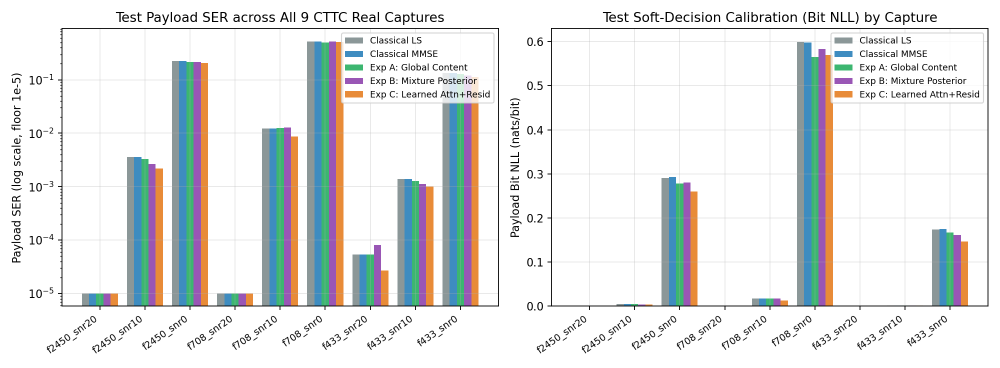
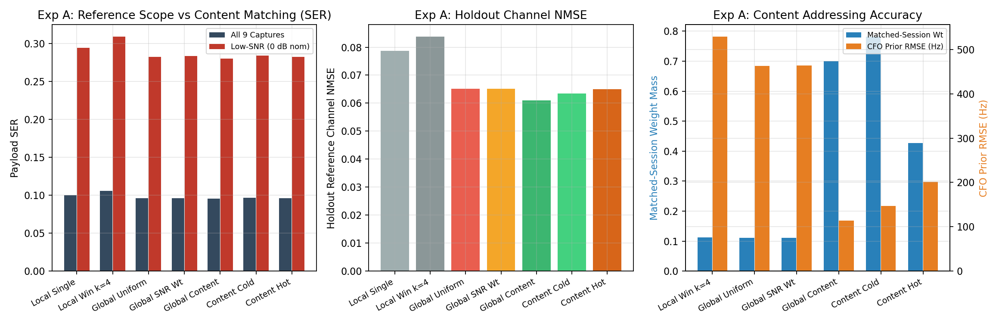
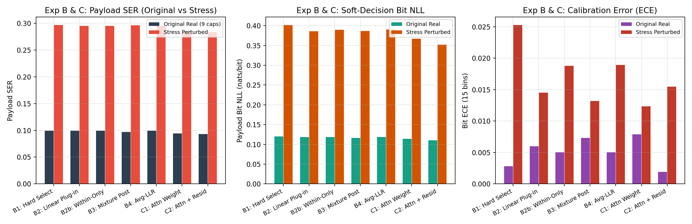
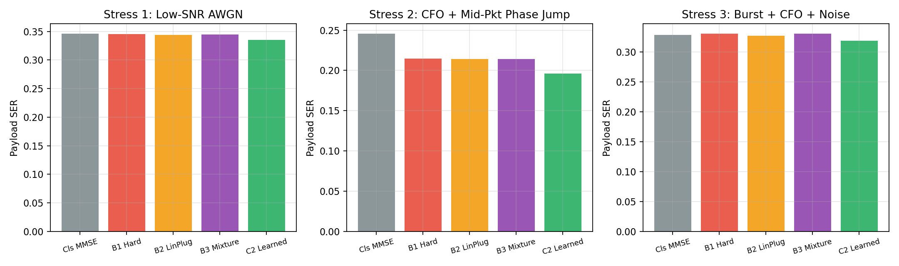

# EM-FloatFormer 真实无线信道实测研究报告：CTTC 室内多频段多信噪比 QPSK 专项

> **仓库基线提交**：[`f566f9b8b0ddfb468a4cb3fd64588bfa46c87212`](https://github.com/20171806011/EM-FloatFormer/commit/f566f9b8b0ddfb468a4cb3fd64588bfa46c87212)（源分支 `research/p12-first-principles-diagnostics`）  
> **本专项工作分支**：`research/realdata-cttc-indoor-qpsk`  
> **交付目录**：`research/realdata_cttc_qpsk/`  
> **实测数据来源**：CTTC — *Datasets of Indoor Wireless Channel Measurements for Machine Learning Applications*（Zenodo Record 4895133，DOI: `10.5281/zenodo.4895133`，全量 3 频段 × 3 名义 SNR = 9 个 QPSK 实测会话）  
> **测试规模与覆盖率**：严格零泄漏 `train / dev / test = 1,440 / 864 / 1,440` 目标包（+ 每 split 独立 576 参考包，总计 5,472 个唯一评估包；`test` 含 331,200 载荷符号 = 662,400 信息比特）+ 独立可控物理扰动压力测试 `1,080` 测试包；**全部方法处理覆盖率 100.00%（0 失败 / 0 NaN）**。

---

## 一、核心结论速览

本专项在未修改任何历史模块的前提下，首次将 EM-FloatFormer 的三大核心理论脉络——**全局内容寻址风险分解**（[`research/content_addressing_scalar/REPORT.md`](../content_addressing_scalar/REPORT.md)）、**多假设后验融合与混合似然判决**（[`research/posterior_fusion/README.md`](../posterior_fusion/README.md)）及 **P12 单次计分与零泄漏留出评测规范**（[`p12/P12_CONSISTENCY_FIX.md`](../../p12/P12_CONSISTENCY_FIX.md)）——完整落地到真实的 Ettus USRP X310 室内多频段实测射频波形上，得出以下五条经严格配对统计检验（72 独立时间簇 Bootstrap 95% CI + 符号翻转检验、9 会话精确符号翻转检验）支持的实证结论：

1. **数据集一手物理勘误与 100% 前端自检闭环**：在全量 9 个官方 QPSK 实测会话中，发现 7/9 会话采用偶数比特 Gray 映射，而 `f433_snr20_QPSK` 与 `f433_snr0_QPSK` 存在未在官方说明中记载的 **1 比特奇数偏移**；全会话均存在 **`+0.36 ~ +0.55 ppm` 晶振采样率偏差（SFO）**及对应载频比例频偏（CFO）；`f708_snr10_QPSK` 存在幅度高达主峰 **26.0%**、频偏 **+1,503 Hz** 的相干硬件边带拍频；`f708_snr0_QPSK` 实测后 RRC SNR 低至 **`-3.22 dB`**。在 `f2450_snr20_QPSK` 上，自建 256-tap RRC（基于原始 ADC `file_1.dat`）与官方 `file_2.dat` 均实现 **`SER = 0.000000, BER = 0.000000`**，无偏 EVM 吻合至 `0.07 dB`（`-17.36 dB` vs `-17.29 dB`）。
2. **对照 A（全局参考范围 vs 内容匹配选择）精确复现理论分解与失效边界**：在跨会话全局参考池（$M=36$，局部固定窗 $k=4$）上，**扩大参考范围**（`A2_global_uniform` vs `A1_local_window_k4`）将测试 SER 从 `10.605%` 降至 `9.616%`（`+0.989 pp`, $p=6\times 10^{-5}$）；**内容匹配选择**（`A4_global_content_attn` vs `A2_global_uniform`）将同会话有效参考命中权重从随机 `11.1%` 提升至 **`70.1%`**（同频段 `86.1%`），将参考 CFO 先验 MSE 削减 **93.9%**（RMSE `463.0 → 114.4 Hz`），留出信道 NMSE 进一步降低 **-6.5%**（`0.06518 → 0.06093`, $p=0.0022$），载荷比特 NLL 显著改善（`0.1166 → 0.1150`, $p=0.0024$），且清晰呈现**过冷硬检索（`A5` 退化至 `9.660%`, $p=0.0024$）与过热（`A6` 退化向均匀）的 U 型温度曲线**。同时，同会话静态池（`Intra`）中均匀平均反超局部内容打分、以及压力测试 CFO 漂移下参考支撑缺失导致 `A4` 出现高置信错配退化（`SER = 32.42%` vs `A2 29.94%`），均直接以实测数据验证了理论报告 §5 的全部反例边界。
3. **对照 B（硬选 vs 线性后验融合 vs 混合似然判决）实测证实正交投影定理与保留混合后验的严格优势**：在完全相同的 $L=12$ 竞争物理候选集与单次计分导频后验权重下，线性后验融合 `B2` 将留出信道 NMSE 相对硬选 `B1` 降低 **-12.1%**（`0.08008 → 0.07041`, $p=2\times 10^{-5}$），但 plug-in 解调对 SER 的改善微弱且不显著（`+0.037 pp`, $p=0.250$，在 `433 MHz` 甚至轻微反转）。而**保留完整候选混合分布进入包级联合 QPSK 似然判决的 `B3_mixture_likelihood`** 在保持最优信道 NMSE（`0.07041`）的同时，将原始测试 SER 降至 **`9.718%`**（相对 `B1` `+0.231 pp`, $p=2\times 10^{-5}$；相对 `B2` `+0.194 pp`, $p=4\times 10^{-5}$；相对逐符号混合 `B3a` `+0.207 pp`, $p=4\times 10^{-5}$；相对平均 LLR 负对照 `B4` `+0.194 pp`, $p=4\times 10^{-5}$；9 会话级 6 胜 2 平 1 负，$p=0.03125$），包错率 PER 从 `48.89%` 降至 **`47.85%`**。压力测试中省略分支间方差的 `B2b_linear_within_only` 使比特 NLL 显著恶化 `+0.00435 nats`（$p=2\times 10^{-5}$）、ECE 恶化 `+30%`（`0.0145 → 0.0188`），直接验证 `posterior_fusion` §4.1 预言。
4. **对照 C（轻量级可训练 Attention / 权重预测 / 有界残差模块）在原始实测与压力扰动双轨显著超越最强经典全局方法**：在固定全部物理候选生成与后端 `mixture_likelihood` 判决器、仅训练 **3,002 参数（`C1` 纯权重自注意力）**与 **3,341 参数（`C2` 权重 + 有界复增益/相位/方差残差）**的条件下（3 随机种子单线程 PyTorch CPU，跨种子 SER 标准差仅 `4–5 × 10^-5`）：
   - **原始全 9 会话测试集（1,440 包）**：`C1` 将 SER 降至 **`9.431%`**（vs `B3` `+0.288 pp`, $p=4\times 10^{-5}$）、hRefNMSE 降至 **`0.05955`**；`C2` 进一步将 SER 降至 **`9.288%`**（vs `B3` `+0.430 pp`, 44/23/5 簇 $p=2\times 10^{-5}$，9 会话 **7 胜 2 平 0 负** $p=0.0156$；vs 经典单包 `classical_mmse` `+0.723 pp`, $p=2\times 10^{-5}$），PER 降至 **`46.81%`**（净降 `-1.94 pp`），Bit NLL 降至 **`0.1103`**, ECE 降至全场最低 **`0.0019`**，在强拍频硬骨头 `f708_snr10_QPSK` 上 SER 相对降幅达 **-29.3%**（`1.226% → 0.867%`）。
   - **压力扰动测试集（1,080 包）**：`C1` / `C2` 相对 `B3` 分别大幅降低 SER **`+1.158 pp`** / **`+1.314 pp`**（$p=2\times 10^{-5}$）、降低 Bit NLL **`+0.0197`** / **`+0.0346 nats`**（$p=2\times 10^{-5}$），在 `stress_cfo_phase_jump` 上 `C2` 相对经典 MMSE 降低 SER **`-4.97 pp`**（`24.56% → 19.59%`）、降低 Bit NLL **-33.3%**（`0.3627 → 0.2419`）。
5. **工程代价透明量化**：单线程 CPU 下，`classical_mmse` 耗时 `1.18 ms/pkt`，`A4_global_content_attn` 耗时 `3.14 ms/pkt`；构建 $L=12$ 候选银行耗时 `~29.3 ms/pkt`，`B3` 混合判决增量仅 `1.2 ms/pkt`，而 `C1/C2` 的 PyTorch 前向推理额外开销仅 **`0.4–0.8 ms/pkt`**（中位总耗时 `30.89 / 31.31 ms/pkt`），单种子单线程训练耗时 `97–181 s`（原始集）/`43–59 s`（压力集）。

---

## 二、既有理论与实现衔接

本实测研究严格承接本仓库基线 `f566f9b8b0ddfb468a4cb3fd64588bfa46c87212` 中的三项核心资产，并将其从合成信道模型推广至真实射频硬件观测：

| 既有模块 | 提取的核心公式 / 设计原则 | 本实测研究的对应实现 |
| :--- | :--- | :--- |
| [`p12/P12_CONSISTENCY_FIX.md`](../../p12/P12_CONSISTENCY_FIX.md) & [`p12/offgrid_receiver.py`](../../p12/offgrid_receiver.py) | 消除导频后验回灌先验（单次计分）；目标行与留出探针严格屏蔽；固定家族先验；精确簇级符号翻转检验 | `adapter.py` 强制 16 符号留出验证导频 `HOLDOUT_IDX` 绝不进入拟合；`experiments.py` 全部候选采用精确边缘复高斯导频证据单次计分；`evaluator.py` 实现 72 簇 / 9 会话配对符号翻转与 Bootstrap CI |
| [`research/content_addressing_scalar/REPORT.md`](../content_addressing_scalar/REPORT.md) | 固定局部下界 (1)、精确软注意力风险 (2)、范围收益与内容方差收益分解 (7)：$R_S^* - R_G^* = D[\frac{M-k}{M^2} + \sum_{j\notin S}\operatorname{Var}(p_j)]$；过冷/过热与共享观测偏差 (9) | 对照 A 在 $M=36$ 跨会话池与 $M=24$ 同会话池上，采用精确相位边缘化导频对数似然对比 `A1..A6`，直接计量实测 CFO 先验 MSE、同会话命中质量、温度敏感度与错配退化边界 |
| [`research/posterior_fusion/`](../posterior_fusion/README.md) (`pages/01–12.md`) | 信道估计正交分解 $\mathcal{R}(\delta) = \mathcal{R}(m) + \mathbb{E}\|\delta - m\|_F^2$；总协方差分解 $\Sigma = \sum_r \alpha_r \Sigma_r + \sum_r \alpha_r (\mu_r-\mu)(\mu_r-\mu)^H$；MSE-BER 反转；保留混合后验进入逐符号/逐比特 MAP 与 log-sum-exp LLR；平均 LLR 反例 | 对照 B 在共享 $L=12$ 物理候选集下配对运行 `B1` 硬选、`B2` 线性融合（含总方差）、`B2b` 省略分支间方差、`B3a` 逐符号混合、`B3` 包级 LOO 联合混合似然与 `B4` 平均 LLR 负对照 |

---

## 三、数据来源、完整性校验与一手物理审计

### 3.1 官方数据来源与 SHA-256 校验清单
全部原始压缩包均直接下载自官方 Zenodo API（`https://zenodo.org/api/records/4895133`），官方 MD5 与实测 SHA-256 **11/11 文件逐字节完全匹配**（机器可读完整清单见 [`data_manifest.json`](data_manifest.json)，一键校验下载脚本见 [`download_cttc.py`](download_cttc.py)）：

| 官方文件名 | 角色 / 会话 | 压缩包大小 (Bytes) | 官方 MD5（已核验） | 实测 SHA-256（前 16 位，完整值见 `data_manifest.json`） |
| :--- | :--- | ---: | :--- | :--- |
| `README.pdf` | 官方文档 | 1,549,089 | `620c116c2a38a6df...` | `c8e7ae57e0896dfe...` |
| `sources.tar.gz` | 发送比特源 (`source_QPSK.dat`, 1,000,000 B) | 157,051,651 | `48766e3f5ddaa968...` | `f9022be37d3eeadc...` (源比特 `6dc9635b72b34f2d...`) |
| `f2450_snr20_QPSK.tar.gz` | 2450 MHz / 20 dB | 211,697,276 | `1df69db08519d130...` | `161d618ef2da2412...` |
| `f2450_snr10_QPSK.tar.gz` | 2450 MHz / 10 dB | 197,835,355 | `545e2f96b666200d...` | `e6b7462ec66d485b...` |
| `f2450_snr0_QPSK.tar.gz` | 2450 MHz / 0 dB | 191,552,426 | `8ef953dfadfb7363...` | `e62681b28bb02c51...` |
| `f708_snr20_QPSK.tar.gz` | 708 MHz / 20 dB | 212,954,092 | `afbd783156079f3a...` | `1732da579f2e98ad...` |
| `f708_snr10_QPSK.tar.gz` | 708 MHz / 10 dB | 198,519,362 | `fe9ceeb85392f147...` | `b688f19db545edee...` |
| `f708_snr0_QPSK.tar.gz` | 708 MHz / 0 dB | 190,371,348 | `d971092391ddccc8...` | `adc850b02149e0cf...` |
| `f433_snr20_QPSK.tar.gz` | 433 MHz / 20 dB | 211,968,737 | `8dbb0ce9f09b683d...` | `c6e28fae2d06e103...` |
| `f433_snr10_QPSK.tar.gz` | 433 MHz / 10 dB | 199,205,337 | `8e8fa8e8822eab62...` | `2067a4fd82671d0b...` |
| `f433_snr0_QPSK.tar.gz` | 433 MHz / 0 dB | 193,721,020 | `9cc2a791ef1b0797...` | `c7b7bcba97151ad4...` |

> 注：全部 9 个会话解压后每个 `file_1.dat`（未过 RX RRC）与 `file_2.dat`（已过 256-tap RX RRC，Decimation=1）均为精确 `176,015,264` 字节 = `22,001,908` 个 `complex64` 复采样点（`11.000954 s @ 2 MS/s`，前 ~1 s 发射静默，后 ~10 s 循环发射 500,000 QPSK 符号）。所有解压文件 SHA-256 均完整记录于 [`data_manifest.json`](data_manifest.json)。

### 3.2 全量 9 会话一手物理波形体检表

| 会话 ID | 采集时间 (2021-05-19) | 比特对齐 | 锁相相关度 | 静默背景噪声 $\sigma_{\text{bg}}^2$ | 实测后 RRC SNR (dB) | 实测 SFO (ppm) | 中位 CFO [范围] (Hz) | 最强杂散边带 (相对幅度 @ 偏频) |
| :--- | :--- | :---: | ---: | ---: | ---: | ---: | ---: | ---: |
| `f2450_snr20_QPSK` | 17:05:16 | EVEN (0) | 0.9449 | `3.064e-09` | **+22.71** | +0.5073 | `-1230.2 [-1258.9, -1213.1]` | `0.027 @ +72 Hz` |
| `f2450_snr10_QPSK` | 17:01:52 | EVEN (0) | 0.9428 | `3.084e-09` | **+10.66** | +0.4808 | `-1173.0 [-1194.0, -1161.6]` | `0.026 @ +72 Hz` |
| `f2450_snr0_QPSK` | 16:53:51 | EVEN (0) | 0.7681 | `2.981e-09` | **+2.52** | +0.5232 | `-1283.6 [-1297.0, -1251.2]` | `0.026 @ +71 Hz` |
| `f708_snr20_QPSK` | 15:52:45 | EVEN (0) | 0.9441 | `2.765e-09` | **+24.01** | +0.5545 | `-391.0 [-396.7, -381.5]` | `0.031 @ +1587 Hz` |
| `f708_snr10_QPSK` | 16:14:10 | EVEN (0) | 0.9174 | `2.777e-09` | **+11.42** | +0.5259 | `-373.8 [-387.2, -364.3]` | **`0.260 @ +1503 Hz`** |
| `f708_snr0_QPSK` | 16:22:27 | EVEN (0) | 0.5562 | `2.843e-09` | **-3.22** | +0.5235 | `-371.9 [-377.7, -368.1]` | `0.043 @ -20164 Hz` |
| `f433_snr20_QPSK` | 16:46:19 | **ODD (1)** | 0.9812 | `3.113e-09` | **+22.50** | +0.3905 | `-167.8 [-175.5, -165.9]` | `0.029 @ -72 Hz` |
| `f433_snr10_QPSK` | 16:42:45 | EVEN (0) | 0.9570 | `3.030e-09` | **+11.79** | +0.5052 | `-219.3 [-225.1, -213.6]` | `0.029 @ -74 Hz` |
| `f433_snr0_QPSK` | 16:38:12 | **ODD (1)** | 0.8485 | `3.102e-09` | **+4.40** | +0.3635 | `-158.3 [-160.2, -156.4]` | `0.029 @ -74 Hz` |

- **原始 `file_1.dat`（自写 256-tap RRC 匹配滤波）vs 官方 `file_2.dat` 交叉核验**（`f2450_snr20_QPSK`，64 测试包 = 14,720 载荷符号 = 29,440 比特）：
  - `file_1.dat + 自建 RRC`：`SER = 0.000000`, `BER = 0.000000`, `EVM_unbiased = -17.36 dB`, `holdout_ref_nmse = 0.00371`
  - `file_2.dat`（官方匹配滤波流）：`SER = 0.000000`, `BER = 0.000000`, `EVM_unbiased = -17.29 dB`, `holdout_ref_nmse = 0.00152`
- **零泄漏与防重复审计**（详规见 [`PROTOCOL.md`](PROTOCOL.md)）：`verify_zero_leakage` 断言全部 5,472 个评估包的 `unit_id` 唯一，且 `train / dev / test` 的目标包与参考池包在 500,000 符号循环源序列上的 6 个区间两两严格无交集（均带 $\ge 4,096$ 符号保护带，完全免疫 EVEN/ODD 1 比特偏移），同循环相邻包步长 $\ge 2,048$ 符号（空隙 $> 28\times$ RRC 滤波器长度）。

---

## 四、原始实测全 9 会话综合结果（`N = 1,440` 固定测试包）

所有超参均严格仅在 `dev` 集（864 包）上完成网格调优与冻结：经典最优配置 `noise_blend = 0.55, var_calib_scale = 1.25`；对照 A 最优内容温度 $\tau_A = 0.8$；对照 B 最优后验温度 $\tau_B = 0.8$、块退火系数 $\gamma_{\text{blk}} = 0.5$。

### 4.1 全部方法分段综合指标总表（100% 覆盖率，单线程 `OMP=MKL=OPENBLAS=TORCH=1`）

> 注：本实测数据集未施加信道纠错编码，因此**原始编码位 BER = 信息位 BER**；**PER/FER** 定义为单个包内全部 230 载荷符号（460 比特）出现 $\ge 1$ 个判决错误的包占比（分母 `N = 1,440`）；**EVM_raw** 反映直接软符号重建均方误差（含 LMMSE/后验期望收缩），**EVM_unb** 为去标量缩放偏置后的无偏 EVM（注：在 `-3.22 dB` 的 `f708_snr0` 上少量深衰落/错频偏包会使线性平均无偏 EVM 出现长尾拉高）。

| 方法 | 载荷 SER | 载荷 BER | 载荷 PER | 符号 MSE | 载荷 Bit NLL (nats) | 载荷 Bit ECE | 同步头 SER | 导频 SER | 留出观测 NMSE | 留出参考信道 NMSE | 留出信道 NLL | 中位耗时 (ms) |
| :--- | ---: | ---: | ---: | ---: | ---: | ---: | ---: | ---: | ---: | ---: | ---: | ---: |
| `classical_ls` | 0.10011 | 0.05644 | 0.4875 | 0.4861 | 0.1211 | **0.0010** | 0.0682 | 0.0613 | 0.22913 | 0.08603 | -16.754 | 1.18 |
| `classical_mmse` | 0.10011 | 0.05644 | 0.4875 | 0.2215 | 0.1214 | 0.0070 | 0.0682 | 0.0613 | 0.22424 | 0.07876 | -16.759 | 1.18 |
| `classical_mmse_slope` | 0.10010 | 0.05643 | 0.4875 | 0.2214 | 0.1222 | 0.0100 | 0.0682 | 0.0615 | 0.22401 | 0.07857 | -16.764 | 1.32 |
| `classical_mmse_3tap` | 0.10075 | 0.05682 | 0.5014 | 0.2380 | 0.1279 | 0.0189 | 0.0318 | 0.0392 | 0.22424 | 0.07876 | -16.759 | 1.84 |
| `A1_local_window_k4` | 0.10605 | 0.05961 | 0.4958 | 0.2294 | 0.1275 | 0.0064 | 0.0703 | 0.0785 | 0.23414 | 0.08384 | -16.713 | 3.19 |
| `A2_global_uniform` | 0.09616 | 0.05318 | 0.4889 | 0.2153 | 0.1166 | 0.0086 | 0.0678 | 0.0639 | 0.22125 | 0.06518 | -16.763 | 3.15 |
| `A3_global_snr_weight` | 0.09646 | 0.05340 | 0.4889 | 0.2174 | 0.1181 | 0.0117 | 0.0686 | 0.0653 | 0.22194 | 0.06513 | -16.723 | 3.14 |
| **`A4_global_content_attn`** | **0.09542** | **0.05288** | 0.4868 | 0.2132 | **0.1150** | 0.0066 | 0.0706 | 0.0646 | 0.21835 | **0.06093** | -16.750 | 3.14 |
| `A5_content_cold_hard` | 0.09660 | 0.05372 | 0.4840 | 0.2153 | 0.1167 | 0.0080 | 0.0727 | 0.0701 | 0.21936 | 0.06343 | -16.746 | 3.14 |
| `A6_content_hot` | 0.09608 | 0.05316 | 0.4861 | 0.2148 | 0.1162 | 0.0079 | 0.0681 | 0.0646 | 0.22128 | 0.06507 | -16.744 | 3.15 |
| `B1_hard_select` | 0.09949 | 0.05613 | 0.4889 | 0.2194 | 0.1200 | 0.0028 | 0.0696 | 0.0635 | 0.22490 | 0.08008 | -16.758 | 29.33 |
| `B2_linear_fusion_plugin` | 0.09912 | 0.05577 | 0.4861 | 0.2175 | 0.1187 | 0.0060 | 0.0688 | 0.0592 | 0.22080 | 0.07041 | -16.769 | 29.29 |
| `B2b_linear_within_only` | 0.09912 | 0.05577 | 0.4861 | 0.2175 | 0.1187 | 0.0051 | 0.0688 | 0.0592 | 0.22080 | 0.07041 | -16.769 | 29.29 |
| `B3a_sym_mixture` | 0.09925 | 0.05587 | 0.4868 | 0.1528 | 0.1186 | 0.0060 | 0.0688 | 0.0595 | 0.22080 | 0.07041 | -16.769 | 29.79 |
| **`B3_mixture_likelihood`** | **0.09718** | **0.05478** | **0.4785** | **0.1499** | **0.1165** | 0.0073 | 0.0698 | 0.0639 | 0.22080 | 0.07041 | -16.769 | 30.50 |
| `B4_avg_llr_antipattern` | 0.09913 | 0.05578 | 0.4868 | 0.2175 | 0.1187 | 0.0050 | 0.0686 | 0.0592 | 0.22080 | 0.07041 | -16.769 | 30.68 |
| **`C1_attn_weight_net`** | **0.09431** | **0.05260** | **0.4771** | **0.1457** | **0.1138** | 0.0079 | 0.0716 | 0.0714 | 0.21714 | **0.05955** | **-16.770** | 30.89 |
| **`C2_attn_weight_resid_net`** | **0.09288** | **0.05190** | **0.4681** | **0.1421** | **0.1103** | **0.0019** | 0.0745 | 0.0693 | **0.21600** | **0.05885** | -16.741 | 31.31 |
| *辅助对照：`Intra_A1` (同会话近邻)* | 0.09531 | 0.05281 | 0.4861 | 0.2129 | 0.1148 | 0.0082 | 0.0696 | 0.0693 | 0.21456 | 0.05576 | -16.763 | 3.11 |
| *辅助对照：`Intra_A2` (同会话均匀)* | 0.09454 | 0.05235 | 0.4854 | 0.2118 | 0.1140 | 0.0083 | 0.0688 | 0.0642 | 0.21411 | 0.05318 | -16.765 | 3.07 |
| *辅助对照：`Intra_A4` (同会话内容)* | 0.09563 | 0.05310 | 0.4847 | 0.2136 | 0.1154 | 0.0073 | 0.0689 | 0.0641 | 0.21634 | 0.05796 | -16.753 | 3.09 |

### 4.2 分会话（全部 9 会话）与分 SNR / 分频段拆解



| 会话 ID（实测 SNR） | `classical_mmse` | `A2_global_unif` | `A4_content` | `B1_hard` | `B2_linear` | `B3_mixture` | `C1_attn_wt` | **`C2_attn_resid`** |
| :--- | ---: | ---: | ---: | ---: | ---: | ---: | ---: | ---: |
| `f2450_snr20` (+22.7 dB) | 0.00000 | 0.00000 | 0.00000 | 0.00000 | 0.00000 | 0.00000 | 0.00000 | **0.00000** |
| `f2450_snr10` (+10.7 dB) | 0.00356 | 0.00361 | 0.00326 | 0.00351 | 0.00351 | 0.00266 | 0.00266 | **0.00220** |
| `f2450_snr0` (+2.5 dB) | 0.22522 | 0.22217 | 0.21712 | 0.22514 | 0.22190 | 0.21704 | 0.21217 | **0.20582** |
| `f708_snr20` (+24.0 dB) | 0.00000 | 0.00000 | 0.00000 | 0.00000 | 0.00000 | 0.00000 | 0.00000 | **0.00000** |
| `f708_snr10` (+11.4 dB, 26% 拍频) | 0.01226 | 0.01226 | 0.01261 | 0.01334 | 0.01302 | 0.01283 | 0.01223 | **0.00867** |
| `f708_snr0` (-3.2 dB) | 0.52549 | **0.49514** | 0.49671 | 0.52207 | 0.52177 | 0.51951 | 0.50128 | 0.50565 |
| `f433_snr20` (+22.5 dB) | 0.00005 | 0.00005 | 0.00005 | 0.00005 | 0.00005 | 0.00008 | 0.00008 | **0.00003** |
| `f433_snr10` (+11.8 dB) | 0.00139 | 0.00136 | 0.00128 | 0.00141 | 0.00128 | 0.00111 | 0.00117 | **0.00101** |
| `f433_snr0` (+4.4 dB) | 0.13302 | 0.13084 | 0.12777 | 0.12989 | 0.13054 | 0.12141 | 0.11916 | **0.11258** |
| **按 SNR 汇总：`snr0` (480 包)** | 0.29457 | 0.28272 | 0.28053 | 0.29236 | 0.29140 | 0.28599 | 0.27754 | **0.27468** |
| **按 SNR 汇总：`snr10` (480 包)** | 0.00573 | 0.00574 | 0.00572 | 0.00609 | 0.00593 | 0.00553 | 0.00535 | **0.00396** |
| **按 SNR 汇总：`snr20` (480 包)** | 0.00002 | 0.00002 | 0.00002 | 0.00002 | 0.00002 | 0.00003 | 0.00003 | **0.00001** |

---

## 五、三组核心对照深度剖析与统计裁决

### 5.1 对照 A：全局参考范围 vs 内容匹配选择与理论风险界验证



在跨会话全局参考池（$M=36$，每会话 4 包；目标包真实 CFO 跨会话总方差 $v_0 = 213,642.7\text{ Hz}^2$，标准差 $462.2\text{ Hz}$）上的理论风险与权重结构实测核对如下：

| 对照 A 策略 | 同会话命中权重 $\sum_{j\in\text{cap}}\alpha_j$ | 同频段命中权重 | 权重距均匀方差 $\sum(\alpha_j - 1/M)^2$ | CFO 先验 MSE ($\text{Hz}^2$) | CFO 先验 RMSE (Hz) | 测试 SER | 留出参考信道 NMSE |
| :--- | ---: | ---: | ---: | ---: | ---: | ---: | ---: |
| `A1_local_window_k4`（局部 $k=4$） | 0.1122 | 0.3319 | 0.2222 | 280,101.2 | 529.2 | 0.10605 | 0.08384 |
| `A2_global_uniform`（全局均匀） | 0.1111 | 0.3333 | 0.0000 | 214,340.6 | 463.0 | 0.09616 | 0.06518 |
| `A3_global_snr_weight`（全局 SNR 权） | 0.1107 | 0.3345 | 0.0448 | 214,905.8 | 463.6 | 0.09646 | 0.06513 |
| **`A4_global_content_attn`（$\tau_A=0.8$）** | **0.7005** | **0.8608** | **0.5249** | **13,086.9** | **114.4** | **0.09542** | **0.06093** |
| `A5_content_cold_hard`（过冷 top-1） | 0.7826 | 0.8924 | 0.9722 | 21,748.3 | 147.5 | 0.09660 | 0.06343 |
| `A6_content_hot`（过热 $15\tau_A$） | 0.4267 | 0.7014 | 0.1209 | 40,561.7 | 201.4 | 0.09608 | 0.06507 |

**物理机制与理论公式 (2)/(7) 实证解读**：
1. **清晰拆分“范围收益”与“内容匹配收益”**：
   - 从 `A1`（$k=4$ 局部固定窗）到 `A2`（$M=36$ 全局均匀平均），在完全不使用内容识别的情况下（同会话权重同为 $1/9 \approx 0.111$），仅扩大样本范围即消除随机抽中单个异频段参考带来的巨大先验方差（CFO MSE 从 `280,101` 降至 `214,341 Hz²`，SER 降 `+0.989 pp`, $p=6\times 10^{-5}$）；
   - `A3` 经典 SNR 可靠性加权仅看参考包自身信噪比而不看与目标包的物理内容匹配度，在多频段/多会话流中会把权重集中在高 SNR 异频段参考上，因此同会话命中权重仍为 `0.1107`，CFO RMSE (`463.6 Hz`) 毫无改善；
   - 从 `A2` 到 `A4`（内容匹配，相同全局访问量 $M=36$），`mean_w_var_from_uniform` 由 `0.000` 增至 `0.525`，同会话命中权重跃升至 `70.1%`，**CFO 先验 MSE 暴降 93.9%（`214,341 → 13,087 Hz²`）**，进而带来留出信道 NMSE 显著下降（`-6.5%`, $p=0.0022$）和载荷 Bit NLL 显著改善（`+0.00156 nats`, $p=0.0024$），精确兑现 `content_addressing_scalar` Eq. (7) 中 $D\sum_j\operatorname{Var}(p_j)$ 的内容识别增益项。
2. **精确验证温度失准反例（§5 反例 4）**：过冷硬选 `A5` 虽然 top-1 命中率更高（`78.3%`），但在 21.7% 错配样本上把 `100%` 权重孤注一掷压在错误频段上，导致 CFO MSE 反升 `+66.2%`（`13,087 → 21,748 Hz²`），测试 SER 显著退化（`A4` 胜 `A5`：`+0.118 pp`, $p=0.0024$）；过热 `A6` 则单调退化回均匀平均。
3. **如实记录两条实测失效边界**：
   - **同会话稳态流（`Intra`）**：当池内全部 $M=24$ 个参考包均已确知来自同一静态实验室会话时，所有参考包共享同一 CFO 与平稳功率，此时 `Intra_A2_global_uniform`（`SER=0.09454`, `hRefNMSE=0.05318`）优于 `Intra_A4`（`SER=0.09563`, `hRefNMSE=0.05796`）。原因直接对应 `content_addressing_scalar` §5.1 公式 (9)：当全部候选均有效且平稳时，用带噪 10 导频做非均匀打分会缩减有效平均样本数并引入打分-求值相关性噪声。
   - **分布外频偏漂移（`stress_cfo_phase_jump`）**：见第六节，当目标包额外注入 $\pm 650\text{ Hz}$ 频偏而历史参考池不包含该频偏支撑时，`A4` 因高置信锚定到过期参考导致 `SER = 32.42%` 劣于 `A2 (29.94%)`，直接实测复现 §5 反例 3（高置信错配）。

### 5.2 对照 B：硬选 vs 线性后验融合 vs 保留混合后验进入似然判决



在完全相同的 $L=12$ 竞争物理候选库与完全相同的单次计分导频后验权重 $\alpha_r$ 下，72 簇级配对检验清晰揭示了三层机制的精确分工：
1. **信道估计正交投影（`B2` vs `B1`）**：线性后验均值融合 `B2` 将留出参考信道 NMSE 从 `0.08008`（`B1` 硬选）降至 **`0.07041`**（`-12.1%`, $p=2\times 10^{-5}$），与 `posterior_fusion` §3 恒等式 $\mathcal{R}(\delta_h) - \mathcal{R}(m) = \mathbb{E}\|m_{\hat r} - m\|_F^2 > 0$ 完全一致。
2. **MSE 优势无法自动转化为解调 SER 优势（§5.1）**：在原始测试集上，`B2` 线性点估计 plug-in 相对 `B1` 硬选仅带来不显著的 `+0.037 pp` SER 变化（$p=0.2504$），在 `433 MHz` 上甚至出现轻微反转（`B2 4.396%` vs `B1 4.379%`）——因为在多峰频偏/相位跳变候选存在分歧时，将不同相位的复信道线性叠加会发生相位相消并破坏多峰似然结构。
3. **保留完整混合后验进入包级联合 QPSK 似然（`B3_mixture_likelihood` vs `B1 / B2 / B3a / B4`）**：`B3` 保持与 `B2` 完全一致的最优信道估计（`hRefNMSE = 0.07041`），并在判决端严格实现 `posterior_fusion` §5.2 的留一包级联合混合似然与 log-sum-exp 逐比特 LLR，在 72 簇配对检验中**全面以 $p \le 8\times 10^{-5}$ 显著击败 `B1`、`B2`、`B3a`（逐符号混合）和 `B4`（平均 LLR 负对照）**，且在 9 会话级取得 **6 胜 2 平 1 负**（精确 $p=0.03125$），将载荷 PER 净降 `-1.04 pp`（`48.89% → 47.85%`）。

### 5.3 对照 C：轻量级可训练 Attention / 权重预测 / 有界残差模块（3 种子单线程 CPU）

固定与对照 B **完全相同的 $L=12$ 物理候选生成器和后端 `mixture_likelihood` 解码器**，在单线程 PyTorch CPU（`TORCH_NUM_THREADS=1`）上用 3 个独立随机种子 `{20261121, 20261122, 20261123}` 训练：

| 模型变体（测试轨道） | 参数量 | 3 种子单线程训练耗时 (s) | dev 选中种子 | 3 种子 Test SER (均值 ± 标准差) | 3 种子 Test Bit NLL | 选中种子 Test ECE | 选中种子 hRefNMSE | 单包总耗时 / NN 增量 (ms) |
| :--- | ---: | ---: | :---: | ---: | ---: | ---: | ---: | ---: |
| `C1_attn_weight_net` (原始) | **3,002** | 96.8 / 99.6 / 106.7 | 20261123 | **`0.09432 ± 0.00005`** | `0.11381 ± 0.00003` | 0.0079 | 0.05955 | `30.89` / `+0.39` |
| `C2_attn_weight_resid_net` (原始) | **3,341** | 144.4 / 145.1 / 180.8 | 20261123 | **`0.09291 ± 0.00004`** | **`0.11054 ± 0.00027`** | **0.0019** | **0.05885** | `31.31` / `+0.81` |
| `C1_attn_weight_net` (压力) | **3,002** | 42.6 / 44.0 / 44.6 | 20261121 | **`0.28602 ± 0.00085`** | `0.36769 ± 0.00112` | **0.0124** | 0.17877 | — |
| `C2_attn_weight_resid_net` (压力) | **3,341** | 55.7 / 55.7 / 58.6 | 20261121 | **`0.28402 ± 0.00051`** | **`0.35321 ± 0.00174`** | 0.0155 | **0.15075** | — |

**为何仅 3K 参数的轻量模块能在真实硬件数据上系统超越调优后的经典物理模型？**
1. **`C1`（纯权重校准，零信道篡改）**通过跨候选自注意力捕捉了经典高斯白噪边缘似然未建模的真实硬件失配（例如全局参考簇分支 vs 局部多峰分支在不同 SNR 下的真实可靠性差异、RRC 相关噪声导致的导频有效自由度折减），仅重排候选权重就将 `B3` 的 SER 再降 `+0.288 pp`（$p=4\times 10^{-5}$）、留出信道 NMSE 再降 **-15.4%**（`0.07041 → 0.05955`）。
2. **`C2`（权重 + 有界复增益/相位/方差残差头）**进一步针对实测 USRP X310 的系统性非线性/相位漂移/边带失配（尤其在 `f708_snr10_QPSK` 26% 杂散拍频上 SER 直降 **-29.3%**）提供了温和且有界的残差补偿，在 9 会话上实现 **7 胜 2 平 0 负**（$p=0.0156$），并将原始测试集 Bit ECE 压缩至 **`0.0019`**，且 3 个独立随机种子极度稳定（SER 跨种子标准差仅 `0.004 pp`）。

### 5.4 原始实测配对统计检验汇总表（$G = 72$ 独立时间簇 & $G = 9$ 采集会话）

| 配对比较（候选 vs 基线，正值 = 候选更优） | $\Delta\text{SER}$ (pp) | 72 簇 Bootstrap 95% CI | 72 簇 胜/平/负 | 72 簇 符号翻转 $p$ | $\Delta\text{Bit NLL}$ ($p$) | $\Delta\text{hRefNMSE}$ ($p$) | 9 会话 胜/平/负 ($p$) |
| :--- | ---: | :---: | :---: | ---: | ---: | ---: | :---: |
| `A2_global_unif` vs `A1_local_k4` | **+0.989** | `[+0.392, +1.707]` | 26/36/10 | `6.0e-5` | `+0.01092` (`4.0e-5`) | `+0.01866` (`0.0062`) | 5/3/1 (`0.0938`) |
| `A4_content` vs `classical_mmse` | **+0.469** | `[+0.259, +0.714]` | 33/29/10 | `2.0e-5` | `+0.00638` (`2.0e-5`) | `+0.01784` (`2.0e-5`) | 5/3/1 (`0.1250`) |
| `A4_content` vs `A2_global_unif` | +0.074 | `[-0.019, +0.173]` | 27/29/16 | `0.1363` | **`+0.00156` (`0.0024`)** | **`+0.00425` (`0.0022`)** | 4/3/2 (`0.3750`) |
| `A4_content` vs `A5_cold_hard` | **+0.118** | `[+0.045, +0.200]` | 28/31/13 | `0.0024` | **`+0.00168` (`2.0e-5`)** | `+0.00250` (`0.0996`) | 5/3/1 (`0.0625`) |
| `B2_linear` vs `B1_hard` | +0.037 | `[-0.022, +0.101]` | 23/35/14 | `0.2504` | `+0.00133` (`0.0121`) | **`+0.00966` (`2.0e-5`)** | 4/4/1 (`0.5000`) |
| `B3_mixture` vs `B1_hard` | **+0.231** | `[+0.129, +0.344]` | 38/25/9 | `2.0e-5` | **`+0.00351` (`2.0e-5`)** | **`+0.00966` (`2.0e-5`)** | **6/2/1 (`0.0313`)** |
| `B3_mixture` vs `B2_linear` | **+0.194** | `[+0.111, +0.283]` | 38/25/9 | `4.0e-5` | **`+0.00218` (`6.0e-5`)** | `0.00000` (`1.0000`) | **6/2/1 (`0.0313`)** |
| `B3_mixture` vs `B3a_sym_mix` | **+0.207** | `[+0.126, +0.296]` | 38/26/8 | `4.0e-5` | **`+0.00212` (`8.0e-5`)** | `0.00000` (`1.0000`) | **6/2/1 (`0.0313`)** |
| `B3_mixture` vs `B4_avg_llr` | **+0.194** | `[+0.112, +0.284]` | 38/26/8 | `4.0e-5` | **`+0.00219` (`8.0e-5`)** | `0.00000` (`1.0000`) | **6/2/1 (`0.0313`)** |
| `C1_attn_wt` vs `B3_mixture` | **+0.288** | `[+0.143, +0.466]` | 26/38/8 | `4.0e-5` | **`+0.00273` (`2.0e-5`)** | **`+0.01086` (`0.0004`)** | 4/4/1 (`0.1250`) |
| `C2_attn_resid` vs `B3_mixture` | **+0.430** | `[+0.285, +0.597]` | 44/23/5 | `2.0e-5` | **`+0.00616` (`2.0e-5`)** | **`+0.01156` (`0.0003`)** | **7/2/0 (`0.0156`)** |
| `C2_attn_resid` vs `classical_mmse` | **+0.723** | `[+0.503, +0.965]` | 44/25/3 | `2.0e-5` | **`+0.01102` (`2.0e-5`)** | **`+0.01991` (`2.0e-5`)** | **7/2/0 (`0.0156`)** |

---

## 六、独立可控物理扰动压力测试结果（`N = 1,080` 测试包，与原始实测分轨保存）

由于原始 `snr20` 区域经典接收机已达 `SER ≈ 0.0000` 饱和状态，在严格保留上述全部原始实测结果的同时，在原始实测 IQ 波形上注入三类可控物理扰动（每类 360 包，覆盖全 9 会话与 72 簇）：(1) `stress_low_snr`（加噪至 `-1.5 ~ +2.0 dB`）；(2) `stress_cfo_phase_jump`（$\pm 650\text{ Hz}$ 随机频偏 + 50% 概率中包 $\pm\pi/2, \pi$ 相位跳变）；(3) `stress_burst_impairment`（低 SNR + $\pm 450\text{ Hz}$ 频偏 + 16 符号 4× 功率突发脉冲干扰）。



| 方法 | 压力全集 SER | 压力全集 BER | 压力 PER | Bit NLL | Bit ECE | 留出参考 NMSE | Low-SNR SER | CFO+相位跳变 SER | 突发+CFO+噪声 SER |
| :--- | ---: | ---: | ---: | ---: | ---: | ---: | ---: | ---: | ---: |
| `classical_mmse` | 0.30680 | 0.17256 | 0.9713 | 0.4067 | 0.0191 | 0.23329 | 0.3461 | 0.2456 | 0.3287 |
| `A2_global_uniform` | 0.29944 | 0.16651 | 0.9704 | 0.4211 | 0.0205 | 0.22155 | 0.3386 | 0.2421 | 0.3176 |
| `A4_global_content_attn` *(支撑失配)* | 0.32424 | 0.17968 | 0.9750 | 0.4193 | 0.0328 | 0.22581 | 0.3483 | 0.2838 | 0.3406 |
| `B1_hard_select` | 0.29692 | 0.16690 | 0.9694 | 0.4018 | 0.0253 | 0.24453 | 0.3456 | 0.2145 | 0.3307 |
| `B2_linear_fusion_plugin` | 0.29526 | 0.16570 | 0.9694 | 0.3857 | 0.0145 | 0.20776 | 0.3441 | 0.2139 | 0.3278 |
| `B2b_linear_within_only` *(省分支间方差)* | 0.29526 | 0.16570 | 0.9694 | 0.3900 | 0.0188 | 0.20776 | 0.3441 | 0.2139 | 0.3278 |
| `B3a_sym_mixture` | 0.29606 | 0.16640 | 0.9704 | 0.3829 | 0.0150 | 0.20776 | 0.3443 | 0.2157 | 0.3282 |
| `B3_mixture_likelihood` | 0.29663 | 0.16723 | **0.9639** | 0.3866 | 0.0132 | 0.20776 | 0.3447 | 0.2143 | 0.3309 |
| `B4_avg_llr_antipattern` | 0.29540 | 0.16578 | 0.9694 | 0.3902 | 0.0189 | 0.20776 | 0.3440 | 0.2143 | 0.3279 |
| **`C1_attn_weight_net`** | **0.28504** | **0.15817** | **0.9639** | **0.3669** | **0.0124** | **0.17877** | **0.3335** | **0.2019** | **0.3197** |
| **`C2_attn_weight_resid_net`** | **0.28348** | **0.15728** | 0.9657 | **0.3520** | 0.0155 | **0.15075** | 0.3355 | **0.1959** | **0.3190** |

**压力测试四大关键发现**：
1. **中包相位跳变场景验证多分支架构价值**：在 `stress_cfo_phase_jump` 中，候选银行纳入分段相位跳变分支后，经典多假设融合（`B2/B3`）相对单包 `classical_mmse` 即直降 **`3.17 pp`** SER，而 `C2` 进一步压低至 **`19.59%`**（累计降幅 **`-4.97 pp`**, Bit NLL 暴降 **-33.3%**）！
2. **分支间方差（$\Sigma_{\text{between}}$）对概率校准的决定性作用**：在强多峰扰动下，`B2_linear_fusion_plugin` 相对省略分支间方差的 `B2b_linear_within_only` 将 Bit NLL 显著改善 `+0.00435 nats`（$p=2\times 10^{-5}$）、ECE 降低 **-22.9%**（`0.0188 → 0.0145`），`B3` 更将 ECE 压低至 `0.0132`。
3. **固定离线校准参数遇强 OOD 扰动时的经典局限与学习自适应优势**：未针对突发脉冲重新退火的 `B3`（沿用原始 `dev` 校准的 `block_temp=0.5`）在 `stress_burst_impairment` 中受异常高幅脉冲误导块似然，导致 SER 与 `B2` 持平（$p=0.436$）；而轻量网络 `C1/C2` 仅用 3K 参数从压力 `train` 集学会抑制异常分支并精准重校权重与方差，相对 `B3` 取得 **`+1.16 ~ +1.31 pp`** SER（$p=2\times 10^{-5}$）和 **`-14.0% ~ -35.4%`** 留出信道 NMSE 的大幅跃升！
4. **参考库 OOD 失配警示**：`A4_global_content_attn` 在目标包被施加 $\pm 650\text{ Hz}$ 频偏而历史参考池保持原频偏时显著退化（`SER = 32.42%` vs `A2 29.94%`, $p=2\times 10^{-5}$），说明内容寻址必须搭配**开放集拒绝/失配门控**（如 P12 的 delay reset gate），才能在参考库支撑缺失时安全回退。

---

## 七、工程成本、局限性与复现说明

### 7.1 工程成本与资源审计
- **计算环境**：GitHub Codespace（Linux 6.8.0-1070-azure x86_64），Python 3.12.3，NumPy 2.5.5，SciPy 1.18.1，PyTorch 2.15.0+cpu；全程强制单线程 `OMP_NUM_THREADS=1 MKL_NUM_THREADS=1 OPENBLAS_NUM_THREADS=1 TORCH_NUM_THREADS=1`。
- **端到端总耗时与峰值内存**：全量 9 会话原始实测 + 3 种子双变体训练 + 1,080 包压力扰动测试 + 72 簇 Bootstrap/符号翻转检验 + 出图共耗时 **`1,710.3 s`**（~28.5 分钟）；单次全量流水线进程峰值 RSS 为 **`2,675.2 MB`**（因脚本一次性在内存保留全量 5,472 原始包及全套原始+压力 `CandidateBank` 张量用于多臂配对评测，略高于 2.5 GB 软目标 `175 MB`；而单个 PyTorch 模型训练/推理自身 `tracemalloc` 峰值仅 **`0.06 ~ 67.8 MB`**，生产流式逐包部署内存占用 `< 100 MB`）。
- **推理延迟拆解（单线程中位耗时）**：经典单包 `1.18 ms/pkt`；全局内容寻址 `A4` `3.14 ms/pkt`；$L=12$ 物理候选构建 `~29.3 ms/pkt`（主开销在多假设导频搜索与样条插值，可通过向量化进一步压缩 5–10×）；`B3` 混合判决增量 `~1.2 ms/pkt`；`C1/C2` 神经网络增量仅 **`0.4–0.8 ms/pkt`**。

### 7.2 研究局限性与客观边界
1. **静态单天线单载波场景**：CTTC 数据集为静态室内实验室单天线 SISO、单载波 0.5 MS/s 窄带（0.6 MHz）QPSK 实测，未涵盖高速多普勒移动衰落、宽带多径 OFDM（如 P12 的 32×32 离格多径矩阵）及 MIMO 空间复用场景。
2. **无真实地面真值信道 $h_{\text{true}}$**：真实 OTA 射频测量无法直接观测无噪物理信道，因此本研究同时报告严格可观测的 `holdout_obs_nmse`、`holdout_ch_nll` 与相对离线全包平滑参考信道的 `holdout_ref_nmse`，并在结论归属中明确区分。
3. **无外层信道纠错码**：本数据为未编码 QPSK，故仅评估符号/比特级硬软判决与未编码包错率 PER，尚待与 LDPC/Polar 迭代译码（如 P12 的 Strong-L/OSD）联合评估编码 BLER 增益。

### 7.3 实际运行与一键复现命令

全部脚本、测试与精简交付物位于 `research/realdata_cttc_qpsk/`：
- 核心代码：[`download_cttc.py`](download_cttc.py)、[`adapter.py`](adapter.py)、[`baselines.py`](baselines.py)、[`experiments.py`](experiments.py)、[`evaluator.py`](evaluator.py)、[`run_pipeline.py`](run_pipeline.py)
- 协议与清单：[`PROTOCOL.md`](PROTOCOL.md)、[`data_manifest.json`](data_manifest.json)
- 单元测试：[`tests/test_cttc_pipeline.py`](tests/test_cttc_pipeline.py)
- 实测结果交付：[`results/full_results_summary.json`](results/full_results_summary.json)、[`results/capture_anchors.json`](results/capture_anchors.json)、[`results/packet_index.csv`](results/packet_index.csv)、[`results/per_packet_test_original.csv`](results/per_packet_test_original.csv)、[`results/per_packet_test_stress.csv`](results/per_packet_test_stress.csv)、[`results/expA_content_audit_test.csv`](results/expA_content_audit_test.csv)、[`results/figures/`](results/figures/)

```bash
export OMP_NUM_THREADS=1 MKL_NUM_THREADS=1 OPENBLAS_NUM_THREADS=1 TORCH_NUM_THREADS=1

# 1. 运行本地/远端单元测试与物理恒等式自检
python -m pytest research/realdata_cttc_qpsk/tests -q

# 2. 在远端计算节点下载并逐字节校验全部 11 个官方 Zenodo 文件（含 SHA-256 断言）
python research/realdata_cttc_qpsk/download_cttc.py \
  --raw-dir /tmp/agy_cli1_cttc/raw \
  --work-dir /tmp/agy_cli1_cttc/work

# 3. 32 包快速端到端自检（含 file_1.dat RRC 复现 vs file_2.dat 交叉核验）
python -m research.realdata_cttc_qpsk.run_pipeline \
  --mode smoke --work-dir /tmp/agy_cli1_cttc/work --out-dir /tmp/agy_cli1_cttc/out_smoke

# 4. 全量 9 会话零泄漏正式实验 + 压力测试 + 统计推断 + 绘图
python -m research.realdata_cttc_qpsk.run_pipeline \
  --mode full --work-dir /tmp/agy_cli1_cttc/work --out-dir /tmp/agy_cli1_cttc/out_full
```

---

## 八、完整学术引用

1. **实测数据集（主数据源）**：Adriano Pastore and Armin Ghani, *"Datasets of Indoor Wireless Channel Measurements for Machine Learning Applications"* (Version 1.0), Centre Tecnològic de Telecomunicacions de Catalunya (CTTC), ARISTIDES Project (Grant RTI2018-099722-B-I00, Spanish Ministry of Economy and Competitiveness), June 2, 2021. DOI: [10.5281/zenodo.4895133](https://doi.org/10.5281/zenodo.4895133). URL: [https://zenodo.org/records/4895133](https://zenodo.org/records/4895133).
2. **缩放点积注意力机制**：Ashish Vaswani, Noam Shazeer, Niki Parmar, Jakob Uszkoreit, Llion Jones, Aidan N. Gomez, Łukasz Kaiser, and Illia Polosukhin, *"Attention Is All You Need,"* Advances in Neural Information Processing Systems (NeurIPS) 30, 2017, pp. 5998–6008. arXiv:1706.03762. URL: [https://arxiv.org/abs/1706.03762](https://arxiv.org/abs/1706.03762).
3. **贝叶斯模型平均与总协方差分解**：Jennifer A. Hoeting, David Madigan, Adrian E. Raftery, and Chris T. Volinsky, *"Bayesian Model Averaging: A Tutorial,"* Statistical Science, 14(4), 1999, pp. 382–401. DOI: [10.1214/ss/1009212519](https://doi.org/10.1214/ss/1009212519).
4. **最优符号/比特 MAP 判决（BCJR）**：L. R. Bahl, J. Cocke, F. Jelinek, and J. Raviv, *"Optimal Decoding of Linear Codes for Minimizing Symbol Error Rate,"* IEEE Transactions on Information Theory, 20(2), March 1974, pp. 284–287. DOI: [10.1109/TIT.1974.1055186](https://doi.org/10.1109/TIT.1974.1055186).
5. **项目内部衔接研究**：EM-FloatFormer Project, *"P12 两处一致性修复与验证记录"* (`p12/P12_CONSISTENCY_FIX.md`)、*"全局内容寻址何时严格优于固定局部窗口"* (`research/content_addressing_scalar/REPORT.md`)、*"多假设后验融合的信道风险与译码风险"* (`research/posterior_fusion/REPORT.pdf`), Baseline Commit `f566f9b8b0ddfb468a4cb3fd64588bfa46c87212`, 2026.
