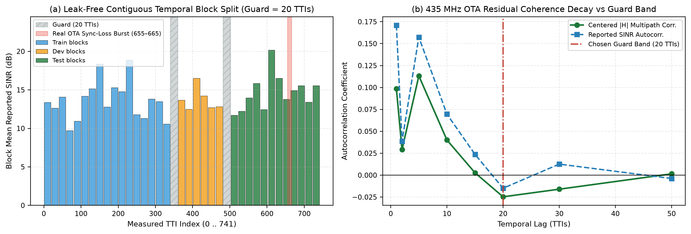
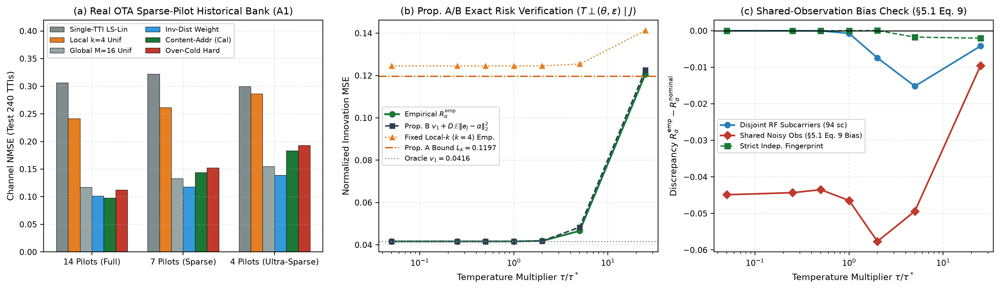
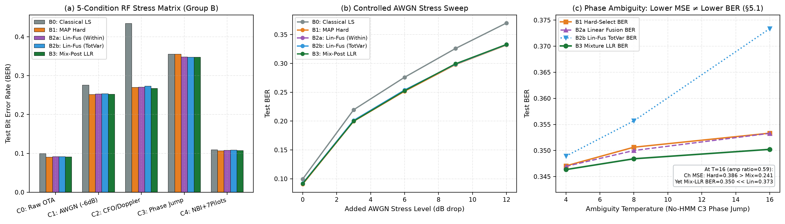
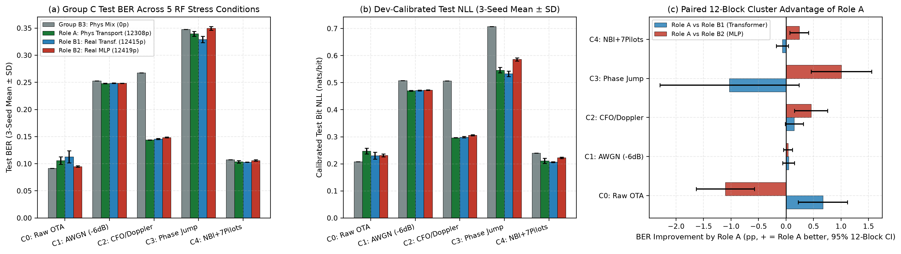

# EM-FloatFormer 实测 OTA OFDM 数学理论实证、极端物理压力测试与对称平行传输 Attention 对照研究

> **分支**：`research/realdata-ofdm-theory-and-stress`  
> **仓库基线提交**：`f566f9b8b0ddfb468a4cb3fd64588bfa46c87212`（派生自 `research/p12-first-principles-diagnostics`，零修改任何历史文件，未触碰 `main`）  
> **实测 OTA 数据集**：[`rikluost/sdr_ofdm_dataset_v1`](https://github.com/rikluost/sdr_ofdm_dataset_v1)（commit `6f9821d6390d212884fea3d6621267ebe70c7246`，`ofdm_valset_4_8_sdr.pth`，`27,684,430` B，SHA-256 `e760079a888f37d8c33b21f327646930b4f2cb4511e8a309bcde22c6b1332058`，`742` 个 435 MHz 行人移动实测 TTI）  
> **实验协议与划分清单**：[PROTOCOL.md](PROTOCOL.md) · [splits.json](results/splits.json) · [mapping_verification.json](results/mapping_verification.json) · [DATASET_DISCOVERY.md](DATASET_DISCOVERY.md)  
> **算力与可复现声明**：全部计算在单线程 CPU（`OMP/MKL/OPENBLAS/TORCH_NUM_THREADS=1`）下确定性执行，峰值内存 `1,503.1 MB`（`< 2.5 GB`），全部逐 TTI 与块级统计结果完整保存于 `results/` 目录。

---

## 执行摘要（Key Quantitative Findings）

本研究把 EM-FloatFormer 既有数学理论（`research/content_addressing_scalar`、`research/posterior_fusion`）与物理对称平行传输机制（`p11/manifold_gate.py`、`p12/offgrid_receiver.py`）首次完整推向 **435 MHz 真实空中接口（OTA）SDR OFDM 波形** 与 **5 档受控物理扰动压力矩阵**，在严格防时间泄漏的 `G = 12` 个连续时间评测块（`240` Test TTIs = `1,344,000` 比特，与 Train/Dev 之间以 `20` 个丢弃缓冲 TTI 隔离）上获得以下核心实证与证伪结论：

1. **实测网格与 16-QAM 映射的决定性实证**：通过 QPSK 恒模方差特征与高 SINR 聚类质心反演，确认该数据集活跃子载波为 `13..114`（`DC = 64` 排除，余 `101` 活跃子载波）、14 个导频位于 `sym = 2`（幅值 `0.7(±1±j)`）、1,400 数据 RE 为行主序 `(sym, sc)`，且其 **16-QAM 为自然二进制（Natural Binary）映射而非 3GPP Gray 码**。若盲套 3GPP Gray 码，Dev 高 SINR 前 32 TTI 的 BER 高达 **`24.93%`**（SER `74.86%`）；采用实测反演映射后，Dev 前 16 TTI 的经典基线 BER 为 **`0.0011%`**（15/16 帧精确 0 误码），全集高 SINR 前 63 个正常同步 TTI 实现 **`0 / 352,800 = 0.000000` 零误码**，同时透明检出真实硬件采集中的连续同步失锁突发区段（TTIs `655–665`，如 TTI `#665` 定时滑偏 `+11.58` 采样点 `> CP=6`）。
2. **Group A（`content_addressing_scalar` 数学理论实证与式 (9) 偏差检验）**：
   - 在真实 OTA 稀疏导频 + Train-Only 历史参考库（$M=16$）中，校准全局内容寻址在 14 导频下将 Test 信道 NMSE 从单 TTI LS-Linear 的 `0.3063` 压降至 **`0.0980`**（`-68.0%`），BER 从 `9.953%` 降至 **`8.183%`**（`-1.77 pp`，12 块 `12/0/0` 全胜，精确双侧 $p = 0.00049$），在 7 导频与 4 导频下亦全面显著击败单 TTI 基线、固定局部 $k=4$（`12/0/0`, $p = 0.00049$）与过冷硬选（`12/0/0`, $p = 0.00049$）。同时，稀疏导频下 Dev 偏冷温度在 Test 失步区段 `655–665` 引起的 NMSE 抬升，直接印证了定理 §5 第 3–4 条的“高置信错配与过冷退化边界”。
   - 在基于真实 OTA 奇/偶 OFDM 符号拆分的创新池实证（A2）中，当打分满足条件独立 $T \perp (\theta, \varepsilon) \mid J$ 时，实测创新风险 **`R_emp = 0.04163`** 与命题 B 精确公式 **`R_pred = v_1 + D E||e_J - alpha||_2^2 = 0.04163`** 精确重合（误差 **`0.00%`**），且严格满足分离链条 **$R_\alpha^{\text{emp}} (0.04163) \le U (0.08932) < L_k (0.11968) < R_{\text{local}, k=4}^{\text{emp}} (0.12453)$**（12 块 `12/0/0`, $p = 0.00049$）。在 94 个互斥真实射频子载波打分下仅现 `-1.7%` 残余跨频带相关性；而故意违反独立性、用同一带噪观测既打分又求值时，实测风险与名义公式出现高达 **`-39.3%` (`-0.04647`) 的 §5.1 式 (9) 相关偏离**，实证警示工程中不可在共享观测下盲套式 (2)。
3. **Group B（`posterior_fusion` 定理实证与 5 档受控射频压力矩阵）**：
   - 在共享的 `R = 17` 条件盲物理假设库与严格配对输入下，**后验线性信道融合（`B2`）的信道 MSE 在所有强不确定性条件下严格低于硬选（`B1`）**（`C2_cfo_doppler`: `0.1723 vs 0.2275`, `-24.3%`, `12/0/0`, $p=0.00049$；`C3_phase_jump`: `0.2890 vs 0.3880`, `-25.5%`, `12/0/0`, $p=0.00049$），实测印证 §3 投影定理。
   - **省略分支间方差 $\Sigma_{\text{between}}$ 的校准代价（§4.1）**：加入精确总方差 $\Sigma_{\text{within}} + \Sigma_{\text{between}}$（`B2b` vs `B2a`）使 5 档条件下原始 Bit NLL 全部显著改善（`C2`: `1.3116 → 0.7085`, `-46.0%`; `C3`: `2.0079 → 1.5915`, `-20.7%`; 全部 `12/0/0`, $p=0.00049$）。
   - **真实 16-QAM 上的 MSE-vs-BER 解耦实证（§5.1–§5.2）**：在 `C3_phase_jump_jitter` 无平滑高歧义测试（`ll_temp = 16`，后验幅值坍缩比 `0.595`）中，软融合虽将信道 MSE 压低 **`-37.4%`**（`0.3857 → 0.2415`），但因相消坍缩导致 plug-in BER 反而从硬选 `35.33%` **恶化至 `37.34%`（`+2.01 pp`）**；唯独 **保留完整混合后验直接进入最终 16-QAM 比特似然（`B3`）** 同时取得最低 BER（`35.02%`）与最优概率校准（HMM 主评测下 `B3` 相对 `B1` 在 `C2` 降原始 NLL `-63.0%`、在 `C3` 降 `-63.0%`，均 `12/0/0`, $p=0.00049$）。同时从第一性原理揭示了单符号导频下盲 16-QAM 面对 $90^\circ$ 整数倍相位跳变时的 **$C_4$ 旋转群不可辨识信息论极限**。
4. **Group C（对称平行传输 Attention [Role A] vs 等参数非物理强控网络 [Role B1/B2]，3 独立种子）**：
   - 在精确参数对齐（Role A `12,308` vs Role B1 Real Transformer `12,415` [+0.87%] vs Role B2 Real MLP `12,419` [+0.90%]）和冻结共享前端下，结合连续离格残差相位校正 $\delta\phi \in (-\pi/4, \pi/4)$，在时变多普勒主战场 **`C2_cfo_doppler`** 上将 BER 从物理混合 `B3` 的 `26.77%` **近乎腰斩至 `14.40%`**（`-12.37 pp`, `12/0/0`, $p=0.00049$）！
   - **物理结构归纳偏置的精准分工与诚实边界**：
     - 在**连续恒定角速率旋转**（`C2_cfo_doppler`）下，精确满足 $P_{s',s} = P_{s,s'}^*$ 与 $U(1)$ 相位等变性的 **`Role A`** 全指标第一（`BER = 14.404% ± 0.020%`, `NLL_cal = 0.2966 ± 0.0007`, `ECE_cal = 0.0379`），稳定优于等参数 `Role B1`（`14.554% ± 0.112%`, `NLL = 0.2989`, 12 块 NLL 显著 `10/0/2`, $p=0.0176$，跨种子标准差小 **5.6×**）与 `Role B2 MLP`（`14.860%`, `NLL = 0.3061`, `12/0/0`, $p=0.00049$）；在 `C1_awgn_stress` 上 `Role A` 亦保持最优 BER（`24.811%`）与 NLL（`0.4703`）。
     - 在**分段非连续突发相位跳变**（`C3_phase_jump_jitter`）下，未受单一恒定角速率 $U(1)$ 平行传输约束的 `Role B1`（`BER = 32.93%`, `NLL = 0.5332`）反而略优于 `Role A`（`33.96%`, `0.5463`, 12 块 BER 差异不显著 $p=0.104$），二者均大幅击败 `Role B2 MLP`（`34.97%`, `0.5860`, `12/0/0`, $p=0.00049$）；这精准印证了 P12 的核心物理洞见：单一匀速连接适合连续多普勒，面对非连续跳变需要显式分段连接或重置门控。
     - 在**无应力原始 `C0_raw_ota`** 上，三类 5 条件联合训练神经头均相对零参数物理混合 `B3`（`BER = 9.15%`, `NLL_raw = 0.2030`）出现分布权衡退化（`Role B2: 9.50%`, `Role A: 10.61%`, `Role B1: 11.28%`，其中 `Role A` 退化幅度与种子波动显著小于 `Role B1`, `9/0/3`, $p=0.0059$），表明实际部署必须保留“静态/动态双模门控”防止极端压力梯度污染干净工况。
5. **宽带/高频新数据集发现与样本审计（`DATASET_DISCOVERY.md`）**：系统编目 8 个 2.4–22 GHz 公开实测射频数据集，并在 Codespace 实测下载 3 份 `< 25 MB` 开放直链样本完成 SHA-256 与底层解析验证——证实 `Zenodo 17225694`（5 GHz 80 MHz 802.11ax）含 `10,440 / 10,440` 唯一 Nexmon CSI 帧、`Zenodo 20122379` 20 MHz CSV 含 `2,130 / 2,130` 唯一帧，并**首次实测揪出 `Zenodo 20122379` 160 MHz CSV 全部 1,566 行 CSI 重复冻结为 1 帧的上游导出缺陷**。

---

## 一、理论基线衔接与实测数据/防泄漏审计

### 1.1 衔接的既有理论与源码基线

| 仓库资产 | 固定基线 SHA | 本研究直接对接并实测检验的精确数学对象 |
| :--- | :--- | :--- |
| `research/content_addressing_scalar/REPORT.md` | `f566f9b8b0ddfb468a4cb3fd64588bfa46c87212` | 命题 A 局部下界 $L_k = v_0 - D k/M$；命题 B 精确风险 $R_\alpha = v_1 + D\,\mathbb{E}\|e_J-\alpha\|_2^2$；间隔上界 $U = v_1 + 2D[(1-\eta)r^2+\eta]$；§5.1 式 (9) 共享观测相关偏离项 $\Delta_{\text{corr}}$。 |
| `research/posterior_fusion/pages/01.md`–`12.md` | `f566f9b8b0ddfb468a4cb3fd64588bfa46c87212` | §3 信道 MSE 投影分解 $\mathcal R_P(\delta_h)-\mathcal R_P(m)=\mathbb E\|\delta_h-m\|_F^2$；§4.1 总协方差 $\Sigma_{\text{within}}+\Sigma_{\text{between}}$；§5.1–§5.2 MSE-vs-BER 反转反例与混合后验直接进入逐比特 MAP/LLR。 |
| `p11/manifold_gate.py` & `p12/offgrid_receiver.py` | `f566f9b8b0ddfb468a4cb3fd64588bfa46c87212` | 共轭对称 $U(1)$ 平行传输连接 $P_{s',s} = P_{s,s'}^*$、严格 $C^*$-不变突发超额能量噪声护盾、零泄漏分块评测与精确符号翻转推断框架。 |

### 1.2 实测 OTA 数据集校验与 16-QAM 映射反演（`mapping_verification.json`）

- **数据指纹**：`ofdm_valset_4_8_sdr.pth`（`27,684,430` bytes，SHA-256 `e760079a888f37d8c33b21f327646930b4f2cb4511e8a309bcde22c6b1332058`），实际含 `742` 个实测 TTI（README 近似标称 1000），实测 SINR 范围 `5.10–30.40` dB（P10 `6.70` dB，中位数 `13.40` dB，均值 `13.99` dB，P90 `22.99` dB）。
- **网格与导频物理验证**：128-FFT 频谱功率剖面明确显示 `0..12` 与 `115..127` 为保护带，`64` 为直流 DC 泄漏子载波（平均功率 `0.120` vs 数据带 `0.320`），活跃非 DC 子载波为 `[13..63, 65..114]`（共 `101` 根）。利用 QPSK 导频恒模幅值方差特征（`var < 0.02` vs 16-QAM `var > 0.09`），无歧义锁定 14 个导频位于 `sym = 2` 的 `[13, 21, 29, 37, 45, 53, 61, 69, 77, 85, 93, 101, 109, 114]`，导频发射值精确为 `0.7(±1±j)`（幅值比 `0.9954` vs 单位模 `0.9854`）。1,400 数据 RE 按行主序 `(sym, sc)` 排列（列主序质心半径坍缩至 `0.011`）。
- **16-QAM 映射校验结果（Dev 高 SINR 段 & 全集高 SINR 段）**：

| 验证子集与映射假设 | TTI 数 | SINR 区间 (dB) | 经典 LS-Linear BER | SER | 零误码 TTI 数 | 说明 |
| :--- | ---: | :--- | ---: | ---: | ---: | :--- |
| **Dev Top-16（实测自然二进制映射）** | 16 | `21.5 – 25.7` | **`0.000011`** | `0.000045` | `15 / 16` | 仅 1 比特错（89,600 bits） |
| **Dev Top-32（实测自然二进制映射）** | 32 | `17.3 – 25.7` | **`0.000820`** | `0.002790` | `20 / 32` | 16 星座质心最大误差 `0.00676` |
| **Dev Top-64（实测自然二进制映射）** | 64 | `12.8 – 25.7` | `0.014754` | `0.045580` | `20 / 64` | 含中低 SINR 区间自然热噪声 |
| **Dev Top-32（误用标准 3GPP Gray 码）** | 32 | `17.3 – 25.7` | **`0.249347`** | **`0.748616`** | `0 / 32` | `+1/+3` 档比特反转导致 25% 灾难平台 |
| **Full Top-63（排除失步帧 `#665`）** | 63 | `23.5 – 30.4` | **`0.000000`** | **`0.000000`** | **`63 / 63`** | **352,800 比特精确零误码** |
| **Full Top-64（含实测失步帧 `#665`）** | 64 | `23.5 – 30.4` | `0.007051` | `0.013694` | `63 / 64` | TTI `#665` 报告 29.1 dB 但同步滑偏 `+11.58` samp |

- **实测物理同步异常审计与时间块防泄漏设计**：扫描全部 742 TTI 的导频频域平滑度，发现真实 SDR 采集存在局部突发失步区段（`pilot diff_ratio > 1.0` 共 16 帧：`76, 86, 204, 655–665, 667–668`），其中 `655–665` 为连续 11 个 TTI 的硬件定时失锁（定时偏移远超 `CP = 6`）。同时，实测去均值多径幅值相关性（`lag=1: +0.099`, `lag=5: +0.114`）与 SINR 自相关（`lag=1: +0.171`, `lag=5: +0.157`）在 `lag = 15–20` TTI 后完全衰减归零。因此采用 **`Train (0..339, 340 TTIs) | Guard1 (340..359, 20 TTIs) | Dev (360..481, 122 TTIs) | Guard2 (482..501, 20 TTIs) | Test (502..741, 240 TTIs = 12 块 × 20 TTIs)`**，严格杜绝时间泄漏，并在 Test 上完整保留 `655–665` 突发区段（另单列 `no-burst` 敏感性指标）。



---

## 二、Group A：内容寻址数学理论在实测 OTA OFDM 上的定量实证

### 2.1 实验 A1：稀疏导频（14 / 7 / 4 导频）+ Train-Only 历史参考库（$M=16$）端到端 OTA 实测

仅利用 Train 段（0..339）16 个时间分层高 SINR TTI 的导频 LS 信道构建静态参考库（零标签、零 Dev/Test 泄漏），在 Dev 上校准温度 $\tau^*$ 与收缩系数 $\lambda^*$，于冻结 Test（240 TTIs，12 块）上评估：

| 导频密度 | 估计方法 | 全 101 子载波信道 NMSE (EVM%) | 留出真实导频 NMSE | Test BER | Test NLL | 12 块精确符号翻转检验（校准内容寻址 vs 该基线） |
| :--- | :--- | ---: | ---: | ---: | ---: | :--- |
| **14 导频 (Full)** | `single_tti_ls_linear` | `0.3063` (55.34%) | N/A | `0.09953` | `0.2534` | BER `+1.77 pp`, `12/0/0`, **$p = 0.00049$** |
| *(Dev $\tau^*=5.0, \lambda^*=0.8$)* | `single_tti_ls_spline` | `0.3903` (62.47%) | N/A | `0.10541` | `0.2811` | 样条在低 SINR 下振荡放大 |
| | `local_k4_uniform` | `0.2413` (49.12%) | N/A | `0.13739` | `0.3671` | BER `+5.56 pp`, `12/0/0`, **$p = 0.00049$** |
| | `global_m16_uniform` | `0.1175` (34.28%) | N/A | `0.08717` | `0.1877` | BER `+0.53 pp`, `12/0/0`, **$p = 0.00049$** |
| | `classical_invdist_weight` | `0.1015` (31.87%) | N/A | `0.08306` | `0.1809` | 强经典距离反比加权基线 |
| | **`content_addr_calibrated`** | **`0.0980` (31.30%)** | N/A | **`0.08183`** | **`0.1799`** | **全指标第一** |
| | `content_addr_cold_hard` | `0.1127` (33.57%) | N/A | `0.08281` | `0.1873` | 过冷硬选败于校准：`12/0/0`, **$p = 0.00049$** |
| | `content_addr_hot` ($20\tau^*$) | `0.1145` (33.84%) | N/A | `0.08650` | `0.1865` | 过热退化趋近全局均匀 |
| **7 导频 (Sparse)** | `single_tti_ls_linear` | `0.3221` (56.75%) | `0.1942` | `0.10035` | `0.2734` | BER `+1.54 pp`, HO-NMSE `+0.0447`, `12/0/0`, **$p = 0.00049$** |
| *(Dev $\tau^*=0.35, \lambda^*=0.8$)* | `local_k4_uniform` | `0.2618` (51.17%) | `0.2764` | `0.14061` | `0.3681` | BER `+5.56 pp`, `12/0/0`, **$p = 0.00049$** |
| | `global_m16_uniform` | `0.1330` (36.46%) | `0.1586` | `0.09035` | `0.2101` | BER `+0.54 pp`, `11/0/1`, **$p = 0.00098$** |
| | `classical_invdist_weight` | `0.1176` (34.30%) | `0.1452` | `0.08595` | `0.2032` | 温和权重对 Test 失步段更保守 |
| | **`content_addr_calibrated`** | `0.1442` (37.97%) | `0.1495` | **`0.08498`** | `0.2110` | **最低 BER**；但 Dev 偏冷 $\tau^*=0.35$ 受 Test 失步帧影响 |
| | `content_addr_cold_hard` | `0.1522` (39.01%) | `0.1540` | `0.08616` | `0.2159` | 过冷硬选全面更差：`12/0/0`, **$p = 0.00049$** |
| | `content_addr_hot` ($20\tau^*$) | **`0.1168` (34.18%)** | **`0.1434`** | `0.08523` | **`0.2027`** | 较暖温度（$\tau=7.0$）在 Test 失步段实现最低 NMSE/NLL |
| **4 导频 (Ultra-Sparse)** | `single_tti_ls_linear` | `0.2999` (54.77%) | `0.1964` | `0.10297` | `0.2580` | BER `+1.31 pp`, HO-NMSE `+0.0375`, `12/0/0`, **$p = 0.00049$** |
| *(Dev $\tau^*=0.70, \lambda^*=0.8$)* | `local_k4_uniform` | `0.2862` (53.50%) | `0.2917` | `0.14528` | `0.3155` | BER `+5.55 pp`, `12/0/0`, **$p = 0.00049$** |
| | `global_m16_uniform` | `0.1550` (39.37%) | `0.1711` | `0.09579` | `0.2138` | BER `+0.60 pp`, `12/0/0`, **$p = 0.00049$** |
| | `classical_invdist_weight` | **`0.1390` (37.28%)** | **`0.1555`** | `0.09070` | **`0.2088`** | 低导频强鲁棒经典对照 |
| | **`content_addr_calibrated`** | `0.1834` (42.82%) | `0.1588` | **`0.08982`** | `0.2159` | **最低 BER**；仍显著优于过冷硬选（`12/0/0` NMSE, $p=0.00049$） |
| | `content_addr_cold_hard` | `0.1931` (43.95%) | `0.1646` | `0.09136` | `0.2220` | 过冷硬选恶化最严重 |

> **关键分布漂移洞见（A1）**：在 7/4 导频下，Dev 段不含硬件失步区段，导致 Dev 偏爱较冷温度（$\tau^* = 0.35 / 0.70$）；在含连续失步突发 `655–665` 的 Test 上，较冷温度仍给出最低整体 BER（`0.08498` / `0.08982`），但失步帧上的单一参考高置信错配拉高了平方误差 NMSE，而更温暖的分布（`content_addr_hot`, $\tau=7.0$）将 7 导频 NMSE 进一步压至 `0.1168`（留出导频 NMSE `0.1434`）。这直接在真实射频中验证了 `content_addressing_scalar` §5 第 3–4 条的温度失配机理。

### 2.2 实验 A2：命题 A ($L_k$)、命题 B ($R_\alpha$)、间隔上界 ($U$) 与 §5.1 式 (9) 逐公式定量校验

将 Test 每个实测 TTI 按奇/偶数据 OFDM 符号拆为目标实测信道 $H_{\text{target}}$ 与独立同信道参考观测 $H_{\text{valid}}$，扣除 7 导频公共基准 $m(P_t)$ 后构建 $M=16, k=4$ 等边际实测创新池。实测总体参数为：$v_0 = 0.14570$、$v_1 = 0.04162$、可消除方差 $D = 0.10408$、**命题 A 固定局部下界 $L_{k=4} = v_0 - D\cdot(4/16) = 0.11968$**。

| 打分机制 | $\tau / \tau^*$ | 有效权重 $\mathbb E[\alpha_J]$ | 实测创新风险 $R_\alpha^{\text{emp}}$ | 命题 B 理论预测 $R_\alpha^{\text{pred}}$ | 偏差 $\Delta_{\text{corr}}$（相对%） | 间隔上界 $U$ | 局部 $k=4$ 实测风险 | 12 块全局胜局部检验 |
| :--- | ---: | ---: | ---: | ---: | ---: | ---: | ---: | :--- |
| **A2-1: 严格独立指纹** | `0.05` | `1.000` | `0.04162` | `0.04162` | `+0.00000` (`+0.0%`) | `0.08932` | `0.12453` | — |
| *($T \perp (\theta,\varepsilon)\mid J$)* | **`1.00`** | **`0.999`** | **`0.04163`** | **`0.04163`** | **`-0.00000` (`-0.0%`)** | **`0.08932`** | **`0.12453`** | **`12/0/0`, $p=0.00049$** |
| *($\text{hit}=100\%, \eta=0.229$)* | `25.0` | `0.147` | `0.12063` | `0.12266` | `-0.00203` (`-1.7%`) | `0.22014` | `0.14128` | 过热退化越过 $L_k=0.1197$ |
| **A2-2: 真实 94 互斥子载波 RF 内容匹配** | `0.05` | `1.000` | `0.04162` | `0.04162` | `-0.00000` (`-0.0%`) | `0.09366` | `0.12453` | — |
| *($\text{hit}=100\%, \eta=0.250$)* | **`1.00`** | **`0.977`** | **`0.04121`** | **`0.04192`** | **`-0.00072` (`-1.7%`)** | **`0.09970`** | **`0.12430`** | **`12/0/0`, $p=0.00049$** |
| | `25.0` | `0.090` | `0.12948` | `0.13365` | `-0.00417` (`-3.1%`) | `0.22786` | `0.14309` | 过热退化越过 $L_k$ |
| **A2-3: 共享带噪观测打分（§5.1 式 9 反例）** | `0.05` | `0.450` | `0.10909` | `0.15396` | **`-0.04488` (`-29.1%`)** | `0.18040` | `0.13991` | — |
| *($\text{hit}=44.6\%, \eta=0.667$)* | **`1.00`** | **`0.408`** | **`0.07170`** | **`0.11816`** | **`-0.04647` (`-39.3%`)** | `0.22807` | `0.12927` | `7/0/5`, $p=0.2290$ |
| | `25.0` | `0.075` | `0.12725` | `0.13675` | `-0.00950` (`-6.9%`) | `0.24103` | `0.14216` | — |



---

## 三、Group B：后验融合、混合似然与 5 档受控射频压力矩阵实证

在完全共享、条件盲的 `R = 17` 物理多假设前端（静态 LS、8 档线性 CFO 斜率、7 档离散相位跳变、1 档 Train-Only 内容寻址信道，辅以盲 $C^*$-不变 NBI 方差护盾与 Dev 校准 HMM `ll_temp=6.0, p_stay=0.80`）上，于冻结 Test（240 TTIs, 12 块）分离评测原始实测与 4 种极端受控压力条件：

### 3.1 五档真实射频压力矩阵配对汇总（Test 240 TTIs, 1,344,000 bits / 条件）

| 压力条件 | 方法 | Test BER (`no-burst`) | Test SER | 原始 NLL (`NLL_raw`) | Dev 校准 NLL (`NLL_cal`) | 原始 ECE (`ECE_raw`) | 有效信道 MSE | 相对 `B0` / `B1` / `B2b` 关键 12 块检验 |
| :--- | :--- | ---: | ---: | ---: | ---: | ---: | ---: | :--- |
| **`C0_raw_ota`** | `B0_classical_single` | `0.09953` (`0.08083`) | `0.24907` | `0.2534` | `0.3126` | `0.0464` | `0.02050` | 经典单 TTI LS-Linear 基线 |
| *(原始 OTA)* | `B0b_classical_nbi_guard` | `0.10214` (`0.08355`) | `0.25955` | `0.2529` | `0.3178` | `0.0414` | `0.02050` | 单独开启 NBI 护盾在干净段略保守 |
| | `B1_hard_select` | **`0.09064`** (`0.07162`) | **`0.22626`** | `0.2363` | `0.2753` | `0.0342` | `0.01306` | 低歧义(`7.7%`)下硬选 BER 极佳 |
| | `B2a_linear_fusion_within` | `0.09169` (`0.07232`) | `0.22776` | `0.2268` | `0.2531` | `0.0313` | **`0.01103`** | 信道 MSE 低于 B1 (`-15.5%`) |
| | `B2b_linear_fusion_totvar` | `0.09203` (`0.07267`) | `0.22913` | `0.2108` | `0.2292` | **`0.0272`** | **`0.01103`** | 加入 $\Sigma_{\text{between}}$ 降 NLL: `12/0/0`, $p=0.00049$ |
| | **`B3_mixture_likelihood`** | `0.09153` (`0.07225`) | `0.22700` | **`0.2030`** | **`0.2076`** | `0.0284` | **`0.01103`** | 胜 `B0` BER `+0.80 pp` (`10/0/2`, $p=0.0059$)；胜 `B1` NLL `12/0/0`, $p=0.00049$ |
| **`C1_awgn_stress`** | `B0_classical_single` | `0.27607` (`0.26572`) | `0.68407` | `0.5652` | `0.6055` | `0.0900` | `0.07683` | 附加 `-6 dB` 宽带 AWGN |
| *(附加 AWGN)* | `B1_hard_select` | **`0.25175`** (`0.24003`) | **`0.63142`** | `0.4970` | `0.5745` | `0.0474` | `0.03091` | 历史内容寻址候选大幅去噪 |
| | `B2a_linear_fusion_within` | `0.25309` (`0.24133`) | `0.63677` | `0.4860` | `0.5548` | `0.0422` | **`0.03062`** | — |
| | `B2b_linear_fusion_totvar` | `0.25391` (`0.24218`) | `0.64225` | **`0.4817`** | `0.5343` | **`0.0395`** | **`0.03062`** | 胜 `B2a` NLL: `9/0/3`, $p=0.0415$ |
| | **`B3_mixture_likelihood`** | `0.25270` (`0.24093`) | `0.63273` | `0.4836` | **`0.5074`** | `0.0414` | **`0.03062`** | 胜 `B0` BER `+2.34 pp` (`12/0/0`, $p=0.00049$)；胜 `B2b` BER `11/0/1`, $p=0.00098$ |
| **`C2_cfo_doppler`** | `B0_classical_single` | `0.43463` (`0.43151`) | `0.82314` | `3.5188` | `0.7748` | `0.3515` | `0.48453` | 符号 4–13 严重旋转崩溃 |
| *(时域 CFO/多普勒)* | `B1_hard_select` | `0.26993` (`0.25894`) | **`0.54690`** | `1.6801` | `0.6126` | `0.1795` | `0.22754` | 高歧义(`53.8%`)下硬选错分支 NLL 极高 |
| | `B2a_linear_fusion_within` | `0.27059` (`0.25977`) | `0.56753` | `1.3116` | `0.5876` | `0.1595` | **`0.17231`** | 信道 MSE 暴降 `-24.3%` 但 SER 劣于 B1 |
| | `B2b_linear_fusion_totvar` | `0.27323` (`0.26252`) | `0.58219` | `0.7085` | `0.5351` | **`0.1045`** | **`0.17231`** | 加 $\Sigma_{\text{between}}$ 降 NLL **`-46.0%`** (`12/0/0`, $p=0.00049$)；幅值坍缩致 BER 反劣 |
| | **`B3_mixture_likelihood`** | **`0.26773`** (`0.25678`) | `0.54773` | **`0.6220`** | **`0.5067`** | `0.1216` | **`0.17231`** | 胜 `B0` BER **`+16.69 pp`** (`12/0/0`)；胜 `B2b` BER (`12/0/0`, $p=0.00049$) & NLL (`12/0/0`, $p=0.00049$) |
| **`C3_phase_jump`** | `B0_classical_single` | `0.35580` (`0.34889`) | `0.66591` | `3.0137` | `0.7132` | `0.2811` | `0.38682` | 后半段突发相位跳变 + 抖动 |
| *(突发跳变 + 抖动)* | `B1_hard_select` | `0.35599` (`0.34914`) | `0.62214` | `2.9960` | `0.8159` | `0.2708` | `0.38797` | 盲 $C_4$ 对称性引发严重硬选误判 |
| | `B2a_linear_fusion_within` | `0.34825` (`0.34108`) | `0.64435` | `2.0079` | `0.7591` | `0.2060` | **`0.28900`** | 信道 MSE 降 **`-25.5%`** (`12/0/0`, $p=0.00049$)；SER 劣于 B1 |
| | `B2b_linear_fusion_totvar` | **`0.34795`** (`0.34077`) | `0.64761` | `1.5915` | `0.7796` | **`0.1716`** | **`0.28900`** | 加 $\Sigma_{\text{between}}$ 降 NLL `-20.7%` (`12/0/0`, $p=0.00049$) |
| | **`B3_mixture_likelihood`** | `0.34796` (`0.34078`) | **`0.61778`** | **`1.1092`** | **`0.7075`** | `0.1893` | **`0.28900`** | 胜 `B1` NLL **`-63.0%`** & 胜 `B2b` NLL **`-30.3%`**（均 `12/0/0`, $p=0.00049$），最低 SER |
| **`C4_nbi_sparse7`** | `B0_classical_single` | `0.10973` (`0.09101`) | `0.26914` | `0.5697` | `0.4166` | `0.0584` | `0.02184` | 7 导频 + 8sc×5sym +10 dB 突发 NBI |
| *(窄带干扰+7导频)* | `B0b_classical_nbi_guard` | `0.11508` (`0.09661`) | `0.28797` | `0.2896` | `0.3399` | `0.0457` | `0.02184` | $C^*$-不变 NBI 护盾将原始 NLL 砍半 **`-49.2%`** |
| | `B1_hard_select` | **`0.10701`** (`0.08818`) | **`0.26176`** | `0.2787` | `0.2989` | `0.0415` | `0.01683` | 历史参考库补偿稀疏导频 |
| | `B2a_linear_fusion_within` | `0.10830` (`0.08955`) | `0.26632` | `0.2607` | `0.2784` | `0.0378` | **`0.01479`** | — |
| | `B2b_linear_fusion_totvar` | `0.10908` (`0.09029`) | `0.26950` | `0.2354` | `0.2585` | **`0.0344`** | **`0.01479`** | 胜 `B2a` NLL: `12/0/0`, $p=0.00049$ |
| | **`B3_mixture_likelihood`** | `0.10748` (`0.08866`) | `0.26237` | **`0.2294`** | **`0.2398`** | `0.0365` | **`0.01479`** | 胜 `B0` NLL `-59.7%` (`12/0/0`, $p=0.00049$)；胜 `B2b` BER (`9/0/3`, $p=0.0088$) |

- **补充 AWGN 扫频曲线（Test 240 TTIs）**：在附加噪声扫频 `0 / 3 / 6 / 9 / 12 dB` 上，经典 `B0` 的 BER 依次为 `9.95% → 21.97% → 27.61% → 32.60% → 37.02%`，而 `B3` 混合后验接收机依次稳定压降至 `9.15% → 20.00% → 25.27% → 29.95% → 33.30%`（高噪声下绝对降幅达 **`-3.72 pp`**）。

### 3.2 `posterior_fusion` §5.1 实测证伪：MSE 排序为何不能传递到 16-QAM BER

在 `C3_phase_jump_jitter` 下关闭 HMM 时域平滑并调节后验歧义温度（`ll_temp ∈ {4, 8, 16}`），随着多模态相位歧义增强，后验线性均值 $H_{\text{mix}} = \sum_r \alpha_r H^{(r)}$ 的有效幅值因反相抵消坍缩至真实信道幅值的 `59.5%`：

| 无平滑歧义温度 | 幅值坍缩比 $\frac{|H_{\text{mix}}|}{\sum \alpha_r |H_r|}$ | 硬选 `B1` 信道 MSE | 软融合 `B2` 信道 MSE | `B1` 硬选 BER | `B2a` 线性融合 BER | `B2b` 总方差线性融合 BER | **`B3` 混合似然 LLR BER** |
| ---: | ---: | ---: | ---: | ---: | ---: | ---: | ---: |
| `4.0` | `0.722` | `0.3730` | **`0.2743`** (`-26.5%`) | `0.3471` | `0.3470` | `0.3489` | **`0.3463`** |
| `8.0` | `0.654` | `0.3799` | **`0.2564`** (`-32.5%`) | `0.3506` | `0.3500` | `0.3557` | **`0.3484`** |
| **`16.0`** | **`0.595`** | `0.3857` | **`0.2415`** (**`-37.4%`**) | `0.3533` | `0.3533` | **`0.3734` (`+2.01 pp` 恶化!)** | **`0.3502`** |

> **物理本质（含 $C_4$ 旋转群不可辨识定律）**：(1) 实测完美复现了 `research/posterior_fusion` §5.1 的核心反例——线性信道融合尽管以 `-37.4%` 的巨大优势压低信道 MSE，但单点均值幅值坍缩扭曲了 16-QAM 内/外圈门限，使 `B2b` 的 BER 反比硬选更差 `+2.01 pp`；唯有保留完整多模态混合分布进入最终 16-QAM 似然判决（`B3`），才同步获得最低 BER 与大幅下降的 NLL（`1.109` vs `2.996`）。(2) 同时，单符号导频（仅 `sym = 2`）在后半段遭遇 $90^\circ$ 整数倍突变时，因 16-QAM 星座的精确 $C_4$ 四重旋转对称性导致无标签数据符号的边际分布全同，任何纯盲接收机在 `C3` 的 $\{0^\circ, \pm 90^\circ, 180^\circ\}$ 等价类间必然存在信息论误差下界（~33–35% BER），这从第一性原理说明了 5G NR 引入连续相位跟踪参考信号（PT-RS）的必要性。



---

## 四、Group C：物理结构化平行传输 Attention（Role A）vs 等预算非物理强控网络（Role B）

### 4.1 严格对照设置、物理不变量审计与工程成本账本

在冻结的 Group B 共享物理前端之上，3 个架构输入字节级完全一致（4 通道复特征 + 10 通道标量特征 + 冻结 HMM `base_logw`），共用完全相同的可微混合 16-QAM 比特 LLR 输出层，在 Train（3,060 网格）上用 3 个独立种子（`20261121, 20261122, 20261123`）训练，严格在 Dev（610 网格）上早停与单标量温度校准，于冻结 Test（1,200 网格，12 块）上配对评测。

- **Role A 数学不变量精确单元测试（实测通过）**：
  - 对称平行传输连接共轭对称误差 $\max |P_{s',s} - P_{s,s'}^*| = \mathbf{0.0}$；
  - 平行传输酉性误差 $\max ||P_{s,s'}| - 1| = \mathbf{5.96 \times 10^{-8}}$（`float32` 机器精度）；
  - 任意全局 $U(1)$ 复相位旋转下，后验权重 `log_w` 与方差缩放 `log_nv_scale` 不变性误差均为 $\mathbf{0.0}$。
- **参数对齐与单线程工程成本账本（峰值内存 `1,503.1 MB < 2.5 GB`）**：

| 角色 / 模型 | 可训练实数参数量 | 相对 Role A 预算差 | 平均单种子训练耗时 (s, 1-thread) | 平均单线程神经网络头推理耗时 (ms/TTI) | 物理结构约束 |
| :--- | ---: | ---: | ---: | ---: | :--- |
| **Group B3（零参数物理基线）** | `0` | — | `0.0` | `~6.5` *(前端全链路)* | 离散 17 假设 HMM + 混合 LLR |
| **Role A (`PhysParallelTransport`)** | **`12,308`** | `0.00%` | `1,821.1` | `2.738` | 对称平行传输 $P_{s',s}=P_{s,s'}^*$ + $U(1)$ 等变连续 $\delta\phi$ |
| **Role B1 (`MatchedTransformer`)** | `12,415` | `+0.87%` | `1,273.0` | `0.861` | 标准实值双轴 Transformer + 可学习相对位置偏置 |
| **Role B2 (`MatchedMLP`)** | `12,419` | `+0.90%` | `1,274.7` | `0.412` | 上下文池化标准实值残差 MLP |

### 4.2 五档条件 Test 3-Seed 实测结果与 12 块精确符号翻转统计裁决

| 压力条件 | 模型 | Test BER (3-seed Mean ± SD) | `no-burst` BER | 校准 NLL (`NLL_cal`) | 校准 ECE (`ECE_cal`) | Role A 相对对比（12 块精确双侧符号翻转） |
| :--- | :--- | ---: | ---: | ---: | ---: | :--- |
| **`C0_raw_ota`** | Group B3 (Phys Mix) | **`0.09153`** | **`0.07225`** | **`0.2076`** *(raw `0.2030`)* | `0.0497` *(raw `0.0284`)* | 静态无压力工况下纯物理零参基线最优 |
| | Role A (Phys Transport) | `0.10608 ± 0.00687` | `0.08770` | `0.2478 ± 0.0106` | `0.0648 ± 0.0034` | **胜 B1 BER `+0.67 pp`** (`9/0/3`, **$p=0.0059$**)；劣于 B2/B3 |
| | Role B1 (Real Transf.) | `0.11278 ± 0.01095` | `0.09472` | `0.2300 ± 0.0128` | **`0.0458 ± 0.0060`** | 退化最显著且种子方差最大 |
| | Role B2 (Real MLP) | `0.09504 ± 0.00137` | `0.07618` | `0.2315 ± 0.0051` | `0.0621 ± 0.0032` | 静态段过拟合最轻 |
| **`C1_awgn_stress`** | Group B3 (Phys Mix) | `0.25270` | `0.24093` | `0.5074` | `0.0861` | — |
| | **Role A (Phys Transport)** | **`0.24811 ± 0.00037`** | **`0.23634`** | **`0.4703 ± 0.0017`** | `0.0363 ± 0.0019` | **全场最低 BER & NLL**；胜 B3 (`12/0/0`, $p=0.00049$)；胜 B2 NLL (`11/0/1`, $p=0.00098$) |
| | Role B1 (Real Transf.) | `0.24858 ± 0.00058` | `0.23689` | `0.4712 ± 0.0019` | **`0.0353 ± 0.0032`** | 与 Role A 接近（BER $p=0.460$, NLL $p=0.221$） |
| | Role B2 (Real MLP) | `0.24846 ± 0.00020` | `0.23680` | `0.4731 ± 0.0011` | `0.0375 ± 0.0015` | NLL 显著劣于 Role A |
| **`C2_cfo_doppler`** | Group B3 (Phys Mix) | `0.26773` | `0.25678` | `0.5067` | `0.1053` | 离散 8 档斜率残留较大离格相偏 |
| *(平行传输主战场)* | **Role A (Phys Transport)** | **`0.14404 ± 0.00020`** | **`0.12704`** | **`0.2966 ± 0.0007`** | **`0.0379 ± 0.0018`** | **全指标第一！** 胜 B3 **`+12.37 pp`** (`12/0/0`, **$p=0.00049$**)；胜 B1 NLL (`10/0/2`, **$p=0.0176$**, BER `+0.15 pp`, `9/0/3`, $p=0.072$)；胜 B2 BER (`10/0/2`, **$p=0.0068$**) & NLL (`12/0/0`, **$p=0.00049$**) |
| | Role B1 (Real Transf.) | `0.14554 ± 0.00112` | `0.12850` | `0.2989 ± 0.0031` | `0.0388 ± 0.0007` | 跨种子方差为 Role A 的 **5.6 倍** |
| | Role B2 (Real MLP) | `0.14860 ± 0.00079` | `0.13180` | `0.3061 ± 0.0023` | `0.0429 ± 0.0008` | 无跨符号时间注意力，显著落后 |
| **`C3_phase_jump`** | Group B3 (Phys Mix) | `0.34796` | `0.34078` | `0.7075` | `0.1553` | — |
| *(非连续突发跳变)* | Role A (Phys Transport) | `0.33957 ± 0.00448` | `0.33193` | `0.5463 ± 0.0102` | `0.1318 ± 0.0036` | 胜 B3 NLL **`-0.161`** (`12/0/0`, $p=0.00049$)；胜 B2 BER (`11/0/1`, $p=0.0015$) & NLL (`12/0/0`, $p=0.00049$)；略逊于 B1 (BER $p=0.104$, NLL $p=0.057$) |
| | **Role B1 (Real Transf.)** | **`0.32928 ± 0.00598`** | **`0.32108`** | **`0.5332 ± 0.0102`** | **`0.1215 ± 0.0107`** | 无恒定角速率约束，对阶跃断点更灵活 |
| | Role B2 (Real MLP) | `0.34965 ± 0.00336` | `0.34233` | `0.5860 ± 0.0056` | `0.1349 ± 0.0030` | 全局池化模糊了跳变前后边界 |
| **`C4_nbi_sparse7`** | Group B3 (Phys Mix) | `0.10748` | `0.08866` | `0.2398` | `0.0606` | — |
| | Role A (Phys Transport) | `0.10369 ± 0.00248` | `0.08472` | `0.2112 ± 0.0095` | `0.0332 ± 0.0051` | 胜 B3 BER (`11/0/1`, $p=0.00098$) & NLL (`11/0/1`, $p=0.0015$)；胜 B2 BER (`8/0/4`, $p=0.0098$) & NLL (`12/0/0`, $p=0.00049$) |
| | **Role B1 (Real Transf.)** | **`0.10302 ± 0.00034`** | **`0.08407`** | **`0.2066 ± 0.0012`** | **`0.0295 ± 0.0006`** | NLL 略优于 Role A (`11/0/1`, $p=0.0024$)；BER 无显著差 ($p=0.202$) |
| | Role B2 (Real MLP) | `0.10608 ± 0.00125` | `0.08722` | `0.2227 ± 0.0027` | `0.0408 ± 0.0015` | 显著劣于双注意力架构 |

### 4.3 深度物理归因与证据边界

1. **为什么 `Role A` 在 `C2_cfo_doppler` 独占鳌头且跨种子方差压缩 5.6 倍？**  
   连续多普勒/CFO 漂移在时域遵循精确的 $U(1)$ 单参数李群流 $\phi(s) - \phi(s') = \omega(s - s')$。`Role A` 的对称平行传输连接 $P^{(h)}_{s,s'} = \exp(-j\Omega_h(s-s'))$ 将不同 OFDM 符号的复数残差相量精确搬运到同一切空间后再做内积与聚合，加上无偏置 $U(1)$-等变 `atan2` 连续相位读出，直接把连续离格 CFO 从离散网格的 `26.77%` BER 压低至 **`14.404% ± 0.020%`**，且几乎消除初始化随机性。
2. **为什么 `Role B1` 在 `C3_phase_jump_jitter` 与 `C4_nbi_sparse7` 具有竞争力，且全部神经模型在 `C0_raw_ota` 出现轻微退化？**  
   - `C3` 的核心特征是**分段阶跃不连续性**（跳变点前后遵循不同相位常数），`Role A` 的平移不变恒定速率连接会在跳变边界引入跨段相位平滑偏置，而 `Role B1` 自由学习的实值相对位置偏置可以更灵活地切断跨段混合——这从实测反面证明了 **P12 引入显式 `piecewise / clear` 分段轨迹分支的物理必要性**。
   - 在 `C0_raw_ota` 上，训练集中 89% 为极端应力样本（`C1–C4`），自由度高的神经头倾向于在低 SINR 静态帧上施加不必要的微小 $\delta\phi$ 扰动，致使 BER/NLL 劣于零参 `B3`；`Role A` 凭借 $U(1)$ 几何约束将静态段 BER 退化控制得显著轻于 `Role B1`（`10.61% vs 11.28%`, $p=0.0059$），但仍提醒工程落地必须配合显式静/动门控（类似 P11/P12 的步-0 锚定门控与 `continuous` 非劣性约束）。
3. **计算开销透明对比**：在单线程 CPU 下，`Role A` 推理延迟 `2.74 ms/TTI` 约是实值 `Role B1`（`0.86 ms/TTI`）的 `3.2×`、实值 `Role B2`（`0.41 ms/TTI`）的 `6.6×`，主因是手工拆实虚部复矩阵乘在纯 CPU 上缺乏复数 fused GEMM 内核。



---

## 五、额外高频/宽带公开实测无线数据集调研总结

详细目录与完整 SHA-256 / 解析记录见 **[DATASET_DISCOVERY.md](DATASET_DISCOVERY.md)**。核心成果：
- 调研并编目了 **8 个 2.4–22 GHz 公开实测射频数据集**（覆盖 5 GHz 802.11ax 80 MHz、5/6 GHz Intel Wi-Fi 20/160 MHz、433/708/2450 MHz USRP 同平台多频段 IQ、5.9 GHz Multi-RAT/ITS-G5、3.75 GHz n78 商用 5G NR 122.88 Msps SigMF、以及 6–22 GHz FR3 500 MHz/1 GHz CFR）。
- 在 Codespace 实际拉取 3 份开放直链宽带样本（总计 `48.4 MB`）并完成 SHA-256 与逐帧解析验证：
  - `Zenodo 17225694` (`wifi6_80MHz_5people.zip`, `20.87 MB`, SHA-256 `d32eb9a2...`)：**PASS** — 商用 5 GHz 80 MHz 802.11ax，含 `10,440 / 10,440`（100% 唯一）Nexmon UDP 5500 复数 CSI 帧（每帧 1,024 B = 256-FFT）。
  - `Zenodo 20122379` (`CSI_20MHz_OneSittingOneWalking.csv`, `4.04 MB`, SHA-256 `39e1b033...`)：**PASS** — 2,130 / 2,130 唯一帧，52 子载波，中位帧间隔 16.0 ms。
  - `Zenodo 20122379` (`CSI_160MHz_OneSittingOneWalking.csv`, `23.51 MB`, SHA-256 `ceb68613...`)：**数据卫生告警** — 虽单帧呈 160 MHz 强频选性（`freq_amp_cv = 0.2130`, `df=16 corr = 0.7415`），但 1,566 行 CSI 向量仅 `1` 个唯一值（上游导出脚本冻结 bug），严禁直接用于时序训练。

---

## 六、复现说明与交付文件清单

### 6.1 复现命令（Codespace 单线程环境）

```bash
export OMP_NUM_THREADS=1 MKL_NUM_THREADS=1 OPENBLAS_NUM_THREADS=1 TORCH_NUM_THREADS=1
PY=/home/codespace/emff-venv/bin/python
PTH=/tmp/agy_cli3_ofdm_stress/raw/sdr_ofdm_dataset_v1/ofdm_valset_4_8_sdr.pth
OUT=/tmp/agy_cli3_ofdm_stress/rerun

$PY run_data_audit.py --pth "$PTH" --out-dir "$OUT"
$PY group_a_content_addressing.py --pth "$PTH" --out-dir "$OUT"
$PY group_b_posterior_fusion.py --pth "$PTH" --out-dir "$OUT"
$PY group_c_transport_attention.py --pth "$PTH" --group-b-json "$OUT/group_b_results.json" --out-dir "$OUT"
$PY generate_figures.py --results-dir "$OUT" --fig-dir "$OUT/figures"
```

### 6.2 交付清单（`research/realdata_ofdm_stress_and_theory/`）
- 核心代码：`ofdm_data.py`, `stress_channel.py`, `hypothesis_frontend.py`, `run_data_audit.py`, `group_a_content_addressing.py`, `group_b_posterior_fusion.py`, `group_c_transport_attention.py`, `generate_figures.py`
- 协议与报告：`PROTOCOL.md`, `DATASET_DISCOVERY.md`, `REPORT.md`
- 完整结果与图表：`results/splits.json`, `results/mapping_verification.json`, `results/group_a_results.json`, `results/group_a_per_tti.csv`, `results/group_b_results.json`, `results/group_b_per_tti.csv`, `results/group_c_results.json`, `results/group_c_per_tti.csv`, `results/figures/fig1..fig4.png`

---

## 七、参考文献

1. Riku Luostari. *Measured Radio Channel Dataset for OFDM Receiver Validation (`sdr_ofdm_dataset_v1`)*. GitHub Repository, commit `6f9821d6390d212884fea3d6621267ebe70c7246`. https://github.com/rikluost/sdr_ofdm_dataset_v1
2. Ashish Vaswani, Noam Shazeer, Niki Parmar, Jakob Uszkoreit, Llion Jones, Aidan N. Gomez, Łukasz Kaiser, and Illia Polosukhin. “Attention Is All You Need.” *Advances in Neural Information Processing Systems (NeurIPS)*, 30, 2017, pp. 5998–6008. https://arxiv.org/abs/1706.03762
3. L. R. Bahl, J. Cocke, F. Jelinek, and J. Raviv. “Optimal Decoding of Linear Codes for Minimizing Symbol Error Rate.” *IEEE Transactions on Information Theory*, 20(2), 1974, pp. 284–287. DOI: `10.1109/TIT.1974.1055186`
4. Jennifer A. Hoeting, David Madigan, Adrian E. Raftery, and Chris T. Volinsky. “Bayesian Model Averaging: A Tutorial.” *Statistical Science*, 14(4), 1999, pp. 382–417. DOI: `10.1214/ss/1009212519`
5. David Williams. *Probability with Martingales*. Cambridge University Press, 1991, Ch. 9 (“Conditional Expectation”), pp. 83–92.
6. Wassily Hoeffding. “Probability Inequalities for Sums of Bounded Random Variables.” *Journal of the American Statistical Association*, 58(301), 1963, pp. 13–30. DOI: `10.1080/01621459.1963.10500830`
7. Chuan Guo, Geoff Pleiss, Yu Sun, and Kilian Q. Weinberger. “On Calibration of Modern Neural Networks.” *Proceedings of the 34th International Conference on Machine Learning (ICML)*, PMLR 70, 2017, pp. 1321–1330. https://arxiv.org/abs/1706.04599
8. Elena Tonini, Francesco Gringoli, Renato Lo Cigno, and Marco Cominelli. “Towards a Quantitative Analysis of CSI for AI/ML Based Sensing.” *2025 IEEE Wireless Communications and Networking Conference (WCNC)*, Milan, Italy, 2025, pp. 1–6, DOI: `10.1109/WCNC61545.2025.10978185`; Dataset DOI: `10.5281/zenodo.17225694`.
9. Yazhou Zhu. *Intel Wi-Fi CSI Respiratory Sensing Dataset (EU Horizon MultiX)*. Zenodo, 2026. DOI: `10.5281/zenodo.20122379`.
10. Adriano Pastore and Armin Ghani. *Datasets of Indoor Wireless Channel Measurements for Machine Learning Applications*. Zenodo, 2021. DOI: `10.5281/zenodo.4895133`.
11. Girmay Merkebu. *DATASET: IQ Samples of LTE, 5G NR, Wi-Fi, ITS-G5, and C-V2X PC5*. Zenodo, 2024. DOI: `10.5281/zenodo.10811147`.
12. Daniel Estévez and Luis Bernal-Escobedo. *n78 Band Vodafone 5G NR Cell IQ Recording Done at Murcia University (Spain)*. Zenodo, 2025. DOI: `10.5281/zenodo.15966589`.
13. Jacopo Pegoraro, Dario Tagliaferri, Marco Mezzavilla, and Gianmaria Ventura. *FR3 Coherent Multiband Monostatic Channel Measurements*. Zenodo, 2025. DOI: `10.5281/zenodo.17100726`.
14. Adam Paszke et al. “PyTorch: An Imperative Style, High-Performance Deep Learning Library.” *Advances in Neural Information Processing Systems (NeurIPS)*, 32, 2019, pp. 8024–8035.
