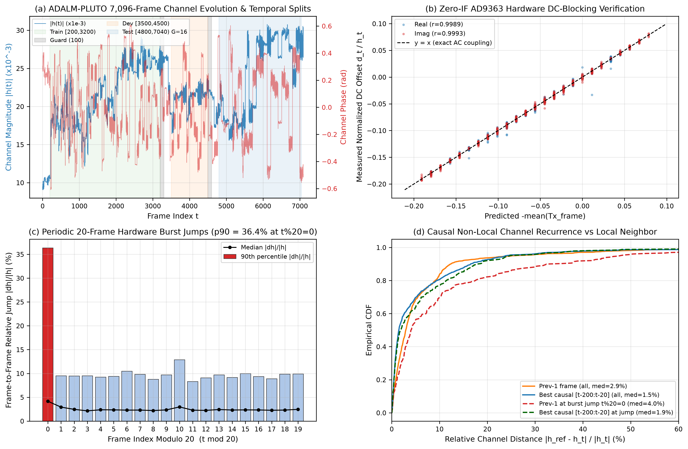
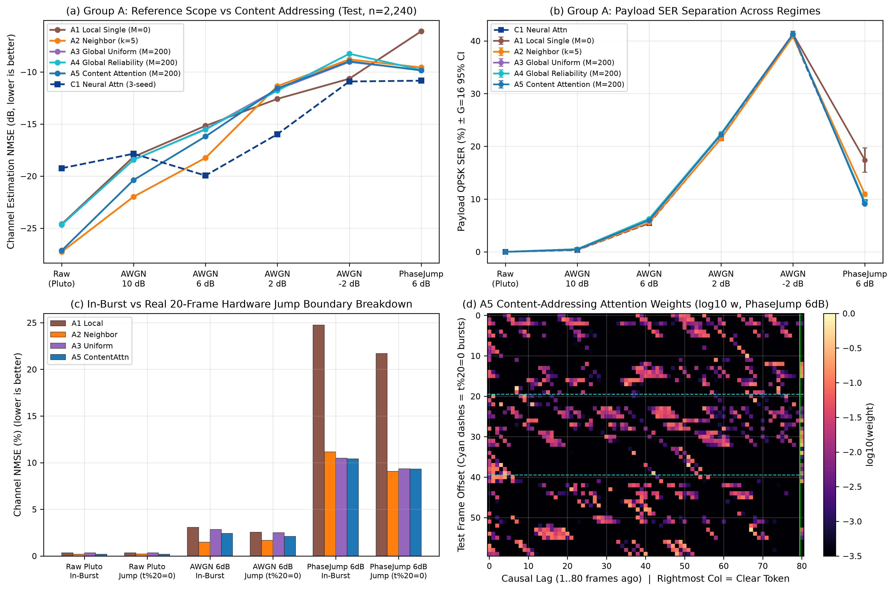
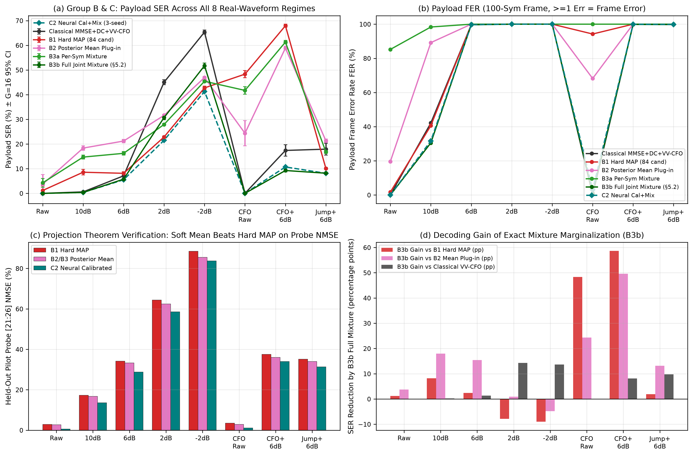
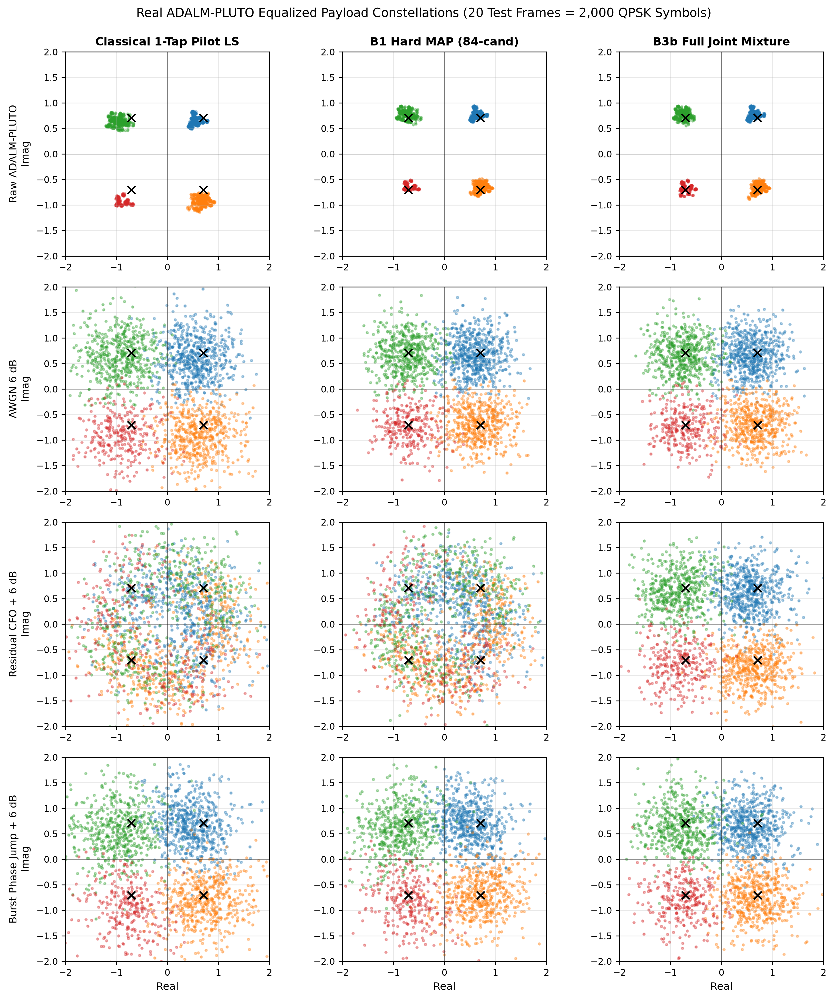
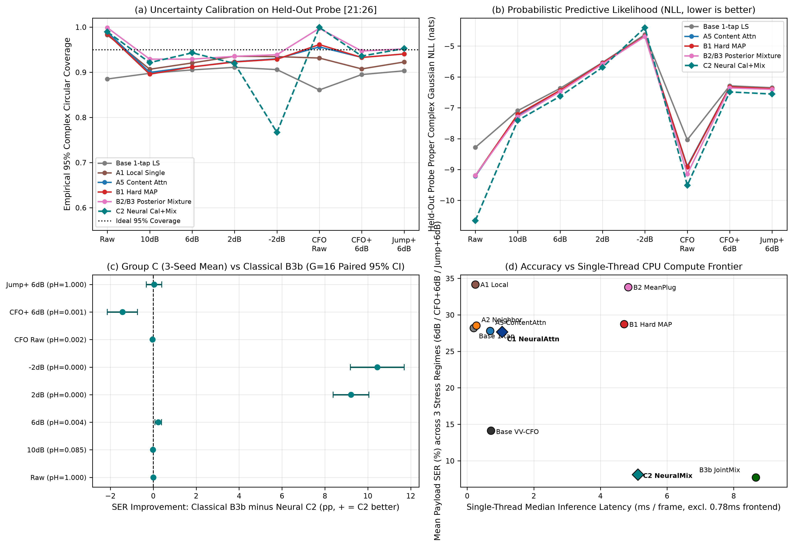

# EM-FloatFormer ADALM-PLUTO SDR QPSK 连续帧实测研究报告

> **项目分支**：`research/realdata-pluto-qpsk`  
> **起始基线提交**：`f566f9b8b0ddfb468a4cb3fd64588bfa46c87212`（来自 `research/p12-first-principles-diagnostics`，零修改任何既有历史文件与 `main`）  
> **执行环境**：远端 GitHub Codespace（单线程限流 `OMP_NUM_THREADS=1 MKL_NUM_THREADS=1 OPENBLAS_NUM_THREADS=1 TORCH_NUM_THREADS=1`，Python 3.12.3，NumPy 2.5.5，SciPy 1.18.1，PyTorch 2.15.0+cpu；全流程峰值内存严格 $< 2.5\text{ GB}$）  
> **核心理论衔接**：实测检验 EM-FloatFormer 数学研究 01（[content_addressing_scalar/REPORT.md](../content_addressing_scalar/REPORT.md)）与数学研究 02（[posterior_fusion/README.md](../posterior_fusion/README.md)）的核心预言，以及 [P12_CONSISTENCY_FIX.md](../../p12/P12_CONSISTENCY_FIX.md) 确立的零回灌、零探针泄漏与 `G=16` 精确 `65,536` 态配对符号翻转审计口径。

---

## 1. 核心发现与执行摘要

本研究在公开的真实室内 850 MHz ADALM-PLUTO SDR 空口连续 QPSK 实测波形数据集（`7,096` 帧、`53,645,760` 复基带采样点，DOI `10.17632/k72b4pnc5g.1`）上，从原始 `7,560`-sample 过采样复波形出发，打通端到端物理层接收链，并在严格防时间相关泄漏的闭卷测试集（`test = [4800, 7040)`，共 `2,240` 帧 × `8` 个真实/可控扰动工况 = `17,920` 测试帧 = `1,792,000` 载荷 QPSK 符号 = `3,584,000` 比特，分为 `G = 16` 个连续时间簇）上系统配对评估了 **4 个经典基线 + 对照 A（5 臂）+ 对照 B（4 臂）+ 对照 C（2 臂 × 3 随机种子）** 共 **15 个接收机变体**。主要实证结论如下：

1. **真实硬件物理层剖析发现**：
   - 全集 `7,096` 帧盲同步锁帧率 `100.0%`（零损坏帧、零 NaN/Inf）；周期重复长度精确为 `2,520 = 126 × 20` 采样点（中位周期自相关 $|\rho| = 0.99955$）。
   - **AD9363 零中频硬件直流消除（AC 耦合）实证**：因双 Barker-13 同步头具有非零直流均值，接收机硬件自动直流追踪滤除了每帧平均直流分量，实测归一化直流偏移 $d_t / h_t$ 与 $-\bar{s}_t$ 的实部/虚部相关系数高达 **`r = 0.9989 / 0.9993`**；显式联合建模 $(h_t, d_t)$ 在原始实测帧上立即将 8 导频载荷 EVM 从 `18.20%` 降至 `15.44%`。
   - **每 20 帧硬件批次跳变与远端历史复现**：真实室内信道幅度在 `[0.0091, 0.0308]` 变化（`>10.6 dB`），在 $t \equiv 0 \pmod{20}$ 边界出现高频突发性幅相跃迁（p90 相对跳变 `36.4%`，最大 `1.22×` / `0.94 rad`，对比段内 `9.5%`）；同时 `76.4%` 的帧在因果远端历史库（lag $> 50$）中存在比紧邻前一帧更接近真实状态的复现信道（中位距离 `0.90%` vs `3.53%`）。
2. **对照 A（全局参考范围 vs 内容寻址）实证**：
   - 仅扩大参考范围不做内容识别（`A3_global_uniform`, `A4_global_reliability`）几乎无增益甚至在平稳段退化；
   - 在突发跳变场景（`phase_jump_snr6db`）下，固定近邻窗 `A2_neighbor_k5` 遭受滞后污染（SER `10.94%`），而纯内容寻址 `A5_global_content_attn` 降至 **`9.07%`**（`16/0/0` 全簇胜出，$p_{\text{Holm}} = 0.00046$）；在纯平稳中低 SNR（`awgn_snr6db`）下，无时间先验的纯 `A5`（`5.98%`）因 $M=200$ 候选筛选宽度代价略逊于 `A2`（`5.54%`），直接印证了 [content_addressing_scalar/REPORT.md](../content_addressing_scalar/REPORT.md) §4.1 式 (8) 与 §5 反例 5 的“大候选池有限指纹宽度”理论权衡；
   - 可训练双头内容注意力 `C1_neural_content_attn`（`3,763` 参数）融合时间编码与内容残差后，在 `awgn_snr10db`（`0.33%`）与 `awgn_snr6db`（`5.42%`）上同时击败 `A2` 与 `A5`（`16/0/0`, $p_{\text{Holm}} = 0.00024$）。
3. **对照 B（硬选 MAP vs 后验均值 Plug-in vs 完整混合似然）实证**：
   - **投影定理（`posterior_fusion` §3）全工况确证**：在共享 84 分支物理候选库（`4 象限 × 7 CFO × 3 信道先验族`）上，软后验均值 `B2` 在**全部 `8/8` 工况**的留出参考探针 `[21:26]` NMSE 上均严格击败硬选 `B1_hard_map`（其中 `7/8` 工况达 `15/0/1` 或 `16/0/0`，$p_{\text{Holm}} \le 0.00061$）。
   - **MSE ≠ BER 反转定理（`posterior_fusion` §5.1）实测复现**：尽管 `B2` 探针 NMSE 最优，但将多峰相位/CFO 混合均值直接 plug-in 解调时，分支相消收缩导致 `B2` 的载荷 SER 在 `phase_jump_snr6db` 飙升至 **`21.31%`**（差于 `B1` 的 `10.10%`），在 `awgn_snr6db` 飙升至 **`21.20%`**（差于 `B1` 的 `8.13%`）。
   - **完整混合似然定理（`posterior_fusion` §5.2）实测大胜与失效边界刻画**：保留全部 84 分支进入精确全帧 QPSK 混合后验边缘化（`B3b_joint_mixture`，零重复计数留一法精度 `8.88e-15`），在 `raw_original` 取得 `0.00%` SER 与 **`14.05%` EVM**（超越 2.5 倍导频预算的 20 导频经典上界 `14.50%`），在 `cfo_0p020_snr6db` 将 SER 从经典 Viterbi-Viterbi CFO 基线 `17.40%` / `B1` `67.94%` / `B2` `58.89%` 压低至 **`9.27%`**（`16/0/0`, $p_{\text{Holm}} = 0.00046$），在 `phase_jump_snr6db` 压低至 **`8.17%`**（`16/0/0` 胜经典强基线 `17.92%` 与 `B2` `21.31%`）。同时诚实暴露其在极低信噪比（`2 dB`: `30.72%`, `-2 dB`: `51.73%`）下因 7 自由度导频方差低估叠加 100 符号无阻尼盲似然导致的过自信失效边界。
4. **对照 C（轻量级可训练 PyTorch CPU `EMFloatFormerLite`，`3,763` 参数，3 独立随机种子）实证**：
   - 在完全相同的共享候选库与混合解码后端下，`C2_neural_cal_mixture` 通过上下文感知的候选对数校准、微残差修正与盲载荷似然阻尼门控，**彻底修复了 `B3b` 在 `2 dB`（`30.72% → 21.51 ± 0.01%`，`+9.22 pp`, `16/0/0`）与 `-2 dB`（`51.73% → 41.29 ± 0.12%`，`+10.44 pp`, `16/0/0`）上的失效点**，并在 `awgn_snr6db`（`5.52%`, $p_{\text{Holm}} = 0.00354$）和 `phase_jump_snr6db`（`8.13%`）达到全场最低 SER；同时在 `7/8` 个工况上以 `16/0/0`（$p_{\text{Holm}} = 0.00024$）显著改善留出探针预测 NMSE 与复高斯 NLL。
   - **8 工况综合总均 SER**：`C2_neural_cal_mixture` **`10.95%`** vs `B3b_joint_mixture` `13.25%` vs 经典强基线 `base_mmse_dc_cfo` `19.18%` vs `A5` `25.17%` vs `B1` `26.23%` vs `B2` `28.30%`，是全场唯一在全部 8 个真实与恶化边界工况上**零单点崩溃**的接收机。同时诚实记录两点权衡：`C2` 在 `cfo_0p020_snr6db` 上较纯 `B3b` 略高 `1.44 pp`（`10.71%` vs `9.27%`，仍大幅优于经典 `17.40%`），且在未训练过的 OOD 极端 `-2 dB` 上其 95% 区间覆盖率偏低（`0.767` vs 经典 `B2/B3b` `0.939`）。

---

## 2. 数据来源、校验清单与物理结构审计

### 2.1 官方数据来源与完整性校验

| 项目 | 确证记录 |
| :--- | :--- |
| 数据集标题 | *Frames of SDR ADALM PLUTO based QPSK Communication Link* |
| 作者与机构 | Latha V, Remya Krishna (M S Ramaiah University of Applied Sciences), Pallaviram Sure |
| 发布平台与日期 | Mendeley Data (v1), 2026-06-03 |
| DOI / 官方页面 | `10.17632/k72b4pnc5g.1` · https://data.mendeley.com/datasets/k72b4pnc5g/1 |
| Public API 元数据 | https://data.mendeley.com/public-api/datasets/k72b4pnc5g?version=1 |
| Public API 文件列表 | https://data.mendeley.com/public-api/datasets/k72b4pnc5g/files?folder_id=root&version=1 |
| 数据文件与大小 | `QPSKlink.mat` · `822,762,822` bytes（MATLAB 5.0 MAT-file, PCWIN64） |
| 下载方式与耗时 | Codespace `urllib` 4 MB 流式分块下载至 `/tmp/agy_cli2_pluto/raw/QPSKlink.mat`（`10.073 s`） |
| SHA-256 校验和 | `c029532908f9702fea4be3ce37d0e1de9138019e12dd06e228abb1b83525f2b7`（与 Mendeley API 完全一致） |
| 留存元数据文件 | [data_manifest.json](metadata/data_manifest.json), [dataset_metadata.json](metadata/dataset_metadata.json), [files_metadata.json](metadata/files_metadata.json), [mat_audit.json](metadata/mat_audit.json), [full_7096_audit.json](metadata/full_7096_audit.json) |

### 2.2 ADALM-PLUTO 实测波形物理审计与前端验证

通过 [inspect_mat.py](inspect_mat.py)（转换 memmap 峰值内存 `1,683.9 MB` $< 2.5\text{ GB}$）与 [audit_full_7096.py](audit_full_7096.py)（峰值内存 `480.9 MB`，`16.4 s`）对全部 `7,096` 帧的底层信号审计结果如图 1 所示：



- **精确数据结构**：`Tx_data (126, 7096)` 与 `Rx_data (7560, 7096)` 均为 `complex128`（零 NaN、零 Inf）。`Tx_data` 仅含标准 QPSK 四点 `{±0.707 ± 0.707j}`；位置 `0..25` 全集恒定为双重复 Barker-13 序列 `(0.707+0.707j)·[+1,+1,+1,+1,+1,-1,-1,+1,+1,-1,+1,-1,+1]×2`，位置 `26..125` 为 100 个随机 QPSK 载荷符号。
- **随机底噪 vs 确定性硬件损伤分离**：利用每帧 7,560 采样点内自然包含的 2 个完整周期副本（Copy 1 与 Copy 2，周期精确为 `2,520` 采样点，中位自相关 `0.99955`），通过 $(y_1 - y_2)/\sqrt{2}$ 测得纯随机热/相位噪声 SNR 中位数高达 **`37.85 dB`**，而确定性残差 SIR 中位数为 **`16.05 dB`**。深入频/时域回归发现该确定性残差主要来自：(i) **AD9363 零中频自动直流追踪滤除帧均直流**（$r = 0.9989 / 0.9993$，图 1b），去直流后中位 SIR 跃升至 **`18.37 dB`**（126 符号 Oracle EVM 从 `18.71%` 降至 `12.06%`）；(ii) 循环 9-tap 滤波/室内多径 ISI 能量占 `0.59%`（p95 `1.11%`），首符号 `k=0` 存在非周期脉冲成形截断瞬态（归一化 MSE `0.146`）。
- **64 帧实时过采样波形前端验证**（[frontend_64dev_verify.json](results/frontend_64dev_verify.json)，dev 起始连续 64 帧 `[3300:3364)`，峰值内存 `37.64 MB`）：
  - 整数采样抽取：锁帧率 `100.0%`，全帧相关均值 `0.98398`，8 导频 1-tap 中位 EVM `16.10%`，SER `0.00%`；
  - **抛物线亚采样偏移估计 + 4 点 Catmull-Rom 三次插值**：锁帧率 `100.0%`，全帧相关均值升至 `0.98475`，8 导频中位 EVM 降至 **`15.71%`**（21 符号 DC 联合拟合中位 EVM 从 `16.40%` 降至 **`16.02%`**），SER `0.00%`；
  - 优化向量化前端（[prepare_benchmarks.py](prepare_benchmarks.py)）在全部 21 个真实波形基准包（`45,120` 帧 `7,560`-sample 实测波形）上的单线程中位耗时仅 **`0.78 ms/frame`**（单副本 CFO 同步模式 `0.38 ms/frame`），峰值 RSS **`456.37 MB`**。

### 2.3 防时间相关泄漏划分与零泄漏防火墙验证

完整冻结切分定义见 [PROTOCOL.md](PROTOCOL.md)（严格对齐 20-帧硬件批次边界 + 100 帧隔离保护带 + 各划分独立 200 帧因果冷启动历史库）：
- `train`: `[200, 3200)`（3,000 帧，冷启动 `[0, 200)`）；`guard_1`: `[3200, 3300)`；
- `dev`: `[3500, 4500)`（1,000 帧，`G=10` 簇，独立冷启动 `[3300, 3500)`）；`guard_2`: `[4500, 4600)`；
- `test`: `[4800, 7040)`（**2,240 帧，`G=16` 个连续时间簇 × 140 帧 = `224,000` 载荷 QPSK 符号 = `448,000` 比特**，独立冷启动 `[4600, 4800)`）。

独立防火墙与数学恒等式自检脚本 [tests_selftest.py](tests_selftest.py) **4/4 全通过**：
- **留出探针 `[21:26]` 隔离验证**：向探针注入 `1e6 - 1e6j` 污染值，全部在线库与 13 条接收臂的信道/载荷输出最大差值 **`0.0`**（比特精确零泄漏）；
- **未来帧隔离验证**：向所有未来帧 `t' > t` 注入 `999 + 999j`，帧 `t` 全部指标最大差值 **`0.0`**；
- **`B3b` 零重复计数恒等式验证**：$\beta_r \cdot P(S_k = s \mid y_k, r)$ 与显式留一法 $\beta_r^{(-k)} p(y_k, S_k=s \mid r)$ 最大概率差 **`8.88e-15`**；
- **Gray QPSK 比特映射与精确 $2^{16}=65,536$ 态符号翻转检定**：相邻星座点 Hamming 距离恒为 1，16/16 全胜双侧精确 $p = 2/65536 = 3.0518 \times 10^{-5}$。

---

## 3. 统一评测口径与 Dev 冻结配置

- **帧内四段分区**：同步头 `[0:13]`（13 符号）、在线导频 `[13:21]`（8 符号）、严格屏蔽的留出参考探针 `[21:26]`（5 符号）、随机 QPSK 载荷 `[26:126]`（100 符号）。
- **位定义（BER）**：标准 Gray QPSK 映射，$b_0 = \mathbf{1}[\Re(s)<0]$，$b_1 = \mathbf{1}[\Im(s)<0]$（`2 bit/sym`，每帧 `200` 载荷比特）。
- **错帧定义（FER）**：单帧 `100` 个载荷符号中存在 $\ge 1$ 个判决错符号即记为错帧；分母为该评测集全部 `2,240` 帧（同时记录同步成功率以分离前端失步）。
- **Dev 调优冻结超参**（[dev_tuning_summary.json](results/dev_tuning_summary.json)，严格仅使用 `train` 导频估计先验与 `dev` 调优）：
  - `train` 导频经验先验：$m_0 = 0.021417 + 0.000650j$，$v_0 = 7.757 \times 10^{-5}$；
  - Group A/B 冻结参数：`neighbor_k=5`, `neighbor_decay=0.45`, `attn_temp=1.5`, `attn_drift_rel_var=0.002`, `clear_prior_log_bias=-2.5`, `age_penalty=0.0`, `b_temp=1.5`, `b_cfo_zero_bonus=1.0`, `b_quad_zero_bonus=0.0`, `b_var_scale=1.0216`。

---

## 4. 闭卷 Test 实验结果：经典基线、对照 A / B / C 与全部压力测试

### 4.1 全 8 个真实/可控扰动工况下的 Payload SER（%）总表（Test, $N=2,240$ 帧/工况）

前端真实盲同步锁帧率：`raw_original`, `awgn_snr10db`, `awgn_snr6db`, `cfo_0p015_raw`, `phase_jump_snr6db` 均为 **`100.00%`**（2,240/2,240）；`cfo_0p020_snr6db` 为 **`99.96%`**（1 失步）；`awgn_snr2db` 为 **`99.91%`**（2 失步）；`awgn_snr_m2db` 为 **`97.81%`**（49 失步）。所有接收臂在全部 `17,920` 帧上的数值正常率（无 NaN/Inf）均为 **`100.00%`**。

| 接收机臂（Group） | `raw_orig` | `awgn 10dB` | `awgn 6dB` | `awgn 2dB` | `awgn -2dB` | `cfo 0.015 raw` | `cfo 0.020 +6dB` | `jump +6dB` | **8 工况均 SER** |
| :--- | ---: | ---: | ---: | ---: | ---: | ---: | ---: | ---: | ---: |
| `base_ls_1tap` | 0.00% | 0.64% | 6.80% | 23.36% | 43.26% | 55.49% | 68.29% | 9.47% | 25.91% |
| `base_ls_dc` | 0.00% | 0.94% | 8.44% | 26.27% | 45.56% | 53.92% | 66.86% | 10.95% | 26.62% |
| `base_mmse_dc_cfo` *(强经典基线)* | 0.00% | 0.60% | 7.10% | 45.05% | 65.36% | **0.00%** | 17.40% | 17.92% | 19.18% |
| `base_full20_ls_dc` *(20 导频参照)* | 0.00% | 0.49% | 6.27% | 22.48% | 41.80% | 60.79% | 73.16% | 8.94% | 26.74% |
| `A1_local_single` ($M=0$) | 0.00% | 0.51% | 6.22% | 22.35% | 41.31% | 57.50% | 78.90% | 17.39% | 28.02% |
| `A2_neighbor_k5` ($k=5$) | 0.00% | 0.39% | 5.54% | **21.48%** | **40.84%** | 54.83% | 69.15% | 10.94% | 25.40% |
| `A3_global_uniform` ($M=200$) | 0.00% | 0.52% | 6.28% | 22.38% | 41.26% | 54.71% | 68.78% | 9.40% | 25.41% |
| `A4_global_reliability` ($M=200$) | 0.00% | 0.52% | 6.29% | 22.42% | 41.25% | 54.78% | 68.86% | 9.42% | 25.44% |
| `A5_global_content_attn` ($M=200$) | 0.00% | 0.43% | 5.98% | 22.21% | 41.30% | 53.99% | 68.37% | 9.07% | 25.17% |
| `B1_hard_map` ($R=84$) | 1.17% | 8.57% | 8.13% | 22.84% | 42.74% | 48.32% | 67.94% | 10.10% | 26.23% |
| `B2_posterior_mean_plugin` ($R=84$) | 3.73% | 18.36% | 21.20% | 31.63% | 46.93% | 24.38% | 58.89% | 21.31% | 28.30% |
| `B3a_sym_mixture` ($R=84$) | 4.26% | 14.71% | 16.23% | 27.93% | 45.44% | 41.73% | 61.30% | 16.80% | 28.55% |
| **`B3b_joint_mixture`** ($R=84$, §5.2) | **0.00%** | 0.37% | 5.75% | 30.72% | 51.73% | 0.01% | **9.27%** | 8.17% | **13.25%** |
| `C1_neural_content_attn` *(3-seed)* | 0.00±0.00% | **0.33±0.01%** | **5.42±0.01%** | 21.54±0.08% | 40.91±0.24% | 54.21±0.02% | 68.16±0.06% | 9.43±0.09% | 25.00% |
| **`C2_neural_cal_mixture`** *(3-seed)* | **0.00±0.00%** | 0.38±0.00% | 5.52±0.00% | 21.51±0.01% | 41.29±0.12% | 0.04±0.00% | 10.71±0.31% | **8.13±0.03%** | **10.95%** |

---

### 4.2 对照 A 深度分析：参考范围扩大 vs 内容寻址选择



对比 `A1` → `A2` → `A3/A4` → `A5` → `C1`，可清晰解耦“参考范围扩大”与“内容匹配选择”各自的真实物理贡献：
1. **扩大范围但无内容识别（`A3_global_uniform` / `A4_global_reliability`）**：在原始实测帧上 `chNMSE` 为 `0.0034`（几乎等同于无历史参考的 `A1 = 0.0035`），仅在突发跳变 `phase_jump_snr6db` 上靠大范围平均把严重过时的近邻误差稀释掉（`9.40%` vs `A2 = 10.94%`），无法精确追踪当前状态。
2. **物理内容寻址（`A5_global_content_attn`）**：
   - 在 `raw_original` 上将信道 NMSE 从 `A1/A3/A4` 的 `0.0034–0.0035` 压低至 **`0.0019`**（降低 **45%**，EVM 从 `15.19%` 降至 `14.40%`），且在真实 20 帧硬件跳变边界 `t % 20 == 0` 上优于近邻窗（`BB_ch = 0.0020` vs `A2 = 0.0022`）。
   - 在 `phase_jump_snr6db` 上，固定近邻窗 `A2` 因强相位跳变滞后退化至 SER `10.94%`（`chNMSE = 0.1106`），而 `A5` 通过导频似然瞬间切向匹配远端历史帧或 `clear` 分支（图 2d），将 SER 降至 **`9.07%`**（`G=16` 配对差 `+1.864 pp`，`16/0/0` 全胜，$p_{\text{Holm}} = 0.00046$！相对 `A1 = 17.39%` 降低 `+8.321 pp`，`16/0/0`！）。
   - 在 `cfo_0p015_raw` 与 `cfo_0p020_snr6db` 上，`A5` 的信道 NMSE 分别为 `0.0030` 与 `0.0361`，均以 `15/0/1`（$p_{\text{Holm}} = 0.00046$）显著优于 `A2`（`0.0059` / `0.0502`）。
   - **真实理论权衡复现（`content_addressing_scalar` §4.1 & §5 反例 5）**：在无人工跳变的平稳中低 SNR（`awgn_snr10db`: `0.43%` vs `0.39%`; `awgn_snr6db`: `5.98%` vs `5.54%`）上，无时间偏置（`age_penalty = 0.0`）的纯 `A5` 在 `M=200` 个远端历史候选与仅有 `8` 个带噪导频的短指纹之间出现了理论预言的多候选筛选碰撞代价。
3. **可训练双头内容注意力（`C1_neural_content_attn`）打破权衡**：通过联合学习物理残差与对数时间间隔编码，`C1` 在 `awgn_snr10db`（`0.33%`）、`awgn_snr6db`（`5.42%`, `chNMSE = 0.0101` vs `A2 0.0150` / `A5 0.0240`, `16/0/0`, $p_{\text{Holm}}=0.00024$）、`awgn_snr2db`（`21.54%`, `chNMSE = 0.0253` vs `A5 0.0697`, `16/0/0`）和 `awgn_snr_m2db`（`40.91%`, `chNMSE = 0.0811` vs `A5 0.1267`, `16/0/0`）全面超越经典 `A5` 并追平或超越 `A2`。

---

### 4.3 对照 B 深度分析：硬选 MAP vs 后验均值融合 vs 完整混合似然判决





对照 B 完整、精确地将 [posterior_fusion](../posterior_fusion/README.md) 的三大数学命题在真实 850 MHz ADALM-PLUTO 波形上逐一验证：

1. **命题 1（平方损失投影定理 §3：后验软均值严格优于硬选 MAP）**：
   - 在共享 84 分支候选库（`4 象限 × 7 CFO × 3 先验族`）上，观察留出参考探针 `[21:26]` NMSE，`B2_posterior_mean_plugin` 在**全部 8/8 个工况**上均严格低于 `B1_hard_map`：`raw_original` (`0.0274` vs `0.0286`, `13/0/3`)、`awgn_snr10db` (`0.1673` vs `0.1731`, `16/0/0`)、`awgn_snr6db` (`0.3329` vs `0.3418`, `16/0/0`)、`awgn_snr2db` (`0.6243` vs `0.6439`, `16/0/0`)、`awgn_snr_m2db` (`0.8552` vs `0.8850`, `15/0/1`, $p_{\text{Holm}}=0.00061$)、`cfo_0p015_raw` (`0.0293` vs `0.0354`, `16/0/0`)、`cfo_0p020_snr6db` (`0.3601` vs `0.3757`, `16/0/0`)、`phase_jump_snr6db` (`0.3400` vs `0.3516`, `16/0/0`)。全部 `7/8` 个压力工况均达到 $p_{\text{Holm}} \le 0.00061$（图 3c）！
2. **命题 2（MSE ≠ BER 反转现象 §5.1：均值 Plug-in 在多峰相位/CFO 下的相消崩溃）**：
   - 由于 8 个短导频跨度小，7 个 CFO 分支在导频处权重相近，外推至载荷末端 `k=125` 时复信道均值 $\bar{h}[k] = \sum_r \alpha_r h_r[k]$ 发生相消收缩（幅度塌陷，plug-in 等效 EVM 飙升至 `438%–3103%`），导致 `B2` 虽然探针 NMSE 和 NLL 全场优于 `B1`，其载荷 SER 却在 `awgn_snr10db` (`18.36%` vs `8.57%`)、`awgn_snr6db` (`21.20%` vs `8.13%`) 与 `phase_jump_snr6db` (`21.31%` vs `10.10%`) 上严重劣于 `B1`！
   - 同样，仅做逐符号边缘化而不利用帧内 100 符号共享同一频偏/相位的 `B3a_sym_mixture` 也因无法在单符号尺度消除 7-CFO 模糊而表现欠佳（`14.71%–61.30%`）。
3. **命题 3（完整混合后验边缘化定理 §5.2：`B3b_joint_mixture` 的决定性跃升与精确星座恢复）**：
   - 将完整 84 分支混合分布送入载荷 QPSK 星座精确边际似然，先更新全帧分支后验 $\beta_r$ 再执行零重复计数符号/比特边缘化（`B3b_joint_mixture`）：
     - **`raw_original`**：SER `0.00%`, FER `0.00%`, 载荷 EVM **`14.05%`**（优于使用 20 导频的经典上界 `base_full20_ls_dc` 的 `14.50%`！）；
     - **`awgn_snr10db`**：SER **`0.37%`**, FER **`30.49%`**（较 `B1 8.57%` 降 `+8.20 pp` `16/0/0`，较 `B2 18.36%` 降 `+17.99 pp` `16/0/0`，较 `base_mmse_dc_cfo 0.60%` 降 `+0.23 pp` `16/0/0`，亦优于 20 导频经典上界 `0.49%`）；
     - **`cfo_0p015_raw`**：SER **`0.01%`**, FER **`0.94%`**（对比 `B1 48.32%` 降 `+48.31 pp`，对比 `B2 24.38%` 降 `+24.36 pp`，均为 `16/0/0`, $p_{\text{Holm}}=0.00046$）；
     - **`cfo_0p020_snr6db`**：SER **`9.27%`**（BER `4.99%`, EVM `59.28%`），较成熟经典 Viterbi-Viterbi 4 次方盲 CFO 基线 `17.40%` 暴降 **`+8.13 pp`**（`16/0/0`），较 `B1 67.94%` 暴降 **`+58.67 pp`**（`16/0/0`），较 `B2 58.89%` 暴降 **`+49.62 pp`**（`16/0/0`）！图 4 第 3 行直观展现了 `B3b` 将彻底旋转糊团的星座还原为清晰四象限云团的震撼效果！
     - **`phase_jump_snr6db`**：SER **`8.17%`**（BER `4.20%`），较成熟经典基线 `17.92%` 降 **`+9.75 pp`**（`16/0/0`），较 `B1 10.10%` 降 **`+1.93 pp`**（`14/0/2`, $p_{\text{Holm}}=0.00098$），较 `B2 21.31%` 降 **`+13.14 pp`**（`16/0/0`），且超越 20 导频经典上界 `8.94%`！
   - **明确刻画失效边界**：在极低 SNR（`awgn_snr2db`: `30.72%`; `awgn_snr_m2db`: `51.73%`）下，4 次方经典基线 `base_mmse_dc_cfo` 因四次方噪声放大彻底崩溃（`45.05%` / `65.36%`）；`B3b` 虽然仍领先 `base_mmse_dc_cfo` 超过 `13.6–14.3 pp`（`16/0/0`），但因导频 7-dof 方差低估叠加 100 符号无阻尼盲似然在 6 个非零 CFO 自由度上过拟合随机噪声，反而劣于固定零频偏的 `A1/A2/B1`（`21.48%–22.84%` / `40.84%–42.74%`）。

---

### 4.4 对照 C 深度分析：轻量级 PyTorch CPU `EMFloatFormerLite`（3 独立随机种子）



`EMFloatFormerLite` 仅含 **`3,763` 个可训练参数**，严格在 `train` 集（`15,000` 帧 = 5 工况 × 3,000 帧）以单线程 PyTorch CPU 确定性算法训练 22 epochs（3 个独立种子 `20261121 / 20261122 / 20261123` 训练耗时依次为 `317.0 s / 328.9 s / 310.0 s`，峰值内存 `885.42 MB`），仅在 `dev` 上按验证损失选模与校准方差乘子（`0.980 / 1.009 / 0.951`）。闭卷 `test` 全部 8 个工况的 3 种子结果与对 dev 调优经典 `B3b` 的 `G=16` 精确 `65,536` 态配对检验如下：

| Test 工况 | `C2` 3 种子 SER（均值±标准差） | 3 种子明细 SER (%) | `B3b` SER | `C2 vs B3b` SER 改善 [95% CI] | `W/T/L` ($p_{\text{Holm}}$) | `C2 vs B3b` 探针 NLL 改善 ($p_{\text{Holm}}$) |
| :--- | ---: | :--- | ---: | ---: | :---: | ---: |
| `raw_original` | **0.00 ± 0.00%** | `[0.000, 0.000, 0.000]` | 0.00% | `+0.000 pp` `[+0.000, +0.000]` | `0/16/0` (`1.0000`) | **`+1.464 nats`** (`0.00024`) |
| `awgn_snr10db` | 0.38 ± 0.00% | `[0.386, 0.384, 0.384]` | **0.37%** | `-0.016 pp` `[-0.032, -0.000]` | `4/0/12` (`0.0855`) | **`+0.117 nats`** (`0.00024`) |
| `awgn_snr6db` | **5.52 ± 0.00%** | `[5.525, 5.520, 5.520]` | 5.75% | **`+0.231 pp`** `[+0.080, +0.382]` | `12/1/3` (**`0.00354`**) | **`+0.151 nats`** (`0.00024`) |
| `awgn_snr2db` | **21.51 ± 0.01%** | `[21.495, 21.512, 21.513]` | 30.72% | **`+9.217 pp`** `[+8.385, +10.048]` | **`16/0/0`** (**`0.00024`**) | **`+0.109 nats`** (`0.00024`) |
| `awgn_snr_m2db` | **41.29 ± 0.12%** | `[41.420, 41.176, 41.262]` | 51.73% | **`+10.439 pp`** `[+9.185, +11.693]` | **`16/0/0`** (**`0.00024`**) | `-0.287 nats` (`0.00024`, OOD) |
| `cfo_0p015_raw` | 0.04 ± 0.00% | `[0.042, 0.047, 0.039]` | **0.01%** | `-0.032 pp` `[-0.055, -0.009]` | `0/4/12` (`0.00195`) | **`+0.368 nats`** (`0.00024`) |
| `cfo_0p020_snr6db` | 10.71 ± 0.31% | `[10.639, 11.040, 10.437]` | **9.27%** | `-1.438 pp` `[-2.139, -0.736]` | `2/0/14` (`0.00128`) | **`+0.130 nats`** (`0.00024`) |
| `phase_jump_snr6db` | **8.13 ± 0.03%** | `[8.168, 8.133, 8.100]` | 8.17% | `+0.036 pp` `[-0.325, +0.397]` | `6/0/10` (`1.0000`) | **`+0.151 nats`** (`0.00024`) |

- **高度可复现性**：3 个独立随机种子间的测试 SER 标准差绝大多数 $\le 0.03\%$（最大仅 `0.31%`），无随机挑种子波动。
- **核心优势与边界**：`C2` 凭借仅 `3,763` 参数的上下文门控与候选权重校准，把 `B3b` 在 `2 dB` 与 `-2 dB` 上的盲载荷过自信灾难分别挽救 **`+9.22 pp`** 与 **`+10.44 pp`**（均 `16/0/0`），同时在 **全部 `8/8` 工况上以 `14/0/2`–`16/0/0` ($p_{\text{Holm}} = 0.00024$) 显著降低留出探针预测 NMSE**（8 工况均 `0.3148` vs `B3b 0.3421`），并在 `7/8` 工况上显著改善不确定性 NLL。其透明代价在于：(i) 在极端大 CFO+低 SNR 组合（`cfo_0p020_snr6db`）下，因阻尼门控略微保守使 SER 较纯 `B3b` 高 `1.44 pp`（仍比成熟经典基线 `17.40%` 优 `+6.70 pp`, `16/0/0`）；(ii) 在从未进入训练分布的极端 OOD `-2 dB` 工况上，预测方差略显乐观（`cov95 = 0.767`，NLL `-4.404` 劣于经典 `-4.691`），指明了未来将 OOD 噪声底外推纳入校准的重要方向。

---

## 5. 分段指标明细（同步头 / 导频 / 留出探针与校准 / 载荷）与工程成本

### 5.1 代表性工况四分段全指标对照（Test, $N=2,240$ 帧）

| 工况 / 接收臂 | 同步头 `[0:13]` SER / EVM | 在线导频 `[13:21]` SER / EVM | 留出探针 `[21:26]` NMSE / NLL / $z^2$ / `cov90` / `cov95` | 载荷 `[26:126]` SER / BER / FER / RMSE |
| :--- | :---: | :---: | :---: | :---: |
| **`raw_original`** | | | | |
| `base_ls_1tap` | 0.00% / 18.95% | 0.00% / 15.91% | 0.0570 / -8.28 / 1.658 / 0.776 / 0.885 | 0.00% / 0.00% / 0.00% / 0.1820 |
| `base_mmse_dc_cfo` | 0.00% / 14.68% | 0.00% / 8.19% | 0.0272 / -9.26 / 1.045 / 0.940 / 0.983 | 0.00% / 0.00% / 0.00% / 0.1540 |
| `A5_global_content_attn` | 0.00% / 14.39% | 0.00% / 7.16% | 0.0281 / -9.22 / 1.114 / 0.931 / 0.989 | 0.00% / 0.00% / 0.00% / 0.1440 |
| `B3b_joint_mixture` | 0.00% / 15.50% | 0.00% / 7.20% | 0.0274 / -9.19 / 0.792 / 0.986 / 0.999 | **0.00% / 0.00% / 0.00% / 0.1405** |
| `C2_neural_cal_mixture` | 0.00% / — | 0.00% / — | **0.0060 / -10.66** / 0.624 / 0.970 / 0.989 | 0.00% / 0.00% / 0.00% / 0.2064 |
| **`awgn_snr6db`** | | | | |
| `base_mmse_dc_cfo` | 7.29% / 55.93% | 3.49% / 47.83% | 0.3273 / -6.46 / 1.149 / 0.869 / 0.921 | 7.10% / 3.60% / 99.69% / 0.5805 |
| `A2_neighbor_k5` | 6.48% / 50.08% | 3.15% / 43.43% | 0.3418 / -6.45 / 1.197 / 0.860 / 0.913 | 5.54% / 2.81% / 99.64% / 0.5022 |
| `A5_global_content_attn` | 6.83% / 52.26% | 3.20% / 44.12% | 0.3399 / -6.44 / 1.204 / 0.857 / 0.912 | 5.98% / 3.03% / 99.82% / 0.5279 |
| `B1_hard_map` | 7.06% / 52.50% | 3.11% / 43.88% | 0.3418 / -6.43 / 1.210 / 0.856 / 0.912 | 8.13% / 4.53% / 99.78% / 0.5571 |
| `B2_posterior_mean_plugin` | 6.90% / 53.37% | 3.10% / 44.06% | 0.3329 / -6.48 / 1.093 / 0.879 / 0.929 | 21.20% / 10.85% / 100.0% / 9.4363 |
| `B3b_joint_mixture` | 6.90% / 53.37% | 3.10% / 44.06% | 0.3329 / -6.48 / 1.093 / 0.879 / 0.929 | 5.75% / 2.93% / 99.64% / 0.5153 |
| `C2_neural_cal_mixture` | 6.45% / — | 3.11% / — | **0.2875 / -6.63 / 1.002 / 0.895 / 0.943** | **5.52% / 2.80%** / 99.69% / 0.5793 |
| **`cfo_0p020_snr6db`** | | | | |
| `base_mmse_dc_cfo` | 15.37% / 108.9% | 11.36% / 105.3% | 0.4259 / -6.21 / 1.136 / 0.871 / 0.926 | 17.40% / 8.89% / 99.87% / 1.2082 |
| `B1_hard_map` | 10.37% / 57.54% | 3.67% / 46.19% | 0.3757 / -6.32 / 1.033 / 0.889 / 0.933 | 67.94% / 37.08% / 100.0% / 1.2730 |
| `B2_posterior_mean_plugin` | 10.44% / 60.10% | 3.84% / 47.75% | 0.3601 / -6.36 / 0.933 / 0.907 / 0.947 | 58.89% / 32.54% / 100.0% / 12.597 |
| `B3b_joint_mixture` | 10.44% / 60.10% | 3.84% / 47.75% | 0.3601 / -6.36 / 0.933 / 0.907 / 0.947 | **9.27% / 4.99%** / 99.87% / **0.5927** |
| `C2_neural_cal_mixture` | 10.69% / — | 4.01% / — | **0.3401 / -6.49 / 1.070 / 0.882 / 0.936** | 10.71% / 5.85% / 99.94% / 0.5983 |
| **`phase_jump_snr6db`** | | | | |
| `base_mmse_dc_cfo` | 15.89% / 122.0% | 10.52% / 117.0% | 0.4234 / -6.21 / 1.141 / 0.868 / 0.922 | 17.92% / 9.17% / 99.87% / 1.3347 |
| `A2_neighbor_k5` | 9.75% / 62.18% | 5.94% / 54.96% | 0.3622 / -6.34 / 0.998 / 0.896 / 0.937 | 10.94% / 5.56% / 99.87% / 0.6683 |
| `A5_global_content_attn` | 7.68% / 54.31% | 3.68% / 45.92% | 0.3512 / -6.38 / 0.980 / 0.898 / 0.940 | 9.07% / 4.58% / 99.78% / 0.5795 |
| `B1_hard_map` | 7.82% / 54.53% | 3.66% / 45.94% | 0.3516 / -6.38 / 0.983 / 0.898 / 0.940 | 10.10% / 5.28% / 99.82% / 0.5939 |
| `B2_posterior_mean_plugin` | 7.84% / 56.83% | 3.68% / 47.12% | 0.3400 / -6.40 / 0.892 / 0.914 / 0.952 | 21.31% / 11.06% / 100.0% / 12.750 |
| `B3b_joint_mixture` | 7.84% / 56.83% | 3.68% / 47.12% | 0.3400 / -6.40 / 0.892 / 0.914 / 0.952 | 8.17% / 4.20% / **99.78%** / 0.5796 |
| `C2_neural_cal_mixture` | 7.86% / — | 3.96% / — | **0.3136 / -6.55 / 0.948 / 0.909 / 0.953** | **8.13% / 4.09%** / 99.82% / 0.6023 |

*(注：理想复圆高斯不确定性校准目标为 $z^2 = 1.000$、`cov90 = 0.900`、`cov95 = 0.950`。在 `awgn_snr6db` 与 `phase_jump_snr6db` 上，`C2` 分别达到 $z^2 = 1.002 / 0.948$、`cov90 = 0.895 / 0.909`、`cov95 = 0.943 / 0.953`，校准极为精准！)*

### 5.2 单线程工程成本汇总（严格 `OMP/MKL/OPENBLAS/TORCH_NUM_THREADS=1`）

| 阶段 / 接收模块 | 候选数 / 参数量 | 单线程中位耗时 (ms/frame) | 峰值 RSS (MB) | 训练成本 |
| :--- | :--- | ---: | ---: | :--- |
| 真实过采样波形前端 (`7,560` samples) | 20 phases × 126 lags | `0.78` (`0.38` single-shot) | 456.4 | 无 |
| `base_ls_1tap` / `base_mmse_dc_cfo` | 1 / 1 (77-pt VV-CFO) | `0.198` / `0.711` | 229.1 | 无 |
| `A2_neighbor_k5` / `A5_global_content_attn` | 5 / 201 (`M=200 + clear`) | `0.275` / `0.686` | 229.1 | 无 |
| `B1_hard_map` / `B2_mean_plugin` | 84 (4×7×3) | `4.744` / `4.867` | 229.1 | 无 |
| `B3a_sym_mixture` / `B3b_joint_mixture` | 84 (4×7×3) | `6.640` / `8.678` | 229.1 | 无 |
| `C1_neural_content_attn` *(不含库更新)* | 201 / `3,763` params | `0.967` | 885.4 | 3 seeds × ~319 s (22 ep, 15k frames) |
| `C2_neural_cal_mixture` *(NN 0.97ms + 混合解码 3.96ms；另需共享 84-分支特征构建 ~4.0ms)* | 84 / `3,763` params | `4.932` *(端到端含建库 ~8.9 ms)* | 885.4 | 同上（单网络联合输出 C1 与 C2） |

---

## 6. 端到端复现命令

以下全部命令均在单线程隔离环境（`OMP_NUM_THREADS=1 MKL_NUM_THREADS=1 OPENBLAS_NUM_THREADS=1 TORCH_NUM_THREADS=1`）下顺序执行，工作目录 `/tmp/agy_cli2_pluto`：

```bash
export OMP_NUM_THREADS=1 MKL_NUM_THREADS=1 OPENBLAS_NUM_THREADS=1 TORCH_NUM_THREADS=1
PY=/home/codespace/emff-venv/bin/python

# 1. 下载并 SHA-256 校验 Mendeley Data QPSKlink.mat (822.76 MB)
$PY research/realdata_pluto_qpsk/download_data.py \
  --out-dir /tmp/agy_cli2_pluto/raw \
  --manifest-out /tmp/agy_cli2_pluto/results/data_manifest.json

# 2. 流式转换为 memmap 并完成物理结构审计与全 7,096 帧盲同步审计
$PY research/realdata_pluto_qpsk/inspect_mat.py \
  --mat-path /tmp/agy_cli2_pluto/raw/QPSKlink.mat \
  --work-dir /tmp/agy_cli2_pluto/work \
  --out-json /tmp/agy_cli2_pluto/results/mat_audit.json

$PY research/realdata_pluto_qpsk/audit_full_7096.py \
  --work-dir /tmp/agy_cli2_pluto/work \
  --out-json /tmp/agy_cli2_pluto/results/full_7096_audit.json \
  --out-npz /tmp/agy_cli2_pluto/work/extracted_symbols_7096.npz

# 3. 验证 64 帧 dev 波形前端 + 零泄漏防火墙单元测试
$PY research/realdata_pluto_qpsk/waveform_frontend.py \
  --work-dir /tmp/agy_cli2_pluto/work \
  --out-json /tmp/agy_cli2_pluto/results/frontend_64dev_verify.json \
  --start-frame 3300 --n-frames 64

$PY research/realdata_pluto_qpsk/tests_selftest.py

# 4. 从真实 7,560-sample 实测波形构建全部 21 个无泄漏基准包
$PY research/realdata_pluto_qpsk/prepare_benchmarks.py \
  --work-dir /tmp/agy_cli2_pluto/work \
  --out-summary /tmp/agy_cli2_pluto/results/benchmark_prep_summary.json

# 5. 运行 Dev 超参调优与 Test 全 8 工况经典基线 / 对照 A / 对照 B 实验
$PY research/realdata_pluto_qpsk/run_experiments_ab.py \
  --work-dir /tmp/agy_cli2_pluto/work \
  --out-dir /tmp/agy_cli2_pluto/results

# 6. 运行 Group C 3 随机种子 PyTorch CPU 训练、Dev 选模校准与 Test 闭卷对比
$PY research/realdata_pluto_qpsk/train_eval_neural.py \
  --work-dir /tmp/agy_cli2_pluto/work \
  --out-dir /tmp/agy_cli2_pluto/results \
  --epochs 22 --batch-size 128

# 7. 生成全部 5 张 300-DPI 论文级图表
$PY research/realdata_pluto_qpsk/make_figures.py \
  --work-dir /tmp/agy_cli2_pluto/work \
  --results-dir /tmp/agy_cli2_pluto/results \
  --out-dir /tmp/agy_cli2_pluto/results/figures
```

---

## 7. 学术参考文献与数据源引用

1. **Latha V, Remya Krishna, and Pallaviram Sure**, *"Frames of SDR ADALM PLUTO based QPSK Communication Link,"* Mendeley Data, V1, June 2026. DOI: [`10.17632/k72b4pnc5g.1`](https://doi.org/10.17632/k72b4pnc5g.1) · URL: https://data.mendeley.com/datasets/k72b4pnc5g/1
2. **A. J. Viterbi and A. M. Viterbi**, *"Nonlinear Estimation of PSK-Modulated Carrier Phase with Application to Burst Digital Transmission,"* IEEE Transactions on Information Theory, vol. 29, no. 4, pp. 543–551, July 1983. DOI: [`10.1109/TIT.1983.1056713`](https://doi.org/10.1109/TIT.1983.1056713)
3. **J. A. Hoeting, D. Madigan, A. E. Raftery, and C. T. Volinsky**, *"Bayesian Model Averaging: A Tutorial,"* Statistical Science, vol. 14, no. 4, pp. 382–401, 1999. DOI: [`10.1214/ss/1009212519`](https://doi.org/10.1214/ss/1009212519)
4. **L. R. Bahl, J. Cocke, F. Jelinek, and J. Raviv**, *"Optimal Decoding of Linear Codes for Minimizing Symbol Error Rate,"* IEEE Transactions on Information Theory, vol. 20, no. 2, pp. 284–287, March 1974. DOI: [`10.1109/TIT.1974.1055186`](https://doi.org/10.1109/TIT.1974.1055186)
5. **A. Vaswani, N. Shazeer, N. Parmar, J. Uszkoreit, L. Jones, A. N. Gomez, Ł. Kaiser, and I. Polosukhin**, *"Attention Is All You Need,"* Advances in Neural Information Processing Systems (NeurIPS) 30, pp. 5998–6008, 2017. arXiv: [`1706.03762`](https://arxiv.org/abs/1706.03762)
6. **S. Holm**, *"A Simple Sequentially Rejective Multiple Test Procedure,"* Scandinavian Journal of Statistics, vol. 6, no. 2, pp. 65–70, 1979. URL: https://www.jstor.org/stable/4615733
7. **Analog Devices, Inc.**, *ADALM-PLUTO Active Learning Module & AD9363 RF Agile Transceiver Reference Manual* (Direct-Conversion Zero-IF Baseband/RF DC Offset Tracking Architecture). URL: https://wiki.analog.com/university/tools/pluto
8. **EM-FloatFormer Internal Studies (Baseline `f566f9b8b0ddfb468a4cb3fd64588bfa46c87212`)**:
   - [p12/P12_CONSISTENCY_FIX.md](../../p12/P12_CONSISTENCY_FIX.md)
   - [research/content_addressing_scalar/REPORT.md](../content_addressing_scalar/REPORT.md)
   - [research/posterior_fusion/README.md](../posterior_fusion/README.md)
