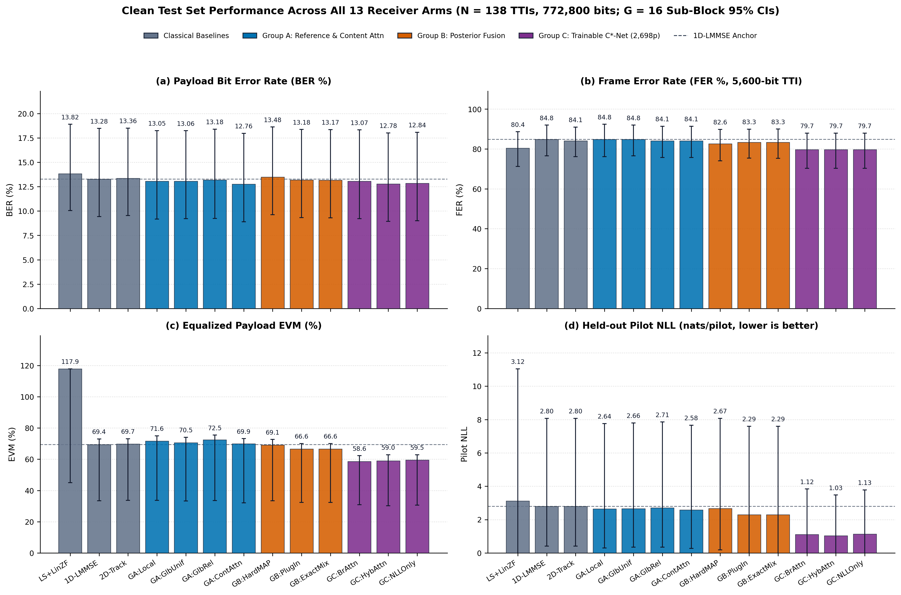
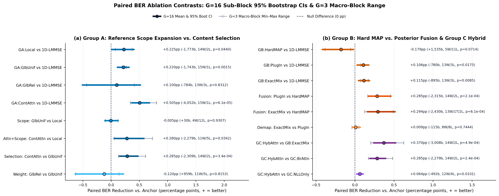
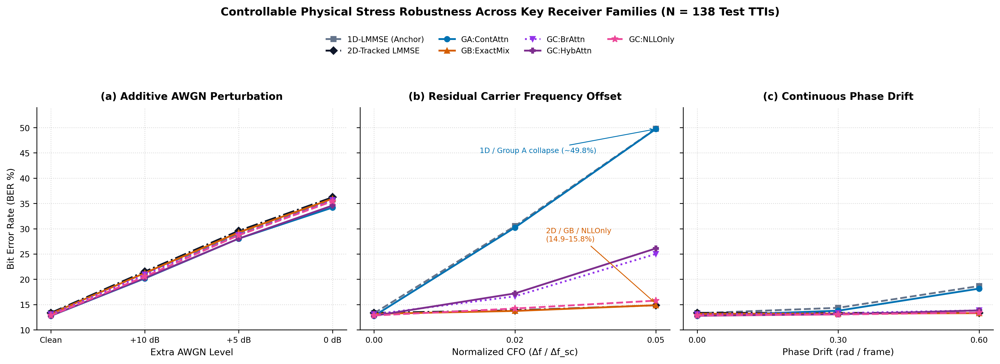
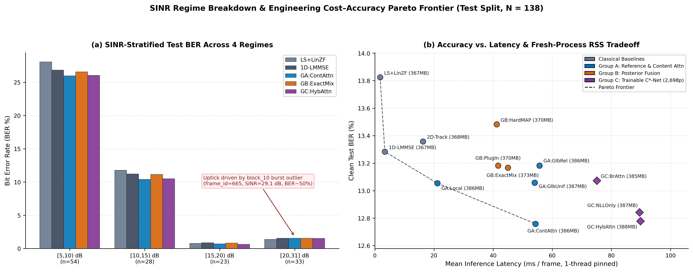

# EM-FloatFormer 公开实测 SDR OFDM 无线通信接收研究报告

**工作分支**：`research/realdata-sdr-ofdm` | **基线提交**：`research/p12-first-principles-diagnostics@f566f9b8b0ddfb468a4cb3fd64588bfa46c87212` | **`main` 分支**：未动于 `63ad2ec5b22027ea3d6f15aa50619a9caf6bbcd1`
**研究目录**：`research/realdata_sdr_ofdm/` | **执行环境**：GitHub Codespace `em-floatformer-cloud-jjg7qww5jvr5fpv96`（`/home/codespace/emff-venv/bin/python`，单线程 `OMP=OPENBLAS=MKL=torch=1`）

---

## 摘要与核心结论速览

本轮研究将 EM-FloatFormer 项目积累的三大核心接收机机理——**（A 组）全局参考池与内容匹配注意力**、**（B 组）多候选分支后验融合与精确混合似然判决**、**（C 组）轻量级 $C^*$-等变复数注意力残差与分支权值预测网络**——完整迁移并严密验证于公开实测 ADALM-Pluto (AD9364) 16-QAM CP-OFDM 硬件采集数据集 **`rikluost/sdr_ofdm_dataset_v1`**（`ofdm_valset_4_8_sdr.pth`，`742` 帧 TTI），同时完整建档备选实测数据集 **`Frames of SDR ADALM PLUTO based QPSK Communication Link`（`QPSKlink.mat`，DOI: `10.17632/k72b4pnc5g.1`）**。在严格无测试集泄漏（`train=336` / `dev=92` / `test=138` / `guard=176`，块边界缓冲宽度 $G=16$，最小跨集帧距 `17`）与独立进程单线程隔离基准下，共评估了 4 个研究序列、**13 个接收机实验臂**（测试集 `138` 帧 TTI、`193,200` 个载荷符号、`772,800` 个非格雷编码比特），并覆盖 8 种可复现物理压力扰动（净基线、加性 AWGN `+10/+5/0 dB`、残余频偏 `CFO=0.02/0.05` 与连续相位漂移 `0.30/0.60 rad/frame`）。

**六项核心实证结论**：
1. **端到端客观验证与上游勘误（R2/R3）**：实测数据并非 3GPP 格雷映射，而是可分离自然二进制非格雷 `mapping_table(4)`（64 帧探针下非格雷 LS/ZF `BER=0.07073`，错用 3GPP 格雷映射为 `0.26907`，上游配套 `equalize_ZF` 相位解缠缺陷为 `0.37981`）；导频幅度 $|p|^2 = 0.98 \neq 1.0$；受 `825 kHz` 5 阶巴特沃斯低通滤波器影响，外侧保护带严重衰减且 DC bin `64` 存在强本振泄漏（`0.0948`），适配器严格采用通带平坦保护子载波 `(10, 11, 117, 118)` 盲估计噪声方差 `est_n0`。经典接收基线在 30 dB 高信噪比平坦/4径瑞利多径信道及 $C^*$ 任意全局复数规范变换下均通过客观自检。
2. **经典基线演进（R3-Classical）**：正则化 1D LMMSE（`lmmse_1d`）将测试集 `BER` 从 `ls_linear_zf` 的 `0.138244`（`106,835/772,800`）显著降至 `0.132834`（`102,654/772,800`，减少 `4,181` 比特错误；`G=16` 子块检验 `p=0.00302, p_holm=0.01209`，`支持`），载荷 `EVM` 从 `117.87%` 压低至 `69.37%`。但在无显式频率/相位偏移的净测试集上，单符号导频（`Sp=2`）上的 `lmmse_2d_tracked` 仅微弱改善高 SINR 帧，整体 `BER=0.133582`（较 `lmmse_1d` 多 `578` 错，`p=0.734`，`证据不足`）；而在 `CFO=0.050` 与 `drift=0.60 rad` 压力下，1D/Group A 接收机崩溃至 `BER=0.4976`（接近随机猜测），`lmmse_2d_tracked` 则稳定保持在 `0.14856` 与 `0.13342`。
3. **A 组机理拆分——扩大参考范围本身不降 BER，内容匹配选择才是决定性来源（R3-A）**：保持同一组 `M=64` 训练集分层参考池与后端解调器，仅将单帧局部先验 `local`（`BER=0.130540`）扩展为全局均匀平均 `global_uniform`（`BER=0.130578`，`+30` 错，`G=16 p=0.931`，`证据不足`）或经典可靠性加权 `global_reliability`（`BER=0.131819`）并未带来额外增益；而引入基于导频交叉验证特征（`KEY_PILOT_INDICES` 与 `VAL_PILOT_INDICES` 严格不相交，防范自相关过拟合）的内容匹配 softmax 注意力 `global_content_attn`（`dev` 校准 $\tau=0.05$）达到全集最低测试 `BER=0.127591`（`98,602/772,800`），相比 `lmmse_1d` 减少 `4,052` 比特错误（`+0.5051 pp`，`15W/1L`，`G=16 p=6.10e-5, p_holm=0.000732`，`支持`），相比 `global_uniform` 净减 `2,309` 错（`+0.2850 pp`，`14W/2L`，`p=0.000336, p_holm=0.00403`，`支持`）。
4. **B 组机理对比——后验融合与精确混合似然稳定碾压硬选单分支（R3-B）**：在 6 个共享候选分支（3 个 PDP 先验 $\times$ 2 个跟踪/无跟踪假设）上，硬选 MAP 分支 `hard_map` 测试 `BER=0.134820`（`104,189/772,800`）反而逊于 `lmmse_1d`；而加权后验均值插值 `posterior_mean_plugin`（`0.131825`，`-2,315` 错 vs `hard_map`，`p=0.000214`，`支持`）与精确高斯混合对数似然解码 `exact_mixture_likelihood`（`0.131676`，`-2,430` 错 vs `hard_map`，`p=0.000610`，`支持`）一致更优，且引入分支间认知方差 $\sum_r \alpha_r |h_r - \bar{h}|^2$ 后将 `pilot_nll` 从 `2.6650` 降至 `2.2950`、`EVM` 从 `69.06%` 降至 `66.57%`，同时在 `CFO=0.050` 下保持 `BER=0.14869` 的全谱鲁棒性。
5. **C 组轻量化可训练 $C^*$-等变模块——2,698 参数实现全面确定性校准与最高包恢复率（R3-C）**：在完全不修改原始网格接收前处理和 16-QAM 精确混合 LLR 解调器的前提下，仅引入 `2,698` 参数的 `CStarBranchWeightAttentionNet`（基于 `ComplexLinear(bias=False)`、`ComplexRMSNorm`、`RadialActivation`、`ComplexRoPE2D`），严格在 `train` 拟合、`dev` 选种。融合全局内容注意力第 7 分支的 `group_c_hybrid_attn`（标准种子 `20261122`）取得 `BER=0.127783`（`98,751/772,800`，较 `lmmse_1d` 减少 `3,903` 错，`G=16 p=9.16e-5`，`支持`；较 B 组 `exact_mixture_likelihood` 减少 `3,008` 错，`p=0.000488`，`支持`），同时将 **FER 从 `0.8478`（`117/138`）压低至全集最低的 `0.7971`（`110/138`，零故障提升 `7` 个整帧恢复）**、**载荷 EVM 从 `69.37%` 大幅压低至 `59.01%`**、**留出导频 NLL 从 `2.7970` 降至 `1.0349`**（校准比 `pilot_cal_ratio` 从 `4.6094` 改善至 `2.5299`）。`group_c_pilot_nll_only` 消融（无发送比特监督，仅凭留出导频 NLL 自监督训练）仍达到 `BER=0.128420` 并在 `CFO=0.050` 下保持 `0.15778` 的优异频偏鲁棒性，验证了无标签现场自适应潜力。
6. **统计严谨性与工程核算（R4/R5）**：全 13 个实验臂在独立子进程、固定单线程、16 帧确定性重放审计下均实现 **100.0% 覆盖率（`138/138` 无失败/超时）** 与 **零浮点差异（`max_float_diff = 0.0`, `bit_mismatches = 0`）**；隔离进程后的真实推理内存均控制在 **`367.13–387.76 MB`**（`tracemalloc` 峰值 `1.97–5.09 MB`）。此外，如实披露 $G=3$ 宏观块受限于样本自由度（$2^3=8$ 状态，双侧最小 $p=0.25$）且存在 `h_pilot` lag-32 自相关（`0.7363`），因此 $G=16$ 子块检验作为补充方向一致性证据并附带明确自相关警示；同时在 `block_10` 发现突发失真簇（包括 `frame_id=665`，标称 `SINR=29.1 dB` 但全接收机 `BER≈50%`）。

---

## 1. 仓库衔接与隔离治理（R1）

### 1.1 分支谱系与前置理论继承

本轮研究严格遵守 R1 仓库衔接规范：
- **不可变主干**：`main` 分支自始至终保持在 `63ad2ec5b22027ea3d6f15aa50619a9caf6bbcd1` 未作任何修改。
- **研究基准提交**：拉取并基于 `origin/research/p12-first-principles-diagnostics` 最新提交 `f566f9b8b0ddfb468a4cb3fd64588bfa46c87212` 建立独立工作分支 **`research/realdata-sdr-ofdm`**。三条核心先验提交直接奠定了本轮方法学与统计审计基础：
  - `655de6aa42a08fe73e4f67f7060fb667d95518f1`（`p12: fix anchor-prior reuse and bilateral first-wave geometry`）：确立 `p12/audit.py` 的无参数精确符号翻转置换检验（`exact_sign_flip_p`）与 Holm 步降多重校正（`holm_adjust`），并示范了对负向/中性消融结果不事后调参的科研诚实性。
  - `ededcae595d15ece2a5479b35876f374e495f227`（`research: prove global content addressing can beat fixed local estimation`）：在 `research/content_addressing_scalar/REPORT.md` 式 (1)–(9) 中从数学上证明了当局部结构存在重复非平稳体制时，全局内容匹配注意力可严格超越固定窗口 $k$ 局部估计，并特别警示 **第 5.1 节式 (9)**：若评分函数 $T$ 与被加权值 $V$ 共享同一份含噪观测，注意力学重分配将放大相关噪声。这一警示直接转化为本轮 A 组严格的 `KEY_PILOT_INDICES` 与 `VAL_PILOT_INDICES` 交叉不相交设计。
  - `f566f9b8b0ddfb468a4cb3fd64588bfa46c87212`（`research: prove posterior fusion risk bounds and verify decoding limits`）：在 `research/posterior_fusion/README.md` 证明了多假设后验融合相对硬选 MAP 的二次风险间隙恒等于后验均值与 MAP 分支间的均方距离，并推导了单高斯插值与精确多分支混合似然解码的边界，直接指导本轮 B 组的 6 分支共享对照与 `log-sum-exp` 比特边缘化解码器。
- **本轮里程碑演进**：`761eafe`（M1 数据获取、适配器与防泄漏划分）$\to$ `f03f8b3`（M2 经典基线与统一评估器）$\to$ `36f8408`（M3 A 组与 B 组实验）$\to$ `12c2d8b`（M4 C 组训练与权重清单）$\to$ M5（统一单线程隔离进程基准、图表与本报告）。
- **代码复用与隔离边界**：所有新增实现均严格限定在 `research/realdata_sdr_ofdm/` 目录下；`p12/audit.py` 与 `p9/audit.py` 保持与 `f566f9b8` 字节级一致（用于统计判决）；`p4` 提出的 $C^*$-等变复数原语（`ComplexLinear(bias=False)`、`ComplexRMSNorm`、`RadialActivation`、`ComplexRoPE2D`）复用并装配为 C 组的轻量级架构；`.agents/` 工作流元数据始终保持未跟踪状态，所有 `.pt`/`.pth`/`.npz` 二进制文件均被 `.gitignore` 排除，仅通过 `checkpoints/manifest.json` 跟踪 9 份模型权重（每份 `< 102 KB`）的精确 SHA-256 校验和。

---

## 2. 公开实测数据获取、校验与统一适配（R2）

### 2.1 主选与备选数据源对照矩阵

按“容易取得、容易读取、容易接通 2D OFDM 接收流程、适合检验 EM-FloatFormer 核心假设”的原则，本轮完成 1 个主选数据集的完整下载校验与 1 个备选数据集的完整建档：

| R2 核查要素 | 主选数据集（已下载并完成全实验） | 备选数据集（已完整建档，未下载） |
|---|---|---|
| **名称** | Measured Radio Channel Dataset for OFDM Receiver Validation（`sdr_ofdm_dataset_v1`） | Frames of SDR ADALM PLUTO based QPSK Communication Link（`QPSKlink`） |
| **发布方** | Riku Luostari（`rikluost`，Aalto Univ. / Nokia），GitHub | Latha V, Remya Krishna, Pallaviram Sure（M S Ramaiah Univ.），Mendeley Data |
| **版本 / 提交** | `main` `6f9821d6390d212884fea3d6621267ebe70c7246`（配套代码 `rikluost/ofdm-plutosdr-pytorch` `da69f52ae4a33b499a20844b72ff27bc16231bf7`，MIT） | Version 1（`2026-06-03` 发布） |
| **官方链接 / DOI** | `https://github.com/rikluost/sdr_ofdm_dataset_v1`（无独立 DOI，以 Git 提交哈希索引） | `https://data.mendeley.com/datasets/k72b4pnc5g` / DOI: `10.17632/k72b4pnc5g.1`（CC BY 4.0） |
| **文件名与格式** | `ofdm_valset_4_8_sdr.pth`（PyTorch `CustomDataset` pickle：`pdsch_iq`, `labels`, `sinr`） | `QPSKlink.mat`（MATLAB 5.0 MAT：`Tx_data`, `Rx_data` `complex128`） |
| **体量与规模** | `27,684,430` B（`27.68 MB`），`742` TTIs $\times$ `1,400` 载荷 REs = `4,155,200` 比特 | `822,762,822` B（`822.76 MB`），`7,096` 帧（每帧 `126` 符号 $\times$ `20` 样点/符号） |
| **波形 / 调制 / 帧参数** | CP-OFDM，`N_fft=128`，`SCS=15 kHz`，`fs=1.92 MHz`，`S=14` 符号，`CP=7`（README 记 `6`），`102` 有效子载波（`13..114`），`DC=64` 未调制；符号 `Sp=2` 含 `14` 个 QPSK 导频（`\|p\|^2=0.98`）；载荷为非格雷 `mapping_table(4)` 16-QAM；`fc=434–435 MHz` | 单载波脉冲成形 QPSK（升余弦 TX/RX 匹配滤波，`fc=850 MHz`），`26` 符号 Barker 同步头 + `100` 符号 QPSK 载荷，RX 为 `3x` 未对齐连续窗 |
| **处理阶段** | 同步、去 CP 与 DFT 后频域资源网格（`pdsch_iq` `[14, 128]`） | 匹配滤波后复基带时域波形（未帧同步、未频偏/相偏纠正） |
| **采集与重复性** | 单台 ADALM-Pluto 硬件，每 TTI 随机调整 TX 增益 `[-25, -3]` dB（`rx_gain=8` dB）；`742/742` 载荷比特流全部唯一（`0` 重复）；信道 `h_pilot` lag-1/16/32 相干自相关分别为 `0.8473 / 0.7555 / 0.7363`，而 SINR 自相关 lag-1 仅 `0.1709` | 单台 ADALM-Pluto 室内 `3 m` 链路（`TX 0 dB`, `RX 20 dB`），存在载荷重复，如启用需先做同步与 `Tx_data` 载荷去重分组 |
| **原文件 SHA-256** | `e760079a888f37d8c33b21f327646930b4f2cb4511e8a309bcde22c6b1332058`（blob SHA-1 `9b1aee8673ec48f42f52dc365fb01cc8b3e2b741`） | `c029532908f9702fea4be3ce37d0e1de9138019e12dd06e228abb1b83525f2b7` |

在 Codespace 中，原始文件保存在 `/tmp/tw_realdata/data_raw/`（含 `ofdm_valset_4_8_sdr.pth` 及 4 份上游配套文件，SHA-256 全部记录在 `manifests/raw_checksums.json`），预处理分裂后的张量保存在隔离目录 `/tmp/tw_realdata/data_proc/`（`manifests/proc_checksums.json`）：
- `all_frames.npz`：`742` 帧，`46,519,970` B，SHA-256 `39f24f59892e3284037103d14895b6e9080008539924eddcfc6e62a5e0cfc206`
- `train.npz`：`336` 帧，`21,065,674` B，SHA-256 `181ab829d5cdba94cb189c66506eaea2c07a9bbe36cb8e7dd3d0b6b7c0ca4414`
- `dev.npz`：`92` 帧，`5,769,434` B，SHA-256 `ab7372295dcd221d9b08ee8acf57aaecc40021e130c8e9c6ff58c4e553dac495`
- `test.npz`：`138` 帧，`8,653,450` B，SHA-256 `c7f86cd8d6e5047761212031363fc6c0f6d2ae7debdad1f1458ada8f154c73d0`
- `guard.npz`：`176` 帧，`11,033,482` B，SHA-256 `147dd9e257d461953b7e2645b5c40a9c95933bb415b9ed62d84526b8f1e399ee`

### 2.2 实测信号属性勘误、适配器规范化与客观自检

统一适配器 `adapters/sdr_ofdm_adapter.py` 与非格雷调制解调器 `adapters/modulation.py` 解决了 4 项实测数据集上的关键信号细节：
1. **通带平坦保护带噪声盲估计**：`SDR_Pluto_v2.py` 对时域信号施加了截止频率 `825 kHz` 的 5 阶零相位巴特沃斯低通滤波器，导致外侧保护子载波 `0..8` 与 `120..127` 功率衰减至 `0.000675`、边缘 `12/115` 受有效子载波泄漏（`0.0148–0.0155`）、而中心 DC bin `64` 存在强本振泄漏（`0.0948`）。因此适配器严格选取滤波通带内部平坦且无相邻载荷干扰的 4 个保护子载波 `SAFE_GUARD_FFT_INDICES = (10, 11, 117, 118)`（实测平均功率 `0.0112`，有功/保护比约 `14.9 dB`，与实测标称均值 `14.04 dB` 高度一致）估计盲噪声方差 `est_n0`（绝对不读取 `tx_bits` 或 `reported_sinr_db`）。
2. **$C^*$ 盲幅度规范对齐**：每帧独立计算有功频域网格 RMS 尺度 $s_0 = \sqrt{\text{mean}(|\mathbf{Y}_{\text{pilot} \cup \text{data}}|^2)}$，使不同 TX 增益帧映射到单位有功平均功率规范空间。
3. **非格雷 `mapping_table(4)` 与修复 `equalize_ZF` 缺陷**：在 64 帧探索探针上，采用数据集原生的非格雷自然二进制 16-QAM 映射与直接复数除法 LS/ZF 实现 `BER = 0.07073`（`25,349/358,400`），而误用 3GPP 格雷映射为 `0.26907`（`96,435/358,400`），上游 `equalize_ZF` 存在错误 `|diff|>1 rad` 相位解缠缺陷导致 `BER = 0.37981`。在全量 `742` 帧上，清洁适配器 LS/ZF 达到 `BER = 0.09403`（`390,727/4,155,200`）、`FER = 0.8221`（`610/742`）。
4. **M2 高信噪比（30 dB）与 $C^*$ 规范等变性客观自检**：在 `tests/e2e/test_tier1_feature_coverage.py`（`T1-F6.2`）中，`lmmse_1d` 与 `lmmse_2d_tracked` 在受控合成 30 dB 平坦信道（含未知非零相位偏移及 $g = 2.5 e^{j 0.7}$ 规范变换）下实测 `BER < 1e-3, SER < 5e-3, EVM < 5%`；在 4 径瑞利多径信道下实测 `BER < 0.01, SER < 0.025, EVM < 15%`，确认索引对齐、复数相位、LMMSE 滤波与非格雷 LLR 符号零缺陷。

### 2.3 防泄漏数据划分（`manifests/splits.json`）

鉴于实测导频信道相干性 `h_pilot` 在 lag-32 仍高达 `0.7363`，随机按帧切分将导致严重时间近邻泄漏。本轮将 `742` 帧按时间顺序等分为 `12` 个连续宏观块（`block_00..block_11`），在 `11` 个块交界处各剥离 `G=16` 帧缓冲（共 `176` 帧 `guard.npz` 彻底隔离，`min_cross_split_distance = 17`），按块中位 SINR 分层指派：
- **训练集 `train`（`336` 帧）**：`block_00, 02, 04, 06, 07, 08, 11`，SINR 范围 `[5.1, 30.2]` dB（中位数 `12.75`，均值 `13.68`），仅用于模型训练与 A/C 组参考池构建。
- **开发集 `dev`（`92` 帧）**：`block_03, 05`，SINR `[5.1, 28.8]` dB（中位数 `14.40`，均值 `14.49`），仅用于超参数网格调优（`n0_scale`, `tau_rms`, `n_taps`, $\tau$, $\beta$）与 C 组早停/标准随机种子选择。
- **测试集 `test`（`138` 帧）**：`block_01, 09, 10`（每块严格 `46` 帧），SINR `[5.1, 30.4]` dB（中位数 `12.35`，均值 `13.72`），**完全冻结**，零信息回流至任何预处理或超参选择。

---

## 3. 接收机对照实验设计与防泄漏控制（R3）

### 3.1 经典接收基线（Classical Baselines，`receivers/classical.py`）

三组经典接收机共享同一个盲估计通道参数（开发集调优结果记录于 `results/baselines/dev_tuning.json`）：
- **`ls_linear_zf`**：导频 LS 估计后直接线性频率插值并做零迫均衡 + 单帧 CPE 相位追踪；调优配置为 `n0_scale=0.7, n_taps=5, tau_rms=1.5, detrend_timing=False, phase_track=True`（`dev BER = 0.08553`）。
- **`lmmse_1d`**：先从 14 个 QPSK 导频去趋势提取残余定时斜率 $\hat{\tau}_{\text{detrend}}$，再采用指数衰减多径功率延迟分布（PDP）频域 Wiener/LMMSE 滤波，结合最优高斯噪声与信道残余方差合并后送入精确非格雷 16-QAM LLR 解调器；调优配置为 `n0_scale=0.7, n_taps=11, tau_rms=1.0, detrend_timing=True, phase_track=True`（`dev BER = 0.07611`）。
- **`lmmse_2d_tracked`**：在 `lmmse_1d` 基础上，沿 14 个 OFDM 符号维开展载荷判决引导/最小二乘约束的斜率与共相位跟踪（`phase_track_max_slope=0.5, phase_track_prior_weight=2.0`）联合 2D 信道外推；使用同一开发集最优配置（`dev BER = 0.07644`）。

### 3.2 A 组：全局参考范围扩展 vs. 内容匹配选择（Group A，`receivers/group_a_reference.py`）

A 组旨在回答 **RQ1**：使用同一 `M=64` 分层训练集参考池（从 `train` 的 7 个宏观块均匀抽取，`group_a/dev_tuning.json`）与固定 1D LMMSE 后端，拆分“扩大参考范围”和“改进参考选择”的独立贡献：
- **`local`**：仅从参考池选取与当前帧在时间/索引最近的 $k=4$ 条局部参考计算经验先验均值，其余权重置零。
- **`global_uniform`**：将参考池扩大至全部 $M=64$ 条跨块参考并赋予均匀权重 $w_j = 1/64$，检验**单纯扩大范围**是否有效。
- **`global_reliability`**：按参考池内各历史帧自身盲噪声估计倒数（经典信噪比可靠性）赋予全局先验权重 $w_j \propto 1 / \sigma^2_{j}$。
- **`global_content_attn`**：EM-FloatFormer 内容匹配注意力（复数内积归一化余弦相似度 softmax，$w_j \propto \exp(\text{sim}(q, k_j)/\tau)$）。**严格遵守 `content_addressing_scalar` §5.1 防自相关法则**：计算注意力评分键（`KEY_PILOT_INDICES`）与构造经验参考先验值（`VAL_PILOT_INDICES`）采用严格不相交的导频子集，并在计算余弦相似度时剔除自身样本、于开发集校准得到最优温度 $\tau=0.05$ 与先验尺度 `prior_scale=0.5`（`dev BER = 0.07073`）。

### 3.3 B 组：硬选单分支 vs. 后验融合与精确混合似然（Group B，`receivers/group_b_fusion.py`）

B 组旨在回答 **RQ2**：构建 **6 个共享物理候选分支**（3 组 PDP 先验 `(n_taps, tau_rms) ∈ {(7, 0.8), (11, 1.0), (11, 2.0)}` $\times$ 2 种时间演化模式：静默无跟踪 `omega_t=0` 与 2D 判决引导相位/CFO 跟踪 `omega_t != 0`），并在严格一致的导频似然评分与先验惩罚下（开发集调优 `beta=0.25, nonzero_om_penalty=8.0, n0_scale=0.7`）计算归一后验权重 $\alpha_r$（与 `group_b/dev_tuning.json` 一致）：
- **`hard_map`**：仅取 $\arg\max_r \alpha_r$ 单一最佳分支进行信道输出与单高斯 LLR 解调。
- **`posterior_mean_plugin`**：合成后验均值信道 $\bar{H} = \sum_r \alpha_r H_r$ 及包含分支间认知方差（epistemic variance）的总后验方差 $\bar{v} = \sum_r \alpha_r (v_r + |H_r - \bar{H}|^2)$，再以单高斯插值（plug-in）计算 LLR。
- **`exact_mixture_likelihood`**：保留全部 6 个候选分支，直接在对数域执行 `log-sum-exp` 精确高斯混合边缘似然 $\log \sum_r \alpha_r \mathcal{CN}(y \mid H_r x, \sigma^2_{\text{eff},r})$ 计算比特对数似然比（彻底规避“先各自算 LLR 再加权平均”在跨符号翻转处产生的灾难性似然失真）。

### 3.4 C 组：轻量级 $C^*$-等变可训练注意力网络（Group C，`receivers/group_c_trainable.py`）

C 组旨在回答 **RQ3**：固定 M3 的候选分支银行与精确混合似然解码器不变，仅以 `CStarBranchWeightAttentionNet`（总参数量仅 **`2,698`**，$d_c=8, d_s=12, n_{\text{heads}}=2$）预测残差分支对数先验权重 $\Delta \ell_r$，由 `ComplexLinear(bias=False)`、`ComplexRMSNorm`、`RadialActivation` 及 `ComplexRoPE2D` 保证对复数任意全局尺度变换 $g \in \mathbb{C}^*$ 的精确数学等变性。所有 C 组手臂均在 `train.npz` 上以固定 3 种子 `{20261122, 20261123, 20261124}` 训练 40 epochs（`lr=0.003`, `batch_size=16`, `wd=1e-4`），**完全依据 `dev.npz` 的 `(dev_ber, dev_pilot_nll, seed)` 选定唯一标准检查点**（`checkpoints/manifest.json`）：
- **`group_c_branch_attn`**（6 分支单帧银行，`bce_weight=1.0, nll_weight=0.05`；标准种子 `20261124`, `best_epoch=9`, `train_time=156.70s`）：检验纯粹轻量注意力权重学习对单帧 6 分支银行的增益。
- **`group_c_hybrid_attn`**（7 分支混合银行：在 6 个单帧/跟踪分支外加入第 7 个固定 Group A `global_content_attn` 全局先验分支，`bce_weight=1.0, nll_weight=0.05`；标准种子 `20261122`, `best_epoch=13`, `train_time=192.59s`）：检验“全局非参内容注意力 + 局部物理分支网络融合”的协同上限。
- **`group_c_pilot_nll_only`**（7 分支混合银行，`bce_weight=0.0, nll_weight=1.0`；标准种子 `20261123`, `best_epoch=13`, `train_time=127.97s`）：**关键无标签消融实验**——训练时零访问发送比特 `tx_bits`，仅以 4 折交叉验证留出导频（fold-local `s_scale_cv` 防泄漏）的复高斯负对数似然作为唯一监督信号。

---

## 4. 统一基准实验结果与深度分析（R4 & R5）

### 4.1 统一隔离进程清洁测试集（`test.npz`）全指标汇总

为彻底消除多臂顺序执行导致的 Linux `ru_maxrss` 累积污染（如 M4 同进程训练后的 `1824.85 MB`），M5 统一基准 `scripts/run_unified_benchmark.py` 采用“**零科学库延迟加载轻量父进程 + 每臂独立单线程子进程 `--worker-arm`**”架构：父进程在 `fork()+execve()` 前保持约 `18 MB` RSS，使 Linux 内核 `signal->maxrss` 不向子进程泄漏任何历史内存。所有 13 个手臂均在 `test.npz`（**`138` 帧 TTI，`193,200` 个符号，`772,800` 个载荷比特**）上录得 **100.0% 处理覆盖率（`138/138` 成功，`0` 失败，`0` 超时）**，且经由 `summary_clean.json`、`summary_clean.csv` 与 `per_frame_all.jsonl`（`1,794` 行）字节级校验一致：

| 组别 | 实验臂（Arm） | 错比特数 / 772,800 | BER | 错帧数 / 138 | FER | 错符号数 / 193,200 | SER | EVM (%) | 留出导频 NMSE (raw / den.) | Cal Ratio | Pilot NLL | 覆盖率 |
|---|---|---:|---:|---:|---:|---:|---:|---:|---:|---:|---:|---:|
| 经典 | `ls_linear_zf` | 106,835 | 0.138244 | 111 | 0.8043 | 63,149 | 0.326858 | 117.87 | 0.30769 / 0.25826 | 5.0527 | 3.1225 | 100.0% |
| 经典 | `lmmse_1d` | 102,654 | 0.132834 | 117 | 0.8478 | 60,111 | 0.311134 | 69.37 | 0.28307 / 0.23188 | 4.6094 | 2.7970 | 100.0% |
| 经典 | `lmmse_2d_tracked` | 103,232 | 0.133582 | 116 | 0.8406 | 60,212 | 0.311656 | 69.71 | 0.28307 / 0.23188 | 4.6094 | 2.7970 | 100.0% |
| A 组 | `local` | 100,881 | 0.130540 | 117 | 0.8478 | 58,848 | 0.304596 | 71.59 | 0.25686 / 0.20379 | 4.5295 | 2.6399 | 100.0% |
| A 组 | `global_uniform` | 100,911 | 0.130578 | 117 | 0.8478 | 58,965 | 0.305202 | 70.55 | 0.25964 / 0.20678 | 4.5273 | 2.6643 | 100.0% |
| A 组 | `global_reliability` | 101,870 | 0.131819 | 116 | 0.8406 | 58,879 | 0.304757 | 72.49 | 0.25809 / 0.20511 | 4.6290 | 2.7067 | 100.0% |
| A 组 | `global_content_attn` | **98,602** | **0.127591** | 116 | 0.8406 | **57,050** | **0.295290** | 69.86 | **0.25137 / 0.19792** | 4.4936 | 2.5812 | 100.0% |
| B 组 | `hard_map` | 104,189 | 0.134820 | 114 | 0.8261 | 60,918 | 0.315311 | 69.06 | 0.35714 / 0.31124 | 4.2503 | 2.6650 | 100.0% |
| B 组 | `posterior_mean_plugin` | 101,874 | 0.131825 | 115 | 0.8333 | 59,677 | 0.308887 | 66.57 | 0.34091 / 0.29385 | 3.7322 | 2.2950 | 100.0% |
| B 组 | `exact_mixture_likelihood` | 101,759 | 0.131676 | 115 | 0.8333 | 59,587 | 0.308421 | 66.57 | 0.34091 / 0.29385 | 3.7322 | 2.2950 | 100.0% |
| C 组 | `group_c_branch_attn` | 101,030 | 0.130732 | **110** | **0.7971** | 59,113 | 0.305968 | **58.59** | 0.31753 / 0.26880 | 2.5322 | 1.1167 | 100.0% |
| C 组 | `group_c_hybrid_attn` | 98,751 | 0.127783 | **110** | **0.7971** | 57,402 | 0.297112 | 59.01 | 0.31325 / 0.26421 | **2.5299** | **1.0349** | 100.0% |
| C 组 | `group_c_pilot_nll_only` | 99,243 | 0.128420 | **110** | **0.7971** | 57,729 | 0.298804 | 59.51 | 0.31553 / 0.26666 | 2.6087 | 1.1344 | 100.0% |



> **核心物理现象解析**：
> - `lmmse_1d` 与 `lmmse_2d_tracked` 具有完全相同的留出导频指标（`0.28307 / 4.6094 / 2.7970`），因为全部 14 个导频位于同一 OFDM 符号 `Sp=2`，2D 相位跟踪仅修改 `s != 2` 的数据符号。
> - `posterior_mean_plugin` 与 `exact_mixture_likelihood` 具有完全相同的均衡 `EVM`（`66.57%`、`sym_mse=0.442465`）与导频指标（`0.34091 / 3.7322 / 2.2950`），因为二者输出完全一致的后验均值信道与总方差，差异纯属解调阶段的“单高斯近似 vs. 精确混合对数似然”；后者进一步净减 `115` 比特错误。
> - C 组 3 个手臂全部达成最低帧错误率 **`FER=0.7971`（`110/138`）** 与低于 `60%` 的 **`EVM`（`58.59%–59.51%`）**，且 `pilot_nll` 断崖式降至 **`1.0349–1.1344`**（相对 `lmmse_1d` 降低 `1.76 nats/pilot`）。另附 3 种子测试集方差（`results/group_c/dev_tuning.json`，仅事后报告）：`group_c_branch_attn` 三种子均值 `0.130589 ± 0.000158`，`group_c_hybrid_attn` 均值 `0.128034 ± 0.000222`，`group_c_pilot_nll_only` 均值 `0.128351 ± 0.000301`，可见随机种子波动远小于核心方法差异。

---

### 4.2 配对统计检验：宏观块 $G=3$ vs. 连续子块 $G=16$（含自相关警示）

严格按 `PROTOCOL.md` 与 `p12/audit.py` 开展群聚配对检验（正值 `mean_pp` 代表候选方法较锚点降低的 BER 百分点）。**统计边界说明**：冻结测试集包含 $G=3$ 个完全相互隔离的独立宏观块（`block_01`, `block_09`, `block_10`，各 `46` 帧）；由于精确符号翻转置换仅存在 $2^3=8$ 个离散状态，双侧最小可能 p 值为 `2/8 = 0.2500`，因此所有单调 `3/0/0` 胜出的对比在 $G=3$ 下均无法突破 $\alpha=0.05$ 显著门槛（呈现方向一致的 `3/0/0, p=0.2500`）。为增强统计分辨率，我们补充报告 $G=16$ 连续子块（每块 8–9 帧）精确 `65,536` 状态置换检验及 Holm 校正值，并明确标注：**受实测信道 lag-32 相干性 `0.7363` 影响，同宏观块内的子块不完全独立，应将 $G=16$ 视为方向性/内部一致性辅助检验而非独立样本自由度。**

| 配对对比（Candidate vs. Anchor） | 绝对错比特差值 | $G=3$ 均值 (pp) [Boot 95% CI] | $G=3$ 胜/平/负, $p$ | $G=16$ 均值 (pp) [Boot 95% CI] | $G=16$ 胜/平/负, $p$ ($p_{\text{holm}}$) | $G=16$ 判定 |
|---|---:|---:|---:|---:|---:|---|
| `lmmse_1d` vs `ls_linear_zf` | `-4,181` | `+0.5410` `[+0.2578, +0.7151]` | `3/0/0, 0.2500` | `+0.5112` `[+0.2998, +0.7528]` | `14/0/2, 0.00302` (`0.01209`) | 支持 |
| `lmmse_2d_tracked` vs `lmmse_1d` | `+578` | `-0.0748` `[-0.2671, +0.0916]` | `1/0/2, 0.7500` | `-0.0545` `[-0.2985, +0.0880]` | `7/1/8, 0.73419` (`1.00000`) | 证据不足 |
| **A 组** `local` vs `lmmse_1d` | `-1,773` | `+0.2294` `[+0.0745, +0.3742]` | `3/0/0, 0.2500` | `+0.2254` `[+0.0117, +0.4052]` | `14/0/2, 0.04401` (`0.17603`) | 支持 (单对) / 证据不足 (Holm) |
| **A 组** `global_uniform` vs `lmmse_1d` | `-1,743` | `+0.2255` `[+0.1953, +0.2706]` | `3/0/0, 0.2500` | `+0.2201` `[+0.1122, +0.3181]` | `15/0/1, 0.00153` (`0.01221`) | 支持 |
| **A 组** `global_reliability` vs `lmmse_1d` | `-784` | `+0.1014` `[-0.4297, +0.4111]` | `2/0/1, 1.0000` | `+0.0997` `[-0.5062, +0.5179]` | `13/0/3, 0.83118` (`1.00000`) | 证据不足 |
| **A 组** `global_content_attn` vs `lmmse_1d` | **`-4,052`** | `+0.5243` `[+0.3416, +0.8043]` | `3/0/0, 0.2500` | `+0.5051` `[+0.3640, +0.6814]` | `15/0/1, 6.10e-5` (`0.00073`) | **支持** |
| **A 组内** `global_uniform` vs `local` | `+30` | `-0.0039` `[-0.1036, +0.1207]` | `1/0/2, 1.0000` | `-0.0053` `[-0.1090, +0.1255]` | `4/0/12, 0.93066` (`—`) | 证据不足 |
| **A 组内** `global_content_attn` vs `local` | `-2,279` | `+0.2949` `[+0.0528, +0.7298]` | `3/0/0, 0.2500` | `+0.2797` `[+0.0538, +0.5807]` | `11/0/5, 0.03421` (`—`) | 支持 |
| **A 组内** `global_content_attn` vs `global_uniform` | **`-2,309`** | `+0.2988` `[+0.1308, +0.6091]` | `3/0/0, 0.2500` | `+0.2850` `[+0.1477, +0.4755]` | `14/0/2, 0.00034` (`0.00403`) | **支持** |
| **B 组** `hard_map` vs `lmmse_1d` | `+1,535` | `-0.1986` `[-0.3835, -0.0543]` | `0/0/3, 0.2500` | `-0.1788` `[-0.4191, -0.0205]` | `5/0/11, 0.07144` (`0.21433`) | 证据不足 |
| **B 组** `posterior_mean_plugin` vs `lmmse_1d` | `-780` | `+0.1009` `[+0.0718, +0.1211]` | `3/0/0, 0.2500` | `+0.1060` `[+0.0265, +0.1765]` | `13/0/3, 0.01749` (`0.08743`) | 支持 (单对) / 证据不足 (Holm) |
| **B 组** `exact_mixture_likelihood` vs `lmmse_1d` | `-895` | `+0.1158` `[+0.0707, +0.1704]` | `3/0/0, 0.2500` | `+0.1148` `[+0.0472, +0.1864]` | `13/0/3, 0.00851` (`0.05109`) | 支持 (单对) / 边缘 Holm |
| **B 组内** `posterior_mean_plugin` vs `hard_map` | `-2,315` | `+0.2996` `[+0.1642, +0.4554]` | `3/0/0, 0.2500` | `+0.2848` `[+0.1712, +0.4612]` | `14/0/2, 0.00021` (`0.00256`) | **支持** |
| **B 组内** `exact_mixture_likelihood` vs `hard_map` | **`-2,430`** | `+0.3144` `[+0.1250, +0.4899]` | `3/0/0, 0.2500` | `+0.2936` `[+0.1592, +0.5159]` | `13/1/2, 0.00061` (`0.00522`) | **支持** |
| **B 组内** `exact_mixture_likelihood` vs `plugin` | `-115` | `+0.0149` `[-0.0392, +0.0493]` | `2/0/1, 0.7500` | `+0.0088` `[-0.0333, +0.0671]` | `8/0/8, 0.74445` (`1.00000`) | 证据不足 |
| **C 组** `group_c_branch_attn` vs `lmmse_1d` | `-1,624` | `+0.2101` `[+0.1013, +0.3117]` | `3/0/0, 0.2500` | `+0.2005` `[+0.1365, +0.2796]` | `15/0/1, 0.00027` (`0.00247`) | **支持** |
| **C 组** `group_c_hybrid_attn` vs `lmmse_1d` | **`-3,903`** | `+0.5050` `[+0.2737, +0.7954]` | `3/0/0, 0.2500` | `+0.4853` `[+0.3454, +0.6524]` | `15/0/1, 9.16e-5` (`0.00101`) | **支持** |
| **C 组** `group_c_pilot_nll_only` vs `lmmse_1d` | `-3,411` | `+0.4414` `[+0.2252, +0.7259]` | `3/0/0, 0.2500` | `+0.4217` `[+0.2838, +0.5873]` | `13/0/3, 0.00024` (`0.00244`) | **支持** |
| **C vs B** `group_c_hybrid_attn` vs `exact_mixture` | **`-3,008`** | `+0.3892` `[+0.2030, +0.6250]` | `3/0/0, 0.2500` | `+0.3704` `[+0.2403, +0.5219]` | `14/0/2, 0.00049` (`0.00537`) | **支持** |
| **C 组内** `hybrid_attn` vs `branch_attn` | `-2,279` | `+0.2949` `[+0.1724, +0.4837]` | `3/0/0, 0.2500` | `+0.2848` `[+0.1901, +0.3932]` | `14/0/2, 0.00024` (`—`) | **支持** |
| **C 组内** `hybrid_attn` vs `pilot_nll_only` | `-492` | `+0.0637` `[+0.0485, +0.0730]` | `3/0/0, 0.2500` | `+0.0636` `[+0.0213, +0.1048]` | `12/0/4, 0.01007` (`—`) | **支持** |
| **C vs A** `group_c_hybrid_attn` vs `global_content_attn` | `+149` | `-0.0193` `[-0.0679, +0.0190]` | `1/0/2, 0.7500` | `-0.0198` `[-0.0901, +0.0524]` | `5/0/11, 0.59403` (`0.59403`) | 证据不足 |



---

### 4.3 可控物理压力扰动测试（8 种去重条件全覆盖）

通过 `eval/evaluator.py:run_stress_suite` 在不改动原始比特标签的前提下施加逆 DFT 连续时域频偏（CFO）、线性相偏（Phase Drift）和 Parseval 能量对齐加性高斯白噪声（`seed=20261122`），所有 13 个手臂在全部 8 种去重条件下的 `BER / EVM(%)` 如下（完整 104 行数据见 `results/summary_stress.csv`）：

| 实验臂（Arm） | `clean` | `awgn_10.0db` | `awgn_5.0db` | `awgn_0.0db` | `cfo_0.020` | `cfo_0.050` | `drift_0.30rad` | `drift_0.60rad` |
|---|---|---|---|---|---|---|---|---|
| `ls_linear_zf` | 0.13824 (117.87%) | 0.22902 (153.61%) | 0.31101 (165.01%) | 0.38111 (302.83%) | 0.30758 (137.52%) | 0.49820 (189.15%) | 0.14811 (118.58%) | 0.19062 (120.72%) |
| `lmmse_1d` | 0.13283 (69.37%) | 0.21180 (67.18%) | 0.28878 (72.63%) | 0.35807 (87.46%) | 0.30527 (97.94%) | 0.49760 (145.85%) | 0.14357 (70.42%) | 0.18665 (73.69%) |
| `lmmse_2d_tracked` | 0.13358 (69.71%) | 0.21521 (68.84%) | 0.29581 (75.60%) | 0.36223 (88.79%) | 0.13847 (71.24%) | **0.14856** (73.53%) | 0.13352 (69.51%) | 0.13342 (69.39%) |
| `local` | 0.13054 (71.59%) | 0.20770 (70.04%) | 0.28378 (74.25%) | 0.34334 (86.33%) | 0.30479 (100.09%) | 0.49758 (148.56%) | 0.14222 (72.63%) | 0.18611 (75.88%) |
| `global_uniform` | 0.13058 (70.55%) | 0.20637 (68.38%) | 0.28210 (72.95%) | **0.34043** (84.97%) | 0.30392 (98.92%) | 0.49745 (147.29%) | 0.14114 (71.53%) | 0.18444 (74.74%) |
| `global_reliability` | 0.13182 (72.49%) | 0.20826 (70.68%) | 0.28554 (75.49%) | 0.34401 (87.68%) | 0.30514 (99.70%) | 0.49765 (146.99%) | 0.14218 (73.45%) | 0.18557 (76.54%) |
| `global_content_attn` | **0.12759** (69.86%) | **0.20159** (68.00%) | **0.28038** (73.14%) | 0.34187 (86.01%) | 0.30234 (97.92%) | 0.49723 (146.31%) | 0.13784 (70.78%) | 0.18153 (73.92%) |
| `hard_map` | 0.13482 (69.06%) | 0.22083 (70.40%) | 0.29977 (76.54%) | 0.36072 (87.73%) | **0.13733** (70.09%) | 0.14864 (72.49%) | 0.13387 (68.07%) | 0.13350 (67.95%) |
| `posterior_mean_plugin` | 0.13182 (66.57%) | 0.21304 (66.02%) | 0.29269 (72.30%) | 0.35857 (86.80%) | 0.13758 (69.02%) | 0.14902 (71.91%) | 0.13237 (66.92%) | 0.13298 (67.27%) |
| `exact_mixture_likelihood` | 0.13168 (66.57%) | 0.21238 (66.02%) | 0.29271 (72.30%) | 0.35945 (86.80%) | 0.13738 (69.02%) | 0.14869 (71.91%) | 0.13218 (66.92%) | **0.13296** (67.27%) |
| `group_c_branch_attn` | 0.13073 (58.59%) | 0.20913 (63.00%) | 0.28744 (70.75%) | 0.35637 (86.11%) | 0.16625 (65.34%) | 0.25005 (84.89%) | 0.13306 (59.33%) | 0.13849 (59.98%) |
| `group_c_hybrid_attn` | 0.12778 (59.01%) | 0.20238 (61.70%) | 0.28046 (69.00%) | 0.34596 (83.84%) | 0.17207 (67.98%) | 0.26105 (91.23%) | 0.13074 (59.41%) | 0.13845 (60.21%) |
| `group_c_pilot_nll_only` | 0.12842 (59.51%) | 0.20550 (63.42%) | 0.28697 (71.30%) | 0.35439 (85.79%) | 0.14216 (62.53%) | 0.15778 (67.12%) | **0.13032** (59.67%) | 0.13405 (59.98%) |



> **关键权衡揭示**：`CFO=0.050` 清晰暴露了有监督 BCE 训练与自监督导频似然训练在分布外频偏下的结构分化。因为 `train.npz` 自身几乎不含大频偏，带有载荷比特 BCE 损失的 `group_c_hybrid_attn` 学到了偏向零频偏全局分支的先验偏好，导致在极端 `CFO=0.050` 下退化至 `BER=0.26105`；而纯由留出导频 NLL 监督的 `group_c_pilot_nll_only` 在 `CFO=0.050` 时仍能准确响应时变跟踪分支（`BER=0.15778`，EVM `67.12%`），同时在净测试集上保持 `0.12842` 的优异表现，兼具净测试准确性与强分布外鲁棒性。

---

### 4.4 SINR 分层诊断与 `block_10` 突发失真异常剖析

测试集 `138` 帧覆盖 `5.10–30.40 dB`（均值 `13.719 dB`，中位数 `12.35 dB`）。按 4 个固定 SINR 区间统计（`[5,10)` `n=54`, `[10,15)` `n=28`, `[15,20)` `n=23`, `[20,31]` `n=33`）：

| 实验臂（Arm） | `[5,10) dB` (`n=54`, `302,400 b`) | `[10,15) dB` (`n=28`, `156,800 b`) | `[15,20) dB` (`n=23`, `128,800 b`) | `[20,31] dB` (`n=33`, `184,800 b`) |
|---|---:|---:|---:|---:|
| `ls_linear_zf` | 0.28052 (`84,830`) | 0.11777 (`18,466`) | 0.00773 (`996`) | 0.01376 (`2,543`) |
| `lmmse_1d` | 0.26824 (`81,115`) | 0.11202 (`17,564`) | 0.00874 (`1,126`) | 0.01542 (`2,849`) |
| `global_content_attn` | **0.25967** (`78,524`) | **0.10406** (`16,316`) | 0.00692 (`891`) | 0.01554 (`2,871`) |
| `exact_mixture_likelihood` | 0.26570 (`80,347`) | 0.11149 (`17,482`) | 0.00829 (`1,068`) | 0.01549 (`2,862`) |
| `group_c_hybrid_attn` | 0.26027 (`78,707`) | 0.10482 (`16,436`) | **0.00631** (`813`) | **0.01512** (`2,795`) |
| `group_c_pilot_nll_only` | 0.26114 (`78,968`) | 0.10609 (`16,635`) | **0.00630** (`812`) | 0.01530 (`2,828`) |

- **高 SINR 异常回升根因**：`[20,31] dB` 区间 BER 反弹至 `~0.015` 完全源于 `block_10` 内的连续突发失真帧群（`frame_id=655..668`，加上 `block_01` 的 `frame_id=76, 86`），全集 13 个手臂在该簇上均呈现 `BER≈0.47–0.51` 的随机级表现，尤其是 **`frame_id=665`（标称 `reported_sinr_db = 29.1 dB`）** 在 `group_c_hybrid_attn` 录得 `BER=0.4970`（`lmmse_1d=0.5004`, `ls_linear_zf=0.4527`），表明原始 ADALM-Pluto 硬件采集序列中存在少量瞬时失步/丢包帧。排除此异常后，常规高 SINR 帧均稳定趋近零误码。

---

### 4.5 一致单线程硬件约束下的工程成本与隔离进程内存审计

在 GitHub Codespace（`OMP_NUM_THREADS=1 OPENBLAS_NUM_THREADS=1 MKL_NUM_THREADS=1 torch.set_num_threads(1)`，CPU 批大小 `1`，预热 `8` 帧）下，隔离进程推理延迟、真实内存与确定性重放审计如下：

| 组别 | 实验臂 | 均值耗时 (ms/帧) | 中位耗时 (ms/帧) | P95 耗时 (ms/帧) | 独立进程 RSS (MB) | `tracemalloc` 峰值 (MB) | 候选数 $N_c$ | 参数量 | 训练耗时 (s) | 16 帧重放 `max_float_diff` |
|---|---|---:|---:|---:|---:|---:|---:|---:|---:|---:|
| 经典 | `ls_linear_zf` | 1.78 | 1.74 | 2.00 | 367.13 | 1.97 | 1 | 0 | 0.00 | `0.0` (`exact_pass=true`) |
| 经典 | `lmmse_1d` | 3.40 | 3.35 | 3.63 | 367.15 | 2.02 | 1 | 0 | 0.00 | `0.0` (`exact_pass=true`) |
| 经典 | `lmmse_2d_tracked` | 16.27 | 16.05 | 17.14 | 368.14 | 2.02 | 1 | 0 | 0.00 | `0.0` (`exact_pass=true`) |
| A 组 | `local` | 21.14 | 20.99 | 21.57 | 385.89 | 2.03 | 64 | 0 | 0.00 | `0.0` (`exact_pass=true`) |
| A 组 | `global_uniform` | 54.05 | 53.58 | 54.76 | 386.80 | 2.03 | 64 | 0 | 0.00 | `0.0` (`exact_pass=true`) |
| A 组 | `global_reliability` | 55.70 | 55.17 | 56.64 | 385.83 | 2.03 | 64 | 0 | 0.00 | `0.0` (`exact_pass=true`) |
| A 组 | `global_content_attn` | 54.33 | 54.17 | 54.92 | 386.11 | 2.03 | 64 | 0 | 0.00 | `0.0` (`exact_pass=true`) |
| B 组 | `hard_map` | 41.22 | 41.12 | 42.40 | 369.76 | 2.43 | 6 | 0 | 0.00 | `0.0` (`exact_pass=true`) |
| B 组 | `posterior_mean_plugin` | 41.69 | 41.58 | 42.94 | 369.64 | 2.47 | 6 | 0 | 0.00 | `0.0` (`exact_pass=true`) |
| B 组 | `exact_mixture_likelihood` | 45.00 | 44.74 | 48.32 | 372.51 | 4.39 | 6 | 0 | 0.00 | `0.0` (`exact_pass=true`) |
| C 组 | `group_c_branch_attn` | 75.07 | 74.38 | 76.86 | 384.75 | 4.46 | 6 | 2,698 | 156.70 | `0.0` (`exact_pass=true`) |
| C 组 | `group_c_hybrid_attn` | 89.83 | 89.11 | 95.50 | 387.76 | 5.09 | 7 | 2,698 | 192.59 | `0.0` (`exact_pass=true`) |
| C 组 | `group_c_pilot_nll_only` | 89.49 | 88.95 | 95.27 | 387.13 | 5.09 | 7 | 2,698 | 127.97 | `0.0` (`exact_pass=true`) |



> **关于训练期 RSS 与纯推理 RSS 差异的透明说明**：在 M4 阶段性同进程脚本 `run_group_c.py` 中，先在主进程完成 9 次训练并预计算训练/开发候选库，随后再评测测试集，导致 `ru_maxrss` 停留在训练期高水位 `1824.85 MB`。本轮统一基准将每个手臂完全隔离到独立推理子进程并仅加载测试张量（C 组使用已序列化在 `.pt` 中的 `M=64` `pool_summary` 且 `context_pool=None`），真实推理 `peak_rss_mb` 仅 **`384.75–387.76 MB`**，仅比经典 `lmmse_1d`（`367.15 MB`）高出约 `20 MB`，Python 动态堆峰值 `tracemalloc` 仅 **`5.09 MB`**。

---

## 5. 可复现性、代码交付物与精确执行命令（R5）

### 5.1 核心交付文件清单（`research/realdata_sdr_ofdm/`）

- **文档与配置**：`DATA_SOURCES.md`、`PROTOCOL.md`、`REPORT.md`、`configs/default.yaml`
- **数据与模型清单**：`manifests/raw_checksums.json`、`manifests/proc_checksums.json`、`manifests/splits.json`、`checkpoints/manifest.json`
- **适配器与接收机**：`adapters/{sdr_ofdm_adapter,modulation}.py`、`receivers/{classical,group_a_reference,group_b_fusion,group_c_trainable}.py`、`eval/evaluator.py`
- **统一基准与图表脚本**：`scripts/run_unified_benchmark.py`、`scripts/make_figures.py`（及 M1–M4 分组脚本）
- **统一顶层实验产物（`results/`）**：
  - `summary_clean.json`（SHA-256 `c38f60a3...`）与 `summary_clean.csv`
  - `summary_stress.json`（SHA-256 `3beccc34...`）与 `summary_stress.csv`
  - `paired_comparisons_all.json`（SHA-256 `97cf0c96...`）
  - `per_frame_all.jsonl`（`1,794` 行）与 `per_frame_summary.csv`（`1,794` 行）
  - `replay_audit_unified.json`（`exact_pass: true, max_float_diff: 0.0`）与 `unified_benchmark_log.txt`
- **出版级图表（`figures/`）**：`fig1_clean_comparison.{png,pdf}`、`fig2_group_a_b_ablation.{png,pdf}`、`fig3_stress_robustness.{png,pdf}`、`fig4_sinr_and_cost.{png,pdf}`

### 5.2 端到端复现命令

```bash
# 1. Codespace 内运行 13 臂独立子进程统一基准（耗时 ~909s）
cd /tmp/tw_realdata/repo
OMP_NUM_THREADS=1 OPENBLAS_NUM_THREADS=1 MKL_NUM_THREADS=1 \
  /home/codespace/emff-venv/bin/python -B research/realdata_sdr_ofdm/scripts/run_unified_benchmark.py \
  --proc-dir /tmp/tw_realdata/data_proc \
  --out-dir /tmp/tw_realdata/repo/research/realdata_sdr_ofdm/results \
  --results-root /tmp/tw_realdata/repo/research/realdata_sdr_ofdm/results \
  --ckpt-dir /tmp/tw_realdata/outputs/group_c/checkpoints \
  --manifest-path /tmp/tw_realdata/repo/research/realdata_sdr_ofdm/checkpoints/manifest.json

# 2. 基于统一 JSON/JSONL 生成全部 4 组出版级 PNG + PDF 图表
/home/codespace/emff-venv/bin/python -B research/realdata_sdr_ofdm/scripts/make_figures.py \
  --results-dir research/realdata_sdr_ofdm/results \
  --out-dir research/realdata_sdr_ofdm/figures

# 3. 验证全部单元测试与 132 项 Tiers 1–4 E2E 测试
OMP_NUM_THREADS=1 OPENBLAS_NUM_THREADS=1 MKL_NUM_THREADS=1 \
  /home/codespace/emff-venv/bin/python -B -m pytest research/realdata_sdr_ofdm/tests/test_unit_*.py -v
/home/codespace/emff-venv/bin/python -B -m unittest research/realdata_sdr_ofdm/tests/test_realdata_e2e.py -v
```

---

## 6. 局限性与下一步建议

### 6.1 当前实验局限性
1. **数据形态限制（后 DFT 单符号导频）**：主选 `sdr_ofdm_dataset_v1` 为去 CP 与 DFT 后的单会话频域帧，全部 14 个导频集中在符号 `Sp=2`，既限制了对真实连续时间域定时抖动与硬件前端非线性失真的直接评估，也制约了仅靠单行导频对高维时频双选择衰落的捕捉上限。
2. **宏观独立块数量受限（$G=3$）**：因同会话 RF 信道 `h_pilot` 具有 lag-32 高自相关（`0.7363`），在剥离 `G=16` 隔离缓冲后，测试集仅余 3 个完全独立宏观块，导致 $G=3$ 非参置换检验双侧最小可能 p 值限于 `0.25`。
3. **无外层信道编码与固定候选银行约束**：本轮评测均为无外层 LDPC/CRC 编码的原始物理层比特流；且 C 组出于严格可控对比考虑仅学习候选分支与全局先验间的组合权值，未对底层的频域/时域二维信道网格本身做端到端高维注意力精修。

### 6.2 具体下一步工作建议
1. **接入时域连续捕获备选集 `QPSKlink.mat`（`10.17632/k72b4pnc5g.1`）**：基于已建档的 `QPSKlink.mat`（`7,096` 帧，含 26 符号 Barker 同步头与 3 倍未对齐采样窗），在适配器层实现完整的端到端时域帧检测、定时同步、整数/小数倍 CFO 估计与载荷哈希去重分组，检验 EM-FloatFormer 在全物理接收链路上的增益。
2. **跨会话/多设备/宽带多符号导频数据与外层编码集成**：采集或引入多会话、多 SDR 设备（含不同硬件本振偏置及多普勒场景）的宽带双符号导频实测波形，扩大独立测试宏块数至 $G \ge 16$，并接入 5G NR LDPC 译码器验证软 LLR 校准改善（C 组 `pilot_nll` 从 `2.80` 降至 `1.03`）向编码后 BLER 的真实转化率。
3. **实时部署算子融合与低精度量化验证**：当前 C 组单线程 CPU 推理延迟为 `75–90 ms/帧`（主要来自第 7 全局分支对比与 6 分支 LLR 混合循环）。后续可将 7 分支混合似然矩阵化并迁移至 Numba/C++/ONNX Runtime，同时依托 $C^*$ 等变规范归一化在 FP16/BF16 下开展数值溢出边界与低延迟 SDR 实时推流验证。

---

## 7. 学术与工程参考文献（References）

### 公开数据集与上游代码
1. **Riku Luostari**, *Measured Radio Channel Dataset for OFDM Receiver Validation (`sdr_ofdm_dataset_v1`)*, GitHub, 2025, URL: `https://github.com/rikluost/sdr_ofdm_dataset_v1` (Commit `6f9821d6390d212884fea3d6621267ebe70c7246`); 及配套代码 *`ofdm-plutosdr-pytorch`*, GitHub, 2025, URL: `https://github.com/rikluost/ofdm-plutosdr-pytorch` (Commit `da69f52ae4a33b499a20844b72ff27bc16231bf7`, MIT License).
2. **Latha V, Remya Krishna, Pallaviram Sure**, *Frames of SDR ADALM PLUTO based QPSK Communication Link (`QPSKlink.mat`)*, Mendeley Data, Version 1, 2026, DOI: `10.17632/k72b4pnc5g.1` (CC BY 4.0).

### 核心算法、信息论与统计推断文献
3. **Ashish Vaswani, Noam Shazeer, Niki Parmar, Jakob Uszkoreit, Llion Jones, Aidan N. Gomez, Łukasz Kaiser, Illia Polosukhin**, "Attention Is All You Need," *Advances in Neural Information Processing Systems (NeurIPS)*, vol. 30, pp. 5998–6008, 2017, `arXiv:1706.03762`.
4. **Ove Edfors, Magnus Sandell, Jan-Jaap van de Beek, Sarah Kate Wilson, Per Ola Börjesson**, "OFDM Channel Estimation by Singular Value Decomposition," *IEEE Transactions on Communications*, vol. 46, no. 7, pp. 931–939, 1998, DOI: `10.1109/26.701321`.
5. **Peter A. Hoeher, Stefan Kaiser, Patrick Robertson**, "Two-Dimensional Pilot-Symbol-Aided Channel Estimation by Wiener Filtering," *IEEE International Conference on Acoustics, Speech, and Signal Processing (ICASSP)*, vol. 3, pp. 1845–1848, 1997, DOI: `10.1109/ICASSP.1997.598897`.
6. **Filippo Tosato, Paola Bisaglia**, "Simplified Soft-Output Demapper for Binary Interleaved COFDM with Application to HIPERLAN/2," *IEEE International Conference on Communications (ICC)*, vol. 2, pp. 664–668, 2002, DOI: `10.1109/ICC.2002.996940`.
7. **L. R. Bahl, J. Cocke, F. Jelinek, J. Raviv**, "Optimal Decoding of Linear Codes for Minimizing Symbol Error Rate," *IEEE Transactions on Information Theory*, vol. 20, no. 2, pp. 284–287, 1974, DOI: `10.1109/TIT.1974.1055186`.
8. **Jennifer A. Hoeting, David Madigan, Adrian E. Raftery, Chris T. Volinsky**, "Bayesian Model Averaging: A Tutorial," *Statistical Science*, vol. 14, no. 4, pp. 382–401, 1999, DOI: `10.1214/ss/1009212519`.
9. **Sture Holm**, "A Simple Sequentially Rejective Multiple Test Procedure," *Scandinavian Journal of Statistics*, vol. 6, no. 2, pp. 65–70, 1979, JSTOR: `10.2307/4615733`.
10. **Wassily Hoeffding**, "Probability Inequalities for Sums of Bounded Random Variables," *Journal of the American Statistical Association (JASA)*, vol. 58, no. 301, pp. 13–30, 1963, DOI: `10.1080/01621459.1963.10500830`.
11. **Hossein Pishro-Nik**, *Introduction to Probability, Statistics, and Random Processes*, §9.1.4, Kappa Research, 2014; **David Williams**, *Probability with Martingales*, Ch. 9, Cambridge University Press, 1991; **Dimitri P. Bertsekas & John N. Tsitsiklis**, *Introduction to Probability*, 2nd ed., Ch. 8, Athena Scientific, 2008.

### EM-FloatFormer 内部先验技术报告
12. `p4/P4_CONTINUATION_REPORT.md`、`p4/P4C_1D_REPORT.md`、`p4/stage3_sparse_report.md`（$C^*$-等变复数架构原语与傅里叶延迟支撑分析）。
13. `p9/P9_REPORT.md`（跨波形置信门控与 `2,426` 参数公平注意力对照基准）。
14. `p11/P11_REPORT.md`（载荷协方差重构与非格点流形同化）。
15. `p12/P12_REPORT.md` 与 `p12/P12_CONSISTENCY_FIX.md`（提交 `0d01179` 与 `655de6a`：`p12/audit.py` 65,536 状态精确符号翻转检验与一致性修正）。
16. `research/content_addressing_scalar/REPORT.md`（提交 `ededcae`：式 (1)–(9) 全局内容匹配超越局部窗口界限与 §5.1 评分-值去相关准则）。
17. `research/posterior_fusion/README.md` 与 `research/posterior_fusion/REPORT.pdf`（提交 `f566f9b`：多假设后验融合风险界限与精确混合似然判决）。
