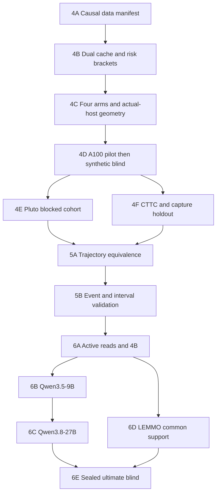

# M6 Round 2 • A CPU-gated, all-A100 Stage 4 execution lock

**Decision.** Reuse the Stage 3D score archive for diagnosis, build both cache views on CPU, and allow at most a disjoint-dev 69-step pilot per arm before any full four-arm fit. All Stage 4 GPU work uses A100-80GB within a **\$9.50** gross cap, leaving **\$3.38** against the historical \$12.88. §§1–3 retain the Round 1 mathematical foundations. §§4–6 state the operative Round 2 schedule and gates. Round 2 used local CPU only.

## 1. The exact population loss ladder

Let $A\in\{0,\ldots,m-1\}$ be the answer label, $Y$ the permitted raw observations at the time of the question, $Z=T(Y)$ the frozen cache, and $D$ the public condition, question, and evidence available through that time. $D$ includes the revealed references and their provenance where these enter both comparators, plus the host's instruction or the variables needed to render it. Condition on the frozen checkpoint and a known seed, or include the independently assigned seed in $D$. Define

$$
U_0=(Y,D),\quad U_1=(Z,D),\quad U_2=(E_\theta(U_1),\mathrm{prompt}(U_1)),\quad
U_3=L=\Pi s(H_{\rm LLM}(U_2)),\quad q_\tau=\mathrm{softmax}(L/\tau),
\qquad \Pi=I-\mathbf1\mathbf1^\top/m.
$$

Here $U_2$ contains every token embedding, mask, and position that reaches the host. $s$ is the vector of candidate sequence log-likelihoods. Public side information in $U_2$ is a function of $U_1$. If the system gains a reference later, instantiate a second ladder at that reveal state. If a downstream stage is handed a reference or an oracle parameter that the upstream comparator lacks, the stated chain need not hold. For stochastic inference, use label-independent transition noise or condition on the relevant randomness. A fitted temperature is held fixed on evaluation.

Write $p_j=P(A\mid U_j)$, $R(q)=\mathbb E[-\log q(A)]$, and $H_j=H(A\mid U_j)$. For $A\to U_j\to U_{j+1}$, $\mathbb E[p_j\mid U_{j+1}]=p_{j+1}$. Expanding the logarithm and conditioning gives

$$
\begin{aligned}
\mathbb E\,D_{\rm KL}(p_j\Vert p_{j+1})
&=\mathbb E\sum_a p_j(a)\log p_j(a)-\mathbb E\sum_a p_{j+1}(a)\log p_{j+1}(a)\\
&=H_{j+1}-H_j=I(A;U_j\mid U_{j+1}).
\end{aligned}
$$

Also $R(q_\tau)=H_3+\mathbb E D_{\rm KL}(p_3\Vert q_\tau)$. The sum telescopes to

$$
R(q_\tau)-H_0=\underbrace{I(A;Y\mid Z,D)}_{\Delta_{\rm enc}}+
\underbrace{I(A;U_1\mid U_2)}_{\Delta_{\rm conn}}+
\underbrace{I(A;U_2\mid L)}_{\Delta_{\rm host}}+
\underbrace{\mathbb E D_{\rm KL}(P(A\mid L)\Vert q_\tau)}_{\Delta_{\rm cal}}.
$$

Each term is nonnegative. A transition preserves Bayes log-loss exactly when its posterior is unchanged almost surely. The host term includes the conversion from hidden states to the restricted candidate score vector. One can insert a hidden-state rung and split that term if the hidden states are recorded. A small output dimension or a low rank in a linearization does not by itself establish positive conditional MI. Even one real number can encode a finite cache injectively. Conversely, an injective prefix can let the host output unusable probabilities. A fixed positive scalar temperature is invertible on centered logits through $L=\tau\Pi\log q_\tau$. It cannot remove a score collision or change the top-1 decision. The difference $R(q_\tau)-R(q_1)$ is signed and measures the effect of the chosen temperature. It differs from the nonnegative calibration term above.

### What the Stage 3D archive identifies

The verifier replays the real NPZ artifacts. Q3 is synthetic at 2 dB, with paired CFO signs and three rotations per mother. It averages scores over seeds, rather than scoring an ensemble. Full IQ uses known channel parameters and the repository's matched synthetic likelihood. The s17 table is a physical readout and can have its own mismatch to $P(A\mid Z,D)$. In general the observed direct-minus-IQ gap equals the population encoding term plus the difference of the two readouts' KL regrets, up to sampling. If Full IQ is the true posterior under the matched law, the population direct-minus-IQ gap upper-bounds the encoding penalty. If the Full-IQ solver is approximate, include its error in any certified bound. No intervening prefix, hidden-state posterior, or cost-free counterfactual training is available in these archives. The replay localizes the **operational** deficit to the path after the cache, with temperature measured separately. The internal conditional MI terms remain unidentified. If independent validation detects no input leaks, the comparator already witnesses that this cache permits much better G1 decisions.

| Q3 cell | Mothers | Full IQ Acc / NLL | s17 Acc / NLL | Phase Acc / NLL | Zero Acc / NLL | s17 − IQ NLL | Phase − s17 NLL | Zero − s17 NLL |
|---|---:|---:|---:|---:|---:|---:|---:|---:|
| G1 both extrapolated | 8,384 | 64.641% / .929038 | 64.617% / .941126 | 23.799% / 1.445229 | 19.406% / 1.480879 | .012088 | .504103 | .539753 |
| G2 both interpolated | 512 | 46.777% / 1.019346 | 46.777% / 1.022230 | 33.876% / 1.335826 | 36.361% / 1.308067 | .002884 | .313596 | .285837 |
| G3 angle extrapolated | 512 | 61.914% / .953916 | 62.109% / .979568 | 22.678% / 1.441047 | 19.737% / 1.478130 | .025652 | .461480 | .498563 |
| G4 CFO extrapolated | 512 | 49.219% / 1.003738 | 47.754% / 1.015851 | 33.290% / 1.334667 | 34.961% / 1.309751 | .012113 | .318816 | .293900 |
| H_c4_035 | 1,024 | 63.867% / .942628 | 63.770% / .950133 | 25.765% / 1.416987 | 23.172% / 1.435077 | .007505 | .466854 | .484944 |

For G1 the paired 64-mother block 95% intervals are **[.009178, .014998]** for s17 minus Full IQ and **[.491294, .516912]** for phase minus s17. Phase's observable telescope is .012087838 + .478025740 + .026076989 = .516190567 nats, using unit-temperature host scores for the middle contrast. About **97.66%** of phase's excess over Full IQ lies after the s17 readout when measured at locked temperature. The G1 phase-versus-zero uplift did meet Stage 3D's relative target, even though both arms exceeded the log-loss of a uniform predictor (1.386294). G1's co-rotation worst coordinate defect was **.380019** in phase and near machine precision for the direct readout. Offline 16-way group averaging brought phase NLL to **1.411312** and accuracy to **17.050%**. On the archive's sampled rotations these are distinct endpoints. The all-rotation `H_c4_035` row above is a fresh replay from the archive. Its identity-rotation, both-sign host metrics match Work F. The separate positive-sign Stage 3B lookup anchor in the master JSON is a different comparison.

| Q2 C4 reference arm | Work A Acc / NLL | Phase Acc / NLL | Zero Acc / NLL | Phase − Work A NLL | Zero − Work A NLL |
|---|---:|---:|---:|---:|---:|
| None | 25.000% / 1.386294 | 24.805% / 1.392846 | 25.781% / 1.393822 | .006552 | .007528 |
| Valid | 66.406% / .819207 | 28.776% / 1.388883 | 26.628% / 1.410690 | .569676 | .591483 |
| Duplicate, dedup | 66.406% / .819207 | 28.776% / 1.388883 | 26.628% / 1.410690 | .569676 | .591483 |
| Duplicate, raw | 66.406% / .819207* | 26.302% / 1.394420 | 25.781% / 1.413341 | .575213 | .594135 |
| Independent only | 25.000% / 1.386294 | 24.805% / 1.407714 | 24.935% / 1.420522 | .021420 | .034227 |
| Valid + independent | 66.406% / .819207 | 24.544% / 1.408232 | 27.279% / 1.418281 | .589025 | .599074 |
| Fresh resample | 74.219% / .663189 | 26.432% / 1.405640 | 25.781% / 1.406397 | .742451 | .743208 |

\* Duplicate-raw uses the existing deduplicated Work A row as its information-equivalent physical reference. Q2 contains 512 mothers at (+0.35), without a paired Full-IQ score in the NPZ. Work A is a cache/physical reference. The host receives s17 window codes and 12-dimensional continuous reference features. Fresh evidence improves the Work A NLL by **.156017** and worsens phase NLL by **.016758**. The raw duplicate worsens phase accuracy by **2.474 pp** (mean TV **.040377**), while the dedup arm has zero TV. Two tokens for one acquisition and tokens for two genuine acquisitions test different physics. Both the actual length change and the added attention content can matter. A matched padding/mask experiment is needed to identify their separate effects.

Historical scope. `PROTOCOL_LOCK.json` records six frozen-host checkpoints, 8 epochs, 160 steps per epoch, batch 32, microbatch 16 and dev-fit temperatures. The Work E variance scenario used $q=.35,\rho=.01$, mother NLL SD .5, pilot block SDs .02104014/.01928086, and planned 131 blocks for the joint endpoint gate. Stage 3D's report orders smoke and scorer diagnostics, six trains (2,884–3,218 s each), independent dev variance lock, then blind scoring. The **\$17.12** receipt includes smoke, one OOM/benchmark, all six trains, dev and blind evaluation, and the aborted historical Ministral check. The archival charge was **\$0.00** after allowances. The 150,912 G1 rows are logical predictions per arm from a verified finite table, not 150,912 distinct forwards.

## 2. Tier 0 • analytic rejection before any host work

### 2.1 Bayes-risk brackets for each evidence state

Set $S=(Z,C,\mathcal R)$, with causal metadata (C) and unique allowed references $\mathcal R$. Under a specified kernel, evaluate (p(a,s)\) by summing or integrating the latent state, then compute $H(A\mid S)=-\sum_{a,s}p(a,s)\log p(a\mid s)$ or its integral. For Q3, tabulate by sign/delay/cache pair and compare the same $D$ in the unrestricted physical solver. For Q2, repeat with none/valid/fresh and counterfactual visibility. Integrate correlated references jointly conditional on latent trajectory. A distinct second acquisition need only be independent conditional on the latent state for multiplication of its likelihood. One physical sample duplicated has one likelihood factor. The entropy drop on reveal is exactly $I(A;R_{\rm new}\mid S)\ge0$ under a common nested law. It is an expectation. Sample-level losses can increase after a valid observation.

For Pluto and CTTC, a causal physical $q_S$ fitted off-fold provides $H(A\mid S)\le R(q_S)$, hence $I(A;S)\ge H(A)-R(q_S)$. This is a one-sided variational bound on MI. Poor learned/table scores alone leave the opposite bound unknown. Obtain a lower risk bound by one of the following valid routes.

- Use a certified physical observation model with $S=f(Y,D)$, and a lower bound on $H(A\mid Y,D)$. Alternatively add independent-known oracle information (O) to form the lower bound $H(A\mid S,O)$. Both require actual posterior evaluation or a bound on its error.
- On finite locked support, form a simultaneous confidence set $\mathcal P$ for the true joint law of $(A,S)$, then use $\inf_{p\in\mathcal P}H_p(A\mid S)$ and $\sup_{p\in\mathcal P}H_p(A\mid S)$. For i.i.d. units, a Bonferroni union of exact binomial intervals for fixed atom probabilities, intersected with the simplex, is one valid construction. For independent clusters, use bounded cluster contributions to each atom and a simultaneous concentration bound. If the support is large the interval may be vacuous. Binning a continuous reference gives an entropy **upper** bound on the richer interface. A lower bound for the binned interface applies when the bins are what the host receives.
- A collision class with fixed $S=s$ and at least masses $a,b>0$ of two distinct labels contributes at least $(a+b)h_2(a/(a+b))$ to conditional entropy, where $h_2(u)=-u\log u-(1-u)\log(1-u)$. Restrict to the two-label subevent and condition on its indicator. Exact equivalence of two hypotheses with equal prior forces at least $\log 2$ nats and error at least $1/2$ within that subproblem. If their distributions are only close, equal-prior optimal binary error is $\tfrac12(1-\mathrm{TV}(P_0,P_1))$, from the likelihood-ratio decision rule. This yields a CPU impossibility bound when TV can be bounded above.

**Proposed decision margins.** On development folds, lock an admissible NLL target $r_*=R(q_{\rm IQ})+.05$ nats and a useful mean reveal improvement of .02 nats against the no-reveal control. Use each contrast at fixed context and comparable label distributions, with simultaneous bounds for multiple gate decisions. A certified $L_S>r_*$ ends the current representation branch. With entropy brackets $[L_0,U_0]$ and $[L_1,U_1]$ before and after reveal, $\max(0,L_0-U_1)\le I(A;R_{\rm new}\mid S)\le U_0-L_1$ for simultaneous valid brackets. An upper bound below .02 ends a **Bayes-gain** claim for that reveal contract. A direct readout whose paired upper regret bound is within .05 and whose reveal lower improvement bound exceeds .02 is a practical existence witness. Otherwise report uncertainty, improve the physical kernel or support, and defer GPU. At final release require independent upper confidence bounds within .05 of both the permitted Full-IQ and direct-cache comparators on the primary cell and a lower confidence bound above .02 for host reveal improvement where a gain was declared. These margins are Round 1 proposals for registration.

### 2.2 Exact group action and reference algebra

Derive the action from the intervention before defining the model. In synthetic Q3, for $g=(r_1,r_2)\in C_4^2$, coordinate relabeling of cache windows has $z_i\mapsto z_i+4r_i\bmod16$ and answer transport $P_g=\mathrm{roll}(r_1)$ for the repeat target. Rotate reference coordinates consistently under the experiment's physical action. A coordinate change leaves CFO unchanged. A new physical phase jump or fresh measurement can change the answer and must use a separate intervention. For actions with $P(A\mid gx)=P_gP(A\mid x)$, require $q(gx)=P_gq(x)$. At fixed points require stabilizer invariance. This is an exact contract. On any equal-weight pair with target symmetry and probability defect $d=\mathrm{TV}(q(gx),P_gq(x))$, triangle inequality and Pinsker give mean KL regret at least $d^2/2$. Thus some sufficiently large defects also violate a quantitative loss gate, although a nonzero defect by itself proves failure only of the exact contract.

Define `RefPool` on a **set of acquisition IDs** with authenticated provenance and role masks, before prompt construction. Same ID/same sample reduces to one record, and inconsistent copies of an ID invalidate the input under the locked contract. Each allowed acquisition contributes its conditional likelihood factor once, or enters a joint dependence model once. Excluded IDs and irrelevant padding are removed before aggregation. An independent distractor is Bayes-ignorable only under $A\perp R_d\mid Z,C,\mathcal R_{\rm valid}$, including any conditioning induced by selection. For natural unknown relevance, retain a latent relevance posterior. An oracle `valid` flag is admissible only if shared and available at reveal. Implement a fixed-length pooled representation with typed missing/valid slots, fixed positions and masks, including Qwen's recurrent state semantics. Equal semantic inputs must produce identical bytes for embeddings, positions, masks and prompt. The contract implies token-count invariance to duplicate, masked, or padded records. Genuine evidence must remain capable of changing the posterior.

Two exact ways to enforce output symmetry are (i) score a canonical representative and transport to the original coordinates, projecting on the stabilizer when needed, or (ii) average transported probabilities $q_{\rm eq}(x)=|G|^{-1}\sum_g P_g^{-1}q(gx)$. Reindexing proves covariance in (ii). Jensen gives expected NLL no worse under the full invariant population law. Top-1 accuracy has no analogous Jensen bound. Prefer (i) for fixed inference cost where the action and canonicalization are valid. If the host must itself produce native equivariant answers, a frontend equivariance proof alone is insufficient. Report native and transported scores when both are evaluated. Real hardware phase imbalance or label conventions can break a physical action, so use deliberate coordinate relabeling and score natural and injected perturbations separately.

## 3. Tier 1 • CPU geometry and the frozen host

**Additive obstruction.** For centered scores $f(z,\phi)=a(z)+b(\phi)$, the mixed rectangle $f(z,\phi)-f(z',\phi)-f(z,\phi')+f(z',\phi')$ is identically zero. For complex evidence (u(z)) and phase $\phi=\omega t$, score $\Re[u(z)e^{i\phi}\bar r_a]$ for class (a). The physical rectangle equals $\Re[(u(z)-u(z'))(e^{i\phi}-e^{i\phi'})\bar r_a]$, generically nonzero. At least one corner must have error at least one fourth of the rectangle norm by the triangle inequality. Build $u\cos\phi,u\sin\phi$ into the connector, or transport complex evidence first and apply a joint score. The rotation law then extrapolates for all $\omega t$ where the physical model holds. The verified toy probe fits on $|\omega|\le .25$ and evaluates at $\omega=\pm .40,t=4$ ($|\phi|=1.60>\pi/2$). Additive vs coupled OOD centered-logit RMSE is **.935161 vs .000000000000000738**, with rectangle L2 norm **3.998294** and subsecond execution. A smaller randomized frozen host can test software geometry; it has no guaranteed approximation to Qwen. A flexible nonlinear function plus a smooth bump supported outside the training interval can fit the same train data and give any OOD value. Some inductive bias or explicit mechanistic law is therefore indispensable for certified extrapolation.

**Stage 3D interpretation.** The cache-pair MLP sees $z_1,z_2$; a separate phase MLP sees six trigonometric slots; continuous reference features go through a separate MLP per `<REF>`. Signed CFO also appears as text in both arms. A linear fixed-Jacobian map about a common prompt/fixed reference layout yields separate additive score contributions. Qwen's true nonlinear attention can mix those streams and jointly condition its Jacobian. This makes Stage 3D's additive extrapolation risk diagnosable before training, alongside a provable failure of any required symmetry or idempotence whose implementation lacks the corresponding contract. It does not make the observed **.504103** nats or the causal contribution of each suspected mechanism predictable from source alone. Timing, caching and low-precision instability were additional measured risks. A positive CPU joint-readout result establishes feasibility for that readout.

### 3.1 Rank, curvature and optimization certificates

For development example (i), flatten the fixed-length embeddings $e_i=\mathrm{vec}(E_\theta(x_i))\in\mathbb R^{Kd_{\rm LM}}$, define centered host scores $F_i(e_i)$, and compute the actual candidate Jacobian $J_i=D_eF_i(e_i^0)$. For multi-token candidates differentiate the full sum $\sum_t\log p(w_t\mid w_{<t},e_i)$, including gradients of the log normalizer and the cached context. Use candidate-vector JVPs or VJPs in FP32. With a shared adapter perturbation $\delta$, stack $A_i=J_iD_\theta e_i$ and $d_i=\Pi\log p^*_i-F_i(e_i^0)$ after weighting examples by their locked masses. For the stack (A,d), a frozen tangent can achieve residual $\epsilon$ iff $\inf_{\|\delta\|\le r}\|A\delta-d\|\le\epsilon$; without the norm cap the projection residual is $\|(I-AA^+)d\|$. A rank threshold is necessary only for a declared target subspace. A one-dimensional joint task can succeed through a rank-one interface. A shared adapter may require stacked rank across inputs even if all individual $J_i$ have rank (m-1). Fixed thetas, mask patterns and prompts define which local claim is tested.

If the stacked score map has Hessian operator norm bounded by (M) over the trust region, Taylor's theorem yields an unavoidable residual ≥ $\|(I-AA^+)d\|-Mr^2/2\$, and the gain cannot exceed $\|A\|r+Mr^2/2$. If $d\in\operatorname{im}A$, smallest retained singular value (s>0) and $\|d\|/s\le r$, select $\delta=A^+d$. The nonlinear residual is at most $M\|d\|^2/(2s^2)$. With softmax, the log-sum-exp Hessian is $\mathrm{diag}(p)-pp^\top$, has norm ≤1, and has curvature ≥(p_{\min}\) on centered vectors when all probabilities on the segment are ≥(p_{\min}\). Taylor's integral gives $p_{\min}\|e\|^2/2\le\mathrm{KL}(p^*\|q)\le\|e\|^2/2$ for centered logit error (e) with positive matched target. Handle absent sectors through a registered probability floor or a separate support analysis. This converts a certified local rank/curvature inequality into an NLL gate. A finite-difference estimate of (M) is diagnostic until justified as an upper bound. With ordinary training outside the certified trust region, the rejection certificate applies only to the local model.

For least squares in this tangent model, $K=AA^\top$. Gradient flow decays each representable residual eigenmode as $e^{-t\lambda}$; discrete gradient descent multiplies it by $1-\eta\lambda$ for $0<\eta<2/\lambda_{\max}$. The nullspace remains. With fixed train/test Jacobians the linearized test prediction update for minimum-norm interpolation is $A_{\rm test}A_{\rm train}^+d_{\rm train}$. Compare to physical contrasts on a held-out joint CFO/angle grid. A poor result isolates this fixed-tangent extrapolator. A short actual-host test should use locked prompt positions, candidate tokenization, phase signs, matched lengths, and representative physical margins. Use analytic contrast and small CPU probes for the <30 s tier. Full 4B, 9B or 27B Jacobian timings and memory depend on the pinned host and are unmeasured here. A partial host or quantized CPU copy can reject an interface on a structural property shared with the target, or give a heuristic diagnostic. A quantitative negative result transfers only with an error bound on the difference between their operators. [Jacot, Gabriel and Hongler, 2018](https://papers.neurips.cc/paper_files/paper/2018/hash/5a4be1fa34e62bb8a6ec6b91d2462f5a-Abstract.html)

### 3.2 Geometry of $W_{\rm out}$ and vocabulary readout

Use column vectors and map physical coordinates $u\in\mathbb R^r$ into an embedding perturbation (Bu), where $B=W_{\rm out}^\top Q$ in one slot and (Q) selects the physical subspace in $d_{\rm hid}$. For multiple slots stack the corresponding blocks. $B^\top B=\beta^2I$ gives an isotropic frame in embedding space. It does not guarantee candidate-score alignment. For standard LayerNorm at (x), $v=Px$, $P=I-\mathbf1\mathbf1^\top/d\$, and $s=(\|v\|^2/d+\varepsilon)^{1/2}$, its derivative is

$$
D\mathrm{LN}_x=\mathrm{diag}(\gamma)\big(P/s-vv^\top/(ds^3)\big).
$$

The constant direction vanishes and the radial multiplier before learned gains is $\varepsilon/s^3$. On the slice $\{\mathbf1,v\}^\perp$, singular scales lie between $\min|\gamma|/s$ and $\max|\gamma|/s$. RMSNorm uses $P=I,v=x$, retaining the radial attenuation. Check normalization at the projector and inside the host. If a residual map is $x\mapsto x+f_i(x)$ and $\|Df_i\|\le\eta_i<1$, the full-state residual Jacobian scales lie in $[1-\eta_i,1+\eta_i]$ by the triangle inequalities. Products give bounds across a sequence of such maps. They alone do not control routing from the injected slots to the answer token. With no routing, answer Jacobians can vanish even when all residual maps are invertible.

For single distinct answer tokens, let $C_{\rm cand}$ select vocabulary rows and $E_{\rm vocab}\$ be the **actual unembedding**. If $D_{\rm answer}$ is the full derivative from injected slots to the relevant normalized answer hidden state, the effective matrix is $M_{\rm cand}=\Pi C_{\rm cand}E_{\rm vocab}D_{\rm answer}B$. For multi-token answers use $J_iB$ instead. A sufficient condition for preserving every evidence contrast at linear order is $r\le m-1,\ \sigma_{\min}(M_{\rm cand})\ge s_*>0,\ \sigma_{\max}(M_{\rm cand})\le S_*$ on that subspace. In an admissible tangent basis (U), if $J_iU=L\Sigma V^\top$ has $r$ useful singular values, choose $B=UV_r\Sigma_r^{-1}\beta$. Then $J_iB=\beta L_r$ is isotropic **in candidate-score space**, and $\|B\|\le\beta/\sigma_r(J_iU)$. Constrain embedding energy and Jacobian error. One shared (B) needs these bounds across the declared prompts/positions or validated uniform stack constraints, not just one anchor. Full rank of $W_{\rm out}$ can hold while (B) lies in the nullspace of the candidate readout.

For intended class (a) against rival (b), verify baseline centered margin $m^0_{ab}$ and compare $m^0_{ab}+(e_a-e_b)^\top J_iBu$. A positive margin after subtracting $\sqrt2\$ times the Taylor/rounding error bound guarantees local preservation of that decision. Upper-bound logit excursion as well to prevent saturation, preserving the curvature and calibrated probability budget. A large singular value from a generic vocabulary analysis can correspond to directions orthogonal to all answer contrasts. Freeze tokenization and check candidate lengths, boundaries, order, truth-score parity and the reference-count contract before trusting this geometry.

## 4. Round 2 execution lock

The operating result is a **single-seed, four-arm comparison conditional on frozen connector checkpoints**. Use paired synthetic and real training examples in a 1:1 ratio, common data order, prompt lengths, parameter budget and optimizer schedule. Each arm uses 384 steps of 32 logical examples, seed 202611, microbatch 16, frozen s17 and Qwen3.5-4B text revision 851bf6e806efd8d0a36b00ddf55e13ccb7b8cd0a. Freeze the adapter, tokenizer, candidate strings, score implementation, resume state and runtime hashes. M2's approximately 22.4% and 30.0% powers with three random seeds apply to two G1 crossed-model proxy endpoints at specified effects. Ten seeds are a planning example for those endpoints with adequate independent clusters. The current budget targets a conditional checkpoint claim. [M1 design](../M1/THEOREM_M1.md), [M2 power and calibration](../M2/THEOREM_M2.md), [M4 experiment](../M4/THEOREM_M4.md)

### 4.1 Four arms and host contribution

| Arm | Evidence path and score |
|---|---|
| 0 · Zero | Separate window, phase and reference slots, zero numeric phase values. Signed metadata stays in the shared permitted text. Score with Qwen. |
| 0b · Naive-Additive | Same scaffold with separate populated phase slots. Frozen nonlinear attention may mix them. The additive obstruction in §3 applies to centered additive logits and their fixed tangent analogue. |
| 1 · Host-Pure | Canonicalize using the task-specific action, couple cache-derived evidence with continuous phase and lag, and use fixed-length RefSufficientPool evidence. Project those statistics into the frozen host. Only the host's candidate scores determine the canonical prediction. Apply the final label permutation by integer indexing. |
| 2 · Physical+HostResidual | Independently fit the same coupled-token family. The prediction in canonical order is $\operatorname{softmax}(\log p_0+\delta)$, where $p_0$ is the same-information, dev-calibrated physical prior and $\delta=.15\,\Pi\tanh(\Pi s_{\rm host}/T_R)$. $T_R$ acts only on the host residual. |

For the four-arm comparison all old windows use the same **4-bit s17 per window**, with the same metadata, authorized references and fixed-shape reference plumbing. Arm 1 may use continuous likelihood features derived from that common information. Arm 1 never receives physical answer probabilities or logits. Arms 0 and 0b isolate numeric phase slots. Arms 0b and 1 compare the quotient/coupling package. Isolating the separate training effects of canonicalization and coupling would require a crossed training design. The 16-bit cache is a CPU ablation and export in this lock. If the s17 branch fails risk eligibility, any GPU upgrade to 16 bits requires a new protocol sharing that input across arms.

At residual zero, $\operatorname{softmax}(\log p_0)=p_0$ before the shared scoring floor. Each pairwise residual log-odds shift has magnitude $\le .30$. A wrong physical leader with a gap greater than .30 cannot be reversed. Expanding the normalizer also bounds each single-case NLL gain by .30. Measure Arm 2 versus physical-only and versus shuffled residual with **the same physical prior vector on each row**. Measure Arm 1's native score independently. M1's CPU hybrid reached 64.62% and tied the physical comparator. M2's retrospective blind-temperature audit reversed Stage 3D's G1 phase NLL lead. Fit calibration on disjoint dev folds, then freeze it. [M1 results](../M1/THEOREM_M1.md), [M2 forensic audit](../M2/THEOREM_M2.md)

Score four alternate synthetic views for both 1 and 2: slot-only sign flip, text-only sign flip, both flips, and cyclic slot shuffle under a fixed seed within comparable strata with no fixed points. Reuse the all-matched scores. Fix waveform, labels, causal metadata, candidate IDs, slot count and positions. Lock equal-length text alternatives so the text-only intervention changes only that evidence path. Hold Arm 2's prior and label frame fixed. On real data add one fixed-text Q2-two reference-payload shuffle per record for both arms, preserving positions and observation masks. The counterfactuals test within-checkpoint behavior and contribute no observation likelihood factors.

**Tier-1 gate for both 1 and 2.** Compute actual pinned-host candidate-score JVPs on a predeclared dev grid covering both signs, $|\omega|=.40$, $|\theta|>\pi/2$, text/slot pairs and reference counts. With the prior fixed, the Arm 2 map is

$$
J_2=(.15/T_R)\,\Pi\operatorname{diag}[1-\tanh^2(\Pi s/T_R)]\Pi J_{\rm host}.
$$

Apply §3 on Arm 1's physical target contrast and Arm 2's attainable residual contrast, including the .30 log-odds constraint and trust/curvature allowance. Pass if every declared nondegenerate task/anchor has full target contrast rank (3 for all four sectors), relative rank threshold $10^{-6}\sigma_{\max}$, $\sigma_{\min}/\sigma_{\max}\ge .05$ on the required modes, held-out relative projection residual $\le .10$, and held-out relative centered-logit RMSE $\le .25$ for the locked linear transport probe. Normalize by the nonzero target contrast norm. A zero-target control requires absolute error $\le10^{-6}$. Use the pinned host on CPU or a validated proxy with an error bound that preserves each predicate. The orthogonal-frame fixtures establish the algebra only. A missing or unfunded actual-host receipt is HOLD. Require exact rotation/copy operations on canonical bytes and max observed probability defect $\le10^{-6}$ in Arms 1/2; enumerate all s17 pairs/actions for the finite path. Keep 0/0b as controls when their geometry fails.

### 4.2 Causal shard, dual cache and RefSufficientPool

Build the causal R3 shard once. Derive the historical s17 code and M5's **16-bit per-window packet** from the same lawful observations, clock and calibration. R3 preserves the matched scalar and its effective SNR using seeded independent orthogonal lift noise. Compute the packet's residual quality from **actual authorized orthogonal measurements**. If only the scalar is identified, use a typed missing-quality mask. An uncertifiable R3 triplet has unavailable legacy prefix and a common registered fallback. Preserve the continuous whitened $(T,E)$ and units as a CPU physical reference.

$$
w=(a\ll14)\;|\;(u\ll12)\;|\;(b_\theta\ll6)\;|\;(b_r\ll2)\;|\;b_E,\qquad w\gg12=4a+u=\mathrm{s17}.
$$

Use the half-open sector convention $[-\pi/4,\pi/4)$ and 64 equal angle bins. M5's radial bins for $|T|/\sqrt{v_{\rm nom}}$ use $\operatorname{expm1}(\operatorname{linspace}(0,\log25,17))$ with final edge $+\infty$. Bins for $E/v_{\rm nom}$ have edges $[0,.75,\sqrt{12},16,+\infty]$. Specify little-endian uint16, versioned calibration, masks and time map. Account for headers, addresses and reveals outside the 32 payload bits for a pair. The 4-bit export is an exact view of the 16-bit packet. Its Bayes decision can be emulated with the larger word, proving weakly smaller best achievable risk at fixed side evidence. A strict gain requires a change in conditional answer or candidate-predictive laws within an old cell. M5's simulated event/location gain leaves a measured gap to its continuous reference. [M4 causal frontend](../M4/THEOREM_M4.md), [M5 bit layout and rate–risk law](../M5/THEOREM_M5.md)

Require model-visible state to be measurable in $\mathcal F^r=\mathcal F^0\vee\sigma(R_1,\ldots,R_r)$. $\mathcal F^0$ contains only authorized earlier sync/prior, W1/W2, whitelisted known symbols and independent lift randomness. Every materialized node has a raw-read footprint including every interpolation/filter tap, cutoff, acquisition availability, parent IDs and whitelist status. Require **zero** forbidden support intersections, late reads or whitelist violations. Freeze the W1/W2 bytes before the first reveal. Exclude Pluto's whole-record `fast_blind_frontend`, CTTC's full-source `anchor_capture`, offline CFO/power/channel fields and the full TX truth arrays. Derive timing bounds from authorized sync and commissioning. For each reveal state replace forbidden raw values, withheld references and future truth with sentinel values, and require **zero differing bytes** in features, masks, cache, prompt and candidate manifests, along with an allowed-read mutation positive control on a nondegenerate case. An implementation sentinel complements provenance. It cannot remove genuine analog dependence through channel memory.

Deduplicate by immutable sample/acquisition ID across **the whole causal state**, including sync and previous updates. A content/time conflict fails the row audit. Same-clock independent proper Gaussian emissions support a precision-weighted complex sum and total precision. Keep clock-indexed likelihood messages across different times. For fresh $N$ and previously counted $S$, the only extra factor is $p(N\mid S,u)$, with mean correction $K_{NS}K_{SS}^{-1}(y_S-\mu_S)$ and conditional covariance $K_{NN}-K_{NS}K_{SS}^{-1}K_{SN}$. If the causal state is insufficient for this operation, carry the required message or recompute the authorized joint factor. Duplicate identity contributes one original likelihood factor total. Remove known irrelevant observations before feature and gradient evaluation; represent unknown association as a latent variable. Fixed-slot features, candidate policy, prompt, masks and positions must be byte-identical under copy, reorder, irrelevant padding and known distractor. A fresh informative synth reveal should achieve a dev lower bound $>.02$ nats for the registered two-versus-one contrast. [M3 sufficiency and updated-reader interface](../M3/THEOREM_M3.md)

For uncertain CFO use **one** latent draw/quadrature index per trajectory. Edge increments of signed durations $d_j$ inherit variance matrix $v_\omega dd^\top$ plus Brownian overlap covariance. The single-edge moment has damping $\exp[-n^2(v_\phi |d|+v_\omega d^2)/2]$. Multiplying independent edge marginals loses the shared cross terms. Synthetic independent-window shifts $(r_1,r_2)$ with a fixed pilot frame give Q1 $r_2-r_1$, Q2 and repeat-Q3 $r_1$, independent-Q3 zero. With common pilot turn $r_p$, Q2 shifts $r_1-r_p$. Hardware common RX gauge moves only the received Q3 sector by the RX turn and preserves Q1/Q2 TX labels. A separate uniform TX label convention change shifts the absolute TX label and its known-symbol map, preserving relative Q1 and the RX sector. Enforce valid actions on the registered law, including erasure/stabilizer handling.

### 4.3 Dev-disjoint futility and final inference

For evidence $D$ and remaining budget $b$, let $U(D)$ be expected utility of the best terminal decision. The finite allocation law is $V(D,b)=\max\{U(D),\max_{j:c_j\le b}[-c_j+E V(D,X_j,b-c_j)]\}$ over eligible jobs $j$. This justifies taking free information before an otherwise identical paid decision and prices an early stop through future avoidable cost. With linear compute cost, the model below gives $E[C]=C_{\rm CPU}+P(\mathrm{screen})C_{\rm pilot}+P(\mathrm{GO})(C_{\rm full}-C_{\rm CPU}-C_{\rm pilot})$. Separate branch budgets and the worst-case cap constrain which alternatives enter the recursion.

Buy exactly **69 of 384 steps per arm (17.96875%)**, then 1,000 pilot-dev rows per arm. Training, pilot dev, post-fit calibration dev, and blind data are disjoint by mother and eligible physical/source support. Exclude `f708_snr10` from fit, shared-prior tuning, pilot and calibration. Preserve checkpoint, optimizer, RNG and data position for resume. The pilot spends **zero efficacy alpha**. Continue only when the registered independent dev model gives predictive probability $\ge.10$ of clearing the synthetic joint gate, the engineering predicates pass, and powered enrollment is justified. Each real branch also requires its own predictive probability $\ge.10$ before its blind rows are funded. Calibrate the map from 69 steps to final effects on disjoint development evidence. A step fraction supplies no statistical information fraction. When the law or enrollment is unresolved take HOLD for the confirmatory claim. An unfunded branch contributes $p=1$ to the family.

Use **8 independent 64-mother blocks per G1–G4 cell**, four per sign on new mother namespaces. Use the Stage 3D CFO/lag geometry $(|\omega|,h,\ell)$ of $(.40,2,2),(.20,2,2),(.20,4,4),(.40,1,1)$ respectively, at 2 dB and diffusion SD .10 per square-root symbol. Synthetic primary is Arm 1 versus Arm 0b on **Q3-repeat pre-reveal** for the equal-weight large-angle G1/G3 mixture. G2/G4, per-cell intervals, Q3 post-reveal and Q2 are diagnostics. Five forecasts per mother are Q3 pre/post and Q2 none/one/two, with independent acquisition noise for references at $h/4,3h/4$. Collect them before W2 and withhold their payloads from the initial forecast. Commit the two Q3 forecasts before the repeat arrives at $h+\ell$. The four synthetic intervention views use the Q3 pre-reveal score. These reference times are the new diagnostic design.

For each arm allocate pilot-dev rows as 500 synthetic (100 mothers × 5), 250 Pluto and 250 CTTC (125 Q2 one/two pairs each). Allocate post-fit dev rows as 1,500 synthetic (300 × 5), 750 Pluto (125 × 6) and 750 CTTC (150 × 4 plus 75 repeats × 2). Balance synthetic dev across the four cells and counterbalance signs, using disjoint mother groups. Freeze cohort IDs and prove adequate support or stop the corresponding claim. Real primary is Q2 two-minus-one. Choose Arm 1 if qualified by the frozen dev rule, otherwise Arm 2 if qualified including physical-increment safeguards. Commit before blind access. The alternative arm's estimates are descriptive. Fit scalar temperatures on post-fit dev, then apply the score floor $q^\epsilon=(1-4\epsilon)q+\epsilon$, $\epsilon=10^{-6}$, once across forecasts and comparators.

Use one-sided bounds with a valid predeclared cluster model. For each domain, take the maximum of component p-values (intersection-union test). Apply Holm across synthetic, Pluto and CTTC at .05, with sorted thresholds $.05/3,.05/2,.05$. All relevant inequalities below are strict for positive claims.

- Require NLL lower improvement over uniform and frozen dev prior $>0$ and over Zero $>.02$. Require accuracy lower improvement over chance and Zero $>.02$, over frozen majority/prior $>0$. For synthetic require Arm 1 over 0b NLL lower improvement $>.02$. For real require two versus one Q2 NLL lower improvement $>.02$. All registered failures get a common uniform score.
- For baseline loss $L_b$ and matched physical comparator $L_o$, require positive lower bounds on $L_b-L_o$ and $.90L_b-L_q+.10L_o$. This is reference-normalized when an oracle is uncertified. Use $L_b=\log 4$ under uniform synthetic labels and a frozen causal prior on real. Require upper candidate NLL excess $<.05$ versus the matched physical cache and the finer IQ comparator wherever permissions match the stated release target. Do not require a learner to beat the Bayes risk.
- Require Brier improvement lower bound $>.005$ against uniform, dev prior and Zero, and ten-bin ECE upper bound $<.05$ through a joint signed-bin region or 1,024 linear sign constraints. Require preregistered random-label accuracy/NLL tests where design exchangeability is justified. For real prep a valid randomized negative control; an unvalidated random-label diagnostic cannot support confirmation.
- Slot use requires matched-vs-shuffled fixed-text NLL lower improvement $>.005$ and synthetic matched-vs-flipped $>.005$. Include these in the IUT when claiming the mechanism. A promoted Arm 2 must also clear $>.005$ over its residual-zero and fixed-prior shuffled-residual controls. Physical-only parity leaves the incremental host claim unresolved.

Pluto's 16 blocks are chronological in one campaign. Claim block inference only with a justified dependence model; otherwise describe that cohort. CTTC has 72 loops nested in nine sessions and 36 disjoint loop pairs for Q3. Keep seed, rotations and repeated rows within the physical units; account for repeated source ordinals as well as capture dependence. Report the separate 160-packet/80-Q3-pair result on held-out `f708_snr10`. Nine sessions constitute a benchmark cohort, with one wholly unseen capture. Conditional fixed-seed claims require no population-of-seeds variance estimate. Use worst first-Holm alpha and either registered joint power $\ge.90$ or endpoint failure allocations summing to $\le.10$. The 32-block design does not inherit the 131-block result. When a confirmatory power target fails, retain a descriptive-only route if predeclared, or stop before GPU. Additional seeds or paid blocks require new authorizations and design; exact output reuse on new, independent compatible mothers must be proved at the complete prefix key.

With preblind information $\mathcal D$, GO indicator $G$, and valid conditional final p-value $p$, $P(G=1,p\le a)=E[1_G P(p\le a\mid\mathcal D)]\le a$. Thus a dev-only futility choice preserves Type-I control, including dev-only choice of real candidate. Holm accepts dependence across the three valid domain p-values. Early efficacy from an unvalidated pilot/final correlation would invalidate this argument. The new replay models independent $X\sim N(.6\mu,1)$ (dev) and $Y\sim N(\mu,1)$ (blind) conditional on $\mu$, using a $N(0,4)$ planning prior. The posterior variance is $v=(.25+.6^2)^{-1}$ and mean $.6vX$. Predictive $Y$ has variance $1+v$. At the first Holm boundary and predictive threshold .10 the illustrative dev cutoff is $X\ge .0467962$. It is a model diagnostic; actual promotion uses the independently validated joint model.

The 10,000-candidate replay shows mean scheduled cost **\$3.357607 vs \$8.390648** (**59.9839%** simulated saving, **59.8771%** integrated), **94.040%** working endpoint power (**94.1785%** integrated), and **0.7333%** boundary-null promotion (**0.7220%** integrated), under the modeled mixture, effect sizes and dev slope. CPU costs are charged even on screen rejection. The fixed single-endpoint boundary alpha is 1.6667%. Round 1's separate parametric O'Brien–Fleming sensitivity replay still returns 64.3619% cost saving and 4.4695% binding Type-I error. Production joint power and the pilot mapping require independent development receipts. [Results](results_m6.json)

### 4.4 The sole Stage 4 Modal ledger

Use **A100-80GB for all GPU work**, as preemptible Functions, at **\$0.00075572/s** including 2 physical cores and 16 GiB. Use hard CPU/memory request-limit pairs and no disk requests that raise the charged memory amount. Modal bills the greater of requested and used resources. M4's **\$8.44073416** includes 10,274 A100 seconds at **\$0.00074684/s** with 12 GiB, plus \$0.76770000 CPU-only preparation. Its 131,760 blind rows exclude 16,000 dev rows. Moving to 16 GiB adds **\$0.09123312** on the same seconds. Round 2 adds 713 A100 seconds for fixed-position counterfactuals. Stage 3D measured **52,972.5 MiB** peak allocated memory in training (microbatch 16) and **45,409.9 MiB** in eval (batch 64). Its source divides bytes by $1024^2$ even though the bench JSON says MB. Use the same hardware class; qualify the new longest cases before continuing. [M4 ledger](../M4/THEOREM_M4.md#33-budget-arithmetic-and-zero-bill-gate), [Stage 3D bench](../../stage3d_qwen_signed_phase/results/bench_steady.json), [Modal rates](https://modal.com/pricing), [Resource controls](https://modal.com/docs/guide/resources)

| Debit | Units | Seconds | USD ceiling |
|---|---:|---:|---:|
| CPU ingest and weight staging to Volume, 1 core / 8 GiB | Manifests and authorized data | 1,800 | 0.05554800 |
| CPU causal R3 frontend, dual cache, readers and pool, 4 cores / 16 GiB | One shard per source | 7,200 | 0.63302400 |
| CPU audit, preparation and aggregation, 2 cores / 8 GiB | Locked receipts | 1,800 | 0.07912800 |
| Initial A100 setup and longest-shape smoke | Before pilot | 350 | 0.26450200 |
| A100 pilot train | 4 × 69 steps | 690 | 0.52144680 |
| A100 pilot-dev score | 4,000 rows | 120 | 0.09068640 |
| A100 finish four arms at the same seed | 4 × 315 steps | 3,150 | 2.38051800 |
| A100 post-fit disjoint dev | 12,000 rows | 360 | 0.27205920 |
| A100 synthetic core | 40,960 blind rows | 1,229 | 0.92877988 |
| A100 Pluto natural | 2,240 frames / 53,760 blind rows | 1,613 | 1.21897636 |
| A100 CTTC natural | 1,440 packets + 720 Q3 pairs / 28,800 blind rows | 864 | 0.65294208 |
| A100 real stress | 8,240 rows | 248 | 0.18741856 |
| A100 fixed-position slot/text controls | 23,744 rows | 713 | 0.53882836 |
| A100 remaining setup, commit and teardown | Billed overhead | 750 | 0.56679000 |
| **Scheduled without retries** | **10,087 A100 and 10,800 CPU-only seconds** | | **8.39064764** |
| Explicit controlled retry reserve | A100 | 900 | 0.68014800 |
| **Scheduled with retry** | **10,987 A100 and 10,800 CPU-only seconds** | | **9.07079564** |
| Unassigned inside cap | Metering and bounded runtime | | 0.42920436 |
| **Gross project cap** | **External buffer 3.38 against reported 12.88** | | **9.50** |

The pilot ceiling is **\$0.87663520**, or **\$1.64433520** including the full conservative CPU allowance. The post-GO arm comparison (remaining fit, calibration, synthetic core and remaining shared overhead) is **\$4.14814708**. Natural Pluto costs **\$1.21897636**, and CTTC **\$0.65294208**, including the named holdout. Stress and interventions add **\$0.72624692**. The reserve inside the cap is **\$1.10935236**, of which \$0.68014800 covers the 900 A100 seconds. The **\$3.38** external credit buffer stays outside the project.

Count four answers per logical row, Q1 plus three Q2 forecasts per natural record and two Q3 forecasts per eligible repeat. Controls are four synthetic alternatives × 2,048 mothers × two arms and one real fixed-text Q2-two shuffle × 3,680 records × two arms. Physical-only and dual-cache reads run on CPU. There are 155,504 blind logical rows with interventions, and 171,504 including dev. The 2,477-s raw-real line from M4 divides into 1,613 s Pluto and 864 s CTTC. The new scope buys four matched checkpoints using 1,536 total steps. The Round 1 one-arm 2,880-step plan has been replaced.

**Dispatch.** Require live available credits after other reservations $\ge\$12.88$ for the stated buffer, enough storage/egress allowance, a **\$0.00 workspace net-spend guard** (or enforceable equivalent) and adequate gross headroom. Verify the owner's receipt and the current billing cycle. Keep a serial ledger with one in-flight container/shard, no automatic retries or fan-out, exact requested hardware/resources and precharged bounds including load/idle/termination and pending metering. Lock the gross project ceiling with the applicable workspace/environment backstop. Refuse dispatch on ambiguous caps, unsettled unbounded usage or rate changes beyond the schedule. Precharge failed attempts and every retry. A scope change requires a new version and reserved dollars. Credits, guard and actual throughput have pending status. [Modal budget and spend limits](https://modal.com/docs/guide/budgets)

Require zero OOM and max allocated/reserved/device-used VRAM $\le65000$ MiB on longest registered full gradient, checkpoint-resume and KV scoring workloads, at 512 max prefix tokens and 16 max candidate tokens. Require training-step max elapsed $\le2.50$ s and scoring block time per logical row $\le.030$ s, including padded tails. Use batch 32/microbatch 16 for training, fixed b64 for matching scoring. Hold precision and masks/positions fixed across the compared implementations. Verify maximum probability difference $\le10^{-5}$ on equivalence tests and a same-pattern scorer reference, including expanded linear-attention state. Stage 3D's cross-batch score changes reached .067. Stop for a new parity receipt on any planned batch, precision or kernel change. Do not proceed without the bounded smoke. A100 avoids the known 24 GB mismatch; it still needs a live workload certificate.

## 5. Master Stage 4–6 execution DAG



The numeric lock is emitted as `execution_graph.numeric_lock`. Missing receipts are HOLD. Falsified predicates stop their claim. The eligibility edge from 4D to 4E/4F carries the dev GO, frozen checkpoints and a prediction receipt. Real dispatch is independent of the synthetic blind outcome. After the enrolled branches finish, unseal and compute the domain p-values, then apply Holm once at the join before 5A. A Stage 4 branch can close with a validated equivalence class or another scoped negative result. A fresh lock uses a new namespace and preserves old outcomes. Each node declares what observation or comparison changes the next decision. [Long-term roadmap](../../../docs/LONG_TERM_RESEARCH_PLAN.md)

| Node | Pre-spend gate and exit predicate |
|---|---|
| **4A** | CPU only. Exact registered counts, Pluto ≥100-frame split guard, CTTC ≥4,096-symbol cyclic guard with both EVEN/ODD source footprints and raw support expansion. Zero support intersections, late or non-whitelisted reads and sentinel byte changes. Positive-controls respond. Verify source clock, whitelist, manifest and causal sync per source. |
| **4B** | CPU only. Exhaustive 65,536-word packing, exact valid s17-prefix equality, zero invalid-mask violations or duplicate likelihood factors. Require dev upper cache NLL excess $<.05$ vs permitted physical IQ and reveal lower gain $>.02$ wherever a gain is projected. Use Bayes brackets in §2.1 and preserve the CPU 16-bit and continuous readouts. A certified collision documents the missing observation. |
| **4C** | CPU only. Both Arms 1 and 2 pass rank/condition, projection and OOD predicates in §4.1. Require byte equality of fixed inputs for masked/duplicate/irrelevant operations, native defects $\le10^{-6}$ for 1/2, physically correct actions, zero physical-logit path for 1 and .30 residual log-odds cap for 2. Lock matched and counterfactual feature/text paths. |
| **4D** | CPU verifies protocol/device/billing before the bounded A100 smoke and 69-step pilot. Require 2.50 s/step, 30 ms/row, 65,000 MiB and $10^{-5}$ probability parity, then dev-only futility and ≥.90 planned joint power for the primary. Commit G1/G3 primary predictions, G2/G4 diagnostics and direct/intervention controls in the scoring vault. |
| **4E** | CPU requires 2,240 Pluto frames in 16 chronological blocks, shared ref indices 15/18 and Q3 next-copy at lag 126. Dev and blind lock coverage $\ge .95$ for the applicable positive claim, with all rows scored. End at 1,613 s natural runtime and the independent claim rules in §4.3. |
| **4F** | CPU requires 1,440 packets/72 loops in 9 sessions, 720 Q3 repeats in 36 disjoint loop pairs at lag 500,000 and references 126/127, withholding all fit access to `f708_snr10` (160 packets, 80 Q3 pairs). Require applicable coverage $\ge .95$, all failures scored, 864-s natural cap and valid scope-specific Holm/IUT inference. |
| **5A** | CPU only. Freeze distinct smooth/jump/independent/noise-burst hypotheses. Verify exact same-old-law aliases or an admissible likelihood distinction. For each exact alias allow zero timing refinement below its equivalence class, and require certified EIG lower bound $>0$ before claiming an extra read resolves the distinction. |
| **5B** | CPU first. Hold out event cases and verify model/support/calibration before any host fit. On identifiable cases require median 90% interval width $\le .50$ of search span, one-sided 95% lower coverage bound $\ge .85$, and lower NLL improvement $>.02$ over the locked event comparator. Exact aliases retain their wider timing set. Natural events require truth or separately scored held-out observations. |
| **6A** | CPU first. Register pre-reveal descriptors only. Require EIG error $\le .005$ nats on certified cases and estimated optimum regret $\le .010$ for one-step cases, at most one read per decision, zero duplicate updates or unauthorized rereads. Require held-out lower NLL gain $>.02$ vs fixed (including strongest dev-fixed), random and nearest at equal read access before claiming adaptive advantage. |
| **6B / 6C** | CPU first, sequential 4B → 9B → 27B. Require common packet/pool/feature hashes, 4C actual-host geometry and OOD predicates, $\le100000$ trainable parameters and $\le4$ slots. Require projected peak $\le90\%$ of device memory and then separate budget/smoke. On transfer require paired text/image accuracy lower difference $>-2$ pp and previously locked claim thresholds on the common physical tasks. |
| **6D** | CPU only before comparison. Preseal exact common-support case IDs and score rules, zero overlap with training or checkpoint selection, and identical permitted time/observation/reveal budgets for the matched arm. Enroll only supported native or matched tasks, declare unavailable cases without consulting outcomes. |
| **6E** | CPU first. Independently seal raw recordings and novel question combinations, require zero protocol leaks, scored-row omissions and budget violations, and ≥.90 planned joint power on promoted claims. Run one final paired evaluation on predictions and reveals committed in time order. Qualify inference and abstentions on the locked schema. |

The nine CTTC sessions include the named evaluation holdout and form the benchmark scope. The per-session acquisition timing and alignments must be audited anew on the causal implementation; see [M4 source support and timing](../M4/THEOREM_M4.md). P4's matched-frontend lesson remains important. Compare equal physical observations before attributing an increment to the learned module. Stage 5 and Stage 6 use separate future budget locks.

## 6. Cross-host and fair LEMMO execution law

Define the pre-host state $U_r=\Psi(w,C,\mathrm{RefPool}(S_r))$ from the frozen packet and chronological reveal state. It is computed once per case/reveal state. Keep the numeric task features, read policy, support and calibration of physical measurements fixed. An adapter $E_h$ maps at most four canonical vectors into host width; host-specific rendering handles tokenizer, template, answer IDs and score temperature. When $U_r(gx)=U_r(x)$, a deterministic host sees identical canonical inputs, so integer back-transport gives $q_h(gx)=P_gq_h(x)$ regardless of its weights. Apply stabilizer averaging on fixed points. A shape-compatible adapter can preserve this structural property in every host.

At a fixed reveal policy and common permissions, take $Y$ to include all eligible old and revealed physical observations. $A\to(Y,C)\to(U_r,C)\to q_h$ implies every host's excess over Bayes with raw evidence is at least $I(A;Y\mid U_r,C)$. Thus the representation ceiling is common and can be computed once. RefSufficientPool and the packet define the interface, while §3's right-inverse test characterizes local feasibility for each new host. A requested rank-$r$ target cannot be carried in a tangent map of rank below $r$. Full rank with bounded right inverse and Taylor remainder gives a local construction, while actual frozen-host routing and convergence need their own receipts.

For a frozen rank-16 feature projection, use one shared affine host map and one scalar temperature. Parameter count is $(16+1)d_h+1$ even at four slots; fixed slot IDs/positions add no learned offsets. Public text widths $d_h=2560,4096,5120$ yield **43,521 / 69,633 / 87,041** parameters per variant, all below 100,000. This is a shape and capacity bound for the chosen adapter class. If that class fails the candidate geometry test, use a new version to revise it. The CPU verifier constructs orthogonal-frame fixtures with rank-three candidate geometry for both arms. Actual 4B/9B/27B geometry, fit quality and peak memory remain open. The 9B→27B edge changes generation along with size. [4B config](https://huggingface.co/Qwen/Qwen3.5-4B/raw/main/config.json), [9B config](https://huggingface.co/Qwen/Qwen3.5-9B/raw/main/config.json), [27B config](https://huggingface.co/Qwen/Qwen3.8-27B/raw/main/config.json)

**LEMMO.** Let $S_h$ contain IDs eligible under the prespecified schema and access available to method $h$. Seal $S=S_{\rm ours}\cap S_{\rm LEMMO}$ before observing scores. Hash old sample intervals, timestamps, reveal permissions, stored/effective precision including metadata, target, labels, split and question. Score eligible abstentions with the common locked policy and report excluded tasks. Use identical weights, target encoder and loss and estimate $\sum_{i\in S}w_i(\ell_i^{\rm LEMMO}-\ell_i^{\rm ours})$ on paired cases with valid grouped inference. Replay the same prescribed new read for a decoder comparison. For a policy comparison provide identical eligible windows and read costs and allow policies to choose different windows. Report context, rereads, extra evidence and latency. Attribution to encoding additionally requires matched training data, base revision, trainable parameters and optimization budgets.

LEMMO's native workflows use Q16/Q128 or a direct projector, depending on the task, with Qwen3.5-4B and LoRA in its joint training. Run a native comparison on common registered raw-IQ intervals where weights, data and code are runnable. A cache-matched comparison requires a supported wrapper honoring the same observation and precision limits. If those inputs cannot be matched, publish the native result with its permissions and leave the cache-matched effect unavailable. These eligibility checks are independent of predictive scores. Reuse physical and canonical artifacts and score only preregistered comparison and mechanism rows. [LEMMO paper §3 and B.4](https://arxiv.org/html/2611.09476v1), [LEMMO repository](https://github.com/N1rv4n4/LEMMO), [Host integration roadmap](../../../docs/MULTIMODAL_INTEGRATION_PLAN.md)

## Replay and scope

```powershell
uv run --python 3.12 --with numpy==2.3.5 --with scipy==1.17.0 python -B research/stage4_math_and_design/M6/verify_m6.py
```

Local Round 2 verifies all five Q3 cells and seven Q2 arms (102 accuracy/NLL comparisons, maximum discrepancy $3.56\times10^{-16}$), both 10,000-trial sequential setups, the Decimal ledger, exhaustive packet layouts, sentinel and innovation fixtures, task compositions, adapter sizes and the DAG order. It used Python 3.12.7 with the pinned NumPy and SciPy. Pending production receipts include causal alignment, the pinned-host JVPs, joint power, live throughput and the account guard. Round 2 used local CPU and spent **\$0.00** in Modal. [Verifier](verify_m6.py), [Results](results_m6.json), [Execution handoff](reply_r2.md)
