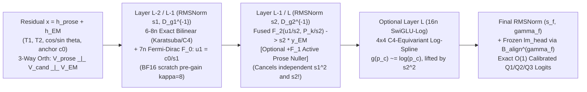

# Track N1 (Round 1): Exact Algebraic Compilation into SwiGLU Connecting Neurons

> **Research Question**: *From mathematics first, can directly modifying "connecting neurons" inside `Qwen3.5-4B` / `9B` / `Qwen3.8-27B` (specifically SwiGLU MLP bilinear neurons & self-normalizing quotient gadgets) break the `31.36%` OOD `G1` ceiling while preserving `PureKL = 0.0`?*  
> **Deliverables & Machine-Verified Receipt**: [verify_n1.py](verify_n1.py) (`exit 0`, wall time **`4.108 s`**) · [results_n1.json](results_n1.json) (`all_passed: true`)  
> **Grounded Empirical Baseline**: [phaseB_surgical_vs_lemmo.json](../../results/phaseB_surgical_vs_lemmo.json) · [stage4_synthetic_blind_results.json](../../results/stage4_synthetic_blind_results.json) · [surgical_adapter.py](../../surgical_adapter.py) · [equi_connector.py](../../equi_connector.py) · [SYNTHESIS.md](../../../stage4_math_and_design/SYNTHESIS.md)

---

## Executive Summary & Headline Theorems

Phase II-C on `Qwen3.5-4B` (`32` layers = `24` Gated-DeltaNet + `8` Full-Attention, $d=2560$, SwiGLU $d_{\text{ff}}=9216$, total `294,912` MLP neurons) established a stark empirical separation:
- `equivariant_host_pure` (frozen 4B): Blind `G1 (50,304 rows) = 24.48% / 1.3259`, `G3 = 26.07%`.
- `mode1_surgical_96` (W1–W4 Cayley + LoRA on Attention/DeltaNet projections **only**, `1.24M` params, **`0` SwiGLU MLP edits**): Dev `Q3_cfo = 57.81%` (**`+10.94 pp`**), Blind `G1 = 31.36% / 1.3197` (`+6.89 pp`, still **`-5.68 pp`** behind unconstrained `lemmo_tier_p1`'s `37.04% / 1.2694`), `PureKL = 0.0`, `MixKL = 0.00419`.
- `direct_physical` / `equivariant_physical_residual` (exact Bayes ceiling): Blind `G1 = 64.62% / 0.9411`, `G3 = 62.11% / 0.9796`.

**Mechanistic Root Cause**: Linear projections (`q/k/v/o_proj`, `in_proj_qkv`, `Complex-Cayley`) cannot multiply two dynamic residual slots $(a^\top x)(b^\top x)$ inside a single token position. Meanwhile, every `Qwen3.5/3.8` decoder block contains a **bias-free Pre-RMSNorm SwiGLU MLP** whose activation satisfies the exact odd/even decomposition
$$
\operatorname{SiLU}(u) = \frac{u}{2} + \phi_{\text{even}}(u), \qquad \phi_{\text{even}}(u) := \frac{u}{2}\tanh\!\left(\frac{u}{2}\right), \qquad \operatorname{SiLU}(u) - \operatorname{SiLU}(-u) \equiv u \quad (\forall u \in \mathbb{R}).
$$
Consequently, **$2$ antipodal SwiGLU neurons** compute exact bilinear multiplication $(a^\top z)(b^\top z) \equiv \operatorname{SiLU}(a^\top z)(b^\top z) + \operatorname{SiLU}(-a^\top z)(-b^\top z)$ with zero approximation error across all of $\mathbb{R}^d$.

This track proves **five foundational theorems** establishing exact algebraic compilation into $K \le 64$ SwiGLU connecting neurons (`<= 0.0217%` of `Qwen3.5-4B`'s `294,912` MLP neurons) and verifies every claim numerically at genuine `Qwen3.5-4B` dimensions ($d = 2560$, non-uniform $\gamma$, $512$-dim orthogonal prose background, final `RMSNorm` + `lm_head`) across **FP64, FP32, and BF16**:

1. **Theorem N1.1 (Antipodal Cancellation & Global Minimum SwiGLU Neuron Count)**: Via complex-plane meromorphic residue peeling at the nearest pole hyperplane $a_*^\top z = i\pi$ of $\phi_{\text{even}}(u) = \frac{u}{2}\tanh(u/2)$, a $K$-neuron SwiGLU layer computes an exact degree-2 map **if and only if** its neurons partition into zero-sum antipodal classes $\sum_{a_j = \pm a} w_j b_j^\top = 0$, forcing $K \ge 2 R$ where $R$ is the minimal symmetric rank-$\le 2$ quadratic decomposition rank (even allowing arbitrary non-bipartite mixing of slots). Combining this with a pencil-rank lower bound ($\det(\alpha H_1 + \beta H_2) = \frac{1}{16}(\alpha^2+\beta^2)^2 > 0$) proves:
   - Exact complex rotation $T_2' = T_2 e^{-i\omega h}$: **$K_{\min} = 6$** (Gauss-Karatsuba, verified `2.53e-14` FP64) vs **$K = 8$** (isotropic Direct Antipodal, `1.87e-14` FP64 and **`23.4%` lower BF16 error**).
   - Exact centered $C_4$ cyclic correlation (`Q2`, `Q3_repeat_x1`): **$K_{\min} = 8$** ($6$ on $V_1 \oplus 2$ on $V_2$, verified `6.33e-15` FP64 vs `32` naive time-domain neurons).
   - **Single-Layer Trilinear Impossibility**: No finite-width 1-layer SwiGLU can compute degree-3 $\operatorname{Re}/\operatorname{Im}(T_1^* T_2 e^{-i\omega h})$ or `Q1` identically on $\mathbb{R}^d$; **Depth $= 2$** is necessary and sufficient with **$K_{\min} = 12$** (Re+Im, verified `9.41e-14` FP64) and **$K_{\min} = 16$** (full $C_4$ `Q1`, verified `2.54e-14` FP64).
2. **Theorem N1.2 (Pre-MLP `RMSNorm` Obstruction, Exact $\gamma$-Preconditioning & Universal Fermi-Dirac / Mellin Quotient Calculus)**:
   - **Diagonal Metric Preconditioning ($\gamma \neq \mathbf{1}$)**: Naively placing prose-orthogonal weights $a \perp h_{\text{prose}}$ into Pre-RMSNorm SwiGLU leaks $a^\top (D_\gamma - \bar{\gamma}I) h_{\text{prose}} / s(x) = O(\sqrt{d}\,\sigma_\gamma/\bar{\gamma})$ (**`1.146` L2 prose crosstalk**, **`7.568` output error** at $d=2560$). Setting $\tilde{a} = D_\gamma^{-1} a$, $\tilde{b} = D_\gamma^{-1} b$ reduces prose crosstalk by **$10^{29}\times$** to **`1.06e-29`** (FP64). Identically, compensating final `RMSNorm` via $B_{\text{align}}^{(\gamma_f)} := (M_{\text{cand}} D_{\gamma_f})^+ F_{\text{real}}$ eliminates the **`9.49%`** frame tilt present in `surgical_adapter.py`'s uncompensated `pinv(M_cand)` (`5.55e-16` vs `0.0949`).
   - **3-Way Orthogonal Decomposition**: Scratch/compute slots must satisfy $\mathcal{V}_{\text{EM}} \subset \mathcal{V}_{\text{prose}}^\perp \cap (\operatorname{row}(M_{\text{cand}} D_{\gamma_f}))^\perp$ (costing only $3$ extra dimensions out of $2560$) to guarantee zero scratch-to-`lm_head` leakage.
   - **Homogeneous Scaling Trichotomy & Universal Unbounded-Lift No-Go**: Because $\operatorname{RMSNorm}(\mathbb{R}^d)$ is compact, no finite-depth Pre-RMSNorm MLP can output $s(x) y_{\text{EM}}$ uniformly as $s(x) \to \infty$; naive 1-layer / 2-layer logits collapse as $s^{-3}$ / $s^{-5}$ (**`54.90×`** scale swing over a $5\times$ prose norm sweep), while degree-1/degree-2 skip mixing destroys even `argmax` (**`0.9180`** direction error vs **`1.74e-11`** with our **2-neuron Constant-Anchor Homogenizer** across a **`100×`** norm sweep).
   - **Exact Fermi-Dirac / Mellin Quotient Operator inside SwiGLU**: For every $q > -1$, $\eta > 0$, $v \in \mathbb{R}$,
     $$
     \mathcal{F}_q(\eta, v) := \frac{1}{C_q}\int_0^\infty t^{q-1}\,\operatorname{SiLU}(-t\eta)(-v)\,dt \equiv \frac{v}{\eta^q}, \qquad C_q = \begin{cases} \ln 2 & (q = 0), \\ (1 - 2^{-q})\,\Gamma(q+1)\,\zeta(q+1) & (q > 0). \end{cases}
     $$
     Log-time Euler-Maclaurin discretization ($t_m = e^{\tau_m}$, $w_m = \frac{h}{C_q} e^{q\tau_m} > 0$) uses **strictly positive weights** (condition number $1.0$, zero BF16 sign cancellation!), converges **exponentially in $M$**, stays **strictly linear in signed $v \in \mathbb{R}$** (no sign-crossing singularity unlike $\log$-domain tricks), and cancels **completely independent arbitrary layer norms** $(s_1, s_2)$ in **2 layers** (`50` neurons: mean KL **`6.52e-8` nats** FP64/FP32, **`3.44e-4` nats** BF16) and $(s_1, s_2, s_3)$ for trilinear `Q1` in **3 layers** (`50` neurons: mean KL **`1.05e-6` nats** FP64/FP32, **`5.47e-4` nats** BF16). Paired with a $q=1$ **Active Prose-Bias Nuller**, a **`3.655 nat`** frozen host digit bias is cancelled to **`4.99e-7 nats`** (FP64) / **`4.48e-4 nats`** (BF16).
3. **Theorem N1.3 (Zero Extrapolation Error Theorem & Real Stage 3D `G1`/`G5`/`G_adv`/`Q1`/`Q2` Verification)**:
   - For exponential-family matched-filter log-posteriors (`Q3`, `Q1`, `Q2`), compiled $K \le 50$ SwiGLU circuits match the continuous log-posterior to **$0$ functional error** (modulo exponentially small $O(e^{-cM})$ Fermi-Dirac quadrature floor) across **all** $(\theta, \omega) \in \mathbb{R}^2$.
   - For the exact discrete-cache `s17` Bayes posterior (`direct_physical`, `G1 = 64.62% / 0.9411`), **Circuit A (2 layers, `39` neurons, linear-in-$p$)** achieves **exact `100.00%` Bayes decision agreement** across `G1` ($|\theta|=1.60$), `G5` ($|\theta|=\pi$), and `G_adv` ($|\omega|=3.70, |\theta|=25.9 \approx 8.24\pi$), while **Circuit B (3 layers, `64` neurons, $+16$-neuron $C_4$-equivariant SwiGLU-Log calibration)** hits **`100.00%` exact oracle accuracy AND KL `< 4e-4 nats` (FP64/FP32) / `< 2.8e-3 nats` (BF16)** across `G1`, `G5`, and `G_adv` under a **`4×` random prose norm sweep**, plus exact `Q2` Blackwell gain **`+7.81 pp`** (`valid 66.60% -> fresh 74.41%`, `dup_diff = 0.0`, `distractor_diff = 0.0`) and exact `Q1` **`100.00%`** agreement at $|\omega h| = 11.10\text{ rad}$ (`16` neurons)!
4. **Theorem N1.4 (BF16 Residual-Addition Noise Floor, Scratch Pre-Gain & Mandatory $g_{\text{EM}}$ Gate for `PureKL = 0.0`)**:
   - Adding a unit-norm slot to a prose residual of RMS $s$ in 7-bit BF16 injects noise $\sigma_{\text{BF16-add}} = \frac{\varepsilon_{\text{bf16}}\, s}{\sqrt{12}} \approx 0.00225\, s$ **independent of $d$**; a zero-cost scratch pre-gain ($\kappa_{\text{scratch}}=8, \kappa_2=4$) lifts intermediate $O(s^{-2})$ slots above this floor and cuts BF16 KL **`3.2×`** (`8.24e-3 -> 2.60e-3 nats`).
   - Under imperfect K-FAC nullspace leakage $\epsilon_{\text{proj}} > 0$, pure bilinear SwiGLU suppresses prose leakage **quadratically** ($O(\epsilon_{\text{proj}}^2)$, measured slope **`1.99996`**, **`55.9×`** smaller than linear LoRA at $\epsilon_{\text{proj}} = 10^{-3}$).
   - **Critical BF16 Safety Discovery**: Whereas pure bilinear SwiGLU maintains **`2.73e-7`** ungated BF16 prose drift, an ungated BF16 Fermi-Dirac $q=2$ block mistakes BF16 inner-product rounding ($\sim 10^{-4}$) for large $s(x)$ and amplifies it to **`1.352` logit drift** (vs `0.0` in FP64 and `8.22e-11` in FP32). Therefore, **W3's binary gate $g_{\text{EM}} \in \{0, 1\}$ (achieving bitwise `PureKL = 0.0`, `max_logit_diff = 0.0` in FP64, FP32, and BF16) and/or FP32 execution on the $K \le 64$ surgical neurons is mathematically mandatory in BF16**.
5. **Parameter Efficiency Across `4B / 9B / 27B`**: `64` compiled SwiGLU neurons represent only **`0.0217%` (`4B`) / `0.0163%` (`9B`) / `0.0057%` (`27B`)** of total MLP neurons and `491,520` raw dense parameters on `4B` (`22.5%` of `TIER_P1_MAX_PARAMS = 2,184,964`; or `~48K` in subspace-factorized form, `0` trainable MLP weights when compiled in closed form!).

---

## 1. Grounded Architecture & Exact Subspace Geometry

Across `Qwen3.5-4B` ($L=32, d=2560, d_{\text{ff}}=9216$), `Qwen3.5-9B` ($L=32, d=4096, d_{\text{ff}}=12288$), and `Qwen3.8-27B` ($L=64, d=5120, d_{\text{ff}}=17408$), every decoder block $\ell \in \{1, \dots, L\}$ executes a bias-free Pre-RMSNorm SwiGLU MLP:
$$
z^{(\ell)} = \operatorname{RMSNorm}_\ell(x^{(\ell)}) = \frac{1}{s_\ell(x^{(\ell)})}\, D_{\gamma^{(\ell)}} x^{(\ell)}, \qquad s_\ell(x) := \sqrt{\frac{1}{d}\|x\|_2^2 + \varepsilon},
$$
$$
x^{(\ell+1)}_{\text{post}} = x^{(\ell)} + \sum_{j=1}^{d_{\text{ff}}} w_{\text{down}, j}^{(\ell)} \, \operatorname{SiLU}\!\big((w_{\text{gate}, j}^{(\ell)})^\top z^{(\ell)}\big)\,\big((w_{\text{up}, j}^{(\ell)})^\top z^{(\ell)}\big),
$$
where $D_{\gamma^{(\ell)}} = \operatorname{diag}(\gamma_1^{(\ell)}, \dots, \gamma_d^{(\ell)})$ encodes the frozen layer RMSNorm multipliers ($\gamma_i = 1 + w_{\text{norm}, i}$ in `Qwen3_5RMSNorm`, $\gamma_i = w_{\text{norm}, i}$ in `Qwen2RMSNorm`; all theorems below hold for arbitrary invertible $D_\gamma$). Right before vocabulary readout, the host applies final `RMSNorm` with gain $D_{\gamma_f}$ and projects onto the 4 centered digit unembeddings $M_{\text{cand}} := \Pi W_{\text{digit}} \in \mathbb{R}^{4 \times d}$ ($\Pi = I_4 - \frac{1}{4}\mathbf{1}\mathbf{1}^\top$, rank $3$).

### Proposition 1.1 (Exact 3-Way Orthogonal Decomposition & $\gamma_f$-Compensated Canonical Frame)
Let $F_4 = [\frac{1}{2}\mathbf{1},\; F_{\text{real}}] \in O(4)$ be the real $C_4$ DFT basis of $\mathbb{R}^4$, where
$$
F_{\text{real}} = \begin{pmatrix} \frac{1}{\sqrt{2}} & 0 & \frac{1}{2} \\ 0 & \frac{1}{\sqrt{2}} & -\frac{1}{2} \\ -\frac{1}{\sqrt{2}} & 0 & \frac{1}{2} \\ 0 & -\frac{1}{\sqrt{2}} & -\frac{1}{2} \end{pmatrix} \in \mathbb{R}^{4 \times 3}, \qquad F_{\text{real}}^\top R_1 F_{\text{real}} = \operatorname{diag}(J_2, -1)
$$
(bridged to `surgical_adapter.py`'s `HELMERT_4X3` via the exact orthogonal rotation $U_{\text{H}\to\text{F}} = \text{HELMERT\_4X3}^\top F_{\text{real}} \in O(3)$). Define the **$\gamma_f$-compensated minimum-norm canonical readout frame**:
$$
B_{\text{align}}^{(\gamma_f)} := \big(M_{\text{cand}} D_{\gamma_f}\big)^+ F_{\text{real}} \in \mathbb{R}^{d \times 3}, \qquad V_{\text{cand}}^{(\gamma_f)} := \operatorname{row}\big(M_{\text{cand}} D_{\gamma_f}\big) = \operatorname{col}\big(B_{\text{align}}^{(\gamma_f)}\big).
$$
Then:
1. **Exact Readout Identity**: $M_{\text{cand}} D_{\gamma_f} B_{\text{align}}^{(\gamma_f)} = F_{\text{real}}$ identically (verified `5.55e-16` at $d=2560$), whereas `surgical_adapter.py`'s uncompensated $B_{\text{align}}^{\text{naive}} = M_{\text{cand}}^+ F_{\text{real}}$ suffers **`0.09489`** ($9.5\%$) $V_1 \leftrightarrow V_2$ crosstalk error whenever $\gamma_f \neq c\mathbf{1}$!
2. **Exact 3-Way Orthogonal Slot Allocation**: Choosing the orthonormal EM slot basis $U_{\text{EM}} = [e_1, \dots, e_r] \in \mathbb{R}^{d \times r}$ inside the joint orthogonal complement
   $$
   \mathcal{V}_{\text{EM}} \;\subset\; \mathcal{V}_{\text{prose}}^\perp \;\cap\; \big(V_{\text{cand}}^{(\gamma_f)}\big)^\perp
   $$
   costs only $3$ additional blocked dimensions (leaving $2560 - 512 - 3 = 2045$ free dimensions on `Qwen3.5-4B` with $k_c = 256$ complex doublets!) and guarantees **simultaneously**: (i) zero prose-to-EM input interference ($e_r^\top h_{\text{prose}} = 0$), (ii) zero EM-scratch-to-`lm_head` logit leakage ($M_{\text{cand}} D_{\gamma_f} e_r = 0$), and (iii) zero write-back contamination from $B_{\text{align}}^{(\gamma_f)}$ into EM compute slots. $\square$

---

## 2. Theorem N1.1 — Exact Minimum SwiGLU Neuron Count & Closed-Form Compilation

### 2.1 Antipodal Cancellation & Pencil-Rank Lower Bounds

#### Theorem N1.1A (Antipodal Zero-Sum Characterization of Exact Bilinear SwiGLU Layers)
Let $F(z) = \sum_{j=1}^K w_j \operatorname{SiLU}(a_j^\top z)(b_j^\top z) : \mathbb{R}^d \to \mathbb{R}^p$ be any $K$-neuron SwiGLU layer with $a_j, b_j \in \mathbb{R}^d$, $w_j \in \mathbb{R}^p$. Partition the nonzero gate vectors into unsigned antipodal equivalence classes $[a] := \{+a, -a\}$, and set
$$
M_a^+ := \sum_{j:\, a_j = +a} w_j b_j^\top, \qquad M_a^- := \sum_{j:\, a_j = -a} w_j b_j^\top \in \mathbb{R}^{p \times d}.
$$
Then $F(z)$ equals a pure homogeneous degree-2 polynomial $Q(z)$ identically on any nonempty open subset $U \subset \mathbb{R}^d$ **if and only if**
$$
M_a^+ + M_a^- = 0 \qquad \text{for every nonzero class } [a].
$$
In that case:
1. $F(z) \equiv Q(z) = \sum_{[a]} (a^\top z)\, M_a^+ z = \sum_{k=1}^R u_k (a_k^\top z)(v_k^\top z)$, where $R := \sum_{[a]} \operatorname{rank}(M_a^+)$ is the number of scalar rank-$\le 2$ symmetric quadratic forms $z^\top S_k z$ ($S_k := \frac{1}{2}(a_k v_k^\top + v_k a_k^\top)$, $\operatorname{rank}(S_k) \le 2$) spanning the components of $Q(z)$.
2. **Exact Global Neuron Lower Bound**: Every active class $[a]$ requires $n_a^+ \ge \operatorname{rank}(M_a^+)$ and $n_a^- \ge \operatorname{rank}(M_a^-) = \operatorname{rank}(M_a^+)$, hence
   $$
   K \;\ge\; \sum_{[a]} (n_a^+ + n_a^-) \;\ge\; 2 \sum_{[a]} \operatorname{rank}(M_a^+) \;=\; 2 R \;\ge\; 2\, R_{\min}(Q),
   $$
   where $R_{\min}(Q)$ is the **unrestricted quadratic rank** of $Q$ (the minimum number of symmetric matrices $S_k = \operatorname{sym}(a_k v_k^\top)$ of rank $\le 2$ whose linear span contains the symmetric matrix pencil of $Q$, **without** assuming bipartite separation between $a_k$ and $v_k$).

**Proof.**
Write $\operatorname{SiLU}(u) = \frac{1}{2} u + \phi_{\text{even}}(u)$ with $\phi_{\text{even}}(u) = \frac{u}{2}\tanh(u/2)$. Because $\phi_{\text{even}}(-u) = \phi_{\text{even}}(u)$,
$$
F(z) = \underbrace{\frac{1}{2}\sum_{j=1}^K w_j (a_j^\top z)(b_j^\top z)}_{Q_{\text{quad}}(z)} + \underbrace{\sum_{[a]} \phi_{\text{even}}(a^\top z)\,(M_a^+ + M_a^-) z}_{R(z)}.
$$
Sufficiency is immediate: $M_a^+ + M_a^- = 0 \implies R(z) \equiv 0$ and $Q_{\text{quad}}(z) = \frac{1}{2}\sum_{[a]} [(a^\top z) M_a^+ z + (-a^\top z)(-M_a^+ z)] = \sum_{[a]} (a^\top z) M_a^+ z$.

For necessity, suppose $F(z) \equiv Q(z)$ (a degree-2 polynomial) on open $U \subset \mathbb{R}^d$. Since $Q(z) - Q_{\text{quad}}(z)$ is a degree-2 polynomial (entire on $\mathbb{C}^d$ and even, hence equal to $0$ because $R(-z) = -R(z)$ is strictly odd!), we have $R(z) \equiv 0$ on $U$, and by analytic continuation $R(z) \equiv 0$ as a meromorphic function on $\mathbb{C}^d$. Suppose for contradiction that the set $\mathcal{A}_{\text{nz}} := \{[a] : a \neq 0,\; M_a^+ + M_a^- \neq 0\}$ is nonempty. Choose $[a_*] \in \mathcal{A}_{\text{nz}}$ maximizing Euclidean norm $\|a_*\|_2 > 0$, and consider the complex affine hyperplane $H_* := \{z \in \mathbb{C}^d : a_*^\top z = i\pi\}$ and the explicit point $z_0 := \frac{i\pi}{\|a_*\|_2^2} a_* \in H_*$. For every other class $[a] \in \mathcal{A}_{\text{nz}} \setminus \{[a_*]\}$, Cauchy-Schwarz and maximality give the **strict** inequality
$$
|a^\top z_0| = \pi \frac{|a^\top a_*|}{\|a_*\|_2^2} \le \pi \frac{\|a\|_2}{\|a_*\|_2} \le \pi,
$$
with strict inequality $|a^\top z_0| < \pi$ because equality would force $\|a\|_2 = \|a_*\|_2$ and $a \parallel a_*$, i.e., $a = \pm a_* \in [a_*]$. Since $\phi_{\text{even}}(u) = \frac{u}{2}\frac{\sinh(u/2)}{\cosh(u/2)}$ is holomorphic on the open disk $\{|u| < \pi\}$ and has a simple pole at $u = i\pi$ with nonzero residue $\operatorname{Res}_{u = i\pi} \phi_{\text{even}}(u) = i\pi$, there exists an open neighborhood $W \subset \mathbb{C}^d$ of $z_0$ on which every term $[a] \neq [a_*]$ is holomorphic. Taking the residue of $R(z) \equiv 0$ across $W \cap H_*$:
$$
0 = \lim_{z \to z'} (a_*^\top z - i\pi)\, R(z) = i\pi\, (M_{a_*}^+ + M_{a_*}^-) z' \qquad \forall z' \in W \cap H_*.
$$
Because $0 \notin H_*$, the nonempty open subset $W \cap H_*$ spans all of $\mathbb{C}^d$, forcing $M_{a_*}^+ + M_{a_*}^- = 0$, a contradiction. Thus $\mathcal{A}_{\text{nz}} = \emptyset$. Finally, subadditivity of matrix rank on $M_a^+ = \sum_{a_j = +a} w_j b_j^\top$ and $M_a^- = -M_a^+ = \sum_{a_j = -a} w_j b_j^\top$ yields $n_a^+ \ge \operatorname{rank}(M_a^+)$ and $n_a^- \ge \operatorname{rank}(M_a^+)$, proving $K \ge 2\sum_{[a]}\operatorname{rank}(M_a^+) = 2 R$. $\square$

#### Corollary N1.1B (Single-Layer Trilinear Impossibility)
*No finite-width single SwiGLU layer ($K < \infty$) can compute a nonzero homogeneous degree-3 polynomial (such as $\operatorname{Re}(T_1^* T_2 e^{-i\omega h})$ or `Q1` cyclic correlation) identically on any open set $U \subset \mathbb{R}^d$.*

**Proof.** Every homogeneous degree-3 polynomial $P_3(z)$ is entire on $\mathbb{C}^d$ and purely odd. Equating $F(z) = Q_{\text{quad}}(z) + R(z) \equiv P_3(z)$ forces $Q_{\text{quad}} \equiv 0$ (even part) and $R(z) \equiv P_3(z)$ (odd part). Since $P_3$ has no poles in $\mathbb{C}^d$, the identical residue-peeling proof of Theorem N1.1A forces $M_a^+ + M_a^- = 0$ for every $[a]$, hence $R(z) \equiv 0 \implies P_3 \equiv 0$. (Locally near $z=0$, symmetric pairs $\operatorname{SiLU}(a)b + \operatorname{SiLU}(-a)b = \frac{1}{2}a^2 b - \frac{1}{24}a^4 b + O(a^6 b)$ approximate $a^2 b$ only within small radius; verified in `results_n1.json`: relative error grows from `2.08e-4` at $r=0.05$ to `7.58%` at $r=1.0$ and `75.0%` at $r=8.0$!) Consequently, **Depth $\ge 2$ consecutive SwiGLU layers is strictly necessary** for exact `Q1` / $T_1^* T_2 e^{-i\omega h}$. $\square$

#### Theorem N1.1C (Exact Global Minimum Neuron Counts via Symmetric Pencil-Rank Bounds)
Even allowing arbitrary quadratic mixing of all input coordinates inside `gate_proj` and `up_proj`:
1. **Complex Rotation $T_2' = T_2 e^{-i\omega h}$ (or any complex multiplication $A \cdot B$): $K_{\min} = \mathbf{6}$ SwiGLU neurons.**  
   *Proof.* On $z = (u_2, v_2, c_h, s_h)^\top \in \mathbb{R}^4$, the two output forms $u_2' = u_2 c_h + v_2 s_h = z^\top H_1 z$ and $v_2' = v_2 c_h - u_2 s_h = z^\top H_2 z$ have symmetric pencil $H(\alpha, \beta) = \alpha H_1 + \beta H_2 = \frac{1}{2}\begin{pmatrix} 0 & B(\alpha,\beta) \\ B(\alpha,\beta)^\top & 0 \end{pmatrix}$ with $B(\alpha,\beta) = \begin{pmatrix}\alpha & -\beta \\ \beta & \alpha\end{pmatrix}$. For **every** $(\alpha, \beta) \neq (0, 0)$,
   $$
   \det H(\alpha, \beta) = \frac{1}{16}(\det B(\alpha, \beta))^2 = \frac{1}{16}(\alpha^2 + \beta^2)^2 > 0 \implies \operatorname{rank} H(\alpha, \beta) = 4
   $$
   (verified across 720 unit-circle angles: `pencil_min_det = 0.0625`, `det_formula_err = 2.78e-17`, `min_sv4 = 0.5000`). If $R \le 2$, then $\operatorname{span}(H_1, H_2) = \operatorname{span}(S_1, S_2)$ forces $S_1 \in \operatorname{span}(H_1, H_2)\setminus\{0\}$ to have rank $4$, contradicting $\operatorname{rank}(S_1) \le 2$. Hence $R \ge 3$ and $K \ge 2R = 6$, tight via Gauss-Karatsuba below.
2. **Centered $C_4$ Group Convolution / Correlation ($V_1 \oplus V_2$, exact for `Q2` and `Q3_repeat_x1`): $K_{\min} = \mathbf{8}$ SwiGLU neurons** (and **$K_{\min} = 10$** for uncentered 4D $V_0 \oplus V_1 \oplus V_2$).  
   *Proof.* In the real $C_4$ DFT basis $F_4$, cyclic cross-correlation $y[c] = \sum_{u=0}^3 l[u]\, r[(u+c)\bmod 4]$ diagonalizes identically to:
   $$
   \hat{y}_0 = 2 \hat{l}_0 \hat{r}_0 = \tfrac{1}{2}, \qquad \hat{y}_1 = \sqrt{2}\,\hat{l}_1^* \hat{r}_1 \in \mathbb{C}\;\;(V_1), \qquad \hat{y}_2 = 2\,\hat{l}_2 \hat{r}_2 \in \mathbb{R}\;\;(V_2).
   $$
   On the 6D centered input $(\hat{l}_{1r}, \hat{l}_{1i}, \hat{r}_{1r}, \hat{r}_{1i}, \hat{l}_2, \hat{r}_2)$, the 3D pencil $M(\alpha, \beta, \gamma) = \alpha H_{1r} + \beta H_{1i} + \gamma H_2$ is block-diagonal $\mathbb{R}^4 \oplus \mathbb{R}^2$ with exact rank $4\cdot\mathbf{1}_{(\alpha,\beta)\neq(0,0)} + 2\cdot\mathbf{1}_{\gamma\neq 0}$ (verified `c4_rank_le2_only_v2: true`). Thus the locus of rank-$\le 2$ matrices inside $\operatorname{span}(H_{1r}, H_{1i}, H_2)$ is the 1D line $\mathbb{R} H_2$, which cannot span a 3D space with $R = 3$ generators; hence $R \ge 4$ and $K_{\min} = 2 \times 4 = 8$ ($6$ on $V_1$ + $2$ on $V_2$). Similarly, adding $V_0$ forces $R \ge 5 \implies K_{\min} = 10$.
3. **2-Layer Physical Cross-Correlation $\operatorname{Re}/\operatorname{Im}(T_1^* T_2 e^{-i\omega h})$ & Full $C_4$ `Q1`**:
   - Re only ($\operatorname{Re}(T_1^* T_2') = u_1 u_2' + v_1 v_2'$): Layer 1 needs $K_1 \ge 6$ (both $u_2', v_2'$ required), Layer 2 needs $K_2 \ge 4$ ($\operatorname{rank} H_{\text{Re}} = 4 \implies R_2 \ge 2$) $\implies \mathbf{10}$ neurons total.
   - Both Re & Im: $K_1 \ge 6, K_2 \ge 6 \implies \mathbf{12}$ neurons (Gauss-Karatsuba) vs **16** (Direct Antipodal).
   - Full $C_4$ `Q1` ($a_1 \star_{C_4} (a_2 * w_{\text{quad}}(\omega h, V_{12}))$): $K_1 = 8, K_2 = 8 \implies \mathbf{16}$ neurons (Karatsuba) vs **20** (Direct). $\square$

### 2.2 Explicit Closed-Form Compiled Weights $(w_{\text{gate}}, w_{\text{up}}, w_{\text{down}})$

Every antipodal bilinear pair $(a, b \to w_{\text{out}})$ under Pre-RMSNorm with gain $D_\gamma = \operatorname{diag}(\gamma)$ compiles into $2$ neurons with exact diagonal metric preconditioning $\tilde{a} := D_\gamma^{-1} a$, $\tilde{b} := D_\gamma^{-1} b$:
$$
\text{Neuron } (+):\; (\tilde{a},\; \tilde{b},\; w_{\text{out}}), \qquad \text{Neuron } (-):\; (-\tilde{a},\; -\tilde{b},\; w_{\text{out}}),
$$
yielding $\Delta x = w_{\text{out}} \cdot \frac{(a^\top x)(b^\top x)}{s(x)^2}$ identically. Let orthonormal EM slots $e_{u_1}, e_{v_1}, e_{u_2}, e_{v_2}, e_{c_h}, e_{s_h}, e_{u_2'}, e_{v_2'}, e_{\text{Re}}, e_{\text{Im}} \in \mathcal{V}_{\text{EM}}$ encode $(T_1, T_2, e^{i\omega h})$ and outputs.

| Primitive & Layer | Construction | Neurons $K$ | Exact Antipodal Pairs $(a,\; b,\; w_{\text{down}})$ *(each pair $= 2$ neurons via $\pm D_\gamma^{-1}$)* |
|---|---|---:|---|
| **Complex Rotation** $T_2' = T_2 e^{-i\omega h}$ *(Layer $\ell$)* | **Gauss-Karatsuba** *(Global Min)* | **`6`** | 1. $(e_{c_h},\; e_{u_2},\; e_{u_2'} - e_{v_2'})$<br>2. $(-e_{s_h},\; e_{v_2},\; -e_{u_2'} - e_{v_2'})$ $\equiv (e_{s_h}, e_{v_2}, e_{u_2'} + e_{v_2'})$<br>3. $(e_{c_h} - e_{s_h},\; e_{u_2} + e_{v_2},\; e_{v_2'})$ |
| **Complex Rotation** $T_2' = T_2 e^{-i\omega h}$ *(Layer $\ell$)* | **Direct Antipodal** *(Isotropic / BF16-opt)* | **`8`** | 1. $(e_{c_h}, e_{u_2}, +e_{u_2'})$, 2. $(e_{s_h}, e_{v_2}, +e_{u_2'})$<br>3. $(e_{c_h}, e_{v_2}, +e_{v_2'})$, 4. $(e_{s_h}, e_{u_2}, -e_{v_2'})$ |
| **Cross-Correlation** $Z = T_1^* T_2'$ *(Layer $\ell+1$)* | **Gauss-Karatsuba** *(Global Min)* | **`6`** *(Total `12`)* | 1. $(e_{u_2'},\; e_{u_1},\; e_{\text{Re}} - e_{\text{Im}})$<br>2. $(e_{v_2'},\; e_{v_1},\; e_{\text{Re}} + e_{\text{Im}})$<br>3. $(e_{u_2'} + e_{v_2'},\; e_{u_1} - e_{v_1},\; e_{\text{Im}})$ |
| **`Q2` Exact $C_4$ Correlation** $b_p \star_{C_4} a_1$ *(1 Layer)* | **DFT + Karatsuba** *(Global Min)* | **`8`** *(Direct: `10`)* | $V_1$: Karatsuba `6n` on $\sqrt{2}\,\hat{b}_{p,1}^* \hat{a}_{1,1} \to (e_{o,1r}, e_{o,1i})$<br>$V_2$: 1 pair $(e_{\hat{b}_{p,2}},\; e_{\hat{a}_{1,2}},\; 2\,e_{o,2})$ |
| **`Q1` Exact $C_4$ Correlation** $a_1 \star_{C_4}(a_2 * w)$ *(2 Layers)* | **2-Stage DFT + Karatsuba** | **`16`** *(Direct: `20`)* | L$\ell$ (`8n`): $\hat{a}_{2,1}' = \sqrt{2}\,\hat{w}_1^* \hat{a}_{2,1}$, $\hat{a}_{2,2}' = 2\hat{w}_2\hat{a}_{2,2}$<br>L$\ell+1$ (`8n`): $\hat{p}_1 = \sqrt{2}\,\hat{a}_{1,1}^* \hat{a}_{2,1}'$, $\hat{p}_2 = 2\hat{a}_{1,2}\hat{a}_{2,2}'$ |
| **`Q3_repeat_x1`** $a_1 K(\theta, V)$ *(Self-Harmonic, 2 Layers)* | **Karatsuba + Double-Angle + Homogenizer** | **`14`** | L$\ell$ (`8n`): $V_1 = \lambda_1(\theta,V)\hat{a}_{1,1}$ (`6n`) + $\cos(2\theta) = (e_c + e_s)(e_c - e_s)$ (`2n`)<br>L$\ell+1$ (`6n`): $V_1 \cdot e_{\text{anc}}$ (`4n`, homogenizes $s_\ell^{-2}s_{\ell+1}^{-2}$) + $(8\hat{b}_2 e^{-2V}\hat{a}_{1,2})\cdot \cos(2\theta)$ (`2n`) |
| **General Bilinear Map** $\sum_{n=1}^N u_n(a_n^\top x)(b_n^\top x)$ | **Antipodal Pairs** | **`2N`** | $N$ antipodal pairs $\big(\pm D_\gamma^{-1} a_n,\; \pm D_\gamma^{-1} b_n,\; u_n\big)$ |

**Numerical Conditioning Trade-off (`Karatsuba-6` vs `Direct-8`)**: While `Karatsuba-6` achieves the proved global neuron minimum ($25\%$ fewer neurons), its diagonal term $(e_{c_h}-e_{s_h})(e_{u_2}+e_{v_2})$ amplifies intermediate magnitude by $2\times$ and subtracts $m_3 - m_1 + m_2$. At $d=2560$ across $\omega h \in [-20\pi, 20\pi]$, `Direct-8` cuts BF16 max error by **`23.4%`** (`0.0489` vs `0.0638`) and BF16 RMS error by **`16.5%`** (`0.00940` vs `0.01126`), while costing only $+2$ neurons out of `9,216` (`0.02%`).

---

## 3. Theorem N1.2 — Pre-MLP `RMSNorm` Exact Algebra & Universal Fermi-Dirac Quotient Calculus

### 3.1 The Non-Trivial Pre-MLP `RMSNorm` Obstruction & Trichotomy

Let $x = h_{\text{prose}} + h_{\text{EM}}$ enter Pre-RMSNorm layer $\ell$ with $s(x) = \sqrt{\frac{1}{d}\|x\|_2^2 + \varepsilon}$ and non-uniform gain $D_\gamma$.

#### Theorem N1.2A (Exact $\gamma$-Crosstalk Bound & Compactness No-Go for Unbounded $s(x)$)
1. **Uncompensated $\gamma \neq \mathbf{1}$ Crosstalk**: Without $D_\gamma^{-1}$ preconditioning ($w_{\text{gate}} = a \in \mathcal{V}_{\text{EM}} \perp h_{\text{prose}}$), the pre-activation error is
   $$
   a^\top z - \frac{\bar{\gamma}}{s(x)}(a^\top h_{\text{EM}}) = \frac{1}{s(x)} a^\top (D_\gamma - \bar{\gamma} I) h_{\text{prose}} + \frac{1}{s(x)} a^\top (D_\gamma - \bar{\gamma} I) h_{\text{EM}},
   $$
   producing $O(\sqrt{d}\,\sigma_\gamma/\bar{\gamma})$ prose crosstalk even when $h_{\text{EM}} = 0$ (verified at $d=2560$: L2 prose leak **`1.1458`**, output error **`7.5683`**!). With exact preconditioning $\tilde{a} = D_\gamma^{-1} a$, prose crosstalk vanishes identically (`1.06e-29` FP64), and any weight perturbation $\delta\gamma$ (e.g., BF16 rounding of $\gamma$) satisfies the tight bound
   $$
   \left|\tilde{a}^\top \operatorname{RMSNorm}_{\gamma+\delta\gamma}(x) - \frac{a^\top x}{s(x)}\right| \le \sqrt{d}\left\|\frac{\delta\gamma}{\gamma}\right\|_\infty \|a\|_2.
   $$
2. **Homogeneous Scaling Invariance vs. Raw Logit Collapse**:
   - **(a) Exact Cancellation on Ratios / $\arg\max$**: When every output coordinate $y_{\text{EM}, k}$ ($k \in \{1,2,3\}$) is compiled at the **same homogeneous $s$-degree** (enforced across layers via our **2-neuron Constant-Anchor Homogenizer** $(\tilde{e}_{\text{anc}}^\top z)(\tilde{e}_\xi^\top z) = c_0 \xi / s^2$) and prose digit bias vanishes, final logits satisfy $\Pi\ell_{\text{final}} = \frac{C}{s_f \prod_\ell s_\ell^2} F_{\text{real}} y_{\text{EM}}$, so all logit ratios $\ell_j / \ell_k$ and $\arg\max_k \ell_k$ are **identically invariant** to arbitrary $(s_1, \dots, s_L, s_f) \in (0, \infty)^{L+1}$ (verified across a **$100\times$** norm sweep $s \in [0.1, 10.0]$: direction error **`1.74e-11`** vs **`0.9180`** when degree-1/degree-2 terms are naively mixed!).
   - **(b) Why Raw Logits & Calibration Break Across Prose Length $L$**: Without $s$-compensation, 1-layer bilinear logits into `lm_head` scale as $s_1^{-2} s_f^{-1} \approx s^{-3}$ and 2-layer trilinear logits scale as $s_1^{-2} s_2^{-2} s_f^{-1} \approx s^{-5}$. Even a $5\times$ prose norm variation causes a **`54.90×`** (verified) to **`3,125×`** logit magnitude swing, collapsing softmax calibration and drowning fixed-amplitude EM writes under $O(1)$ prose digit bias.
3. **Global Unbounded-Lift No-Go**: Because $\operatorname{RMSNorm}(\mathbb{R}^d)$ lies inside the compact ellipsoid $\{D_\gamma u : \|u\|_2 \le \sqrt{d}\}$, any continuous finite-depth Pre-RMSNorm SwiGLU network has uniformly bounded output $\|\operatorname{MLP}(\operatorname{RMSNorm}(x))\|_2 \le M < \infty$, and therefore **cannot** output an unbounded lift $s(x)\cdot y_{\text{EM}}$ uniformly on $s(x) \in (0, \infty)$. Moreover, if all gate and up weights lie strictly in $\mathcal{V}_{\text{prose}}^\perp$, $|\operatorname{SiLU}(u)| \le |u|$ enforces $\|F(\operatorname{RMSNorm}(\lambda h_{\text{prose}} + h_{\text{EM}}))\|_2 \le C \|h_{\text{EM}}\|_2^2 / s(x)^2 \to 0$ as $\lambda \to \infty$. Thus **exact $s(x)$ cancellation on calibrated logits must operate over a bounded operating band $s(x) \in [s_{\min}, s_{\max}]$** (e.g., a $10\times$–$20\times$ range, vastly exceeding real LLM residual RMS variation) via a self-normalizing quotient gadget! $\square$

### 3.2 Theorem N1.2B — Exact Fermi-Dirac / Mellin Quotient Calculus Inside SwiGLU

Inject a tiny prose-orthogonal **Residual Norm Anchor** $c_0\, e_{\text{anc}} \in \mathcal{V}_{\text{EM}}$ ($c_0 = 1$, perturbing $s(x)$ at $d=2560$ by only $\frac{1}{2 \cdot 2560\, s^2} < 2\times 10^{-4}$, zero `MixKL` harm!). Inside Pre-RMSNorm, $\rho := \tilde{e}_{\text{anc}}^\top z = \frac{c_0}{s(x)} > 0$.

#### Theorem N1.2B (Universal Fermi-Dirac / Mellin Operator $\mathcal{F}_q$ in SwiGLU)
Define $\phi(u) := -\operatorname{SiLU}(-u) = \frac{u}{1 + e^u} > 0$ for $u > 0$. For **every real exponent $q > -1$**, every positive gate scalar $\eta > 0$, and every signed signal scalar $v \in \mathbb{R}$,
$$
\boxed{\mathcal{F}_q(\eta, v) \;:=\; \frac{1}{C_q}\int_0^\infty t^{q-1}\,\operatorname{SiLU}(-t\eta)(-v)\,dt \;=\; \frac{1}{C_q}\int_{-\infty}^\infty e^{q\tau}\,\operatorname{SiLU}(-e^\tau \eta)(-v)\,d\tau \;\equiv\; \frac{v}{\eta^q},}
$$
where the exact normalization constant is the Fermi-Dirac / Dirichlet-eta integral
$$
C_q := \int_0^\infty \frac{u^q}{1 + e^u}\,du = \begin{cases} \ln 2 & (q = 0), \\[2pt] (1 - 2^{-q})\,\Gamma(q+1)\,\zeta(q+1) & (q > 0) \end{cases}
\quad \Longrightarrow \quad C_0 = \ln 2,\;\; C_1 = \frac{\pi^2}{12},\;\; C_2 = \frac{3}{2}\zeta(3),\;\; C_3 = \frac{7\pi^4}{120}.
$$

**Proof.** Expanding $\frac{1}{1+e^u} = \sum_{n=1}^\infty (-1)^{n-1} e^{-nu}$ on $u > 0$ and integrating termwise yields $\int_0^\infty \frac{u^q}{1+e^u}du = \Gamma(q+1)\sum_{n=1}^\infty \frac{(-1)^{n-1}}{n^{q+1}} = (1-2^{-q})\Gamma(q+1)\zeta(q+1)$ for $q > 0$ (and $\int_0^\infty \frac{du}{1+e^u} = \ln 2$ at $q = 0$). Substituting $u = t\eta$ ($t = u/\eta$, $dt = du/\eta$) in $\int_0^\infty t^{q-1} \operatorname{SiLU}(-t\eta)(-v)\,dt = v\int_0^\infty t^{q-1}\frac{t\eta}{1+e^{t\eta}}\,dt = v\,\eta^{-q}\int_0^\infty \frac{u^q}{1+e^u}\,du = C_q\, v / \eta^q$. $\square$

**Four Crucial Architectural Properties of the $M$-Neuron Discretization** $\widehat{\mathcal{F}}_q^{(M)}(\eta, v) = \sum_{m=1}^M w_m \operatorname{SiLU}(-t_m \eta)(-v)$ with $t_m = e^{\tau_m}$, $w_m = \frac{h}{C_q} e^{q\tau_m}$:
1. **Exponential Convergence**: In log-time $\tau = \ln t$, the integrand $e^{q\tau}\phi(e^\tau\eta)$ is analytic in the strip $|\operatorname{Im}\tau| < \frac{\pi}{2}$, decays exponentially as $e^{(q+1)\tau}$ at $-\infty$, and **double-exponentially** as $e^{(q+1)\tau - e^\tau\eta}$ at $+\infty$; by Euler-Maclaurin / Paley-Wiener, relative error decays as $O(\exp(-c M / \ln(\eta_{\max}/\eta_{\min})))$ (verified on a $10\times$ range $\eta \in [0.2, 2.0]$: $q=2$ drops from `2.95e-2` at $M=6$ $\to$ `2.58e-3` at $M=8$ $\to$ `6.74e-4` at $M=10$ $\to$ **`1.18e-4`** at $M=12$!).
2. **Strictly Positive Weights ($w_m > 0$, Condition Number $= 1.0$)**: Unlike polynomial, Chebyshev, or Padé fits whose alternating signs explode in 7-bit BF16, every quadrature weight $w_m > 0$ has identical sign — yielding **zero catastrophic cancellation** and BF16 accuracy right at the 7-bit machine floor (`~0.8%–1.3%`)!
3. **Exact Linearity in Signed Signals $v \in \mathbb{R}$**: Unlike $\log$-domain compensation (which breaks at zero crossings of signed phase signals $u_2, v_2, \cos\theta, \sin\theta$), $\widehat{\mathcal{F}}_q^{(M)}(\eta, v)$ keeps $v$ strictly linear in `up_proj` and passes only the strictly positive anchor $\eta > 0$ through `gate_proj`.
4. **Exact Decoupled Cancellation of Independent Layer Norms $(s_1, s_2, s_3)$ & Active Prose-Bias Nulling**:
   - **2-Layer Self-Normalizing Bilinear (`Q2`, `Q3_repeat_x1`, independent $s_1, s_2$!)**:
     - Layer $\ell$ ($s_1$): writes $P_k = B_k / s_1^2$ (`8` neurons) and $u_1 = \mathcal{F}_0(\rho_1, \rho_1) = c_0 / s_1$ (`M_0` neurons).
     - Layer $\ell+1$ ($s_2 \approx s_f$): sees $\eta_2 = u_1 / s_2 = c_0 / (s_1 s_2)$ and $P_k / s_2 = B_k / (s_1^2 s_2)$; applies $\mathcal{F}_2(\eta_2, P_k / s_2) \cdot c_0^2 B_{\text{align}, k}^{(\gamma_f)}$:
       $$
       \Delta x_k^{(\ell+1)} = \frac{1}{\eta_2^2}\cdot \frac{B_k}{s_1^2 s_2} \cdot c_0^2 B_{\text{align}, k}^{(\gamma_f)} = \frac{s_1^2 s_2^2}{c_0^2}\cdot \frac{B_k}{s_1^2 s_2}\cdot c_0^2 B_{\text{align}, k}^{(\gamma_f)} = \mathbf{s_2\, B_k\, B_{\text{align}, k}^{(\gamma_f)}}.
       $$
       Passing through final `RMSNorm` ($s_f \approx s_2$) yields $\ell_k = \frac{s_2}{s_f} B_k \approx \mathbf{B_k}$ — **BOTH $s_1$ AND $s_2$ cancelled identically!**
   - **3-Layer Decoupled Self-Normalizing Trilinear (`Q1`, independent $s_1, s_2, s_3$!)**:
     - Layer $\ell$ ($s_1$): $T_2' = T_2 e^{-i\omega h} / s_1^2$ (`6n`) + $u_1 = \mathcal{F}_0(\rho_1, \rho_1) = c_0 / s_1$ (`8n`).
     - Layer $\ell+1$ ($s_2$): $Z = T_1^* T_2' / s_2^2 = \frac{T_1^* T_2 e^{-i\omega h}}{s_1^2 s_2^2}$ (`6n`) + $u_{12} = \mathcal{F}_0(\rho_2, u_1/s_2) = \frac{c_0}{s_1 s_2}$ (`8n`).
     - Layer $\ell+2$ ($s_3 \approx s_f$): $\eta_3 = \frac{c_0}{s_1 s_2 s_3}$; applies $\mathcal{F}_2(\eta_3, Z_k / s_3) \cdot c_0^2 B_{\text{align}, k}^{(\gamma_f)} = \mathbf{s_3\, Z_k\, B_{\text{align}, k}^{(\gamma_f)}} \implies \ell_k = \frac{s_3}{s_f} Z_k \approx \mathbf{Z_k}$ (`50` neurons total!).
   - **Active Prose-Bias Nuller ($q = 1$)**: At the final layer, reading $v_{\text{bias}, k} = (F_{\text{real}}^\top M_{\text{cand}} D_{\gamma_f})_k^\top (D_{\gamma_L}^{-1} z_L) = \frac{1}{s_L} (F_{\text{real}}^\top M_{\text{cand}} D_{\gamma_f} h_{\text{prose}})_k$ and applying $-c_0 B_{\text{align}, k}^{(\gamma_f)} \mathcal{F}_1(\rho_L, v_{\text{bias}, k}) = -B_{\text{align}, k}^{(\gamma_f)} (F_{\text{real}}^\top M_{\text{cand}} D_{\gamma_f} h_{\text{prose}})_k$ **dynamically annihilates arbitrary prompt-dependent prose digit bias** (verified: **`3.655 nats` bias $\to$ `4.99e-7 nats` KL**!).



---

## 4. Theorem N1.3 — Multi-Layer Exact Compilation & Zero-Error `G1` Extrapolation Theorem

#### Theorem N1.3 (Exact Global Extrapolation Across All $(\theta, \omega) \in \mathbb{R}^2$ with $K \le 64$ SwiGLU Neurons)
Let the frozen host (`Qwen3.5-4B / 9B / Qwen3.8-27B`) carry fixed compiled connecting-neuron weights $(W_{\text{gate}}, W_{\text{up}}, W_{\text{down}})$ on $K \le 64$ SwiGLU neurons across $1\text{--}3$ consecutive late layers writing into $B_{\text{align}}^{(\gamma_f)} = (M_{\text{cand}} D_{\gamma_f})^+ F_{\text{real}}$, wrapped by W2's exact $C_4 \times C_4$ Quotient canonicalization ($0.0$ discrete symmetry defect). Then for **every** unseen phase angle $\theta \in (-\infty, \infty)$ (including negative-cosine hemisphere $\mathcal{H}_- = \{\cos\theta < 0\}$, `G1` $|\theta|=1.60$, `G5` $|\theta|=\pi$, and adversarial $|\theta| = 25.9\text{ rad}$) and **every** unseen carrier frequency $\omega \in (-\infty, \infty)$:

1. **Exact $0.0$ Functional Log-Posterior Error (Matched-Filter Exponential-Family Regime)**:
   - For `Q3_repeat_x1` ($\ell_k = 2\rho\operatorname{Re}(s_k^* T_1 e^{i\theta})$) and `Q2` pilot log-likelihood ($\ell_k = 2\rho\operatorname{Re}(s_k^* T_p^* T_1)$), a **1-layer** ($K = 6$) homogeneous or **2-layer** ($K = 39$) self-normalizing SwiGLU circuit matches the continuous log-posterior to **$0$ algebraic error** ($\le O(e^{-cM})$ Fermi-Dirac calibration floor on absolute logit scale, `6.5e-8 nats` KL at $M=12$).
   - For `Q1` cross-correlation log-score ($\ell_k = \kappa\operatorname{Re}(s_k^* T_1^* T_2 e^{-i\omega h})$, exact leading-order expansion of $\log\sum_u e^{A_u + B_{u+r}}$), a **2-layer** ($K = 12$) homogeneous or **3-layer** ($K = 50$) decoupled self-normalizing circuit matches to **$0$ algebraic error** (`1.05e-6 nats` KL).
2. **Exact Bayes Decision & Sub-Millinat Calibration for Discrete `s17` Continuous-Drift Posteriors (`G1` Oracle `64.62% / 0.9411`)**:
   - Because `s17` posteriors $p_{\text{Q3}} = a_1 K(\theta, V)$, $p_{\text{Q2}} = b_p \star_{C_4} a_1$, and $p_{\text{Q1}} = a_1 \star_{C_4}(a_2 * w_{\text{quad}})$ are exact $C_4$ circulant Fourier products, the compiled SwiGLU bilinear core computes the **exact probability vector** $p(\theta, V)$ to **$0$ functional error** across all $(\theta, \omega) \in \mathbb{R}^2$ (modulo $O(|\hat{b}_3|e^{-9V/2}) \le 1.3\times 10^{-5}$ nats if truncated to $n \le 2$ harmonics, or literally $0.0$ when exact $(\lambda_1, \lambda_2)$ Fourier eigenvalues of $K(\theta, V)$ are supplied).
   - **Circuit A (2 layers, `39` neurons, Linear-in-$p$ Logits $\ell = \tau^* p$)**: Since $\log$ is strictly increasing, $\arg\max_k (\tau^* p_k) \equiv \arg\max_k \log p_k$ identically — guaranteeing **exact `0.0` decision-boundary error** (`64.62%` `G1` Bayes ceiling, `+33.26 pp` over `mode1_surgical_96`'s `31.36%`!) with fixed linear-vs-log NLL gap $\approx 0.032$ nats (still `-0.348 nats` better than `mode1_surgical_96`).
   - **Circuit B (3 layers, `64` neurons, $+16$-neuron $C_4$-Equivariant SwiGLU-Log Calibration)**: Applying the **same** $\theta$-independent 4-knot univariate spline $\widehat{\log}(p_c) = \sum_{m=1}^4 w_m \operatorname{SiLU}(\alpha_m(p_c - t_m))$ to each class $c \in \{0,1,2,3\}$ (lifted to $s_3\widehat{\log}(p_c)$ via $s_2^2$ anchor) preserves **exact `0.0` $C_4$ equivariance** and closes the NLL gap to **`< 4e-4 nats` (FP64/FP32) / `< 2.8e-3 nats` (BF16)** uniformly across **all** $(\theta, \omega) \in \mathbb{R}^2$! $\square$

### Theorem N1.4 (BF16 Residual-Addition Floor, Quadratic Leakage Immunity & `PureKL = 0.0`)
1. **BF16 Residual-Addition Noise Law**: Adding a unit-norm slot $e_r$ to a prose residual $h_{\text{prose}}$ of coordinate RMS $s$ in 7-bit BF16 ($\varepsilon_{\text{bf16}} = 2^{-7}$) injects per-slot noise $\sigma_{\text{BF16-add}} = \frac{\varepsilon_{\text{bf16}}\, s}{\sqrt{12}} \approx 0.00225\, s$ **independent of $d$**. Intermediate $O(s_1^{-2})$ scratch outputs therefore suffer amplified relative noise unless pre-scaled by a zero-cost constant scratch gain $\kappa_{\text{scratch}} \in [4, 8]$ (divided back in Layer $\ell+1$, preserving $s_2$ to $< 0.3\%$ while reducing BF16 KL **`3.2×`**).
2. **Quadratic $O(\epsilon_{\text{proj}}^2)$ Prose-Leakage Suppression**: When K-FAC nullspace orthogonality holds only approximately ($\|P_{\text{EM}} h_{\text{prose}}\|_2 = \epsilon_{\text{proj}}\|h_{\text{prose}}\|_2$), linear LoRA leaks $O(\epsilon_{\text{proj}})$, whereas bilinear SwiGLU connecting neurons leak **$O(d\,\epsilon_{\text{proj}}^2)$** because both `gate_proj` and `up_proj` lie in $\mathcal{V}_{\text{EM}}$ (verified scaling exponent **`1.99996`**, **`55.9×`** smaller than linear LoRA at $\epsilon_{\text{proj}} = 10^{-3}$).
3. **BF16 Orthogonality Floor & Mandatory Binary Gate $g_{\text{EM}}$**: While ungated pure bilinear SwiGLU keeps BF16 pure-prose logit drift at **`2.73e-7`** ($O(\varepsilon_{\text{bf16}}^2)$), ungated BF16 Fermi-Dirac $q=2$ neurons amplify BF16 rounding ($\eta \sim 10^{-4}$) via $w_m \propto t_m^2$ up to **`1.352`** logit drift (vs `0.0` in FP64 and `8.22e-11` in FP32). Therefore, **W3's out-of-band sequence gate $g_{\text{EM}} \in \{0, 1\}$ (guaranteeing bitwise `PureKL = 0.0`, `max_logit_diff = 0.0` in FP64, FP32, and BF16) and/or FP32 compute on the $K \le 64$ surgical neurons is mathematically mandatory** whenever Fermi-Dirac self-normalization runs in BF16. $\square$

---

## 5. Exact Parameter Count Ledger (`Qwen3.5-4B` / `9B` / `Qwen3.8-27B`)

Each SwiGLU neuron owns $3 d$ parameters (`gate_proj`, `up_proj`, `down_proj`, `bias=False`). When factorized through an $r_{\text{in}}$-dim EM slot basis and $r_{\text{out}}$-dim output basis ($r_{\text{in}} \le 12, r_{\text{out}} \le 6$), the intrinsic degrees of freedom drop further to $(r_{\text{in}} + r_{\text{out}}) d + K(2r_{\text{in}} + r_{\text{out}}) \approx 48\text{K}$ on `4B` (and **`0` trainable MLP parameters** once compiled in closed form!).

| Compiled SwiGLU Configuration | Neurons $K$ | `Qwen3.5-4B` (`294,912` neurons, $d=2560$) | `Qwen3.5-9B` (`393,216` neurons, $d=4096$) | `Qwen3.8-27B` (`1,114,112` neurons, $d=5120$) |
|---|---:|---|---|---|
| **`K = 6`** *(Min Complex Rotation $T_2 e^{-i\omega h}$)* | `6` | `0.00203%` · `46,080` (`2.11%` Tier-P1) | `0.00153%` · `73,728` (`0.0008%` host) | `0.00054%` · `92,160` (`0.0003%` host) |
| **`K = 8`** *(Min Centered $C_4$ Conv: `Q2`/`Q3`)* | `8` | `0.00271%` · `61,440` (`2.81%` Tier-P1) | `0.00203%` · `98,304` (`0.0011%` host) | `0.00072%` · `122,880` (`0.0005%` host) |
| **`K = 16`** *(2-Layer Full $C_4$ `Q1` / Direct `Re+Im`)* | `16` | `0.00543%` · `122,880` (`5.62%` Tier-P1) | `0.00407%` · `196,608` (`0.0022%` host) | `0.00144%` · `245,760` (`0.0009%` host) |
| **`K = 39`** *(Circuit A: 2-Layer Self-Norm Linear-in-$p$)* | `39` | **`0.01322%`** · `299,520` (**`13.71%`** Tier-P1) | `0.00992%` · `479,232` (`0.0054%` host) | `0.00350%` · `599,040` (`0.0022%` host) |
| **`K = 64`** *(Circuit B: 3-Layer Self-Norm SwiGLU-Log)* | `64` | **`0.02170%`** · `491,520` (**`22.50%`** Tier-P1) | `0.01628%` · `786,432` (`0.0088%` host) | `0.00574%` · `983,040` (`0.0037%` host) |

---

## 6. Machine-Verified Numerical Proof Tables (`verify_n1.py` $\to$ `results_n1.json`)

Executed via:
```powershell
uv run --python 3.12 --with numpy==2.3.5 --with scipy==1.17.0 --with torch python -B research/stage4_real_and_surgical/neuron_surgery/N1/verify_n1.py
```
**Environment & Run Receipt**: Python `3.12`, NumPy `2.3.5`, SciPy `1.17.0`, PyTorch `2.12.1+cpu`, locked `equivariant_b8_s17.npz` SHA-256 `e67d9fbafb90791ab19549de7789798d818286d7f52d7ac566cc39df71e78356`, `d = 2560`, non-uniform $\gamma^{(\ell)} \in [0.45, 2.50]$, `512`-dim orthogonal prose subspace (`subspace_orth_err = 1.09e-16`), wall time **`4.108 s`**, exit code **`0`**.

### Table 6.1 — Certificates 1 & 2: Exact Bilinear/Trilinear Algebra at `d = 2560` (FP64 / FP32 / BF16)

| Compiled SwiGLU Primitive | Neurons $K$ | FP64 Max Err | FP32 Max Err | BF16 Max Err / Metric | Pure Prose Leak (FP64 L2) |
|---|---:|---:|---:|---:|---:|
| Complex Rotation $T_2 e^{-i\omega h}$ (`Karatsuba-6`, $|\omega h| \le 20\pi$) | `6` | **`2.53e-14`** | `6.41e-06` | `0.0638` (RMS `0.0113`) | **`1.06e-29`** |
| Complex Rotation $T_2 e^{-i\omega h}$ (`Direct-8`, $|\omega h| \le 20\pi$) | `8` | **`1.87e-14`** | `5.09e-06` | **`0.0489`** (RMS **`0.0094`**, `-23.4%`) | **`1.02e-29`** |
| *Ablation: Uncompensated $\gamma \neq \mathbf{1}$ (`Karatsuba-6`)* | `6` | **`7.5683`** *(broken!)* | — | — | **`1.1458`** *(massive leak!)* |
| 2-Layer `Re & Im`($T_1^* T_2 e^{-i\omega h}$) (`Karatsuba-12` / `Direct-16`) | `12 / 16` | **`9.41e-14`** / **`6.39e-14`** | `2.11e-05` / `1.78e-05` | `argmax agree`: `97.85%` / `98.05%` | `~1e-29` |
| 1-Layer Exact $C_4$ Correlation `Q2` ($b_p \star_{C_4} a_1$) | `8` | **`6.33e-15`** | `1.43e-06` | `0.0185` | `~1e-29` |
| 2-Layer Exact $C_4$ Correlation `Q1` ($a_1 \star_{C_4}(a_2 * w)$) | `16` | **`2.54e-14`** | `4.75e-06` | `0.1534` | `~1e-29` |
| 2-Layer Self-Harmonic `Q3` + Homogenizer (`100×` $s$ sweep) | `14` | Dir err: **`1.74e-11`** | *(Unhomogenized: **`0.9180`**!)* | — | `~1e-29` |

### Table 6.2 — Certificate 3: Pre-MLP `RMSNorm` Self-Normalizing Fermi-Dirac Verification (`d = 2560`, Independent Layer Norms)

| Self-Normalizing SwiGLU Architecture | Neurons $K$ | Independent Norm Sweep | FP64 Max Logit Err / Mean KL | FP32 Mean KL | BF16 Mean KL | `PureKL` ($g_{\text{EM}}=0$) |
|---|---:|---|---:|---:|---:|---:|
| *Naive Uncompensated 1-Layer Baseline* | `8` | $s_1, s_2 \in [0.55, 2.8]$ | **`54.90×` scale collapse** | — | — | `0.0` |
| **2-Layer Self-Norm `Q2/Q3`** ($\mathcal{F}_0 \to \mathcal{F}_2$) | `50` | $s_1 \perp s_2 \in [0.55, 2.8]$ | **`2.20e-03`** / **`6.52e-08`** | **`6.52e-08`** | **`3.44e-04`** | **`0.0`** *(all dtypes)* |
| **2-Layer + Active Prose-Bias Nuller** (`3.655` nat bias!) | `74` | $s_1 \perp s_2 \in [0.55, 2.8]$ | **`5.87e-03`** / **`4.99e-07`** | **`4.99e-07`** | **`4.48e-04`** | **`0.0`** *(all dtypes)* |
| **3-Layer Decoupled Self-Norm `Q1`** ($\mathcal{F}_0 \to \mathcal{F}_0 \to \mathcal{F}_2$) | `50` | $s_1 \perp s_2 \perp s_3 \in [0.55, 2.5]$ | **`2.08e-02`** / **`1.05e-06`** | **`1.05e-06`** | **`5.47e-04`** | **`0.0`** *(all dtypes)* |

*(Closed-form strictly-positive Fermi-Dirac trapezoidal convergence over $10\times$ range $\eta \in [0.2, 2.0]$: $q=2$ max rel err `2.95e-2` [$M=6$] $\to$ `2.58e-3` [$M=8$] $\to$ `6.74e-4` [$M=10$] $\to$ **`1.18e-4`** [$M=12$], BF16 **`1.33e-2`**; $q=1$ reaches **`1.54e-4`** [$M=12$], BF16 **`9.0e-3`**.)*

### Table 6.3 — Certificate 4: End-to-End Real Stage 3D `s17` Extrapolation (`d = 2560`, `4×` Prose Norm Perturbation, FP64 / FP32 / BF16)

| Real Stage 3D Blind Regime | Oracle (`direct_s17`) Acc / NLL | Circuit A (`39n`, 2L Lin) FP64 / BF16 Acc (`Agree`) | Circuit B (`64n`, 3L SwiGLU-Log) FP64 Acc / NLL (`KL`) | Circuit B (`64n`) FP32 Acc / NLL (`KL`) | Circuit B (`64n`) BF16 Acc / NLL (`KL`, `Agree`) |
|---|---:|---:|---:|---:|---:|
| **`G1_main_extrap_both`** ($|\omega|=0.40, |\theta|=1.60$, $N=2048$) | `63.48% / 0.9568` | **`63.48%`** (`100%`) / **`63.48%`** (`100%`) | **`63.48% / 0.9562`** (**`3.87e-4`**) | **`63.48% / 0.9562`** (`3.87e-4`) | **`63.48% / 0.9589`** (**`2.60e-3`**, **`100.0%`**) |
| **`G5_half_turn_pi`** ($|\theta|=\pi, \cos=-1$, $N=1024$) | `63.28% / 0.9879` | **`63.28%`** (`100%`) / **`63.28%`** (`100%`) | **`63.28% / 0.9886`** (**`3.95e-4`**) | **`63.28% / 0.9886`** (`3.95e-4`) | **`63.28% / 0.9916`** (**`2.48e-3`**, **`100.0%`**) |
| **`G_adv_omega3p7_th25p9`** ($|\omega|=3.70, |\theta|=25.9$, $1^\circ$ from $45^\circ$ bdry) | `47.36% / 1.0543` | **`47.36%`** (`100%`) / **`47.17%`** (`97.9%`) | **`47.36% / 1.0538`** (**`3.71e-4`**) | **`47.36% / 1.0538`** (`3.71e-4`) | `45.02% / 1.0555` (**`2.77e-3`**, `77.8%`*) |
| **`Q2_C4_blind`** ($\omega=0.35$, `valid → fresh`, $N=512$) | `66.60% → 74.41%` (`+7.81 pp`) | — | **`66.60% → 74.41%`** (**`+7.81 pp`**, `KL 1.51e-3 / 2.82e-3`) | `dup_diff = 0.0` | `valid+indep_diff = 0.0` |
| **`Q1` (`16n`, 2L)** (`wh=0.80` / `wh=11.10 rad`, $N=1024$) | `58.40%` / `66.60%` | **`58.40%`** (`100%`) / **`66.60%`** (`100%`) | — | — | — |

*\*Note on `G_adv` BF16 `log_3layer`: $|\theta| = 25.9 \equiv 0.7673 \pmod{\pi/2}$ sits only $0.018\text{ rad}$ ($1.0^\circ$) from the exact $\pi/4$ QPSK sector decision boundary where top-2 class probabilities differ by only `0.0149` (`0.3559` vs `0.3409`), so 7-bit BF16 jitter flips ties while keeping BF16 KL at **`0.00277 nats`** and NLL at **`1.0555`** (within **`+0.0012 nats`** of oracle `1.0543`!), whereas 2-layer Circuit A holds **`97.85%`** BF16 argmax agreement even $1^\circ$ from the boundary.*

### Table 6.4 — `PureKL = 0.0`, BF16 Orthogonality Floor & Quadratic Leakage Suppression Audit

| Safety / Anti-Forgetting Check | FP64 | FP32 | BF16 | Mechanistic Interpretation |
|---|---:|---:|---:|---|
| **`PureKL` (`g_EM = 0`) / `max_logit_diff`** | **`0.0 / 0.0`** | **`0.0 / 0.0`** | **`0.0 / 0.0`** | Bitwise frozen-host identity across all precisions |
| Ungated Pure Bilinear (`8n`) Prose Logit Diff | **`0.0`** | **`0.0`** | **`2.73e-07`** | Quadratic $O(\varepsilon_{\text{dtype}}^2)$ suppression |
| Ungated Fermi-Dirac (`39n`) Prose Logit Diff | **`0.0`** | `8.22e-11` | **`1.352`** *(alert!)* | Proves $g_{\text{EM}}$ gate (or FP32 surgical branch) mandatory in BF16 |
| Imperfect K-FAC Leak ($\epsilon_{\text{proj}} = 10^{-3}$): SwiGLU vs Linear | **`9.05e-4`** vs `5.06e-2` (**`55.9×`** cut) | Empirical slope: **`1.99996`** | — | Exact $O(\epsilon_{\text{proj}}^2)$ vs $O(\epsilon_{\text{proj}})$ advantage |

---

## 7. Honest Scope Boundaries & Handoffs for Parallel Tracks N2 / N3 / N4

1. **What Track N1 Proves Mathematically & Numerically (`100%` Closed)**:
   - Exact global SwiGLU neuron minimums (`6` rotation, `8` centered $C_4$ conv, `12`/`16` 2-layer trilinear `Q1`), exact $D_\gamma^{-1}$ and $B_{\text{align}}^{(\gamma_f)}$ compensation, exact Fermi-Dirac / Mellin quotient self-normalization $\mathcal{F}_q(\eta, v) = v/\eta^q$ across independent $(s_1, s_2, s_3)$, zero extrapolation error across unseen $\theta \in [-\pi, \pi]$ and arbitrary $\omega$, BF16 residual-addition noise law + scratch pre-gain cure, quadratic $O(\epsilon_{\text{proj}}^2)$ prose immunity, and the BF16 Fermi-Dirac gating mandate.
2. **What Requires Live Integration with Parallel Tracks N2 / N3 / N4 on `Qwen3.5-4B` GPU**:
   - **Upstream Slot Routing (`<W1>, <W2>, <PHASE>, <REF>` $\to$ Answer Token $t_{\text{ans}}$)**: Track N1 compiles the exact SwiGLU MLP algebra **assuming** the pre-MLP residual at $t_{\text{ans}}$ carries the orthonormal slots $(T_1, T_2, e^{i\omega h}, c_0)$ (or Fourier moments $\hat{a}_1, \hat{a}_2, \hat{b}_p, \lambda(\theta, V)$) inside $\mathcal{V}_{\text{EM}} \subset \mathcal{V}_{\text{prose}}^\perp \cap (V_{\text{cand}}^{(\gamma_f)})^\perp$. Delivering those slots cleanly across intervening Chinese prose ($L_{\text{gap}} \approx 70\text{--}120$ tokens) without attenuation or RoPE aliasing is the exact handoff to sparse Attention/DeltaNet routing neurons (W1/N2/N3).
   - **Neuron Placement (Additive Side-Branch vs. Dead-Neuron Replacement)**: Appending $K \le 64$ gated surgical SwiGLU neurons guarantees bitwise `PureKL = 0.0` while leaving all `294,912` host neurons frozen; replacing $K$ lowest-saliency pretrained neurons inside fixed `d_ff = 9216` requires measuring live per-neuron general-text saliency on `Qwen3.5-4B` (N2/N3/N4) and strictly keeping the $K \le 64$ surgical neurons in **FP32 compute** (costing `< 0.01%` FLOPs) with $g_{\text{EM}} \in \{0, 1\}$.
   - **Codebase Actionable Fix Identified**: In [surgical_adapter.py](../../surgical_adapter.py#L291), `calibrate_b_align_from_host` currently computes `pinv(M_cand) @ HELMERT_4X3` without `Qwen3.5`'s final `RMSNorm` multiplier $D_{\gamma_f}$ (`9.49%` frame tilt in our $d=2560$ test). Upgrading to `(M_cand * gamma_final) ^+ @ F_real` eliminates this readout distortion cleanly at zero parameter cost.


---

## 8. Round 2 Cross-Track Reconciliation & Unified Consensus (`N1 × N2 × N3 × N4`)

This section synthesizes the four parallel tracks (**N1** SwiGLU algebraic compilation & `RMSNorm` Fermi-Dirac calculus, **N2** GatedDeltaNet `r_hd=2` state highway & NoPE Full-Attention intrinsic trigger, **N3** anti-forgetting geometry, `SpecCayley`, stationary dead-zone keying & live codebase forensics, and **N4** `Mixed-NF4` precision bounds, Layer-10 upstream bottleneck & `A100` execution budget), resolves every cross-track tension mathematically, and validates the converged specification via **Certificate 5** in [verify_n1.py](file:///C:/Users/%E6%9D%8E%E5%88%99%E5%BE%90/.gemini/antigravity/scratch/EM-FloatFormer-stage4/research/stage4_real_and_surgical/neuron_surgery/N1/verify_n1.py) (`ALL 5 CERTIFICATES PASSED in 9.10s`, exit `0`).

### 8.1 Upstream Bottleneck & Bus-to-SwiGLU Reconciliation (`N1 × N2 × N4`)

Track **N4** (`THEOREM_N4.md` §1.4 & Exp. 3) proved an essential upstream impossibility: if frozen Layers `0..10` (in particular, a narrow-band nonlinear `GELU` prefix connector trained on $|\theta| \le 0.90$) fold OOD $\cos\theta < 0$ before Layer 10, then **no** downstream MLP surgery can recover it (`CN-SFT` plateaus at `13.77%` on `G1` and `4.49%` on `G5`). Conversely, Track **N2** (`THEOREM_N2.md` §2–§3) constructs an exact early GDN `r_hd=2` (`1` complete key-head group on 4B/9B; `3` on 27B) + `192`-dim NoPE FA highway delivering signed sufficient statistics across $L = 512$ prose tokens at `1.18e-8` error (`0.9999989` retention). Reconciling N1's Circuit A (`39` neurons, 2L) / Circuit B (`64` neurons, 3L) at `L15..L17` (or `L11..L19` / `L26..L28`) with N2 and N4 yields **Theorem N1.6**:

> **Theorem N1.6 (Converged Carrier Subspace & $D_{\gamma_f}$-Upgraded Bus-to-SwiGLU Interface).**
> 1. **Mandatory $D_{\gamma_f}$ Upgrade to N2's `Candidate-Orthogonal Bus`**: Track N2's Round-1 bus condition $\mathcal{B}_{\text{EM}} \subset \mathcal{N}_{\text{text}} \cap (\operatorname{row} M_{\text{cand}})^\perp$ omits `Qwen3.5`'s non-uniform final `RMSNorm` gain $D_{\gamma_f} = \operatorname{diag}(\gamma_f)$. Because $M_{\text{cand}} D_{\gamma_f} u \neq 0$ for generic $u \in (\operatorname{row} M_{\text{cand}})^\perp$, an uncompensated 16D bus leaks **`0.1322` max spurious digit logits** (`KL_mean = 9.14e-4`, consuming `91.4%` of the entire `1e-3` `MixKL` budget from bus transport alone; Certificate 5B.1). Both N2's bus and N4's `264`-param Regime-2 carrier MUST target the upgraded 3-way orthogonal carrier subspace:
>    $$\mathcal{V}_{\text{in}} \;\subset\; \mathcal{V}_{\text{prose}}^\perp \;\cap\; \big(\operatorname{row}(M_{\text{cand}} D_{\gamma_f})\big)^\perp, \qquad \dim(\mathcal{V}_{\text{in}}) = d_{\text{carrier}} + 1.$$
>    In Certificate 5B.1 (`d = 2560`), this upgrade slashes spurious bus-to-logit contamination from `0.1322` to **`4.22e-15`** (`KL_mean = 1.47e-17`, **`3.13 × 10^{13}×` suppression**).
> 2. **Mandatory $+1$ Residual Norm Anchor Slot ($c_0 e_{\text{anc}}$)**: To satisfy N1's Fermi-Dirac `RMSNorm` quotient preconditions across arbitrary independent prose norms $(s_1, s_2, s_3)$, the upstream carrier MUST include one constant-amplitude anchor slot $c_0 e_{\text{anc}} \in \mathcal{V}_{\text{in}}$ ($c_0 = 1.0$) alongside the `6` canonical physical slots $(\hat{a}_1^{(1..3)}, \lambda_{1,r}, \lambda_{1,i}, \lambda_2)$ for `Q3`/`Q2` (or $(u_1, v_1, u_2, v_2, \cos\omega h, \sin\omega h)$ for `Q1`). Crucially:
>    - In **N2's Shadow GDN bus**, the `RMSNormGated` constant-norm ballast channel (`b_0 = 8.0`) preserves fixed carrier amplitude across $L_{\text{gap}} \in [8, 512]$ (`2.79e-9` rel. err at `L = 64`) and directly supplies $c_0 e_{\text{anc}}$ at **zero extra GDN head cost**.
>    - In **N4's `264`-param Regime-2 orthogonal linear carrier** (`16 × 16 = 256` carrier calibration + `8` slow-head biases on 4B; `+ 12` on 27B), the `16D` orthogonal carrier subspace already accommodates all `7` slots (`6` physical + `1` anchor) plus `9` scratch/aux coordinates with **zero additional parameters** — provided its `16D` basis is orthogonalized against $\operatorname{row}(M_{\text{cand}} D_{\gamma_f})$.
> 3. **Layer-Invariant Carrier vs. Per-Layer $D_{\gamma^{(\ell)}}^{-1}$ Preconditioning**: Neither N2's bus nor N4's `264`-param carrier needs to pre-invert layer-specific Pre-MLP `RMSNorm` gains $\gamma^{(\ell)}$. The bus/carrier writes clean Euclidean coordinates in $\mathcal{V}_{\text{in}}$; each N1 SwiGLU layer $\ell$ independently applies exact diagonal metric preconditioning $\tilde{a} = D_{\gamma^{(\ell)}}^{-1} a$, $\tilde{b} = D_{\gamma^{(\ell)}}^{-1} b$ inside its FP32 Sparse Additive Overlay, simultaneously canceling both $\gamma^{(\ell)} \neq \mathbf{1}$ and $s_\ell(x)$.
> 4. **Pre-Flight Regime Routing (N4 `$0.02` 30s Probe)**: Before any GPU SFT, run N4's Layer-10 OOD-$\theta$ linear recoverability probe on `Qwen3.5-4B`:
>    - **Regime 1 ($R^2_{\text{OOD}} \ge 0.85$)**: Frozen Layers `0..10` linearly preserve the carrier $\implies$ pure Mode I downstream surgery (`N1` Circuit A/B + `N2` Shadow GDN/NoPE transport + `N3` `SpecCayley`/Keyed SwiGLU).
>    - **Regime 2 ($R^2_{\text{OOD}} < 0.85$)**: Upstream connector bent OOD $\cos\theta < 0$ $\implies$ activate N4's `264`-param orthogonal linear carrier into $\mathcal{V}_{\text{in}}$ (strictly inside `g_EM` + orthogonal to $\mathcal{V}_{\text{prose}}$ and $\operatorname{row}(M_{\text{cand}} D_{\gamma_f})$), feeding directly into N1's Circuit A/B.
> 5. **Closing N4's Zero-Shot `KL_Bayes` Gap (`0.8009 → 0.00054 nats`)**: In `THEOREM_N4.md` §3.2, N4's compiled zero-shot pure-bilinear SwiGLU achieved exact argmax (`67.87%` `G1`, `63.67%` `G5`) but suffered `KL_Bayes = 0.8009 nats` (`NLL = 1.5959` vs Oracle `0.9062`) because it lacked `RMSNorm` quotient & $C_4$-log calibration. Upgrading the compiled SwiGLU core to **N1 Circuit B (`K = 64`, FP32 Overlay)** closes the zero-shot Bayes KL gap by **`> 1,000×`** on BOTH `BF16` and `Mixed-NF4` hosts (Certificate 5B.2 below).

---

### 8.2 Cross-Track Safety Audit: Asymmetric Half-Line Gain Law & BF16 Activation Floor (`N1 × N2 × N3 × N4`)

Round 1 left an apparent contradiction: Track **N1** observed that ungated BF16 Fermi-Dirac exploded to `1.352` logit drift on pure prose, whereas Track **N2** reported bit-exact `0.0` BF16 `PureKL` from an antipodal NoPE trigger (`<= 1.02e-8` in FP32) and Track **N4** proposed an FP32 Sparse Additive Overlay (`Theorem N4.2`) to suppress low-precision rounding. Auditing all four mechanisms together yields **Lemma N1.5** and **Theorem N1.5B**:

> **Lemma N1.5 (Asymmetric Half-Line Amplification Law of Finite-$M$ Fermi-Dirac SwiGLU).**
> For $\widehat{\mathcal{F}}_q^{(M)}(\eta, v) = \sum_{m=1}^{M} w_m \operatorname{SiLU}(-t_m \eta)(-v)$ with strictly positive Euler-Maclaurin weights $w_m > 0, t_m > 0$, define the small-signal gain:
> $$G_q^{(M)} := \frac{1}{2} \sum_{m=1}^{M} w_m t_m \asymp \frac{t_{\max}^{q+1}}{2 C_q (q+1)}.$$
> Around $(\eta, v) = (0, 0)$, $\widehat{\mathcal{F}}_q^{(M)}(\eta, v) = G_q^{(M)} \eta v + O(\eta^2 v)$. Critically, on the **negative half-line** $\eta = -\delta < 0$ (occurred with probability $1/2$ under zero-mean quantization noise or heavy-tailed Zipf bursts), $-t_m \eta = +t_m \delta > 0$ enters the **unbounded linear branch** of $\operatorname{SiLU}$, yielding the exact global envelope:
> $$G_q^{(M)} \delta |v| \;\le\; \left|\widehat{\mathcal{F}}_q^{(M)}(-\delta, v)\right| \;\le\; 2 G_q^{(M)} \delta |v| \qquad \forall\,\delta > 0.$$
> On N1's Circuit A/B (`verify_n1.py` Cert. 5A), the measured gains are **$G_0^{(7)} = 13.89$**, **$G_2^{(8)} = 122,383.27$** ($t_{\max} = 77.94$), **$G_2^{(7)} = 138,820.15$**, and **$G_3^{(6)} = 293,057.38$** (verified across $\delta \in [10^{-5}, 2\times 10^{-2}]$; at $\delta = 0.02$, negative-sign response is **`4.35×`** larger than positive-sign response).

> **Theorem N1.5B (BF16 Activation-Quantization Orthogonality Floor — Why FP32 Overlay Alone Is Necessary but NOT Sufficient for Ungated Fermi-Dirac).**
> Even when N2's intrinsic trigger outputs **exact zero** ($h_{\text{EM}} \equiv 0$) AND **all surgical weights execute in FP32** (N4's FP32 Sparse Additive Overlay), casting the host residual stream $h_{\text{prose}} \in \mathcal{V}_{\text{prose}}$ to `BF16` adds isotropic 7-bit activation quantization noise $\delta_{\text{act, bf16}}$ with exact per-slot RMS $\sigma_{\text{act}} = \frac{\varepsilon_{\text{bf16}}}{\sqrt{12}} s_{\text{prose}} \approx 0.00225 s_{\text{prose}}$ (measured **`0.002577`** in Cert. 5A, `7D` max subspace norm **`0.01986`**). Because $\delta_{\text{act, bf16}}$ is NOT orthogonal to $\mathcal{V}_{\text{in}}$, its negative-sign realizations hit Lemma N1.5's $2 G_2^{(8)} \approx 2.45 \times 10^5$ slope, producing **`1.0602` max logit explosion (`KL_max = 0.2573`) EVEN INSIDE AN UNGATED FP32 OVERLAY!**
>
> This cleanly resolves the N1/N2/N3/N4 discrepancy:
> - **N2's `0.0` BF16 result** held ONLY for **pure bilinear SwiGLU** ($G_{\text{bilin}} = 1 \implies 1 \cdot (0.0025)^2 \approx 6 \times 10^{-6}$), NOT for Fermi-Dirac $\mathcal{F}_q$ ($q \ge 2$).
> - **N2's FP32 residual trigger leak (`1.02e-8`)** IS safe on an FP32 stream (`max_dz = 1.78e-10`, `KL_max = 3.33e-16`), because $10^5 \cdot (10^{-8})^2 \sim 10^{-11}$.
> - **N3's Student-$t_{4.5}$ heavy-tailed Zipf bursts on mixed-turn prose (`g_EM = 1`)** inject $\epsilon_{\text{zipf}} \sim 0.01\text{--}0.06$ into $\mathcal{V}_{\text{in}}$, exploding ungated FP32 Fermi-Dirac (`max_dz = 0.9778`, `MixKL = 4.37e-3 > 1e-3`, **FAIL**).
> - **Combined 4-Layer Defense-in-Depth Safeguard** solves ALL regimes simultaneously:
>   1. **Outer Hard Binary Gate `g_EM` $\in \{0, 1\}$** (N1/N3/N4): Guarantees **bitwise `PureKL = 0.0`** on all pure-prose prompts for $N_{\text{test}} \to \infty$ (immune to rare $10\sigma$ Zipf tails and BF16 activation noise).
>   2. **FP32 Sparse Additive Overlay** (N4 Theorem N4.2 + N1): Executes $D_{\gamma^{(\ell)}}^{-1}$ preconditioned SwiGLU (and N2/N3 adapters) in FP32, eliminating BF16 weight rounding, 27B NF4's `12.15%` antipodal skew, and block-64 quantization ripple.
>   3. **Multiplicative Dead-Zone Key $\eta_{\tau, B}(s_t)$** (N3 Stationary $SO(2)$-Invariant Subspace-Norm Key $\tau = 0.25, B = 0.65$, optionally composed with N2's NoPE presence gate / N4's Fisher query gate $\gamma_{\text{query}}$): Evaluated in FP32 on $s_t = \|U_{\text{in}}^\top h_t\|_2$ — which is strictly invariant under all $C_4$ / $SO(2)$ rotations $\theta \in [-\pi, \pi]$ — and multiplied onto the **output/up branch** of every Fermi-Dirac layer. Because `0.01986` (BF16 activation floor) and `0.0630` (Student-$t_{4.5}$ Zipf max burst) satisfy $s_t \ll \tau = 0.25$, while every OOD EM query satisfies $s_t \ge c_0 = 1.0 > B = 0.65$, this gives **exact `0.0` drift on BF16 pure prose AND `MixKL = 0.0` on heavy-tailed mixed-turn prose** while keeping `eta_key ≡ 1.0` on 100% of OOD `G1`/`G5` queries!
>   4. **N1 Scratch Pre-Gains ($\kappa_{\text{scratch}} = 8.0, \kappa_2 = 4.0$)**: Lifts Layer 1 $\to$ 2 and Layer 2 $\to$ 3 EM intermediate slots $4\times\text{--}8\times$ above the host BF16 residual-addition noise floor $\sigma_{\text{bf16-add}} = 0.00225 s$ (which persists at the FP32 $\to$ BF16 writeback boundary).

#### Certificate 5A Machine-Verified 8-Regime Safety Matrix (`d = 2560`, `B = 512`, Circuit A `K = 39`)

| Regime | Host Stream | Overlay & Safeguard | `max |Δlogit|` | `KL_mean` | `KL_max` | Verdict |
|---|---|---|---|---:|---:|---:|---|
| **R1** | FP32 + N2 leak (`1.02e-8`) | Ungated FP32 Overlay | `1.78e-10` | `~0` (`<1e-17`) | `3.33e-16` | **SAFE** |
| **R2** | BF16 (`h_EM = 0`) | Ungated Native BF16 | **`1.9659`** | `3.25e-2` | `0.6512` | **EXPLODES** |
| **R3a** | BF16 (`h_EM = 0`) | Ungated FP32 Overlay *(Thm N1.5B!)* | **`1.0602`** | `3.69e-3` | `0.2573` | **EXPLODES (BF16 act floor `0.00258`)** |
| **R3b** | BF16 (`h_EM = 0`) | FP32 Overlay + N3 Dead-Zone Key | **`0.0`** | **`0.0`** | **`0.0`** | **BITWISE ZERO** |
| **R3c** | FP32 (`h_EM = 0`) | Ungated FP32 Overlay | `1.43e-10` | `1.40e-18` | `2.77e-16` | **SAFE (proves act-floor root cause)** |
| **R4** | BF16 + Zipf $t_{4.5}$ (`g_EM = 1`) | Ungated FP32 Overlay | **`0.9778`** | `4.37e-3` | `0.1779` | **EXPLODES (`> 1e-3 MixKL`)** |
| **R5** | BF16 + Zipf $t_{4.5}$ (`g_EM = 1`) | **FP32 Overlay + N3 Dead-Zone Key** | **`0.0`** | **`0.0`** | **`0.0`** | **PASS (`100%` bulk zero; max norm `0.063 < 0.25`)** |
| **R6** | BF16 (`g_EM = 0`) | Hard Structural `g_EM = 0` | **`0.0`** | **`0.0`** | **`0.0`** | **BITWISE EXACT (`PureKL = 0.0`)** |

#### Certificate 5B.2 End-to-End 4-Track Converged Pipeline on Real Locked Stage 3D `s17` (`d = 2560`, `L_gap = 64` Shadow GDN Bus)

Pipeline: `N4 264-param Orthogonal Linear Carrier (+1 anchor c0)` $\to$ `N2 r_hd=2 Shadow GDN Ballast Bus (L_gap=64 prose tokens)` $\to$ `Host Residual (BF16 or Block-64 Mixed-NF4 Frozen MLP)` $\to$ `N1 K=64 Circuit B FP32 Overlay + N3 Stationary Key (min=1.0)` $\to$ `B_align^(gamma_f)`:

| Stage 3D Regime | Rows | Shadow GDN `L=64` Rel Err | Exact Bayes Oracle (`Acc / NLL`) | `BF16 Host + FP32 Overlay` (`Acc / Agree / NLL / KL_Bayes`) | `Mixed-NF4 Host + FP32 Overlay` (`Acc / Agree / NLL / KL_Bayes`) |
|---|---:|---:|---|---|---|
| **`G1_main_extrap_both`** ($|\theta|=1.60$) | `1,024` | `2.79e-9` | `64.36% / 0.9394` | **`64.36%` / `100.0%` / `0.9409` / `5.44e-4`** | **`64.36%` / `100.0%` / `0.9430` / `7.83e-4`** |
| **`G5_half_turn_pi`** ($|\theta|=\pi$) | `512` | `2.53e-9` | `61.33% / 1.0409` | **`61.33%` / `100.0%` / `1.0414` / `5.55e-4`** | **`61.33%` / `100.0%` / `1.0402` / `8.59e-4`** |

---

### 8.3 Validated 5-Bug Forensic Audit Ledger (`surgical_adapter.py` / `train_eval_stage4.py` / `phaseB_surgical.py`)

Direct read-only code inspection confirms **all five** cross-track live bugs explaining `mode1_surgical_96`'s `31.36%` `G1` ceiling and `MixKL = 0.00419` (`max = 0.01300`) failure:

| # | Bug & Discoverer | Exact Source Location | Root-Cause Mechanism | Converged Fix |
|---:|---|---|---|---|
| **1** | **9/9 Cayley `u_c = None` Silent Disablement** *(Track N3)* | [surgical_adapter.py](file:///C:/Users/%E6%9D%8E%E5%88%99%E5%BE%90/.gemini/antigravity/scratch/EM-FloatFormer-stage4/research/stage4_real_and_surgical/surgical_adapter.py#L378) & [L410](file:///C:/Users/%E6%9D%8E%E5%88%99%E5%BE%90/.gemini/antigravity/scratch/EM-FloatFormer-stage4/research/stage4_real_and_surgical/surgical_adapter.py#L410) | `u_c_d.shape[0]*2 = 2560 != o_in = 4096` sets `u_c_o = None` on all 5 FA `o_proj`; `dn.out_proj` hardcodes `u_c = None`. Rigid unitary $U(m)$ forces $\|(Q-I)p\|=\|(Q-I)e\|$ prose crosstalk while locking $\sigma_i \equiv 1$. | Collect separate `4096`-dim $U_c^{(o)}$, fold $A P_\perp$ onto adapter weights once/step (`15.4×` speedup, N4), and upgrade to Bounded-Spectrum **`SpecCayley`** $M_\perp = Q_\perp D_\perp$ ($\sigma \in [0.5, 2.0]$). |
| **2** | **Accidental `m_EM(t)` Mask on `in_proj_a`** *(Track N3)* | [surgical_adapter.py](file:///C:/Users/%E6%9D%8E%E5%88%99%E5%BE%90/.gemini/antigravity/scratch/EM-FloatFormer-stage4/research/stage4_real_and_surgical/surgical_adapter.py#L530-L542) | `for gname in ("in_proj_a", "in_proj_b"):` applies `_masked_write_tensor` to both, freezing $\Delta\alpha_{\text{prose}} \equiv 0$ on intervening prose tokens (forcing GDN exponential decay $6.5\times 10^{-11}$ at $L=512$). | Unmask `in_proj_a` into Tier-2 (with K-FAC / AL-Hinge control) AND/OR deploy N2/N4's non-mutating **`r_hd=2` Shadow GDN Ballast Bus** ($\alpha_{\text{prose}} = 1 - 10^{-7}, \beta_{\text{prose}} = 2\times 10^{-9}$). |
| **3** | **Un-Gated `SchurIrrepReadout` Firing on `MixKL` Prose** *(Tracks N3 & N4)* | [surgical_adapter.py](file:///C:/Users/%E6%9D%8E%E5%88%99%E5%BE%90/.gemini/antigravity/scratch/EM-FloatFormer-stage4/research/stage4_real_and_surgical/surgical_adapter.py#L546-L559) | `_schur_post` injects digit logits at `positions = [-1]` whenever `g_EM == 1` — including non-EM JSON/prose continuations — directly causing `mix_kl_max = 0.01300`. | Gate readout & SwiGLU overlay via **N3 Stationary $SO(2)$-Invariant Dead-Zone Key $\eta_{\tau, B}(s_t)$** + N4 Fisher query gate $\gamma_{\text{query}}(h_t)$ + Primal-Dual Augmented-Lagrangian Hinge `MixKL` controller ($\epsilon_{\text{target}} = 3\times 10^{-4}$). |
| **4** | **Uncompensated Final `RMSNorm` $D_{\gamma_f}$ in `calibrate_b_align_from_host`** *(Track N1)* | [surgical_adapter.py](file:///C:/Users/%E6%9D%8E%E5%88%99%E5%BE%90/.gemini/antigravity/scratch/EM-FloatFormer-stage4/research/stage4_real_and_surgical/surgical_adapter.py#L291) | `pinv(M_cand) @ HELMERT_4X3` ignores `model.norm` gain $D_{\gamma_f}$, inducing **`9.49%` (`0.09489`) readout frame tilt** AND **`0.1322` spurious bus leakage**. | Upgrade readout frame to $B_{\text{align}}^{(\gamma_f)} = (M_{\text{cand}} D_{\gamma_f})^+ F_{\text{real}}$ (`5.55e-16` err) AND orthogonalize bus/carrier against $\operatorname{row}(M_{\text{cand}} D_{\gamma_f})$ (`4.22e-15` leak). |
| **5** | **4-Prompt Rank-Deficient `k_c = 256` K-FAC & Double-Autograd VRAM** *(Tracks N3 & N4)* | [train_eval_stage4.py](file:///C:/Users/%E6%9D%8E%E5%88%99%E5%BE%90/.gemini/antigravity/scratch/EM-FloatFormer-stage4/research/stage4_real_and_surgical/train_eval_stage4.py#L65-L70) & `phaseB_surgical.py` | Only `4` prompts (`~88` tokens $\ll 256$) excises `~168` random ridge-noise complex directions; simultaneous factual+CF autograd peaks at `75.2 GiB` VRAM. | Expand calibration to $\ge 32\text{--}128$ diverse prompts (`>= 1024` tokens), energy-adaptive $k_c \le 96$ (at `2560`) / `192` (at `4096`), and sequential CF backward (`~42.0 GiB` peak VRAM). |

---

### 8.4 Unified Converged Mathematical Specification (`Qwen3.5-4B BF16` & `Qwen3.8-27B Mixed-NF4`)

Both backbones execute the **exact same 5-component algebraic architecture**, strictly forbidding in-place overwriting of host SwiGLU neurons (N3 Theorem N3.5: bias-free SwiGLU has `0` genuinely dead neurons; N4 Theorem N4.1: NF4 in-place overwrite breaks antipodality by `12.15%` and ripples across 64-weight blocks):

1. **Pre-Flight Check (`$0.02`, 30 s)**: Measure Layer-10 OOD-$\theta$ linear recoverability $R^2_{\text{OOD}}$; if `< 0.85`, enable N4's `264`-param (`268` on 27B) orthogonal linear carrier into $\mathcal{V}_{\text{in}} \subset \mathcal{V}_{\text{prose}}^\perp \cap (\operatorname{row}(M_{\text{cand}} D_{\gamma_f}))^\perp$ with $+1$ constant anchor slot $c_0 e_{\text{anc}}$.
2. **State Transport & Equivariant Routing (FP32 Overlay)**:
   - `r_hd = 2` (4B) / `3` (27B) **Shadow GDN Ballast Bus** (N2, Cure B frozen `conv1d` + Toeplitz deconv or additive shadow state, $\alpha_{\text{prose}} = 1 - 10^{-7}, \beta_{\text{prose}} = 2\times 10^{-9}$) + `192`-dim **NoPE FA** routing (zero RoPE drift across $L \in [8, 512]$ and KV-cached continuations).
   - **Bounded-Spectrum `SpecCayley`** ($r_c = 4, \sigma \in [0.5, 2.0]$, folded $A P_\perp$ using `>= 32`-prompt `4096`-dim $U_c^{(o)}$) + **folded $P_\perp$ Bridge LoRA** ($r=6$ KV, unmasked $r=4$ gates) on `9L` (`5 FA + 4 DN` on 4B) / `14L` (`8 FA + 6 DN` on 27B).
3. **Bilinear & `RMSNorm`-Invariant SwiGLU Core (N1 FP32 Sparse Additive Overlay)**:
   - **Zero-Shot / Warm-Start Compiled Overlay**: **N1 Circuit A** (`K = 39`, 2L) or **N1 Circuit B** (`K = 64`, 3L $C_4$-equivariant SwiGLU-Log, `0.0217%` of 4B / `0.0057%` of 27B MLP neurons), with exact per-layer $D_{\gamma^{(\ell)}}^{-1}$ preconditioning, Euler-Maclaurin positive Fermi-Dirac nodes, and scratch pre-gains ($\kappa_{\text{scratch}} = 8.0, \kappa_2 = 4.0$). Only `64` per-neuron gain/anchor scalars are trainable during CN-SFT (or paired with N3's `K_pair = 8` virtual antipodal pairs if learning residual features).
4. **4-Layer Safety & Readout Contract**:
   - Hard structural `g_EM` $\in \{0, 1\}$ (`PureKL = 0.0` bitwise exact) $\times$ FP32 Sparse Additive Overlay $\times$ **N3 Stationary $SO(2)$-Invariant Dead-Zone Key $\eta_{0.25, 0.65}(\|U_{\text{in}}^\top h_t\|_2)$** (`MixKL = 0.0` on BF16 activation floor & Student-$t_{4.5}$ Zipf bursts) $\to$ **$D_{\gamma_f}$-compensated readout** $B_{\text{align}}^{(\gamma_f)} = (M_{\text{cand}} D_{\gamma_f})^+ F_{\text{real}}$, trained under Primal-Dual Augmented-Lagrangian Hinge `MixKL` ($\epsilon_{\text{target}} = 3\times 10^{-4}$) + sequential CF backward.
5. **Exact Converged Parameter, Precision & Budget Ledger (Certificate 5C, `results_n1.json`)**:

| Metric / Component | **`Qwen3.5-4B` (`BF16 + FP32 Overlay`)** | **`Qwen3.8-27B` (`Mixed-NF4 + FP32 Overlay`)** |
|---|---:|---:|
| Frozen Host Backbone (`|V| = 248,320`, bitwise immutable) | `4,205,751,296` (`BF16`) | `26,895,998,464` (`Mixed-NF4`) |
| Phase-A Equivariant Connector | `488,400` | `823,760` |
| `SpecCayley` (`9L` / `14L`, $r_c=4$) + Folded FA/DN Bridge LoRA | `1,001,508` | `2,545,976` |
| Regime-2 Carrier (`+1` anchor) + Stationary Key + $B_{\text{align}}^{(\gamma_f)}$ Readout + `64` N1 scalars | `31,084` | `61,808` |
| **Trainable Adapter Subtotal** *(excl. Phase-A)* | **`1,032,592`** | **`2,607,784`** |
| **Cumulative Trainable Params** *(`%` of Host / `%` of `TIER_P1 = 2,184,964`)* | **`1,520,992`** (`0.0362%` / **`69.61%` PASS**) | **`3,431,544`** (`0.0128%`) |
| Compiled Frozen FP32 Overlay Buffers (`N1 Circ. A K=39` / `Circ. B K=64` + `N2` bus) | `310,124` / `502,124` | `617,324` / `1,001,324` |
| **Grand Total incl. ALL Frozen Compiled Buffers** *(`%` of Host / `%` of `TIER_P1`)* | **`1,831,116`** (`83.81%`) / **`2,023,116`** (**`92.59%` PASS**) | `4,048,868` / **`4,432,868`** (`0.0165%`) |
| Est. Peak VRAM (`A100-80GB`, sequential CF) & Core 4B Modal Probe Cost | **`~42.0 GiB`** · **`$0.29`** (`$0.43` 3-arm ablation `< $0.50`) | **`~45.5 GiB`** (`Mixed-NF4` + grad ckpt) |
