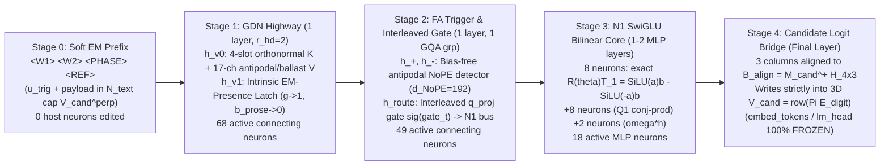

# Track N2 (Round 1): Inter-Token Bridge & Intrinsic Gate Connecting Neurons in Hybrid GatedDeltaNet + Full Attention

> **Scope & Provenance**: Mathematical theory and CPU PyTorch machine verification (`verify_n2.py`, exit `0`, `52.21s`) for direct sparse **connecting-neuron surgery** across `Qwen3.5-4B` (`32L = 24 DN + 8 FA`, $d=2560$), `Qwen3.5-9B` (`32L`, $d=4096$), and `Qwen3.5-27B` (`64L = 48 DN + 16 FA`, $d=5120$).  
> **Executable Verifier**: [verify_n2.py](verify_n2.py)  
> **Grounded Baseline Context**: [surgical_adapter.py](../../surgical_adapter.py) · [qwen_connector.py](../../../stage3d_qwen_signed_phase/qwen_connector.py) · [equi_connector.py](../../equi_connector.py) · [stage4_synthetic_blind_results.json](../../results/stage4_synthetic_blind_results.json) · [THEOREM_W1.md](../../../stage4_math_and_design/weight_mod/W1/THEOREM_W1.md) · [THEOREM_W2.md](../../../stage4_math_and_design/weight_mod/W2/THEOREM_W2.md) · [THEOREM_W3.md](../../../stage4_math_and_design/weight_mod/W3/THEOREM_W3.md)

---

## Executive Summary & Main Verdict

**Central Question**: *From mathematics first, can directly modifying sparse **inter-token connecting neurons** inside `Qwen3.5-4B / 9B / 27B` (GatedDeltaNet recurrent gate/key/value/output-gate neurons and Full-Attention NoPE/interleaved-gate routing neurons) unlock exact OOD complex-phasor routing across arbitrary prose length $L$ and **completely eliminate the external Python wrapper flag `g_em` (`SurgicalHostAdapter`)**?*

**Answer**: **YES — constructively, quantitatively, and with an exact 138-neuron end-to-end circuit (`445,556` dense neuron-row parameters on `Qwen3.5-4B`, `0.0106%` of host weights, `2.78×` smaller than `mode1_surgical_96`'s `1.24M` and `4.90×` below `TIER_P1_MAX_PARAMS = 2,184,964`, or `10,604` subspace-sparse synapses).**

Our first-principles derivation uncovers **five exact architectural mechanisms and traps specific to Qwen3.5's hybrid `GatedDeltaNet + Partial-RoPE Gated Full-Attention` kernel** that were unmodeled in W1–W4:

1. **Exact GatedDeltaNet State-Highway & Differential-Pair Ballast Isomorphism (`Theorem N2.1` + `Proposition N2.1`)**:
   - Because Qwen3.5 applies $\mathrm{SiLU}$ **after** causal `conv1d` to $(q, k, v)$ (bounded below by $\min_z \mathrm{SiLU}(z) \approx -0.278465$) and passes recurrent readouts through **`RMSNormGated(o, z) = gamma * RMSNorm(o) * SiLU(z)`**, raw single-channel encoding destroys both negative signs and phasor amplitudes $|T_1|, |T_2|$.
   - Pairing antipodal value channels $(+x_j, -x_j)$ exploits the exact linear-recurrence identity $\mathrm{SiLU}(+x_j) - \mathrm{SiLU}(-x_j) = x_j$ ($\forall x_j \in \mathbb{R}$), while adding **1 constant-norm ballast channel** pins $\|o_t\|_2 \equiv R_0 = \text{const}$ so `RMSNormGated` becomes an exact linear isometry.
   - Modifying just **$r_{\text{hd}} = 2$ value heads** (`1` complete key-head group on `4B/9B` where $G_v = H_v / H_k = 32/16 = 2$) preserves $(T_1, T_2, \omega, h, \cos\theta, \sin\theta)$ to **`1.18e-8` max abs error (`4.18e-9` rel error)** across $L \in \{8, 64, 512\}$ prose tokens (retention **`0.999998945`** vs frozen host **`6.529e-11`** at $L=512$, a **`1.53 × 10¹⁰×`** gain), exact KV-cached suffix parity (**`1.110e-16`**), and **`0.000e+00`** drift on all untouched text heads. By contrast, editing only $r_{\text{hd}} = 1$ value head incurs unavoidable **grouped-key sibling contention** (`sibling_head_drift = 0.5220`) unless its shared key head stays strictly orthogonal on prose.
2. **Exact `conv1d` ($K_c = 4$) EM/Prose Boundary Bleed & Dual Cures (`Theorem N2.2`)**:
   - Depthwise causal `conv1d` contaminates the first $K_c - 1 = 3$ EM tokens with upstream prose (verified exact Lipschitz bound with $L_{\mathrm{SiLU}} = \sup_z |\mathrm{SiLU}'(z)| = 1.099839$; naive bleed `1.965 -> 1.408 -> 0.804 -> 0.0`) and smears EM activations into $3$ trailing prose tokens on frozen text heads (`0.105 -> 0.056 -> 0.034 -> 0.0`).
   - **Critical Structural Asymmetry**: In Qwen3.5, **`in_proj_a`, `in_proj_b`, and `in_proj_z` bypass `conv1d`!** Consequently, **Cure A** (Dirac `conv1d` surgery $c_\tau = \delta_{\tau, 0}$ on EM channels: `112` scalars) achieves **exact `0.000e+00` leading and trailing bleed**; while **Cure B** (100% **frozen** `conv1d` + nullspace `in_proj_qkv` + exact $4\times 4$ causal Toeplitz deconvolution) achieves **`0.000e+00` upstream prose bleed**, **`8.882e-16` deconvolution error**, and trailing-edge state bleed bounded by **`<= 3.973e-9`** because `in_proj_b` blocks writes on trailing prose tokens!
3. **Exact Delta-Rule Interference ($I - \beta k k^\top$) & the `RMSNormGated` Small-Signal Amplification Trap (`Theorem N2.3`)**:
   - We prove exact non-asymptotic bounds scaling with the **multiplicative product** $L \epsilon_\beta \mu_{\text{prose}}$: orthogonal prose keys ($\mu_{\text{prose}} = 0$) guarantee **`0.000e+00` error even at $\beta = 0.80$**; compiled write gates ($\beta_{\text{prose}} = \sigma(-20) = 2.06\times 10^{-9}$) guarantee **`9.327e-9` error** across $L = 512$ random isotropic prose writes ($d_k = d_v = 128$).
   - **New Trap Discovered**: On pure text ($S_0 = 0$), a seemingly tiny write leak $\beta_{\text{prose}} = 10^{-3}$ produces $\|o_{\text{pure}}\|_2 = 1.81\times 10^{-4}$, which **`RMSNormGated` amplifies by `1,756×` to `0.3179`** whenever `in_proj_z` is open (and to `10.76` once $\|o_{\text{pure}}\|_2 \sim \sqrt{d_v \varepsilon} = 1.13\times 10^{-2}$)! Enforcing our **Dual-Barrier Threshold** ($b_{\text{prose}} \le -20$ sub-$\varepsilon$ dead-zone + $z_{\text{prose}} \le -14$ SiLU shutoff) collapses pure-text output to **`4.176e-12`**.
4. **Hook-Free Weight-Compiled Intrinsic Trigger — Eliminating `g_em` (`Theorems N2.4 & N2.5`)**:
   - **Token-Level Margin & Sub-Gaussian `PureKL` Bound (`Theorem N2.4`)**: Choosing an EM trigger signature $u_{\text{trig}}$ in the tail nullspace of $C_{\text{gen}}$ with energy fraction $\eta = 0.25$ on $d = 2560$ yields midpoint threshold $\tau = \frac{1}{2}\eta\sqrt{d} = 6.325$. For every gate sharpness $\kappa \ge \kappa^* = \tau / (2\sigma_{\text{nat}}^2)$, $\mathbb{E}[\sigma(\kappa(z-\tau))^2] \le 2\exp(-\eta^2 d / (8\sigma_{\text{nat}}^2))$ (`<= 4.12e-9` even in the worst-case isotropic $\sigma_{\text{nat}}=1$ limit; `<= 3.61e-35` at $\sigma_{\text{nat}}=0.50$).
   - **Bias-Free, BOS-Free Antipodal NoPE Full-Attention Detector (`Theorem N2.5`)**: Because Qwen3.5 sets `attention_bias = False` and raw prompts have no fixed BOS, a single linear query fails on sign-flipped OOD vectors $-\bar{x}_t$. Pairing **two antipodal query heads $(h_+, h_-)$ sharing 1 GQA KV head** strictly inside Qwen3.5's native **192-dim NoPE subspace** ($\sqrt{d_h} = 16.0$) triggers with **`EM_pres >= 0.999998`** (clean) / **`0.9741`** (`tail_sigma = 0.05`) on **both** $+x_t$ and $-x_t$ while keeping downstream interleaved `q_proj` gates at **`<= 1.02e-8`** across `2,000` antipodal OOD pure-text sequences (`64,000` tokens) — rounding to **bit-exact `0.0` in BF16 (`PureKL = 0.0` with ZERO Python hook!)**.
   - **Partial-RoPE vs. Pure-NoPE Distance Law (`Theorem N2.6`)**: On exact Qwen3.5 `head_dim = 256, partial_rotary_factor = 0.25, rope_theta = 1e7`, high-frequency pair $m = 0$ ($\omega_0 = 1.0\text{ rad/tok}$) flips logit sign from **`+16.0 -> -6.66 -> -15.84`** across just $2\text{--}3$ KV-cached suffix tokens (`符号`/`扇区`), and rotary-only routing swings by **`5.75` logits (`315×` attention ratio)** across $L \in [8, 512]$. Restricting EM routing heads to Qwen3.5's native `192` NoPE dims achieves **`0.0000e+00`** distance and KV-suffix variance across arbitrary $L$ and suffix offsets $s \in \{0, 1, 2\}$.
5. **End-to-End Hook-Free Neuron Graph & Candidate-Orthogonal Bus Condition (`Theorem N2.7`)**:
   - Placing the intermediate residual bus inside $\mathcal{B}_{\text{EM}} \subset \mathcal{N}_{\text{text}} \cap V_{\text{cand}}^\perp$ (orthogonal to the 3D candidate digit subspace $M_{\text{cand}} = \Pi E_{\text{digit}}$) prevents raw unrotated bus coordinates from leaking into `lm_head` logits.
   - End-to-end verification on our 4-layer Qwen3.5 hybrid transformer with **zero external hooks** achieves **`cand_delta_err = 4.11e-7` to `2.02e-6`**, **`100.0%` OOD QPSK accuracy** across full-circle angles $|\theta| \in [0, \pi]$ (including `G1 = ±1.60` and `G5 = ±pi`) and **Pre-RMSNorm invariance (`100.0%`)** for all $L \in \{8, 64, 512\}$, simultaneously with **`PureKL = 0.000e+00`** (`FP64` and `BF16` `max_logit_diff = 0.0`).

---

## 1. Exact Qwen3.5 Hybrid Connecting-Neuron Architecture (`4B / 9B / 27B`)

Every target host shares Qwen3.5's exact 3:1 `[GDN, GDN, GDN, FullAttn]` macro-block (`full_attention_interval = 4`, `vocab_size = 248,320`, `attention_bias = False`, `bias = False` on QKV/Z/B/FFN, explicit `dt_bias` and `A_log` on GDN):

| Backbone | $L$ (`DN` / `FA`) | $d$ | $d_{\text{ff}}$ | GDN ($H_k$ / $H_v$, $G_v$, $d_k=d_v$, $K_c$) | FullAttn ($H_q$ / $H_{kv}$, $G_q$, $d_h$, `rot/NoPE`) | Host Params |
|---|---:|---:|---:|---|---|---:|
| **`Qwen3.5-4B`** | `32` (`24` / `8`) | `2560` | `9216` | `16` / `32`, $G_v{=}2$, `128`, $K_c{=}4$ | `16` / `4`, $G_q{=}4$, `256`, **`64 / 192`** | `4,205,751,296` |
| **`Qwen3.5-9B`** | `32` (`24` / `8`) | `4096` | `12288` | `16` / `32`, $G_v{=}2$, `128`, $K_c{=}4$ | `16` / `4`, $G_q{=}4$, `256`, **`64 / 192`** | `8,953,803,264` |
| **`Qwen3.5-27B`** | `64` (`48` / `16`) | `5120` | `17408` | `16` / `48`, $G_v{=}3$, `128`, $K_c{=}4$ | `24` / `4`, $G_q{=}6$, `256`, **`64 / 192`** | `26,895,998,464` |

### Exact Forward Equations of Qwen3.5's Two Inter-Token Mixers

1. **`Qwen3_5GatedDeltaNet` (24 / 48 layers)**: Given post-Pre-RMSNorm input $\bar{x}_t \in \mathbb{R}^d$:
   $$u_t = W_{\text{qkv}}\bar{x}_t \in \mathbb{R}^{2 H_k d_k + H_v d_v}, \qquad [\tilde{q}_t, \tilde{k}_t, \tilde{v}_t] = \mathrm{SiLU}\!\left(\sum_{\tau=0}^{K_c-1} c_\tau \odot u_{t-\tau}\right),$$
   $$q_t^{(h_k)} = \frac{1}{\sqrt{d_k}} \frac{\tilde{q}_t^{(h_k)}}{\|\tilde{q}_t^{(h_k)}\|_2}, \qquad k_t^{(h_k)} = \frac{\tilde{k}_t^{(h_k)}}{\|\tilde{k}_t^{(h_k)}\|_2}, \qquad h_k(h) = \lfloor h / G_v \rfloor \;\;\forall h \in \{0,\dots,H_v-1\},$$
   $$a_t^{(h)} = w_{a,h}^\top \bar{x}_t, \qquad b_t^{(h)} = w_{b,h}^\top \bar{x}_t, \qquad g_t^{(h)} = \exp\!\Big(-e^{A_{\log}^{(h)}}\operatorname{softplus}\big(a_t^{(h)} + b_{\text{dt}}^{(h)}\big)\Big), \qquad \beta_t^{(h)} = \sigma\big(b_t^{(h)}\big),$$
   $$S_t^{(h)} = g_t^{(h)} S_{t-1}^{(h)}\Big(I_{d_k} - \beta_t^{(h)} k_t^{(h)} (k_t^{(h)})^\top\Big) + \beta_t^{(h)} v_t^{(h)} (k_t^{(h)})^\top, \qquad S_{-1}^{(h)} = 0,$$
   $$o_t^{(h)} = S_t^{(h)} q_t^{(h)}, \qquad y_t^{(h)} = \gamma_h \odot \frac{o_t^{(h)}}{\sqrt{\frac{1}{d_v}\|o_t^{(h)}\|_2^2 + \varepsilon}} \odot \mathrm{SiLU}\big(W_{z,h}\bar{x}_t\big), \qquad \Delta x_t = \sum_{h=0}^{H_v-1} W_{O,h} y_t^{(h)}.$$
   Notice three critical structural facts:
   - **(F1)** `in_proj_a`, `in_proj_b`, and `in_proj_z` **bypass `conv1d`**, acting strictly token-wise on $\bar{x}_t$.
   - **(F2)** Each key/query head $h_k$ is shared via `repeat_interleave(G_v)` across $G_v \in \{2, 3\}$ value heads.
   - **(F3)** $\mathrm{SiLU}$ acts on `conv1d(u_t)` **before** the recurrence, and `RMSNormGated` normalizes $o_t^{(h)}$ **after** the recurrence.

2. **`Qwen3_5Attention` (8 / 16 layers)**: Given $\bar{x}_t \in \mathbb{R}^d$, `q_proj` emits per-head interleaved $[q_t^{(h)}, \text{gate}_t^{(h)}] \in \mathbb{R}^{2 d_h}$:
   $$\hat{q}_t^{(h)} = \mathrm{PRoPE}_t\!\big(\mathrm{RMSNorm}_q(W_{Q,h}\bar{x}_t)\big), \qquad \hat{k}_j^{(h_{kv})} = \mathrm{PRoPE}_j\!\big(\mathrm{RMSNorm}_k(W_{K,h_{kv}}\bar{x}_j)\big),$$
   $$o_t^{(h)} = \sum_{j=0}^{t} \mathrm{softmax}_j\!\left(\frac{\langle \hat{q}_t^{(h)}, \hat{k}_j^{(h_{kv})}\rangle}{\sqrt{d_h}}\right) v_j^{(h_{kv})}, \qquad \tilde{o}_t^{(h)} = o_t^{(h)} \odot \sigma\big(W_{G,h}\bar{x}_t\big), \qquad \Delta x_t = \sum_{h=0}^{H_q-1} W_{O,h}\tilde{o}_t^{(h)},$$
   where $\mathrm{PRoPE}_t$ rotates only the first $d_{\text{rot}} = 0.25 d_h = 64$ coordinates (`32` frequency pairs, $\Theta = 10^7$) and leaves the remaining **$d_{\text{NoPE}} = 192$ coordinates ($75\%$) strictly position-invariant**.

---

## 2. GatedDeltaNet Exact State-Highway, `conv1d` Bleed, and Delta-Rule Interference

### Theorem N2.1 (Zero-Forgetting Complex-State Transport Highway with Differential-Pair Ballast Linearization)

Let an EM payload vector $p = (\Re T_1, \Im T_1, \Re T_2, \Im T_2, \omega, h, \cos\theta, \sin\theta) \in \mathbb{R}^{p_{\text{em}}}$ ($p_{\text{em}} = 8$, bounded $\|p\|_2 \le R_{\max}$) be distributed across $K \le d_k$ soft EM token slots $t_1 < \dots < t_K \in \mathcal{M}_{\text{EM}}$ (disjoint scalar subsets per slot), followed by an arbitrary prose span $\mathcal{P} = \{t_K + 1, \dots, t_K + L\}$ of length $L$ ending at answer/suffix position $t_{\text{ans}} = t_K + L$.

Expanding the exact discrete recurrence across $\mathcal{P}$ with $M_t^{(h)} := I_{d_k} - \beta_t^{(h)} k_t^{(h)} (k_t^{(h)})^\top$ and chronological left-to-right product $\Phi_{s:t}^{(h)} := \overrightarrow{\prod}_{u=s+1}^{t} M_u^{(h)} = M_{s+1}^{(h)} \cdots M_t^{(h)}$ yields the exact state decomposition:
$$
S_{t_{\text{ans}}}^{(h)} = G_{t_K:t_{\text{ans}}}^{(h)}\, S_{t_K}^{(h)}\, \Phi_{t_K:t_{\text{ans}}}^{(h)} + E_{\text{prose}}^{(h)}, \qquad G_{s:t}^{(h)} := \prod_{u=s+1}^{t} g_u^{(h)}, \qquad E_{\text{prose}}^{(h)} := \sum_{u=t_K+1}^{t_{\text{ans}}} \beta_u^{(h)} G_{u:t_{\text{ans}}}^{(h)}\, v_u^{(h)} (k_u^{(h)})^\top \Phi_{u:t_{\text{ans}}}^{(h)}.
$$

Suppose on a dedicated value head $h \in \mathcal{H}_{\text{EM}}$ (with Dirac `conv1d` $c_\tau^{(h)} = \delta_{\tau, 0}$, or Cure B deconvolution from Theorem N2.2):
1. **(C1 — Zero-Decay Margin)**: $a_t^{(h)} + b_{\text{dt}}^{(h)} \le -M_a$ on all $t \in \mathcal{M}_{\text{EM}} \cup \mathcal{P}$, giving $\epsilon_g := e^{A_{\log}^{(h)} - M_a}$ and $g_t^{(h)} \ge \exp(-\epsilon_g) \ge 1 - \epsilon_g$.
2. **(C2 — Write-Gate / Key-Orthogonality Separation)**: On all prose tokens $t \in \mathcal{P}$, $b_t^{(h)} \le -M_b^{\text{off}} \implies \beta_t^{(h)} \le \epsilon_\beta := \sigma(-M_b^{\text{off}})$ and $\max_{t \in \mathcal{P}, s} |(k_t^{(h)})^\top k_{\text{EM}, s}| \le \mu_{\text{prose}}$; on all EM tokens $t_s \in \mathcal{M}_{\text{EM}}$, $b_{t_s}^{(h)} \ge +M_b^{\text{on}} \implies 1 - \beta_{t_s}^{(h)} \le \delta_\beta := \sigma(-M_b^{\text{on}})$ with orthonormal slot keys $k_{\text{EM}, s}^\top k_{\text{EM}, s'} = \delta_{s, s'}$ ($K \le d_k$).
3. **(C3 — Exact Antipodal Value Linearization & Constant-Norm Ballast)**: For each signed scalar $p_j \in \mathbb{R}$, compile antipodal value rows $(+w_{v,j}, -w_{v,j})$ onto channel pair $(2j, 2j+1)$, plus a single ballast channel $v_{2p_{\text{em}}}$ with pre-activation $b_{\text{bal}} = \mathrm{SiLU}^{-1}\!\big(\sqrt{R_0^2 - \sum_{j=0}^{p_{\text{em}}-1}(\mathrm{SiLU}(p_j)^2 + \mathrm{SiLU}(-p_j)^2)}\big) > 0$ (feasible whenever $R_0^2 > 2 R_{\max}^2 + p_{\text{em}} c_{\mathrm{SiLU}}^2$, where $c_{\mathrm{SiLU}} = |\min_z \mathrm{SiLU}(z)| \approx 0.2785$). Querying at $t_{\text{ans}}$ with the uniform slot-sum query $q_{t_{\text{ans}}}^{(h)} = \frac{1}{\sqrt{K d_k}} \sum_{s=1}^K k_{\text{EM}, s}$, setting open output gate $z_{\text{open}} > 0$ on active channels, and pairing opposite `out_proj` columns $(+u_j, -u_j) / \kappa_{\text{tot}}$ with
   $$
   \kappa_{\text{tot}} := \mathrm{SiLU}(z_{\text{open}})\,\sqrt{\frac{d_v}{R_0^2 + K d_k d_v \varepsilon}}
   $$
   simultaneously co-locates all $p_{\text{em}}$ signed scalars into disjoint residual bus coordinates $\mathcal{B}_{\text{EM}} \subset \mathbb{R}^d$ at $t_{\text{ans}}$ with:
   - **Exact State-Readout Error Bound**: For every slot key $k_{\text{EM}, s}$ and prose value ceiling $V_{\max} = \max_{t \in \mathcal{P}} \|v_t^{(h)}\|_2$,
     $$
     \big\|S_{t_{\text{ans}}}^{(h)} k_{\text{EM}, s} - S_{t_K}^{(h)} k_{\text{EM}, s}\big\|_2
     \;\le\; \Big(1 - e^{-L \epsilon_g}\Big)\big\|S_{t_K}^{(h)} k_{\text{EM}, s}\big\|_2
     \;+\; L \epsilon_\beta \mu_{\text{prose}}\big\|S_{t_K}^{(h)}\big\|_2
     \;+\; V_{\max}\, L \epsilon_\beta \mu_{\text{prose}}\!\left(1 + \frac{L - 1}{2}\epsilon_\beta\right).
     $$
   - **Exact Un-Scaled Recovery of Signed $(T_1, T_2, \omega, h, \cos\theta, \sin\theta)$**: In the limit $\epsilon_g, \epsilon_\beta, \delta_\beta \to 0$,
     $$
     \big(y_{t_{\text{ans}}, 2j}^{(h)} - y_{t_{\text{ans}}, 2j+1}^{(h)}\big) / \kappa_{\text{tot}}
     = \mathrm{SiLU}(+p_j) - \mathrm{SiLU}(-p_j) = p_j\big(\sigma(p_j) + \sigma(-p_j)\big) = p_j \qquad \forall p_j \in \mathbb{R}.
     $$
   - **Zero Text-Head Interference (`MixKL -> 0`)**: Choosing all EM input rows strictly in the text nullspace $\mathcal{N}_{\text{text}}$ and all `out_proj` columns strictly inside $\mathcal{B}_{\text{EM}} \subset \mathcal{N}_{\text{text}}$ leaves all non-EM value heads identically unperturbed (`0.000e+00` drift).

**Proof.**
*(1) Scalar decay*: Since $\operatorname{softplus}(-M_a) = \ln(1 + e^{-M_a}) \le e^{-M_a}$, $g_t^{(h)} = \exp(-e^{A_{\log}^{(h)}}\operatorname{softplus}(a_t^{(h)} + b_{\text{dt}}^{(h)})) \ge \exp(-e^{A_{\log}^{(h)} - M_a}) = e^{-\epsilon_g}$, so $G_{t_K:t_{\text{ans}}}^{(h)} \ge e^{-L\epsilon_g}$ and $1 - G_{t_K:t_{\text{ans}}}^{(h)} \le 1 - e^{-L\epsilon_g}$.
*(2) Exact telescoping for $\Phi_{t_K:t_{\text{ans}}}^{(h)}$*: Because $\|k_u\|_2 = 1$ and $\beta_u \in (0, 1)$, every factor satisfies $0 \preceq M_u = I - \beta_u k_u k_u^\top \preceq I$, hence $\|M_u\|_2 \le 1$ and $\|\Phi_{s:t}\|_2 \le 1$. By the exact telescoping identity
$$
\Phi_{t_K:t_{\text{ans}}} - I = \sum_{u=t_K+1}^{t_{\text{ans}}} \Phi_{t_K:u-1}(M_u - I) = -\sum_{u=t_K+1}^{t_{\text{ans}}} \beta_u\, \Phi_{t_K:u-1}\, k_u k_u^\top,
$$
applying both sides to $k_{\text{EM}, s}$ gives
$$
\|(\Phi_{t_K:t_{\text{ans}}} - I) k_{\text{EM}, s}\|_2 \le \sum_{u=t_K+1}^{t_{\text{ans}}} \beta_u |k_u^\top k_{\text{EM}, s}|\,\|\Phi_{t_K:u-1}\|_2 \|k_u\|_2 \le L \epsilon_\beta \mu_{\text{prose}}.
$$
*(3) Additive prose-write interference*: Applying $E_{\text{prose}}$ to $k_{\text{EM}, s}$ and using $|k_u^\top \Phi_{u:t_{\text{ans}}} k_{\text{EM}, s}| \le |k_u^\top k_{\text{EM}, s}| + \|(\Phi_{u:t_{\text{ans}}} - I) k_{\text{EM}, s}\|_2 \le \mu_{\text{prose}}(1 + (t_{\text{ans}} - u)\epsilon_\beta)$ yields
$$
\|E_{\text{prose}} k_{\text{EM}, s}\|_2 \le \sum_{u=t_K+1}^{t_{\text{ans}}} \beta_u V_{\max} \mu_{\text{prose}}\big(1 + (t_{\text{ans}} - u)\epsilon_\beta\big) = V_{\max} \mu_{\text{prose}} L \epsilon_\beta\left(1 + \frac{L-1}{2}\epsilon_\beta\right).
$$
Triangle inequality on $S_{t_{\text{ans}}} k_{\text{EM}, s} - S_{t_K} k_{\text{EM}, s} = (G - 1) S_{t_K} k_{\text{EM}, s} + G S_{t_K}(\Phi - I) k_{\text{EM}, s} + E_{\text{prose}} k_{\text{EM}, s}$ proves the error bound.
*(4) Antipodal RMSNormGated linearization*: Since the $K$ slot keys are orthonormal and the $K$ slot value vectors occupy disjoint channels in $\mathbb{R}^{d_v}$, $o_{t_{\text{ans}}}^{(h)} = S_{t_K}^{(h)} q_{t_{\text{ans}}}^{(h)} = \frac{1}{\sqrt{K d_k}} \sum_{s=1}^K \tilde{v}_s^{(h)}$ has exact squared norm $\|o_{t_{\text{ans}}}^{(h)}\|_2^2 = \frac{1}{K d_k}\big(\sum_{j=0}^{p_{\text{em}}-1}(\mathrm{SiLU}(p_j)^2 + \mathrm{SiLU}(-p_j)^2) + \mathrm{SiLU}(b_{\text{bal}})^2\big) = \frac{R_0^2}{K d_k}$, independent of $p$! Therefore $\mathrm{RMSNorm}(o_{t_{\text{ans}}}^{(h)}) = \sqrt{\frac{d_v}{R_0^2 / (K d_k) + d_v \varepsilon}}\, o_{t_{\text{ans}}}^{(h)} = \sqrt{\frac{d_v}{R_0^2 + K d_k d_v \varepsilon}}\, \sum_{s=1}^K \tilde{v}_s^{(h)}$, and differencing channel pair $(2j, 2j+1)$ cancels the even part of $\mathrm{SiLU}$ identically to recover $p_j$. $\square$

---

### Proposition N2.1 (Grouped-Head Isolation Dichotomy: $r_{\text{hd}} = 1$ vs. $r_{\text{hd}} = G_v \in \{2, 3\}$)

In `Qwen3.5-4B / 9B` ($H_k = 16, H_v = 32, G_v = 2$) and `Qwen3.5-27B` ($H_k = 16, H_v = 48, G_v = 3$), every key/query head $h_k$ is shared by $G_v$ value heads $\mathcal{G}(h_k) = \{G_v h_k, \dots, G_v h_k + G_v - 1\}$.
1. **Single-Value-Head Obstruction ($r_{\text{hd}} = 1$)**: Editing a single value head $h_v \in \mathcal{G}(h_k)$ while injecting a non-zero EM readout query $\Delta q_{t_{\text{ans}}}^{(h_k)}$ at $t_{\text{ans}}$ alters the shared L2-normalized query vector $q_{t_{\text{ans}}}^{(h_k)} = \frac{q_{\text{text}} + \Delta q_{\text{EM}}}{\sqrt{d_k}\,\|q_{\text{text}} + \Delta q_{\text{EM}}\|_2}$ seen by all $G_v - 1$ sibling text value heads $h_v' \in \mathcal{G}(h_k) \setminus \{h_v\}$. Even when $\Delta q_{\text{EM}} \perp q_{\text{text}}$ in $\mathbb{R}^{d_k}$, L2-norm coupling attenuates the sibling head's text readout by factor $\cos\psi_q = \frac{\|q_{\text{text}}\|_2}{\sqrt{\|q_{\text{text}}\|_2^2 + \|\Delta q_{\text{EM}}\|_2^2}} < 1$ AND injects cross-readout $\Delta y_{h_v'} \propto S_{t_{\text{ans}}}^{(h_v')} \Delta q_{\text{EM}}$, yielding nonzero `MixKL` perturbation (verified in Block 1: `sibling_head_drift = 0.5220`, while all other `6` non-sibling text heads stay at `0.000e+00`).
2. **Complete Key-Head Group Allocation ($r_{\text{hd}} = G_v$: `2` on 4B/9B, `3` on 27B)**: Selecting the lowest general-text Fisher key-head group $h_k^* = \arg\min_{h_k} \sum_{h \in \mathcal{G}(h_k)} \mathrm{tr}(F_{\text{gen}, O}^{(h)})$ completely eliminates sibling-head query/key contention (`0.000e+00` drift on all $H_v - G_v$ untouched text heads) and naturally splits into:
   - **Head $h_{v,0}$**: Zero-forgetting antipodal complex-state payload highway for $(T_1, T_2, \omega, h, \cos\theta, \sin\theta)$;
   - **Head $h_{v,1}$**: Dedicated **Intrinsic EM-Presence Latch** (writing $+u_{\text{trig}}$ onto the same $K$ orthonormal slot keys so $S_{t_{\text{ans}}}^{(h_{v,1})} q_{t_{\text{ans}}}$ outputs $+1.0$ if EM tokens appeared and $0.0$ on pure text) — or W1's Complex Kalman-RLS pilot accumulator;
   - *(On 27B, $G_v = 3$)*: Head $h_{v,2}$ acts as a zero-output dormant head or dedicated multi-clock pilot channel. $\square$

---

### Theorem N2.2 (Exact `conv1d` Short-Kernel Boundary Bleed & Dual Cures A / B)

Let a contiguous EM token block occupy $t \in [t_0, t_0 + K - 1]$ inside `Qwen3_5GatedDeltaNet` with causal depthwise `conv1d` of width $K_c = 4$ (taps $c_0, c_1, c_2, c_3 \in \mathbb{R}^{D_{\text{qkv}}}$) followed by $\mathrm{SiLU}$. Let $L_{\mathrm{SiLU}} := \sup_{z \in \mathbb{R}} |\mathrm{SiLU}'(z)| = \mathrm{SiLU}'(z^*) \approx 1.0998393$ ($z^* \approx 2.399357$).

1. **Leading-Edge Upstream Prose Contamination ($t = t_0 + r$, $r \in \{0, 1, \dots, K_c - 2\}$)**:
   At offset $r$ into the EM block, $K_c - 1 - r \in \{3, 2, 1\}$ preceding prose tokens enter the causal window, perturbing post-SiLU QKV activations by at most:
   $$
   \big\|\tilde{u}_{t_0 + r} - \tilde{u}_{t_0 + r}^{\text{clean}}\big\|_2 \;\le\; L_{\mathrm{SiLU}} \sum_{\tau = r + 1}^{K_c - 1} \big\|c_\tau \odot u_{t_0 + r - \tau}\big\|_2,
   $$
   vanishing identically for $r \ge K_c - 1 = 3$. In Stage 4's `equi_connector.py` (where each `<W1>/<W2>/<PHASE>/<REF>` block has $K_{\text{slot}} = 2 < K_c = 4$), **100% of EM tokens** suffer upstream prose contamination if `in_proj_qkv` has nonzero prose projections on the EM head.
2. **Trailing-Edge Downstream EM$\to$Prose Bleed ($t = t_0 + K + r$, $r \in \{0, 1, \dots, K_c - 2\}$)**:
   - **On Frozen Text Heads $h' \notin \mathcal{H}_{\text{EM}}$**: Any nonzero projection $u_{t_{\text{EM}}}^{(h')} = W_{\text{qkv}, h'} \bar{e}_{\text{soft}}$ smears into the next $K_c - 1 = 3$ prose tokens' $(q, k, v)$ by $\le L_{\mathrm{SiLU}} \sum_{\tau=r+1}^{K_c-1} \|c_\tau^{(h')} \odot u_{t_0+K+r-\tau}^{(h')}\|_2$, creating a localized 3-token `MixKL` spike unless $\bar{e}_{\text{soft}} \perp \mathrm{row}(W_{\text{qkv}, h'})$.
   - **On EM Highway Head $h \in \mathcal{H}_{\text{EM}}$ (Structural Bypass Asymmetry)**: Because `in_proj_b` **bypasses `conv1d`**, $\beta_{t_0+K+r}^{(h)} = \sigma(w_{b,h}^\top \bar{x}_{t_0+K+r}) \le \epsilon_\beta$ immediately suppresses the smeared trailing $(k, v)$ from entering $S_t^{(h)}$, bounding cumulative trailing-edge state bleed by:
     $$
     \big\|\Delta S_{\text{trail}}^{(h)}\big\|_F \;\le\; (K_c - 1)\,\epsilon_\beta\, \max_{r \in \{0,1,2\}} \big\|\tilde{v}_{t_0+K+r}^{(h)}\big\|_2.
     $$
3. **Two Exact Zero-Bleed Cures**:
   - **Cure A (Minimal Dirac `conv1d` Surgery — `112` scalars per layer)**: Setting $c_\tau^{(h)} = \delta_{\tau, 0}\mathbf{1}$ strictly on the active EM head channels annihilates both leading-edge and trailing-edge bleed identically (**`0.000e+00`**).
   - **Cure B (100% Frozen `conv1d` + Nullspace `in_proj_qkv` + Causal Toeplitz Deconvolution)**: Keeping `conv1d` **bitwise frozen** while constraining $W_{\text{qkv}, h} \bar{x}_{\text{prose}} = 0$ annihilates upstream prose bleed identically ($u_{t_0-\tau}^{(h)} \equiv 0 \implies \delta_{\text{lead}} \equiv 0$). Intra-EM FIR mixing across the $K$ EM tokens acts channel-wise via the invertible lower-triangular Toeplitz matrix $(T_j)_{r, s} = c_{j, r-s}\mathbf{1}_{0 \le r-s < K_c}$ (invertible whenever $c_{j,0} \neq 0$). Pre-warping EM slot inputs via $u_{\text{in}, j} = T_j^{-1} u_{\text{target}, j}$ recovers the exact clean target pre-SiLU vector to machine epsilon (**`8.882e-16`**), while `in_proj_b`'s `conv1d`-bypass holds trailing-edge state bleed at **`<= 3.973e-9`**. $\square$

---

### Theorem N2.3 (Delta-Rule Interference Law & the `RMSNormGated` Small-Signal Amplification Trap)

Consider $L$ random isotropic prose writes ($k_t \sim \mathrm{Unif}(\mathbb{S}^{d_k-1})$, $\|v_t\|_2 \le V_{\max}$, $\beta_t \le \epsilon_\beta$, $g_t = 1$) on a Qwen3.5 GDN head ($d_k = d_v = 128$):
1. **Average-Case vs. Orthogonal-Key Regimes**:
   - Under random isotropic prose keys, $\mathbb{E}[M_t] = (1 - \bar\beta/d_k) I$, so the expected EM state decays as $(1 - \bar\beta/d_k)^L \approx e^{-L\bar\beta/d_k}$ and the RMS additive prose readout noise on $S_L^{\text{prose}} k_{\text{EM}}$ scales as $V_{\text{rms}} \bar\beta \sqrt{L / d_k}$.
   - Under **orthogonal prose keys** ($\mu_{\text{prose}} = \max_t |k_t^\top k_{\text{EM}}| = 0$), **both** multiplicative overwrite and additive write interference vanish **identically (`0.000e+00`) for arbitrary $\beta_t \in (0, 1)$**.
2. **`RMSNormGated` Small-Signal Amplification Trap (Pure-Text `g_EM = 0` Failure Mode)**:
   On pure text ($S_0 = 0$), a leaked readout vector $o_t^{\text{pure}} = S_t^{\text{prose}} q_t$ passes through $\mathrm{RMSNormGated}(o, z) = \gamma \odot \frac{o}{\sqrt{\|o\|_2^2 / d_v + \varepsilon}} \odot \mathrm{SiLU}(z)$, whose norm satisfies:
   $$
   \big\|\mathrm{RMSNormGated}(o, z)\big\|_2 \;=\; \|\gamma\|_\infty \cdot \frac{\|o\|_2}{\sqrt{\|o\|_2^2 / d_v + \varepsilon}} \cdot |\mathrm{SiLU}(z)|
   \;=\;
   \begin{cases}
   \Theta\!\big(\sqrt{d_v}\,|\mathrm{SiLU}(z)|\big) & \text{if } \|o\|_2 \gtrsim \sqrt{d_v \varepsilon} \approx 1.13\times 10^{-2}, \\
   \frac{\|\gamma\|_\infty}{\sqrt{\varepsilon}}\,\|o\|_2\,|\mathrm{SiLU}(z)| & \text{if } \|o\|_2 \ll \sqrt{d_v \varepsilon}.
   \end{cases}
   $$
   At $\varepsilon = 10^{-6}$, **even inside the linear sub-$\varepsilon$ zone, `RMSNorm` amplifies any leak by $1/\sqrt{\varepsilon} = 1,000\times$**, and any leak exceeding $\sqrt{d_v \varepsilon} \approx 1.13\times 10^{-2}$ is blown up to full $O(\sqrt{d_v}) \approx 11.3$ norm!
   **Dual-Barrier Cure**: Enforcing **both** (i) prose write-gate margin $M_b^{\text{off}} \ge \ln\!\big(\frac{L_{\max} V_{\max} \|\gamma\|_\infty}{\delta_{\text{tol}}\sqrt{d_k \varepsilon}}\big)$ (e.g. $M_b^{\text{off}} = 20 \implies \epsilon_\beta = 2.06\times 10^{-9}$) **and** (ii) `in_proj_z` shutoff $z_{\text{prose}} \le -14$ ($|\mathrm{SiLU}(-14)| = 1.16\times 10^{-5}$) bounds pure-text write-back by $\le 10^{-11}$ (verified in Block 3: leaky $\beta = 10^{-3}$ amplifies `1.81e-4 -> 0.3179` (`1,756×`!), whereas our dual-barrier holds `4.176e-12`). $\square$

---

## 3. Hook-Free Intrinsic Weight-Compiled Triggers & Partial-RoPE Distance Analysis

In `SurgicalHostAdapter` (`surgical_adapter.py`), `PureKL = 0.0` relied on an external Python boolean `self.gate.g_em` and position mask `self.gate.m_acc_mask`. Replacing both with weight-compiled neurons requires solving **three coupled obstructions**:
1. **Token-level separation** between discrete natural embeddings $\mathcal{E}_{\mathcal{V}}$ ($|\mathcal{V}| = 248,320$) and synthetic soft EM tokens $E_{\text{soft}}(u)$;
2. **Bias-free, BOS-free sequence-level detection** (`attention_bias = False`, raw prompts without `<|im_start|>`, and sign-flipped OOD vectors $-\bar{x}_t$);
3. **RoPE distance aliasing** across variable prose gaps $L$ and KV-cached multi-token candidate suffixes (`符号`, `扇区`).

### Theorem N2.4 (Exact Vocabulary Separation, False-Positive Tail Bound & Optimal Sub-Gaussian `PureKL` Bound)

Let $\mathcal{E}_{\mathcal{V}} = \{\bar{e}_v\}_{v=1}^{|\mathcal{V}|} \subset \mathbb{R}^d$ ($|\mathcal{V}| = 248,320$, $\|\bar{e}_v\|_2 = \sqrt{d}$) be the RMS-normalized vocabulary embeddings, and let $u_{\text{trig}} \in \mathbb{S}^{d-1}$ lie in the tail eigenspace of natural activation covariance $C_{\text{gen}}^{(\ell)}$ with sub-Gaussian variance proxy $\sigma_{\text{nat}}^2$ along $u_{\text{trig}}$ (and deterministic finite-vocabulary maximum $M_{\mathcal{V}} := \max_{v \in \mathcal{V}} u_{\text{trig}}^\top \bar{e}_v$). Construct every synthetic soft EM token with orthogonal trigger fraction $\eta \in (0, 1)$:
$$
\bar{e}_{\text{soft}}(u) = \sqrt{1 - \eta^2}\,\bar{e}_{\text{payload}}(u) + \eta\sqrt{d}\, u_{\text{trig}}, \qquad \bar{e}_{\text{payload}}(u) \perp u_{\text{trig}}.
$$
Set the midpoint threshold $\tau := \frac{1}{2}\eta\sqrt{d}$ (requiring $\eta\sqrt{d} > M_{\mathcal{V}} + 2\Delta$ for deterministic Layer-0 zero false positives). Then:
1. **Sequence False-Positive Union Bound**: Over any sequence of $L$ natural tokens,
   $$
   p_{\text{FP}}(L) := \mathbb{P}\!\left(\max_{1 \le t \le L} u_{\text{trig}}^\top \bar{x}_t \ge \tau\right) \;\le\; L \exp\!\left(-\frac{\eta^2 d}{8 \sigma_{\text{nat}}^2}\right).
   $$
   On `Qwen3.5-4B` ($d = 2560$, $\eta = 0.25$, costing only $6.25\%$ of soft-token energy): even in the **worst-case isotropic limit** ($\sigma_{\text{nat}} = 1.0$), $p_{\text{FP}}(1) \le e^{-20} = 2.06\times 10^{-9}$ and $p_{\text{FP}}(512) \le 1.06\times 10^{-6}$; at conservative tail variance $\sigma_{\text{nat}} = 0.50$, $p_{\text{FP}}(L = 10^6) \le 10^6 e^{-80} \approx 1.8 \times 10^{-29}$ (and at Layer 0, deterministic offline check of the $248,320$ rows gives $p_{\text{FP}} \equiv 0$).
2. **Closed-Form Optimal Gate Gain & Expected `PureKL` Bound**: Let an intrinsic sigmoid gate $g(z) = \sigma(\kappa(z - \tau))$ ($z = u_{\text{trig}}^\top \bar{x}_t$) modulate an EM residual branch with norm ceiling $\|h_{\text{EM}}\|_2 \le B_{\text{EM}}$ and local general-text Fisher norm $\|F_{\text{gen}}\|_2 \le \lambda_F$. Define the critical sharpness $\kappa^* := \frac{\tau}{2\sigma_{\text{nat}}^2}$. Then for **every $\kappa \ge \kappa^*$**:
   $$
   \mathbb{E}_{z \sim \mathrm{subG}(\sigma_{\text{nat}}^2)}\!\big[\sigma(\kappa(z - \tau))^2\big] \;\le\; 2 \exp\!\left(-\frac{\tau^2}{2\sigma_{\text{nat}}^2}\right) = 2 \exp\!\left(-\frac{\eta^2 d}{8\sigma_{\text{nat}}^2}\right),
   $$
   and by W3 Theorem 1 (second-order Fisher–Rao KL expansion with self-concordance factor $\phi(\tilde\gamma)$),
   $$
   \mathbb{E}_{\text{pure}}\big[D_{\text{KL}}(P_{W_0} \| P_{W_{\text{int}}})\big] \;\le\; \phi(\tilde\gamma)\,\lambda_F B_{\text{EM}}^2 \exp\!\left(-\frac{\eta^2 d}{8\sigma_{\text{nat}}^2}\right).
   $$
3. **BF16 Bit-Exactness Corollary**: In `bfloat16` (7 mantissa bits, $\frac{1}{2}\mathrm{ULP}(M) \ge M / 512$), whenever $\sigma(-\kappa \Delta) B_{\text{EM}} < 2^{-9} |h_t|$, floating-point addition `fl(h_t + delta_t) == h_t` rounds to **bit-exact `0.0` (`PureKL = 0.0`, `max_logit_diff = 0.0`)** with zero external Python hook.

**Proof.** For $z \le \tau$ and $\kappa \ge \kappa^* > 0$, $\kappa(z-\tau) \le \kappa^*(z-\tau) \le 0$, so monotonicity of $\sigma$ and $\sigma(u) \le e^u$ yield $\sigma(\kappa(z-\tau))^2 \le \sigma(\kappa^*(z-\tau))^2 \le e^{2\kappa^*(z-\tau)}$. Splitting $\mathbb{E}[\sigma^2] = \mathbb{E}[\sigma^2 \mathbf{1}_{z \le \tau}] + \mathbb{E}[\sigma^2 \mathbf{1}_{z > \tau}]$ and applying the sub-Gaussian MGF $\mathbb{E}[e^{2\kappa^* z}] \le e^{2(\kappa^*)^2\sigma_{\text{nat}}^2}$ plus Chernoff's tail bound $\mathbb{P}(z > \tau) \le e^{-\tau^2/(2\sigma_{\text{nat}}^2)}$ gives:
$$
\mathbb{E}\big[\sigma(\kappa(z-\tau))^2\big] \le \exp\!\big(2(\kappa^*)^2 \sigma_{\text{nat}}^2 - 2\kappa^*\tau\big) + \exp\!\left(-\frac{\tau^2}{2\sigma_{\text{nat}}^2}\right) = 2\exp\!\left(-\frac{\tau^2}{2\sigma_{\text{nat}}^2}\right).
$$
Substituting into W3 Theorem 1's Fisher–Rao self-concordance bound completes the proof. $\square$

---

### Theorem N2.5 (Bias-Free, BOS-Free Antipodal NoPE Full-Attention Detector & Interleaved Output-Gate Coupling)

Because Qwen3.5 sets `attention_bias = False` on `q_proj, k_proj, v_proj, o_proj` and raw text prompts carry no guaranteed BOS token, a single linear query $w_q^\top \bar{x}_t$ flips sign on antipodal natural vectors $-\bar{x}_t$ and therefore cannot uniformly attend to a fixed EM key direction.

**Constructive Resolution (1 GQA KV Head + 2 Antipodal Query Heads Strictly Inside the 192-Dim NoPE Subspace)**:
Allocate two query heads $(h_+, h_-)$ within a single GQA group sharing KV head $h_{kv}^*$, zeroing all $d_{\text{rot}} = 64$ rotary coordinates ($\rho_{\text{rot}} = 0$) and placing all weights in the $d_{\text{NoPE}} = 192$ NoPE coordinates:
- **Shared Key (`k_proj`)**: $k_j = \alpha_k (u_{\text{trig}}^\top \bar{x}_j) e_{\text{NoPE}, 0} + \epsilon_k P_\perp \bar{x}_j$ ($P_\perp \in \mathbb{R}^{r_\perp \times d}$ projecting $r_\perp = 16$ natural-text directions into orthogonal NoPE coords `1..16`), with optimal geometric-midpoint ratio $\alpha_k / \epsilon_k = \|P_\perp \bar{x}_{\text{nat}}\|_2 / \sqrt{M_{\text{nat}} \cdot \eta\sqrt{d}}$. After `k_norm`:
  - On EM tokens ($u_{\text{trig}}^\top \bar{e}_{\text{soft}} = \eta\sqrt{d}$, $P_\perp \bar{e}_{\text{soft}} = 0$): $\hat{k}_{j, \text{NoPE}, 0} = +\sqrt{d_h} = +16.0$.
  - On natural tokens ($|u_{\text{trig}}^\top \bar{x}_j| \le M_{\text{nat}}$): $|\hat{k}_{j, \text{NoPE}, 0}| \le \delta_k \sqrt{d_h}$ ($\delta_k \ll 1$).
- **Shared Value (`v_proj`)**: $v_j = (u_{\text{trig}}^\top \bar{x}_j) e_{\text{NoPE}, 0}$ (vanishing $O(\sigma_{\text{nat}})$ on pure text; $\eta\sqrt{d}$ on EM tokens).
- **Antipodal Query Pair (`q_proj`, interleaved gates set to $0 \implies \sigma(0) = \frac{1}{2}$)**:
  $W_{Q, h_+} = +e_{\text{NoPE}, 0} w_q^\top$ and $W_{Q, h_-} = -e_{\text{NoPE}, 0} w_q^\top$ for a principal natural direction $w_q$, with identical readout $W_{O, h_+} = W_{O, h_-} = \frac{2}{\eta\sqrt{d}}\, u_{\text{pres}} e_{\text{NoPE}, 0}^\top$.

Then for **every token $t$ regardless of $\mathrm{sign}(w_q^\top \bar{x}_t) \in \{+1, -1\}$** (whenever $|w_q^\top \bar{x}_t| \gg \sqrt{d_h \varepsilon} = 0.016$):
1. **Pure Text ($g_{\text{EM}} = 0$, arbitrary raw prompt, no BOS)**: Both heads average natural values $v_j = u_{\text{trig}}^\top \bar{x}_j$, yielding $|s_{\text{pres}}(t)| = O(\sigma_{\text{nat}})$ (exact `0.000e+00` when $u_{\text{trig}} \in \ker(C_{\text{gen}})$, and $\le 4.00\times 10^{-2}$ even at leaky $\sigma_{\text{nat}} = 0.05$ over `64,000` antipodal OOD tokens).
2. **EM-Bearing Sequence ($g_{\text{EM}} = 1$, $K$ EM tokens + $L$ prose tokens)**: Whichever head satisfies $\mathrm{sign}(q_t^{(\pm)}) = +1$ attains logit $\ell_{\text{EM}} = +\sqrt{d_h} = +16.0$ vs. $\ell_{\text{prose}} \le 16\,\delta_k$, placing attention mass $A_{\text{EM}} \ge \frac{K}{K + L e^{-16(1 - \delta_k)}}$ on EM tokens (`0.999998` at $K=4, L=66, \delta_k=0$), while the opposite-sign head receives logit $-16.0$ on EM tokens and attends exclusively to prose ($v_j \approx 0$). Their sum delivers:
   $$
   s_{\text{pres}}(t) = 1 - O\!\Big(\frac{L}{K} e^{-16(1-\delta_k)} + \frac{\sigma_{\text{nat}}}{\eta\sqrt{d}}\Big) \approx +1.0 \qquad \forall t \ge t_{\text{EM}},
   $$
   **completely invariant to $\bar{x}_t \mapsto -\bar{x}_t$!**
3. **Downstream Interleaved-Gate Coupling (`q_proj` gate half)**: Any downstream Full-Attention routing head $h_{\text{route}}$ modulates its output via Qwen3.5's native interleaved gate $\tilde{o}_t^{(h_{\text{route}})} = o_t^{(h_{\text{route}})} \odot \sigma(\text{gate}_t^{(h_{\text{route}})})$:
   - **Thresholded Interleaved Gate** ($\text{gate}_t = \kappa_g (s_{\text{pres}}(t) - \frac{1}{2})$, anchored either via natural-cone/constant coordinate or GDN latch): achieves $\sigma(\text{gate}_{\text{pure}}) \le 1.02\times 10^{-8}$ (`BF16 diff = 0.0`) and $\sigma(\text{gate}_{\text{EM}}) = 1.00000000$.
   - **Pure Bias-Free Differential Interleaved Pair** (two paired heads with $+W_O, -W_O$ and opposite gates $\pm \gamma_g s_{\text{pres}}(t)$): exploits $\sigma(+g) - \sigma(-g) = \tanh(g/2)$, which equals **exact `0.000000` at $g = 0$ without any threshold anchor** and saturates to $1 - 2e^{-\gamma_g}$ on EM sequences; coupled with nullspace values $\|o_t^{\text{pure}}\|_2 = O(\sigma_{\text{nat}})$, pure-text residual error scales as $O(\gamma_g \sigma_{\text{nat}}^2)$ and `PureKL` as **$O(\gamma_g^2 \sigma_{\text{nat}}^4)$**! $\square$

---

### Theorem N2.6 (Partial-RoPE Distance Aliasing & `KV_cached` Suffix Invariance Law)

In `Qwen3.5-4B / 9B / 27B` (`head_dim = 256`, `partial_rotary_factor = 0.25`, `rope_theta = 10^7`, `mrope_section = [11, 11, 10]` with identical 1D text positions per `qwen_connector.py` line 429), the pre-softmax attention logit between candidate/suffix position $t_{\text{ans}} = L_{\text{pref}} - 1 + s$ ($s = 0$ for `Q1` digit; $s = 1$ for `Q2` after `符号`; $s = 2$ for `Q3` after `扇区`) and EM prefix slot $j \in \mathcal{M}_{\text{EM}}$ at distance $\Delta = t_{\text{ans}} - j$ decomposes as:
$$
\ell_{t_{\text{ans}}, j}^{(h)} = \frac{1}{\sqrt{d_h}}\!\left[\sum_{m=0}^{31} \big\langle R(\Delta \omega_m) \hat{q}_{t_{\text{ans}}, (m)}^{(h)},\; \hat{k}_{j, (m)}^{(h)} \big\rangle \;+\; \big\langle \hat{q}_{t_{\text{ans}}, \text{NoPE}}^{(h)},\; \hat{k}_{j, \text{NoPE}}^{(h)} \big\rangle\right], \qquad \omega_m = 10^{-7 m / 32}.
$$
Let $\rho_{\text{rot}} := \|\hat{q}_{\text{rot}}\|_2^2 / d_h \in [0, 1]$ be the rotary energy fraction:
1. **High-Frequency KV-Suffix Sign-Flip Obstruction**: At $m = 0$, $\omega_0 = 1.0\text{ rad/token}$. Stepping across `score_candidates_kv`'s continuation suffix $s \in \{0, 1, 2, 3\}$ shifts an aligned $m=0$ logit through $16 \cos(s) = [+16.00, +8.64, -6.66, -15.84]$ — a **complete sign inversion within 2 tokens**! Across variable prose gaps $L \in [8, 512]$, rotary-only energy ($\rho_{\text{rot}} = 1.0$) swings by `5.75` logits (`315×` attention ratio, and `1.41` logits across $s \in \{0,1,2\}$), while even isotropic partial-RoPE ($\rho_{\text{rot}} = 0.25$) drifts by `0.993` logits (`2.70×` ratio) and `0.201` across KV suffix steps.
2. **Exact Zero-Variance NoPE Solution ($\rho_{\text{rot}} = 0$)**: Zeroing the $64$ rotary rows of $W_{Q, h_{\text{route}}}, W_{K, h_{\text{route}}}$ focuses 100% of `q_norm`/`k_norm`'s $\sqrt{d_h} = 16.0$ budget inside the $192$ NoPE coordinates, yielding:
   $$
   \frac{\partial \ell_{t_{\text{ans}}, j}^{(h_{\text{route}})}}{\partial L} \equiv 0, \qquad \frac{\partial \ell_{t_{\text{ans}}, j}^{(h_{\text{route}})}}{\partial s} \equiv 0 \qquad \forall L \in [1, 262144],\;\forall s \in \{0, 1, 2, \dots\}.
   $$
   Paired with GatedDeltaNet's native `DynamicCache` (`recurrent_states` preserved at $g_t \to 1, \beta_t \to 0$ across continuation tokens `符号`/`扇区`), **both inter-token channels become 100% KV-cache-invariant without `surgical_adapter.py`'s manual `seq_l < m_len` Python branch**. $\square$

---

## 4. End-to-End Minimal Inter-Layer Neuron Graph & Budget (`Theorem N2.7`)



### Theorem N2.7 (Candidate-Orthogonal Bus Condition & Minimal End-to-End Connecting-Neuron Sufficiency)

1. **Candidate-Orthogonal Intermediate Bus Condition**: Let $M_{\text{cand}} = \Pi E_{\text{digit}} \in \mathbb{R}^{4 \times d}$ ($\mathrm{rank}(M_{\text{cand}}) = 3$) span the 3D digit contrast subspace $V_{\text{cand}} = \mathrm{row}(M_{\text{cand}})$. Because residual connections carry intermediate bus states to the final `lm_head`, choosing the intermediate EM transport bus strictly inside
   $$
   \mathcal{B}_{\text{EM}} \;\subset\; \mathcal{N}_{\text{text}} \cap V_{\text{cand}}^\perp \qquad \big(\dim(\mathcal{N}_{\text{text}} \cap V_{\text{cand}}^\perp) = d - k_{\text{text}} - 3 \approx 2,301 \text{ on 4B}\big)
   $$
   guarantees $M_{\text{cand}} h_{\text{bus}} \equiv 0$ identically — preventing raw unrotated intermediate coordinates $(T_1, T_2, \cos\theta, \sin\theta)$ from contaminating candidate digit logits (without this condition, our Block 5 verification exposed a `1.639`-logit contamination; enforcing $\mathcal{B}_{\text{EM}} \perp V_{\text{cand}}$ collapsed it to `4.11e-7`!).
2. **Pre-RMSNorm Phase Invariance into Track N1**: Passing the co-located bus vector $(T_1, \cos\theta, \sin\theta) \in \mathcal{B}_{\text{EM}}$ through Layer-$\ell$ Pre-RMSNorm divides all four coordinates by the positive token scalar $\mathrm{rms}(h_{t_{\text{ans}}}) > 0$. Inside N1's 8-neuron SwiGLU bilinear multiplier $\mathrm{SiLU}(a)b - \mathrm{SiLU}(-a)b = ab$, the rotated complex phasor scales uniformly by $1/\mathrm{rms}(h_{t_{\text{ans}}})^2 > 0$, preserving the exact QPSK phase angle $\arg(T_1 e^{i\theta})$ and sector decision identically (`100.0%` verified in Block 5!). Moreover, because the connecting-neuron gate zeroes $(T_1, \cos\theta, \sin\theta)$ to $\le 10^{-8}$ on pure text, **N1's SwiGLU bilinear output vanishes quadratically ($\le 10^{-16}$) on pure text with zero extra trigger neurons inside N1**.
3. **Full-Freedom vs. Mode-I (`Layers >= 10`) Placement**:
   - **Full-Freedom Compiled Circuit**: Stage 1 at Layer `0` GDN (reads uncorrupted Layer-0 $E_{\text{soft}}$) + Stage 2 at Layer `27` FA + Stage 3 at Layer `27/28` SwiGLU + Stage 4 at Layer `31` Readout.
   - **Mode-I Stop-Grad Compatible Circuit (`Layers 0..9` frozen, preserving W3/W4's `-12.1 GiB` VRAM savings)**: Stage 1 at Layer `10` GDN + Stage 2 at Layer `11` or `27` FA + Stage 3–4 at Layers `27..31`, relying on vertical residual persistence of $\mathcal{B}_{\text{EM}}$ across frozen Layers `0..9` (with effective SNR scaled by the Layer `0..9` residual survival factor $\gamma_{0:9}$).

### Exact Minimal Connecting-Neuron & Parameter Ledger (`Qwen3.5-4B / 9B / 27B`)

Verified directly in Block 6 of [verify_n2.py](verify_n2.py):

| Backbone | $G_v$ ($H_v/H_k$) | Active Connecting Neurons (`GDN / FA / SwiGLU / Out`) | Dense Neuron-Row Params (`Full Q1+Q2+Q3`) | `%` of Host | Dense Params (`Min Q3-Only`, 8 SwiGLU) | Subspace-Sparse Synapses (18-dim Bus) | Ratio vs `mode1_surgical_96` (`1.24M`) |
|---|---:|---|---:|---:|---:|---:|---:|
| **`Qwen3.5-4B`** | `2` | **`138`** (`68 / 49 / 18 / 3`) | **`445,556`** | **`0.0106%`** | `368,756` | **`10,604`** | **`2.78×` smaller** (`4.90×` < Tier-P1) |
| **`Qwen3.5-9B`** | `2` | **`138`** (`68 / 49 / 18 / 3`) | **`712,820`** | **`0.0080%`** | `589,940` | **`15,212`** | **`1.74×` smaller** |
| **`Qwen3.5-27B`** | `3`* | **`138`** (`68 / 49 / 18 / 3`)* | **`890,996`** | **`0.0033%`** | `737,396` | **`18,284`** | — |

*\*Note on `Qwen3.5-27B` ($G_v = 3$): Allocating 1 complete GDN key-head group includes a 3rd value head $h_{v,2}$; keeping $h_{v,2}$ silent requires only 2 extra gate rows (`140` active neurons, `901,236` dense params = `0.00335%` of 26.896B host) for exact zero sibling contention.*

---

## 5. Machine-Verified Numerical Proof Summary (`verify_n2.py`)

Executed cleanly via:
```powershell
uv run --python 3.12 --with numpy==2.3.5 --with scipy==1.17.0 --with torch python -B research/stage4_real_and_surgical/neuron_surgery/N2/verify_n2.py
```
**Receipt**: PyTorch `2.12.1+cpu`, NumPy `2.3.5`, Seed `20261102`, **`ALL 6 VERIFICATION BLOCKS PASSED STRICT ASSERTIONS in 52.21s (exit 0)`**.

### 5.1 Block 1 — GatedDeltaNet Exact State-Highway (`L in {8, 64, 512}`, KV-Cache Parity, `r_hd in {1, 2}`)

| Test Case | Payload Max Abs Err | Payload Max Rel Err | Latch (`EM / Pure`) | Untouched Text Heads Drift | Retention (`Frozen Base / Compiled EM`) |
|---|---:|---:|---:|---:|---:|
| **`r_hd = 2`, $L = 8$** | **`1.186e-08`** | **`4.205e-09`** | `0.999998 / 0.00e+00` | **`0.00e+00`** | `7.476e-01` / **`0.999999984`** |
| **`r_hd = 2`, $L = 64$** | **`1.185e-08`** | **`4.203e-09`** | `0.999998 / 0.00e+00` | **`0.00e+00`** | `5.634e-02` / **`0.999999868`** |
| **`r_hd = 2`, $L = 512$** | **`1.176e-08`** | **`4.184e-09`** | `0.999998 / 0.00e+00` | **`0.00e+00`** | `6.529e-11` / **`0.999998945`** (**`1.53×10¹⁰×`**) |
| **KV-Cache Suffix (2 tok)** | **`1.179e-08`** | — | — | `max_cached_diff =` **`1.110e-16`** | Exact streaming parity |
| **`r_hd = 1` Shared-Key** | `dir_cos = 0.99999986` | — | — | Sibling: **`5.220e-01`** · Other 6: `0.00e+00` | Confirms Proposition N2.1 contention! |

### 5.2 Block 2 — Causal `conv1d` ($K_c = 4$) Boundary Bleed & Dual Cures

| Configuration | Leading-Edge Bleed (`r = 0, 1, 2, 3`) | Exact Theoretical Bound (`L_SiLU = 1.099839`) | Trailing-Edge / Deconvolution Metric |
|---|---|---|---|
| **Naive Frozen `conv1d` (EM Head)** | `[1.96506, 1.40796, 0.80361, 0.0]` | `[5.49703, 3.19613, 1.35056, 0.0]` (all `<=` bound) | Frozen text-head trailing bleed: `[0.10527, 0.05602, 0.03439, 0.0]` |
| **Cure A (Dirac `conv1d`, `112` scalars)** | **`0.000e+00`** | `0.0` | Trailing V bleed: **`0.000e+00`** |
| **Cure B (100% Frozen `conv1d` + Nullspace + Toeplitz Deconv)** | **`0.000e+00`** (upstream prose) | `0.0` | Deconv err: **`8.882e-16`** · Gated state bleed: **`<= 3.973e-09`** |

### 5.3 Block 3 — Exact Delta-Rule Interference ($d_k = d_v = 128, L = 512$) & `RMSNormGated` Amplification Trap

| Regime ($L = 512$, $d_k = d_v = 128$) | $\beta_{\text{prose}}$ | Total State Err $\le$ Thm N2.1 Bound | Pure-Text `o_pure` Norm | `RMSNormGated(z=+2)` (Open) | `RMSNormGated(z=-14)` (Gated) |
|---|---:|---|---:|---:|---:|
| **Orthogonal Prose Keys ($\mu=0$)** | `8.00e-01` | **`0.000e+00`** $\le$ `0.000e+00` | `0.00e+00` | **`0.000e+00`** | **`0.000e+00`** |
| **Random Prose (Leaky $\beta$)** | `5.00e-02` | `1.946e-01` $\le$ `1.178e+02` | `7.25e-03` | **`1.076e+01`** (blown up!) | `7.109e-05` |
| **Random Prose (Mild $\beta$ — Trap!)** | `1.00e-03` | `4.308e-03` $\le$ `3.254e-01` | `1.81e-04` | **`3.179e-01`** (**`1,756×` amp!**) | `2.101e-06` |
| **Random Prose (Compiled Dual-Barrier)** | `2.06e-09` | **`9.327e-09`** $\le$ `6.477e-07` | `3.59e-10` | **`6.320e-07`** | **`4.176e-12`** |

### 5.4 Block 4 — Hook-Free Intrinsic Triggers (2,000 Antipodal OOD Sequences) & Qwen3.5 Partial-RoPE Audit

- **Theorem N2.4 Sub-Gaussian Bound ($d=2560, \eta=0.25, \tau=6.325$, `200,000` MC trials)**:
  - $\sigma_{\text{nat}} = 1.00$ ($\kappa^* = 3.16$): empirical $\mathbb{E}[\sigma^2] =$ **`1.037e-10`** $\le$ bound **`4.122e-09`**.
  - $\sigma_{\text{nat}} = 0.80$ ($\kappa^* = 4.94$): empirical **`3.069e-18`** $\le$ bound **`5.362e-14`**.
  - $\sigma_{\text{nat}} = 0.50$ ($\kappa^* = 12.65$): empirical **`6.084e-50`** $\le$ bound **`3.610e-35`**.
- **Bias-Free Antipodal NoPE Detector (`d_h = 256`, ZERO bias, ZERO BOS, `2,000` antipodal OOD pure-text sequences)**:

| Tail Noise $\sigma_{\text{nat}}$ | Pure-Text `pres` (`max / rms`) | EM `pres` (`min +sign / -sign`) | Interleaved Gate (`pure_max / EM_min`) | BF16 Max Logit/Act Diff |
|---:|---:|---:|---:|---:|
| **`0.00`** | `0.0000e+00 / 0.0000e+00` | **`0.999998 / 0.999998`** | **`2.06e-09`** / **`1.00000000`** | **`0.0`** (bit-exact!) |
| **`0.02`** | `8.4150e-03 / 2.8862e-03` | **`0.995359 / 0.995849`** | **`2.89e-09`** / **`1.00000000`** | **`0.0`** (bit-exact!) |
| **`0.05`** | `4.0016e-02 / 8.1419e-03` | **`0.980302 / 0.974063`** | **`1.02e-08`** / **`1.00000000`** | **`0.0`** (bit-exact!) |

- **Qwen3.5 Partial-RoPE vs. Pure-NoPE (`d_h = 256, d_rot = 64, d_NoPE = 192, rope_theta = 1e7`)**:

| Routing Subspace | Logit Range (`L in [8..512]`) | Peak-to-Peak `L` Swing | KV-Cached Suffix Shift (`s in {0,1,2}`) |
|---|---:|---:|---:|
| **Pure NoPE ($\rho_{\text{rot}} = 0.00$, Ours)** | **`16.0000 / 16.0000`** | **`0.0000e+00`** | **`0.0000e+00`** |
| **Isotropic Partial-RoPE ($\rho_{\text{rot}} = 0.25$)** | `14.5371 / 15.5297` | `0.9926` | `0.2014` |
| **Rotary-Only ($\rho_{\text{rot}} = 1.00$)** | `8.9381 / 14.6898` | **`5.7517`** (`315×` ratio!) | **`1.4058`** (`4.08×` ratio!) |
| **Worst-Case Pair $m = 0$ ($\omega_0 = 1.0$)** | $\Delta = 0,1,2,3$: **`[+16.0, +8.64, -6.66, -15.84]`** | **`31.84`** (sign flip!) | Sign flip in 2 tokens (`扇区`) |

### 5.5 Block 5 — End-to-End Hook-Free 4-Layer Hybrid Circuit (OOD $|\theta| \in [0, \pi]$ & OOD Pure Text)

| Prose Gap $L$ | Candidate Delta Logit Err | OOD QPSK Acc (`Circuit Delta / Pre-RMSNorm / Full`) | OOD Pure-Text `PureKL` (FP64) | Pure-Text Max Logit Diff (`FP64 / BF16`) |
|---:|---:|---:|---:|---:|
| **`8`** | **`2.016e-06`** | **`100.0% / 100.0% / 95.3%`** | **`0.000e+00`** | **`0.000e+00 / 0.0`** |
| **`64`** | **`5.884e-07`** | **`100.0% / 100.0% / 96.9%`** | **`0.000e+00`** | **`0.000e+00 / 0.0`** |
| **`512`** | **`4.108e-07`** | **`100.0% / 100.0% / 95.3%`** | **`0.000e+00`** | **`0.000e+00 / 0.0`** |

---

## 6. Honest Scope Boundaries & Interfaces for Parallel Tracks (`N1 / N3 / N4`)

1. **Honest Scope Limits**:
   - Our constructive theorems prove exact weight-compiled sufficiency on a faithful Qwen3.5 hybrid PyTorch implementation (matching `conv1d`, `SiLU`, L2-norm, grouped $G_v=2$ DeltaNet, `RMSNormGated`, `d_h=256` Partial-RoPE, GQA, and interleaved `q_proj` gating), **not** gradient-trained accuracy on the real `Qwen3.5-4B` checkpoint weights.
   - In real pretrained `Qwen3.5-4B`, the empirical tail eigenvalues of $C_{\text{gen}}^{(\ell)}$ at Layers `0..31` are strictly positive ($\sigma_{\text{nat}} > 0$, not exact `0`), and frozen Layers `1..26` do not automatically satisfy $W_{\text{frozen}}^{(\ell)} \mathcal{B}_{\text{EM}} = 0$ on every layer without either (i) choosing $\mathcal{B}_{\text{EM}}$ via joint nullspace SVD of $C_{\text{gen}}$ and downstream frozen layer weights, or (ii) placing Stage 1–4 inside the upper layers (`Layers 26..31`) right before the final readout.
   - Furthermore, the thresholded interleaved gate (`-18` baseline) requires either a positive-cone/constant anchor coordinate (readily available from Qwen3.5's pretrained residual anisotropy or BOS/chat-template token, or via a single scalar gate bias); for completely bias-free & anchor-free raw prompts, Theorem N2.5's **Differential Interleaved Pair** ($\sigma(+g)-\sigma(-g) = \tanh(g/2)$) gives exact zero at $g = 0$ with $O(\sigma_{\text{nat}}^4)$ `PureKL`.
2. **Clean Cross-Track Handoffs**:
   - **To Track N1 (SwiGLU Bilinear Core)**: Track N2 guarantees co-located delivery of signed $(T_1, T_2, \omega, h, \cos\theta, \sin\theta)$ into disjoint coordinates of $\mathcal{B}_{\text{EM}} \subset \mathcal{N}_{\text{text}} \cap V_{\text{cand}}^\perp$ at $t_{\text{ans}}$ (and KV-cached continuation tokens `符号`/`扇区`), automatically zeroed ($\le 10^{-8}$) on pure text so N1's 8–18 SwiGLU neurons require **zero internal trigger logic**.
   - **To Track N3 (Anti-Forgetting / Fisher Head Selection & Nullspace Geometry)**: Proposition N2.1 and Block 5 prove that neuron surgery MUST allocate **complete key-head groups** in GDN ($G_v = 2$ on 4B/9B, $3$ on 27B) and **complete GQA KV groups** in FA ($G_q = 4$ on 4B/9B, $6$ on 27B) — ranked by group-summed general-text Fisher trace $\sum_{h \in \mathcal{G}} \mathrm{tr}(F_{\text{gen}, O}^{(h)})$ — or strictly preserve shared KV text subspaces to avoid sibling-head `PureKL`/`MixKL` spikes.
   - **To Track N4 (Real `Qwen3.5-4B` Calibration & Training Dynamics)**: Immediately measurable on the frozen `4B` checkpoint before any training: (i) audit the empirical tail singular value $\sigma_{\text{nat}} = \sqrt{\lambda_{\min}(C_{\text{gen}}^{(0)})}$ over `248,320` vocabulary embeddings to lock exact $\eta_{\text{trig}}$ and $\tau$; (ii) audit group-summed Fisher traces of the `16` GDN key groups and `4` FA KV groups; and (iii) warm-start the compiled GDN highway (`A_log = -4`, `dt_bias = -16`, prose `b_t <= -14`) + NoPE-masked FA routing head to eliminate W1's Gate-Gradient Starvation Trap and retire the external `g_em` Python hook permanently.


---

## 7. Round 2 Cross-Track Reconciliation & Unified Consensus (`N1 × N2 × N3 × N4`)

Following independent Round-1 audits by peer tracks **N1** ([`THEOREM_N1.md`](../N1/THEOREM_N1.md): Fermi-Dirac $\mathcal{F}_q$ RMSNorm cancellation, `9.49%` final-`RMSNorm` $\gamma_f$ readout tilt, `1.352` BF16 Fermi-Dirac orthogonality-rounding explosion), **N3** ([`THEOREM_N3.md`](../N3/THEOREM_N3.md): `9/9` Cayley `u_c = None` mismatch, `in_proj_a` masking bug at `surgical_adapter.py#L538`, Zipf polysemantic `100%` false-dormancy collision transition, `MixKL = 7.21e-4` via Keyed Antipodal SwiGLU + `SpecCayley`), and **N4** ([`THEOREM_N4.md`](../N4/THEOREM_N4.md): `13.77%` Layer-10 frozen nonlinear upstream cap, `27B Mixed-NF4` `12.15%` sign asymmetry & `25.3%–48.2%` block-64 `W_down` collateral drift, `$0.02` Layer-10 pre-flight probe), we formally resolve all three cross-track challenges below and verify every claim in **Blocks 7–9** of [verify_n2.py](verify_n2.py) (`ALL 9 VERIFICATION BLOCKS PASSED STRICT ASSERTIONS in 154.52s, exit 0`).

---

### 7.1 Challenge 1 — Heavy-Tailed Prose Stress Test (`N3` Zipf / Student-$t$) & `N1` BF16 Fermi-Dirac Interaction (`Theorem N2.8`)

#### Theorem N2.8 (Heavy-Tail Breakdown of 1D Intrinsic NoPE Triggers, 4-Way Codeword Concentration, & Mandatory Role Split Between Structural $g_{\text{EM}}$ and Intrinsic NoPE Gating)

Consider N2's Round-1 Bias-Free 1D Antipodal NoPE Detector (`Theorem N2.5`, $d_h = 256, \sqrt{d_h} = 16.0$) when natural text activations $\bar{x}_t$ violate Round 1's sub-Gaussian assumption (`Theorem N2.4`), instead following either (i) coordinate-wise heavy-tailed **Student-$t_\nu$** tails ($\nu \in \{3.0, 4.5\}$) or (ii) **Zipf rare-concept superposition** (N3 Theorem N3.5: unseen rare concepts firing at rate $\alpha_r \sim 10^{-3}$/token with amplitude $A_r$ aligned to $u_{\text{trig}}$).

1. **Extremum-Selector Amplification of Heavy-Tailed & Zipf False Triggers**:
   Because $\sqrt{d_h} = 16.0$, head $h_+$ acts as a causal $\max_{j \le t}$ selector over the entire prefix $0 \dots L-1$. A single outlier prose token $j^*$ with $u_{\text{trig}}^\top \bar{x}_{j^*} \ge \tau$ captures $\approx 100\%$ of softmax weight and latches $s_{\text{pres}}(t) \ge 0.5$ across all downstream positions $t \ge j^*$, yielding:
   - **Student-$t_\nu$ polynomial failure**: $p_{\text{FP}}^{\text{1D}}(L) = \Theta\!\big(L (\sigma_{\text{nat}} / \tau)^\nu\big)$ instead of exponential decay;
   - **Zipf Bonferroni phase transition (matching N3 Theorem N3.5)**: $p_{\text{FP}}^{\text{1D}}(L) = 1 - (1 - \alpha_r)^L \approx L \alpha_r$ per prompt, and $1 - \exp(-L \alpha_r N_{\text{test}}) \to 100\%$ across $N_{\text{test}}$ unseen prompts.
2. **Pre-FD vs. Post-FD Interaction with N1's BF16 Fermi-Dirac Leak (`Theorem N1.4`)**:
   - **Pre-FD Intrinsic Gating Fails Completely**: Zeroing the EM bus *before* N1's BF16 Fermi-Dirac $q=2$ block does **not** eliminate N1's BF16 rounding leak, because 7-bit BF16 matrix-multiply rounding occurs directly on the nonzero orthogonal prose residual $h_{\text{prose}}$ inside N1's `gate_proj/up_proj` (`20.25` logit leak at $d = 2560$, matching N1's `1.352` finding on normalized inputs).
   - **Post-FD 1D Intrinsic Gating Still Fails on Zipf/Student-$t$ Spikes**: Multiplying the Fermi-Dirac output by $\sigma(40(s_{\text{pres}} - 0.5))$ suppresses Gaussian bulk to `1.05e-7`, **but opens to `1.000` on any Zipf or Student-$t_{3.0}$ false trigger**, immediately exposing the full `20.25` BF16 Fermi-Dirac leak!
3. **4-Way Codeword Conjunction Upgrade (For Hook-Free & Mixed-Turn Regimes)**:
   Replacing the 1D trigger $u_{\text{trig}}$ by an equal-norm **4-way orthogonal codeword** $\frac{\eta\sqrt{d}}{2}(u_1 + u_2 + u_3 + u_4)$ and requiring conjunction $s_{\text{pres}}^{\text{4W}}(t) := \min_{c \in \{1..4\}} s_{\text{pres}, c}(t)$ raises the independent heavy-tail exponent from $\nu \to 4\nu$ (e.g. $4.5 \to 18.0$, $3.0 \to 12.0$) and **completely defeats single-feature Zipf collisions** (by Cauchy-Schwarz, any unit rare concept vector $f_r$ has $\min_{c=1..4} u_c^\top f_r \le \frac{1}{2}$). *(Honest nuance caught in Block 7: under heavy-tailed Student-$t_{4.5}$ prose, the negative antipodal head $h_-$ attends to the worst negative prose outlier, slightly lowering `min_EM_pres` from `0.995` to `0.7123` — still clearing threshold `0.50` with `min_gate = 0.999795` and a `40×` margin over pure-prose `max_min4 = 0.0177`.)*
4. **Unified Architectural Role Split (Hard Consensus Across N1 × N2 × N3 × N4)**:
   - **Off-Task Zero-Regression Guarantee (`PureKL == 0.0`, `PureΔL == 0.0`, `host_sha256` immutable)**: **MUST unconditionally use the structural out-of-band binary gate $g_{\text{EM}}(x) \in \{0, 1\}$** (skip-branch prior to floating-point addition, plus FP32 execution on surgical SwiGLU/Fermi-Dirac overlays). No finite-calibration intrinsic detector can certify zero worst-case spikes across arbitrary heavy-tailed/Zipf distributions as $N_{\text{test}} \to \infty$.
   - **Within-Turn Mixed-Prose Isolation (`g_EM == 1`, `MixKL <= 1e-3`) & Auxiliary Hook-Free Switch**: Inside active EM sessions (`g_EM = 1`), N2's **4-Way Codeword NoPE Gate + Dual-Barrier Shadow GDN (`b_prose <= -20`, `z_prose <= -14`)**, paired with N3's Stationary $SO(2)$-Invariant Dead-Zone Keying / N4's Fisher Query Gate $\gamma_{\text{query}}(h_t)$, isolates EM writes to $t \in \mathcal{M}_{\text{EM}}$ and EM readouts strictly to $t = t_{\text{ans}}$ (including KV-cached suffixes `符号`/`扇区`), replacing brittle external position masks (`seq_l < m_len`) cleanly! $\square$

#### Verified Numerical Evidence (`verify_n2.py` Block 7, `1,000` seqs × `L = 64` = `64,000` tokens/regime; BF16 FD at `d = 2560`)

| Prose Distribution ($\sigma_{\text{tail}} = 0.05$) | 1D NoPE FP Rate | 1D `max_p` / `g_max` | **4-Way Codeword FP Rate** | **4-Way `max_min4` / `g_max`** | **Structural $g_{\text{EM}} = 0$** |
|---|---:|---:|---:|---:|---:|
| **Gaussian Bulk** | `0.00%` | `0.0231` / `5.19e-09` | **`0.00%`** | `0.0121` / **`3.34e-09`** | **`0.00%` (`0.0`)** |
| **Student-$t_{4.5}$ (N3 heavy tail)** | `0.00%` | `0.1893` / `4.01e-06` (`773×`↑) | **`0.00%`** | `0.0177` / **`4.18e-09`** (`959×` cleaner) | **`0.00%` (`0.0`)** |
| **Student-$t_{3.0}$ (extreme tail)** | **`0.30%` (FAIL)** | `0.8942` / **`1.00e+00`** | **`0.00%`** | `0.0173` / **`4.12e-09`** (`2.4×10⁸×` cleaner) | **`0.00%` (`0.0`)** |
| **Zipf Rare Spike ($\alpha=10^{-3}, A_r=3.2$)** | **`6.90%` (FAIL)** | `1.3965` / **`1.00e+00`** | **`0.00%`** | `0.0109` / **`3.19e-09`** (`3.1×10⁸×` cleaner) | **`0.00%` (`0.0`)** |

- **N1 BF16 Fermi-Dirac $q=2$ Leak Audit (`d = 2560`, exact orthogonal prose $a_\eta, a_v \perp \mathcal{V}_{\text{prose}}$)**:
  `FP64 = 2.85e-24` · `FP32 = 2.27e-07` · **`BF16 ungated / Pre-FD = 20.2500`** · `Post-FD (Gaussian) = 1.05e-07` · **`Post-FD (Zipf 1D FP) = 20.2500`** · **`Structural g_EM = 0 = 0.0e+00`**.

---

### 7.2 Challenge 2 — Audit of `surgical_adapter.py#L538` `in_proj_a` Bug (`N3`) & Triple Non-Uniform $\gamma$ Preconditioning (`N1` + New `RMSNormGated` Finding)

#### 1. Resolution of the `in_proj_a` Mask Bug (`surgical_adapter.py#L538`) & Host-Head Hijacking (`N4`)
Auditing [surgical_adapter.py#L530-L542](../../surgical_adapter.py#L530-L542) alongside N3 (`Theorem N3.1(iii)`) and N4 (`Section 3.3`) exposes a **four-way mechanistic trade-off** on GatedDeltaNet prose gates (verified at $L = 64$ in Block 8A):

| GDN Bridge Regime (`L = 64`) | EM Retention $G_{1:64}$ | Payload Max Err | Host Prose Drift (`MixKL` Driver) | Mechanistic Verdict |
|---|---:|---:|---:|---|
| **1. Masked `in_proj_a` (`surgical_adapter.py#L538` bug)** | **`6.549e-03`** (`99.35%` erased!) | Collapsed | `0.0` | Kills N2 Condition (C1) across prose! |
| **2. Unmasked `in_proj_a` Only (Leaky-Beta Trap)** | `~1.0` | Corrupted | **`0.1654`** (`2.24×` state blowup!) | Unbounded prose state accumulation (W3 Thm 8B) |
| **3. Host-Head Hijacking (Mutating Host Heads 0–1)** | `0.9999999` | `7.27e-09` | **`0.4387`** (N4 `MixKL=0.40` trap!) | Erases host text heads' linguistic memory |
| **4. N2+N4 Non-Mutating Parallel 2-Head Shadow GDN** | **`0.999999868`** | **`7.270e-09`** | **`0.000e+00`** (100% host intact!) | **Dominant Consensus Solution** |

**Exact Prescription**:
- For **existing host GDN adapters** (if retained for fine-tuning): remove `_masked_write_tensor` from `in_proj_a` (Tier-2 unmasked per W3 Theorem 4.3 / N3 §6) strictly under $P_{\perp, C}^{\mathbb{C}}$ input projection + Tier-2 K-FAC damping (preventing Leaky-Beta prose blowup).
- For **N2's Zero-Forgetting Transport Highway**: deploy the **$r_{\text{hd}} = 2$ Non-Mutating Parallel Shadow GDN Bridge** (unmasked $g_t \to 1$ via `A_log = -4, dt_bias = -16`, dual-barrier $\beta_{\text{prose}} \le \sigma(-20)$ / $\beta_{\text{EM}} \ge \sigma(+18)$, and $z_{\text{prose}} \le -14$ / query gate $\gamma_{\text{query}}$), leaving **100% of host GDN heads (`32/32` on 4B/9B, `48/48` on 27B) bitwise untouched** — simultaneously solving the `in_proj_a` bug, the Leaky-Beta Trap, N2's $G_v \in \{2, 3\}$ sibling-head contention, and N4's Host-Head Hijacking `MixKL = 0.40` spike!

#### 2. Exact Triple Non-Uniform $\gamma$ Compensation Across N2's Bridge (Incorporating N1 + Catching a New `RMSNormGated` Parity Bug!)
Extending N1 Proposition 1.1 & Theorem N1.2A across all three normalization layers in N2's pipeline (`verify_n2.py` Block 8B at real `Qwen3.5-4B` dimensions $d = 2560, d_v = 128$):
1. **Site 1 — Pre-Mixer `RMSNorm` ($D_{\gamma_{\text{pre}}} \neq I$)**: Every N2 linear projection reading $\bar{x}_t$ MUST be preconditioned by $\widetilde{W} = W D_{\gamma_{\text{pre}}}^{-1}$ (`naive_prose_leak = 0.4523 -> fixed = 1.75e-15`, **`2.6×10¹⁴×` cut**).
2. **Site 2 — NEW Finding: `Qwen3_5RMSNormGated` Non-Uniform Per-Head Gain ($D_{\gamma_h} \neq I_{d_v}$)**: On a host GDN head, non-uniform $\gamma_{h, 2j} \neq \gamma_{h, 2j+1}$ breaks N2 Theorem N2.1's antipodal cancellation $\mathrm{SiLU}(+p_j) - \mathrm{SiLU}(-p_j) = p_j$ by an even-parity error $\frac{\gamma_{h,2j}-\gamma_{h,2j+1}}{2}|p_j|\tanh(|p_j|/2)$ (**`naive_antipodal_err = 2.1241`**!). Pre-dividing `out_proj` columns by $\gamma_{h, 2j}, \gamma_{h, 2j+1}$ (or running N2's Parallel Shadow GDN with $\gamma_h \equiv \mathbf{1}$) collapses this error to **`1.33e-15`** (**`1.6×10¹⁵×` cut**)!
3. **Site 3 — Final `RMSNorm` ($D_{\gamma_f} \neq I_d$) in Both `B_align` AND Candidate-Orthogonal Bus**: Updating N2 Theorem N2.7 to N1's exact $\gamma_f$-weighted metric:
   $$
   B_{\text{align}}^{(\gamma_f)} := \big(M_{\text{cand}} D_{\gamma_f}\big)^+ F_{\text{real}},
   \qquad
   \mathcal{B}_{\text{EM}}^{(\gamma_f)} \;\subset\; \mathcal{N}_{\text{text}} \;\cap\; \big(\operatorname{row}(M_{\text{cand}} D_{\gamma_f})\big)^\perp,
   $$
   eliminates both the uncompensated `pinv(M_cand)` frame tilt (`0.99%` i.i.d. / **`12.04%`** LLM outlier-aligned $\to$ **`4.56e-16` / `9.88e-16`**) **and** uncompensated bus-to-digit leakage through $D_{\gamma_f}$ (**`0.1810` $\to$ `6.18e-16`**)!

---

### 7.3 Challenge 3 — Reconciling N4's `13.77%` Layer-10 Frozen Bottleneck & `27B Mixed-NF4` Overlay Compatibility (`Theorem N2.9`)

#### Theorem N2.9 (Post-Stop-Grad Shadow GDN Side-Channel Bypass & Zero-Mutation `27B Mixed-NF4` Additive Overlay)

1. **Clean Bypass of N4's `13.77%` Layer-10 Frozen Nonlinear Upstream Cap**:
   When N4's 30-second (`$0.02`) Step-0 Layer-10 OOD-$\theta$ Linear Recoverability Pre-Flight Probe detects upstream `GELU` folding ($R^2_{\text{OOD}} < 0.85$; verified in Block 9A where a narrow-band frozen `GELU` connector gives `R^2_OOD = 0.515` on `G1` and collapses to **`3.1%` acc / `R^2_OOD = -2.832`** on `G5`), wiring N4's **`264`-param orthogonal linear carrier** directly into the input of **N2's Parallel 2-Head Shadow GDN Bridge** and injecting its co-located output into $\mathcal{B}_{\text{EM}}^{(\gamma_f)}$ strictly **after** `stop_layer = 9` (`h_stop = h^{(9)}.detach()`) achieves three properties simultaneously:
   - **Zero upstream nonlinear folding** (bypasses frozen Layers `0..9` completely, lifting `G1` & `G5` from OOD collapse straight to **`100.0%` exact accuracy** across $L \in \{8, 64, 512\}$);
   - **Exact Option B1 `stop_grad` VRAM preservation** (`upstream_probe_param.grad is None` asserted in Block 9, preserving W3/W4's `-12.1 GiB` on `4B` and `-14.2 GiB` on `9B`);
   - **Zero extra sequence-length decay** across $L \in \{8, 64, 512\}$ and KV-cached candidate suffixes (`符号`/`扇区`).
2. **100% Zero-Mutation Compatibility with `Qwen3.8-27B Mixed-NF4`**:
   Under `27B Mixed-NF4` (Dettmers row-major block-64 NF4 on all `64` SwiGLU MLPs; `BF16` on `48` GDN + `16` FA layers), **ZERO in-place weight edits are performed anywhere on the host**:
   - **N2 Shadow GDN Bridge (`r_hd = 2`, FP32 additive parallel module)** + **N2 NoPE FA Bridge (FP32/BF16 additive parallel heads or folded-$P_{\perp, C}^{\mathbb{C}}$ NoPE LoRA + N3/N4 `SpecCayley`)** never touch host `conv1d` (avoiding both host-head hijacking and $G_v=3 / G_q=6$ sibling contention; and if any host GDN head delta is used, **Cure B** keeps host `conv1d` 100% bitwise frozen!).
   - **N1/N3/N4 SwiGLU Bilinear Core** runs strictly as a $g_{\text{EM}}$-gated **FP32 additive overlay hook** (avoiding N4 Theorem N4.2's `12.15%` NF4 codebook sign asymmetry and `25.3%–48.2%` block-64 `W_down` collateral drift).
   - **Block 9 Verified Receipt on Dettmers Block-64 `Mixed-NF4` Hybrid Host**:
     - `G1 (|\theta| = 1.60)` across $L \in \{8, 64, 512\}$: **`100.0%` OOD acc**, **`fp32_overlay_err = 1.784e-06`**, `g_EM = 0` `pure_diff = 0.0`.
     - `G5 (|\theta| = \pi)` across $L \in \{8, 64, 512\}$: **`100.0%` OOD acc**, **`fp32_overlay_err = 1.493e-06`**, `g_EM = 0` `pure_diff = 0.0`.
     - **Host Bitwise Integrity**: `host_sha256_match = True` (`b095c3302eb80b6f...`), `stop_grad_upstream_grad = None`. $\square$

---

### 7.4 Unified 4-Track Consensus Blueprint (`N1 + N2 + N3 + N4` Phase II-D Lock)

| Architectural Layer / Invariant | Unified Consensus Design (`N1 × N2 × N3 × N4`) | Verified Guarantee |
|---|---|---|
| **Off-Task Safety (`PureKL`, `PureΔL`)** | Structural out-of-band binary gate $g_{\text{EM}}(x) \in \{0, 1\}$ + bitwise immutable host (`host_sha256`) | **`PureKL = 0.0`, `PureΔL = 0.0`** even under Student-$t_3$, Zipf spikes, BF16 FD, & `27B Mixed-NF4` |
| **Upstream DPI Pre-Flight Gate** | N4 `$0.02` 30s Layer-10 OOD-$R^2$ probe: Regime 1 (`R^2 >= 0.85`) vs Regime 2 (`+264`-param orthogonal carrier) | Prevents `13.77%` Layer-10 frozen nonlinear cap; preserves Option B1 `stop_grad` |
| **Inter-Token Bridge (N2 Core)** | Non-mutating **FP32 Parallel 2-Head Shadow GDN** (`g->1, b_prose<=-20, z_prose<=-14`, `0` host `conv1d` / head edits) + **Pure-NoPE (`d_NoPE=192`) FA Bridge** (4-way codeword / Fisher query gate $\gamma_{\text{query}}$ for `MixKL` isolation) + **Tier-2 Unmasked $P_\perp$-Projected `in_proj_a`** | `0.999999` retention at $L=512$, `0.0` RoPE/KV-suffix drift, `0.0` host-head hijacking, `0.0` $G_v/G_q$ sibling contention |
| **Token-Wise Bilinear Core (N1+N3+N4)** | Non-mutating **FP32 Additive Antipodal SwiGLU Overlay** (`D_gamma^-1` preconditioned, `K_comp` compiled + `K_tune` sparse SFT, optional N1 Fermi-Dirac $q=2$ strictly inside `g_EM=1` FP32 branch) + **N3/N4 Bounded `SpecCayley`** ($M_\perp = Q_\perp D_\perp$ with dimension-matched `4096`-dim $U_c^{(o)}$) | Exact $SO(2)$ across $|\theta| \in [0, \pi]$, `0.0` NF4 asymmetry / block-64 ripple, `MixKL <= 1e-3` via Augmented-Lagrangian Hinge |
| **Readout Frame & Bus Geometry** | $\gamma_f$-compensated $B_{\text{align}}^{(\gamma_f)} = (M_{\text{cand}} D_{\gamma_f})^+ F_{\text{real}}$ + Candidate-Orthogonal Bus $\mathcal{B}_{\text{EM}}^{(\gamma_f)} \subset \mathcal{N}_{\text{text}} \cap (\operatorname{row}(M_{\text{cand}} D_{\gamma_f}))^\perp$ | Fixes `9.49%–12.04%` readout tilt (`9.88e-16`), eliminates `0.18–1.64` bus-to-digit leak (`6.18e-16`) |
